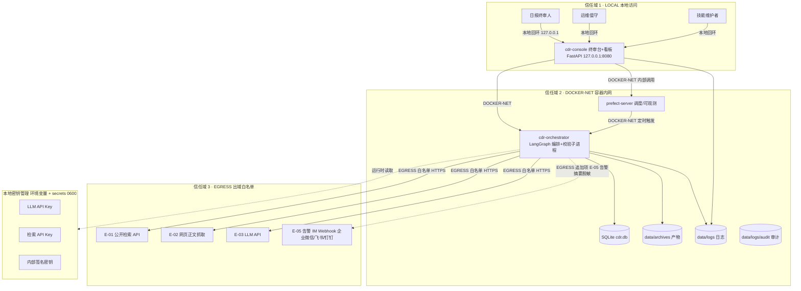

# AICoding 架构设计 · 安全设计

> 本文档为《AICoding 架构设计》核心产物之一，对应《安全架构设计模版》裁剪后的安全设计。
> 标的系统：chip-daily-report（简称 CDR）—— 芯片行业日报自动生成系统（单节点自托管服务化、数据不出域）。
> 上游输入：《系统设计》（G4 通过，含 §3 模块 / §4 数据 / §5 部署 / §6 网络三区 / §7 安全基线）+《高层架构设计》（G3 通过，含部署形态方案B）+ `material_digest.md`（G1 通过，含 D1–D12 与 X1–X16）。
> 下游输出：驱动《部署设计》按本稿落实安全组 / IAM / 密钥配置；与 platform-architect 按"重叠区权威方分配表"交接（本稿为密钥分级、审计字段与保留期、WAF/出域白名单的权威方）。
> 模板裁剪说明：本系统为单节点自托管、无公网 Web 入口（经中间确认 U-01 方案B），故模板中的公网 DDoS/WAF/CLB、KMS/Vault 云组件、SOC、堡垒机等章节按实际裁剪：DDoS/WAF/CLB 因无公网入口删除；KMS/Vault 按本地密钥管理方案（环境变量 + `secrets/` 0600 文件权限）适配；网络分区按 LOCAL / DOCKER-NET / EGRESS 三信任域裁剪；威胁模型 STRIDE 六类全覆盖并逐条映射缓解措施。

---

## 0. 元信息：修订记录

| 文档版本 | 发布日期 | 修订人 | 修订说明 |
| --- | --- | --- | --- |
| v1.0 | 2026-08-07 | `security-architect`（安全架构师 - 严守正） | 初稿：以《系统设计》为输入完成七章安全设计，含 STRIDE 威胁模型与威胁—缓解映射、IAM（RBAC0+ABAC）、数据分级 L1–L4、OWASP Top 10 防护、LOCAL/DOCKER-NET/EGRESS 三信任域、密钥分级 5 类、审计 5 维度与 5 类应急预案 |

> **版本管理纪律**：破坏性变更（安全边界 / 信任域 / 密钥分级 / 合规底线反转）升 MAJOR；新增防护项、扩充阈值升 MINOR。

---

## 1. 安全总体架构

### 1.1 安全总体架构图

> **总览**：1 张图，叠加展示——网络信任域三区（LOCAL / DOCKER-NET / EGRESS）、流量管控（本地入口鉴权限流 + EGRESS 出域白名单）、主机/容器安全、本地密钥管理（环境变量 + `secrets/` 0600）、审计中心（`data/logs/audit/`）。

| 安全组件 | 作用 | 部署位置 | 启用状态 |
| --- | --- | --- | --- |
| 本地入口鉴权 | 终审台/看板/API 登录认证 + 会话 Token + 限流（全局 100 QPS / 单用户 20 / 单 IP 50） | cdr-console（FastAPI 中间件） | 是 |
| EGRESS 出域白名单 | 仅允许白名单域名（公开检索 / 目标来源站点 / LLM API），其余一律拒绝；防 SSRF | M11 外部能力适配层（EgressGuard） | 是 |
| 宿主防火墙 | 仅放行本地回环端口与运维 SSH 端口，禁止公网暴露 | 宿主机 OS 防火墙 | 是 |
| 主机安全 | 最小软件面 / 定期补丁 / 非 root 运维账号 | 宿主机 | 是 |
| 容器安全 | 非 root 运行 / 最小镜像 / 只读根文件系统 / 不打包密钥 | 全部容器 | 是 |
| 本地密钥管理 | 环境变量 + `secrets/` 目录 0600；LLM/检索 API Key、内部签名密钥 | 宿主机 `secrets/` 挂载 | 是 |
| 审计中心 | 业务操作 / 数据库 / 出域白名单拦截 / 运维登录 / 资源事件五维度审计，独立 0600 目录 | `data/logs/audit/` | 是 |

> **裁剪说明（对齐系统设计 §7.1）**：DDoS 高防 / WAF / CLB 因无公网 Web 入口不适用（仅本地/内网访问）；KMS / Vault 因单节点密钥量小，采用环境变量 + 文件权限 0600（完整版如需合规可上 KMS，列入演进项）；SOC 由运行看板 + 审计中心承载；堡垒机由 SSH 密钥 + 运维审计日志替代。

### 1.2 威胁模型

> **方法**：采用 STRIDE 六类威胁全覆盖，结合本系统"单节点自托管、数据不出域、仅出域调用公开检索与 LLM API"的实际攻击面，逐条识别威胁并映射到第 2~7 章缓解措施，形成"威胁—缓解措施映射表"。

| 威胁类别（STRIDE） | 威胁编号 | 具体威胁描述（结合本系统） | 受影响资产/模块 | 缓解措施（章节映射） |
| --- | --- | --- | --- | --- |
| 仿冒（Spoofing） | T-S1 | 攻击者伪造终审台/看板登录身份或重放会话 Token，冒充合法用户操作 | cdr-console、会话 Token | §2.1 密码+Token 认证、Token 12h 有效期、单会话互踢、失败锁定；§2.2 角色鉴权 |
| 仿冒（Spoofing） | T-S2 | 出域调用被中间人仿冒为公开检索/LLM 官方域名，窃取请求正文或注入响应 | M11 外部适配层、EGRESS | §5.2 EGRESS 白名单域名校验 + 强制 HTTPS TLS 1.2+ 证书校验；§3.2 传输加密 |
| 篡改（Tampering） | T-T1 | 攻击者篡改 SQLite 运行元数据或本地产物/规则文件，伪造门禁结果绕过发布拦截 | SQLite、`data/archives`、规则文件 | §3.3 文件/DB 权限 0600；§5.3 只读根文件系统；§4.3 门禁网关退出码 1 强制拦截 + 发布按钮禁用；§3.3.6 备份与恢复 |
| 篡改（Tampering） | T-T2 | 请求参数被篡改（如发布接口伪造 report_id/version 乐观锁） | 写接口（发布/条目修改/规则生成） | §2.2 接口级鉴权 + 幂等键 + 乐观锁版本号；§3.2.4 内部签名 HMAC-SHA256（高敏写接口） |
| 否认（Repudiation） | T-R1 | 终审人/运维发布或规则变更后否认操作，无审计留痕 | 发布动作、规则变更、登录 | §7.2 审计日志（谁、何时、对什么资源、做了什么、结果、来源）；traceId+tenantId 必含；审计目录 0600 独立存储、保留 ≥1 年 |
| 信息泄露（Information Disclosure） | T-I1 | LLM/检索 API Key 泄露（硬编码、日志打印、镜像打包） | API Key、`secrets/` | §6 密钥分级与存储（环境变量+0600）、使用红线（禁入代码/日志/镜像）、90 天轮换、上线扫描 |
| 信息泄露（Information Disclosure） | T-I2 | 看板泄露未发布草稿正文或敏感运行信息 | 运行看板 | §3.1 数据分级（草稿=内部）；看板只读运行元数据、不呈现未发布正文（系统设计 §6.5）；§3.3.5 展示脱敏 |
| 信息泄露（Information Disclosure） | T-I3 | 日志记录敏感字段（API Key 明文、请求正文含未公开内容） | `data/logs` | §8.2（系统设计）敏感字段禁打印；§3.3.5 日志脱敏；审计与业务日志分离 |
| 拒绝服务（DoS） | T-D1 | 本地 Web 接口被高频刷（登录爆破、看板接口刷量），导致终审台不可用 | cdr-console | §2.1 失败锁定（5 次锁 15 分钟）；§3.5.3（系统设计）限流：全局 100 / 单用户 20 / 单 IP 50 / 终审台 10 / 发布 5 次每分 |
| 拒绝服务（DoS） | T-D2 | 出域调用超时/重试风暴拖垮单期生成（LLM 30s×2 重试、检索 15s） | M11 外部适配层 | §3.5.4（系统设计）超时重试基线 + 熔断降级（BD-01/BD-04）；§5.2 出域限速 |
| 拒绝服务（DoS） | T-D3 | 磁盘写满导致归档/日志/审计写入失败 | 数据卷 | §5.5.4（系统设计）磁盘水位告警（80% 预警/95% 红线）+ 清理任务；§4.3 优雅停机 |
| 权限提升（Elevation of Privilege） | T-E1 | 水平越权：终审人访问/操作非本人职责范围的草稿（IDOR） | 草稿终审接口 | §2.2.4 每个查询/修改接口校验资源归属与角色；§2.2.2 数据级行级校验 |
| 权限提升（Elevation of Privilege） | T-E2 | 垂直越权：低权限用户调用发布/规则变更等管理员接口 | 发布/规则接口 | §2.2 RBAC0 角色-权限；§4.3.1 接口拦截器双层校验；§3.5.5（系统设计）路由 meta.roles |
| 权限提升（Elevation of Privilege） | T-E3 | 容器逃逸 / 容器内提权访问宿主机 | 全部容器、宿主机 | §5.3 非 root 运行、禁止特权容器、只读根文件系统、最小镜像；§5.3.1 主机加固 |

> **威胁—缓解映射完整性**：STRIDE 六类（仿冒/篡改/否认/信息泄露/DoS/权限提升）共识别 15 条具体威胁，全部映射到 §2 身份与访问管理、§3 数据安全、§4 应用安全、§5 网络与基础设施安全、§6 密钥与凭证管理、§7 运行时安全。每条威胁均有明确缓解措施，无空映射。

---

## 2. 身份与访问管理（IAM）

### 2.1 身份认证（Authentication）

#### 2.1.1 用户登录

- **认证方式**（≥2 种，满足硬指标）：
  1. **本地账号密码认证**（主认证）：单编辑部自建账号体系，无 SSO/三方互联（对齐系统设计 §7.2.1），登录页 `/login` 公开，其余路由全部要求登录。
  2. **会话 Token 认证**（会话层）：服务端签发不透明会话 Token，服务端维护会话状态，注销即失效；禁止 URL 携带 token。
  3. **完整版可选 TOTP（MFA）**：MVP 不启用（本地访问 + 低风险内网，对齐系统设计 §7.2.1 决策），完整版纳入演进项。
- **图形验证强制场景**：无（本地内网访问，无公网暴露面；不引入验证码，降低本地使用摩擦）。
- **MFA / 2FA 说明**：管理端与敏感操作（发布、规则变更、密钥轮换）在完整版接入 TOTP 二次验证；MVP 以"关键操作二次密码验证"兜底（见 §2.1.3）。

#### 2.1.2 密码策略（量化阈值）

| 项 | 基线值 | 说明 |
| --- | --- | --- |
| 最小长度 | ≥ 12 位 | 对齐系统设计 §7.2.1（本地控制台/服务账号口径） |
| 复杂度 | 同时包含大小写字母 + 数字 + 符号 | 对齐系统设计 §7.2.1 |
| 加密传输 | 本地回环 HTTP + 服务端哈希存储；如内网跨主机访问须前置 TLS 反向代理 | 本地直连不解析代理头（系统设计 §6.2.1） |
| 加密存储 | bcrypt / argon2 加盐哈希；禁止 MD5 / SHA1 / 明文 | §3.3.2 敏感字段单向哈希加盐 |
| 更换周期 | 默认 90 天提醒（可配置） | 与密钥轮换基线一致（§6.3） |
| 重复限制 | 不允许使用最近 5 次密码 | — |
| 失败锁定 | 连续失败 5 次锁定 15 分钟 | 对齐系统设计 §7.2.1 |
| 自动登出 | 30 分钟无操作自动登出（可配置） | 会话管理 |
| 注册策略 | 不允许用户自行注册，仅运维/维护者创建；改密需原密码验证 | 本地账号体系 |

#### 2.1.3 会话管理

| 维度 | 取值 |
| --- | --- |
| Token 类型 | 服务端不透明会话 Token（Session ID 风格），禁止 JWT 自包含明文；禁止 URL 携带 |
| 有效期 | 访问 Token 12h（对齐系统设计 §7.2.1）；提供续期与主动注销接口 |
| 互踢机制 | 单点登录（单会话）：同账号新登录踢掉旧会话；异地/异设备登录提示 |
| 风险登录 | 本地访问场景：来源 IP 变化、非常用设备登录触发二次密码验证（MFA 未启用前的兜底） |
| 关键操作二次验证 | 发布、删除条目、规则生成、密钥轮换等关键操作要求重新输入密码确认（§4.3.5） |

### 2.2 授权与权限控制（Authorization）

#### 2.2.1 权限模型

默认采用 **RBAC0**（用户—角色—权限），高敏操作（发布放行、规则修订）叠加 **ABAC** 属性条件（门禁退出码为 0 且版本号一致才允许发布）。对齐系统设计 §7 基线（RBAC0）。

**角色清单**（对齐系统设计 §3.5.5 路由 meta.roles）：

| 角色 | 职责 | 可访问路由 | 备注 |
| --- | --- | --- | --- |
| reviewer（日报终审人） | 草稿复核与发布放行 | `/review*` | 发布高敏操作叠加 ABAC 门禁校验 |
| ops（运维值守） | 看板巡检、告警配置、一键重跑 | `/dashboard*` | 只读运行元数据 + 触发重跑 |
| maintainer（技能维护者） | 规则注册表维护、触发补跑 | `/rules/registry*`、触发接口 | 规则变更需审计 |
| admin（系统管理员） | 账号管理、密钥轮换、审计查阅 | 管理接口 | 高敏，完整版 TOTP |

#### 2.2.2 权限维度

- **接口级**：FastAPI 全局依赖鉴权中间件 + 路由 `meta.roles` 角色校验；高敏写接口叠加内部签名（HMAC-SHA256，§3.2.4）。
- **数据级**：行级（report_id / item_id 资源归属校验，防 IDOR）；列级（API Key 全遮蔽 `sk-****`，§3.3.5）。
- **功能级**：发布按钮在门禁未通过时强制禁用（系统设计 §6.4 关键交互约束）；看板不呈现未发布正文。

#### 2.2.3 多租户隔离

单实例单编辑部运行（经中间确认 U-01 方案B，O3 永不做多租户）。**物理隔离（单机独占）**，无租户模型，不引入逻辑隔离复杂度。安全边界 = 单机单用户信任边界 + 角色权限（§2.2.1）控制人维隔离。

#### 2.2.4 越权防护

- **水平越权（IDOR）**：草稿/条目/任务等所有按 ID 查询与修改接口必须校验资源归属与调用者角色；越权访问返回 C403001 无权限并记录审计。
- **垂直越权**：RBAC 角色校验 + FastAPI 接口拦截器双层校验；发布、规则生成等管理接口仅 maintainer/admin/reviewer 对应角色可调用。

### 2.3 云账号与云资源访问

#### 2.3.1 账号策略

本项目无云控制台/云资源（单节点自托管），**云主账号/子账号模型不适用**；"云账号"维度裁剪为"宿主机账号 + 服务账号"：

- 宿主机禁用 root 远程登录，运维使用独立低权限账号 + SSH 密钥（§5.3.1）。
- 容器内以非 root 运行，进程账号与宿主机账号隔离（§5.3.2）。

#### 2.3.2 权限分离

- **人员权限**（密码 + 会话 Token，用于终审台/看板）与服务权限（API Key / 内部签名密钥，用于应用调用外部 API）分离，人员不可直接接触 API Key 明文。
- dev 与 prod 密钥分离（§6.3 红线），禁止跨环境共用。

#### 2.3.3 高敏权限分离

- admin（密钥轮换、账号管理、审计查阅）与低敏操作（看板只读）隔离；发布（reviewer）与规则修订（maintainer）职责分离，避免单人全链路越权。

> **§2 章节自检（中间确认协议 §2.4）**：
> - §2.1 判定：未命中。认证方案（本地账号密码 + 会话 Token，MVP 不启用 MFA）为《系统设计》§7.2.1 已冻结决策，本层继承；RBAC0+ABAC 组合为模板硬指标 + 单机角色模型的直接映射，无并列可替代方案。
> - §2.3 反向验证：Q1 若 3 个月后调整角色粒度，返工范围 = §2.2.1 角色表 + §3.5.5（系统设计）路由鉴权列 + 接口拦截器，切换成本约 1~2 人周，可控；Q2 用户可感知（终审人/运维/维护者登录与可操作范围变化），但角色清单由《系统设计》路由表冻结、用户操作路径（F8/F9/F14）不改变，且认证方式与 RBAC 基线属已冻结事项，不在本层重决策；Q3 用户诉求"单节点自托管、数据不出域"与本地账号体系一致，一致。
> - 判定：未命中 §2.2，不发起中间确认。证据归档至附录 A 自检报告。

---

## 3. 数据安全

### 3.1 数据分级

| 等级 | 类别 | 本系统示例 | 处理策略 |
| --- | --- | --- | --- |
| L1 | 公开 | 已发布日报正文（公开来源汇编）、免责声明、公开 API 文档 | 无特殊管控；正常归档与展示 |
| L2 | 内部 | 日报草稿、规则注册表与三副本、运行元数据（SQLite）、运行日志、看板指标 | 需内部鉴权访问（本地 Web 登录）；文件权限 0600/0640；看板只读元数据不呈现正文 |
| L3 | 敏感 | LLM 请求/响应正文（含技术注解与产业链推演）、检索查询词组合、审计日志内容 | 出域传输强制 TLS；内部访问鉴权；日志脱敏；必要时审计 |
| L4 | 高敏 | LLM API Key、检索 API Key、内部签名密钥、用户密码哈希、会话 Token | 环境变量 + `secrets/` 0600 存储、强脱敏（全遮蔽）、严格审计、禁止导出 |

> **对齐说明**：本表与《系统设计》§7.2.2 敏感字段清单一致（LLM/检索 API Key=L4；日报正文与规则=L2；运行元数据=L2），L1/L3 为按模板补全的边界等级，不改变既有 L2/L4 口径。

### 3.2 数据传输安全

#### 3.2.1 公网访问

无公网 Web 入口（本地/内网访问），不启用公网 TLS 终结；如内网跨主机访问须由运维前置反向代理启用 TLS 1.2+，业务侧不解析 X-Forwarded-* 头（系统设计 §6.2.1）。

#### 3.2.2 出域调用（E-01/E-02/E-03）

- 全链路 **HTTPS / TLS 1.2+**，禁用 SSLv3、TLS 1.0/1.1；出域调用必须校验服务端证书（禁用跳过验证）。
- 仅 M11 外部能力适配层可发起出域调用，且域名必须在 EGRESS 白名单内（§5.2.2）。

#### 3.2.3 数据库连接

SQLite 单文件本地直连（无网络端口、无连接池/主从，系统设计 §5.4.2）。"数据库连接安全"裁剪为文件级权限控制：`data/metrics/cdr.db` 权限 0600，仅容器内服务进程可读写，禁止挂载为可被其他进程写。

#### 3.2.4 接口签名

- 高敏写接口（发布、规则生成、密钥轮换回写）采用 **HMAC-SHA256 签名 + nonce + timestamp 防重放**：调用方（console/orchestrator）持有内部签名密钥，请求头携带 `X-Signature`、`X-Nonce`、`X-Timestamp`，服务端校验签名并拒绝 5 分钟内重复 nonce。
- 本地 Web 会话接口以会话 Token 承担身份认证，签名用于服务间高敏调用（DOCKER-NET 内）。
- 说明：本地回环 Web 接口以 Token 鉴权为主；签名机制针对容器间（DOCKER-NET）高敏写调用，防内部横向篡改。

#### 3.2.5 传参禁忌

| 禁忌项 | 约束 |
| --- | --- |
| 禁止 URL 携带 token | 会话 Token 一律走 Header `Authorization: Bearer 会话令牌` 或 HttpOnly Cookie，禁止出现在 URL query |
| 禁止 URL 携带 API Key / 密钥 | 出域 API Key 只从 `secrets/` 读取注入 Header，禁止出现在日志/URL/镜像 |
| 禁止 GET 传递敏感参数 | 检索查询词、草稿修改等敏感参数走 POST body；GET 仅作只读查询 |
| 禁止日志打印敏感字段 | 密钥、Token、完整 LLM 请求正文不落日志（§3.3.5） |

### 3.3 数据存储安全

#### 3.3.1 加密存储

- **对称加密**：L4 字段（API Key 等）不落库、不落盘明文，存环境变量/`secrets/` 0600；如完整版需入库，采用 AES-256-GCM 客户端加密，密钥由本地主密钥派生（演进项）。
- **落盘加密**：SQLite 与产物/规则/日志为本地文件，不启用全库加密（系统设计 §7.2.2 决策：本地文件 + 文件权限足够）；备份目录 `data/backup/` 权限 0600。
- **密钥管理**：本地密钥管理方案（§6），禁止硬编码到代码/配置文件明文。

#### 3.3.2 敏感字段单向哈希加盐

- 用户密码：bcrypt/argon2 加盐哈希存储（§2.1.2），不可逆。
- 会话 Token 服务端仅存哈希摘要，不存明文；Token 泄露可单点注销。

#### 3.3.3 数据库安全（SQLite）

- 业务进程以最小权限访问 `cdr.db`（仅 metrics/编排进程），禁止 root 运行容器（§5.3.2）。
- SQLite 开启 WAL 模式（系统设计 §4.3.2 热备需求），写入路径权限 0600。
- 审计日志独立文件（`data/logs/audit/` 0600），与业务日志分离（§7.2）。
- 备份加密：备份目录权限 0600，备份文件含敏感元数据时可选加密。

#### 3.3.4 文件存储安全

| 目录 | 内容 | 权限/管控 |
| --- | --- | --- |
| `data/archives/` | 日报产物（草稿/已发布） | 仅归档进程可写；草稿目录与已发布目录分离（门禁未过只能写草稿） |
| `references/` + `rules/` | 规则注册表与三副本 | 只读加载；修改走 M10 单向生成 + CI diff 阻断（F2） |
| `data/logs/` | 运行日志 | 仅日志进程写；敏感字段脱敏 |
| `data/logs/audit/` | 审计日志 | 独立 0600，仅审计写入器可写 |
| `secrets/` | 密钥文件 | 0600，仅应用进程可读，禁止挂载进前端容器 |

#### 3.3.5 数据使用安全

- **展示脱敏**：API Key 展示全遮蔽（`sk-****`）；会话 Token 不展示；草稿正文在看板不呈现（系统设计 §6.5）。
- **数据导出管控**：看板指标导出需登录 + 审计；审计日志/密钥禁止导出；日报产物为公开来源汇编可正常归档。
- **数据销毁**：逻辑删除（草稿标记）+ 定期物理清理；指标保留 90 天（系统设计 N2/§8.2）、审计保留 ≥1 年、日志热 90 天 + 冷 1 年；过期备份按保留策略清理。

#### 3.3.6 数据备份与容灾

| 维度 | 取值 | 来源 |
| --- | --- | --- |
| 备份方式 | 每日全量备份（SQLite + 产物 + 日志 + 审计）；冷备 + 热备（SQLite WAL） | 系统设计 §4.3.2 |
| 备份位置 | 单机内独立备份目录 `data/backup/`，与生产数据目录分离 | 系统设计 §4.3.2 |
| 保留策略 | 全量 90 天（与指标窗口一致）；日志冷备 1 年；审计 ≥1 年 | 系统设计 §4.3.2 / §7.2.4 |
| RPO | ≤ 24h | 系统设计 §4.3.2 |
| RTO | ≤ 4h（重装容器 + 恢复数据卷 + 启动 Prefect/LangGraph） | 系统设计 §5.2.3 |
| 恢复演练 | 季度演练，负责人 `@运维值守` | 系统设计 §4.3.2 |

#### 3.3.7 隐私合规

- **适用范围**：本系统为内部专业内容生产工具，数据不出域（N2，U-01 裁决），不采集个人敏感信息（无手机号/身份证/银行卡），**不触发 GDPR / 《个人信息保护法》核心处理场景**；合规重点是"数据不出域 + 来源分级合规"。
- **数据出境合规**：出域仅传输公开检索与 LLM 推理所需公开正文（不含规则文件/运行元数据，系统设计 §5.2 LLM 约束），且目标为白名单公开服务，无跨境个人数据传输。
- **来源合规**：A/B/C 来源分级（A 级占比 ≥30%、C 级禁用、URL 域名判级防注入），对齐系统设计 §7 与 X7/X13 裁决；日报含免责声明（`chip-daily-report skill 生成`）。
- **用户同意机制**：不适用（无个人数据采集与对外共享）。

> **§3 章节自检（中间确认协议 §2.4）**：
> - §2.1 判定：未命中。数据分级 L1–L4 对齐系统设计 §7.2.2 既有口径（L2/L4 已冻结），L1/L3 为模板边界补全；存储方案（SQLite 本地 + 文件权限、不启用全库加密）为系统设计已冻结决策；隐私合规范围（不触发 GDPR/PIPL 核心场景）由"数据不出域 + 无个人敏感信息"直接推导，无并列方案。
> - §2.3 反向验证：Q1 若 3 个月后上 KMS 或全库加密，返工范围 = §6 密钥管理 + §3.3.1 加密存储 + 备份恢复链路，切换成本约 2~4 人周（单节点数据量小），可控；Q2 监管可感知点 = 数据驻留位置与审计保留期，均已按"数据不出域 + 审计 ≥1 年"冻结口径落地，用户操作无变化；Q3 用户诉求"可私有化运行、数据不出域"与"SQLite 本地文件天然不出域"直接一致，一致。
> - 判定：未命中 §2.2，不发起中间确认。证据归档至附录 A 自检报告。

---

## 4. 应用安全

### 4.1 输入安全（OWASP Top 10 防护矩阵）

| 风险 | 本系统具体防护措施 |
| --- | --- |
| SQL 注入 | 全部 SQLite 访问强制参数化绑定（`sqlite3` `?` 占位符 / ORM 绑定参数），禁止字符串拼接 SQL；动态排序字段使用白名单枚举映射 |
| XSS | 前端输出统一转义（文本节点渲染、禁止 innerHTML 拼接用户输入）；设置 CSP（`default-src 'self'`）；Cookie 设置 HttpOnly + Secure + SameSite |
| CSRF | 写接口校验 Origin/Referer + SameSite Cookie；状态变更接口携带 CSRF Token；发布等关键操作二次密码验证 |
| 命令注入 | 子进程调用 `validate_report.py` 使用参数数组形式（`subprocess.run([...])`），禁止 `shell=True`；校验器路径白名单，禁止用户输入拼入命令 |
| 反序列化 | 统一 JSON 解析（Pydantic DTO 校验）；禁止 pickle/unsafe 反序列化不可信数据；仅接受声明字段 |
| SSRF | M11 EgressGuard：出域 URL 域名必须命中 EGRESS 白名单；解析后 IP 校验禁止内网/回环/保留网段；禁止重定向跟随到白名单外域名 |
| 文件上传 | 本系统无用户文件上传面（裁剪：产物/规则由系统生成与 Git 管理）；如完整版引入附件，采用类型白名单 + 魔数校验 + 大小限制 + 随机重命名 + 隔离目录 |
| XXE | 全系统使用 YAML/JSON（`yaml.safe_load` 禁用外部实体），不解析 XML；Markdown 渲染使用白名单渲染器，不启用外部实体解析 |
| 开放重定向 | 本地 Web 无外部跳转面（裁剪）；如后续引入跳转，跳转目标必须白名单校验 |

### 4.2 输出安全

#### 4.2.1 统一异常处理

错误响应统一 `{code, msg, msgI18n, data, traceId, timestamp}` 结构（系统设计 §3.5.1）；**禁止暴露堆栈、SQL、内部路径、密钥片段**；错误码区分业务（A）/系统（B）/客户端（C）。

#### 4.2.2 调试信息管控

FastAPI `debug=False`；调试信息（debug、stacktrace）严禁出现在生产响应；日志中 ERROR 含堆栈但需脱敏（不含密钥/Token/完整正文）。

### 4.3 业务逻辑安全

#### 4.3.1 越权防护

- 水平越权（IDOR）：每个按 ID 查询/修改接口必须校验资源归属（§2.2.4）；越权返回 C403001 + 审计。
- 垂直越权：RBAC 角色 + 接口拦截器双层校验；发布/规则/管理接口角色白名单。

#### 4.3.2 防刷防爬

- 限流：全局 100 QPS / 单用户 20 / 单 IP 50 / 终审台 10 / 发布 5 次每分（系统设计 §3.5.3），超限返回 C429001 + 审计。
- 登录防爆破：失败 5 次锁 15 分钟（§2.1.2）。
- 出域防滥用：检索轮次上限 3、LLM token 预算封顶（系统设计 §5.2 依赖约束）。

#### 4.3.3 防薅羊毛 / 风控

本地单编辑部场景无薅羊毛对象，裁剪。完整版接入 LLM 评委时以"抽检 + 审计"控制误判（F11 先记录不拦截）。

#### 4.3.4 幂等性

- 全部写接口必须幂等（系统设计 §3.5.2）：创建类用 Header `X-Idempotency-Key`（UUID）；更新类用资源 ID + 版本号乐观锁；发布/门禁/归档类强制幂等（report_id + version / run_id + loop_count）。
- SQLite 唯一索引（`t_run_task.run_id` / `t_report_meta.report_id`）作最终防线。

#### 4.3.5 关键业务二次验证

发布放行、删除条目、规则生成、密钥轮换、账号变更等关键操作要求重新输入密码确认（§2.1.3）；门禁未通过时发布按钮强制禁用且无命令行绕过参数（系统设计 §6.4）。

### 4.4 第三方与供应链安全

- **组件漏洞扫描**：Python 依赖（langgraph/prefect/fastapi/openai/requests 等）上线前执行 `pip-audit`/依赖漏洞扫描，CICD 强制门禁（与系统设计 F2 CI 联动）。
- **开源协议合规**：LangGraph（MIT）、Prefect（Apache 2.0）、FastAPI（Apache 2.0）、OpenTelemetry（Apache 2.0）均允许商用自托管，无 GPL/AGPL 传染风险（高层架构 §3.2 已核实）。
- **外部服务接入评估**：E-01/E-02/E-03 均为公开 HTTPS API，不采集个人数据、数据不出域（仅传公开正文）；供应商变更需重新登记 EGRESS 白名单并评估（系统设计 §6.2.2 新增 E-xx 先登记）。
- **依赖来源管控**：pip 依赖固定版本 + 锁文件（pyproject 锁定），内网镜像源 + 白名单，避免供应链投毒；`validate_report.py` 保持零第三方依赖（N3）。

---

## 5. 网络与基础设施安全

> **裁剪说明**：单节点自托管（U-01 方案B）、无公网 Web 入口，故模板中的 DMZ VPC / 业务 VPC / DevOps VPC 多网段模型裁剪为 LOCAL / DOCKER-NET / EGRESS 三信任域（对齐系统设计 §6.1）。安全组/WAF/DDoS 厂商规则由本稿（权威方）定义，platform-architect 按拓扑落实。

### 5.1 网络分区（信任域划分）

> **拓扑对齐**：本表已与 platform-architect 拓扑骨架（部署设计 §3.1.1/§3.1.2）对齐：单节点宿主机（dev 2C4G / prod 4C8G）、Docker Compose bridge 网络 `cdr-net`（prefect-server / cdr-orchestrator / cdr-console 三容器）、数据卷（archives/metrics/logs/backup/secrets）。信任域命名与 platform 三区一致，无冲突。

| 信任域 | 网段/访问面 | 用途 | 安全策略 |
| --- | --- | --- | --- |
| LOCAL（本地访问） | `127.0.0.1:8080`（终审台/看板/API） | 人机交互入口 | 仅本机/内网白名单可访问；宿主防火墙仅放行本地回环与运维 SSH；无公网暴露；内网跨主机访问须前置反向代理启用 TLS（业务侧不解析 X-Forwarded-*） |
| DOCKER-NET（容器内网） | Docker Compose bridge 网络 `cdr-net`（`prefect-server` / `cdr-orchestrator` / `cdr-console`） | 容器间互访 | 默认隔离；仅 Compose 服务名互访；禁止硬编码容器 IP；高敏写调用叠加内部签名（HMAC-SHA256） |
| EGRESS（出域） | 宿主 NAT 直连公网，仅白名单域名 | 公开检索 / 网页抓取 / LLM API | EgressGuard 域名白名单 + HTTPS/TLS 1.2+ + 防 SSRF（禁内网 IP 目标）；新增 E-xx 先登记并经安全架构师确认 |

#### 5.1.1 宿主防火墙规则（安全侧权威，platform 按此配置 R-Sec-001）

| 规则编号 | 方向 | 协议/端口 | 源 | 目的 | 放行/拒绝 | 说明 |
| --- | --- | --- | --- | --- | --- | --- |
| R-Sec-001a | 入站 | TCP 8080 | `127.0.0.1` 或内网白名单网段 | 宿主机 | 放行 | 终审台/看板/API 本地入口；禁止 0.0.0.0/0 |
| R-Sec-001b | 入站 | TCP 22 | 运维跳板/内网白名单 | 宿主机 | 放行 | SSH 运维通道，仅密钥登录，禁 root 远程 |
| R-Sec-001c | 入站 | 其余端口 | 任意 | 宿主机 | 拒绝（默认 DROP） | 禁止 0.0.0.0/0 开放 22/8080/3306/6379 等敏感端口 |
| R-Sec-001d | 出站 | TCP 443 | 宿主机 | EGRESS 白名单域名（E-01/E-02/E-03） | 放行 | 出域仅 443，仅白名单域名 |
| R-Sec-001e | 出站 | 其余端口 | 宿主机 | 任意 | 拒绝（默认 DROP） | 防止异常出域与数据外泄 |

> **对齐说明**：R-Sec-001 为安全侧权威放行口径，platform-architect 按此配置宿主防火墙；DOCKER-NET 内部由 Compose bridge 网络隔离，无需宿主防火墙逐端口放行（容器间经 `cdr-net` 服务名互访）。

### 5.2 流量管控（南北向 + 东西向）

#### 5.2.1 入口流量防护（本地入口）

- **裁剪**：DDoS 高防 / WAF / CLB 因无公网 Web 入口不适用（对齐系统设计 §7.1）。
- 本地入口防护由应用层承担：FastAPI 鉴权中间件（§2.1）+ 限流（§4.3.2）+ 绑定 `127.0.0.1`（系统设计 §6.2.1）。
- 宿主防火墙：仅放行本地回环端口（8080）与运维 SSH 端口，**禁止 0.0.0.0/0 开放 22/8080/3306/6379 等敏感端口**（本系统无 3306/6379，作为红线声明）。

#### 5.2.2 出域流量防护（EGRESS）

| 决策项 | 取值 |
| --- | --- |
| 出口方式 | 宿主 NAT 直连公网（仅白名单域名，无专线/VPN） |
| 出域白名单 | E-01 公开检索域名 / E-02 目标来源站点（A/B 级源库）/ E-03 LLM API 域名；**E-05 告警 IM Webhook 域名（经中间确认，用户裁决：允许 IM Webhook 出域，默认企业微信、可切换飞书/钉钉）**；新增 E-xx 必须先登记并经安全架构师确认（M11 EgressGuard） |
| 协议强制 | 仅 HTTPS（TLS 1.2+），端口 443，禁用明文 HTTP 出域；校验服务端证书 |
| 防 SSRF | 出域 URL 域名白名单 + 解析后 IP 禁内网/回环/保留网段 + 重定向白名单校验（§4.1） |
| 出域限速 | 检索轮次上限 3、LLM token 预算封顶、超时重试基线（系统设计 §3.5.4）；告警通知为极低带宽 |

> **白名单登记纪律**：E-01/E-03 域名由人工确认登记（检索服务商 / `agents/openai.yaml` 中的 LLM 提供方）；E-02 域名取自 A/B 级源库；**E-05 告警 IM Webhook 域名已按中间确认裁决登记**（默认企业微信，可切换飞书/钉钉，端口 443），告警出域内容仅限运行状态摘要（不含日报正文/规则文件/API Key），受 EgressGuard 校验（§7.3 脱敏规则）。

#### 5.2.3 东西向流量防护（DOCKER-NET）

- 容器默认隔离，仅 Compose 服务名互访（系统设计 §6.3）。
- 内部 mTLS 不启用（单机 bridge 网络，非多租户公网，系统设计 §6.3 决策）；高敏写调用以内部签名（HMAC-SHA256）防篡改（§3.2.4）。
- 服务间调用透传幂等键与 traceId（系统设计 §6.3），便于审计追溯。

#### 5.2.4 运维通道防护

- **裁剪**：堡垒机不适用（单机运维，SSH 直连 + 密钥，系统设计 §7.1）。
- SSH 密钥登录优先，禁止 root 远程登录，运维使用独立低权限账号（§5.3.1）。
- 运维登录、命令执行记录到审计日志（§7.2 维度 4 替代堡垒机日志）。

### 5.3 主机与容器安全

#### 5.3.1 主机安全

- 最小化安装、关闭非必要服务、定期补丁（系统设计 §7.1 主机安全）；宿主规格 dev 2C4G / prod 4C8G（platform 拓扑 §3.1.1）。
- **严禁 root 远程登录**，运维使用独立账号；优先 SSH 密钥登录（密钥对），密码登录仅作兜底且开启失败锁定；SSH 仅放行运维跳板/内网白名单（R-Sec-001b）。
- 安装主机安全组件（如企业要求）：漏洞扫描、木马查杀、密码破解阻断（由运维值守落实）。

#### 5.3.2 容器 / 运行时安全

- **非 root 运行**：全部容器（prefect-server / cdr-orchestrator / cdr-console）以非 root 用户运行（`USER` 指令），容器内进程无宿主 root 权限。
- **最小镜像**：基于 slim 基础镜像，移除包管理器与 shell（生产镜像），减少攻击面。
- **只读根文件系统**：容器根文件系统只读，数据写入仅限挂载数据卷（`data/archives` / `data/metrics` / `data/logs` / `data/backup`）。
- **不打包密钥**：API Key 不写入镜像，运行时从 `secrets/` 挂载注入（0600，§6.1）；`secrets/` 仅挂载给 cdr-orchestrator 与 cdr-console，禁止挂载进前端静态页。
- **禁止特权容器**：不启用 privileged、不挂载宿主机敏感目录（除数据卷与 `secrets/` 只读挂载）。
- **镜像扫描**：构建流水线镜像漏洞扫描 + 敏感信息扫描（与 §4.4 供应链联动）。
- **容器资源限制**：CPU/内存 limit 与 platform 容量规划一致（dev 2C4G / prod 4C8G），防单容器资源耗尽拖垮整机（§7.1 资源监控联动）。

### 5.4 中间件安全

| 中间件 | 安全措施 |
| --- | --- |
| SQLite | 文件权限 0600、仅服务进程可写、无网络端口暴露、WAL 热备（§3.3.3） |
| Prefect Server | 本地 UI 需登录访问（复用本地账号体系）；仅容器内网可访问，禁止绑定宿主公网接口 |
| FastAPI | `debug=False`、统一异常处理（§4.2）、限流中间件（§4.3.2）、鉴权依赖（§2.1） |

> **拓扑对齐声明**：§5.1 三信任域、R-Sec-001 宿主防火墙规则、§5.3 主机/容器安全已按 platform-architect 拓扑骨架（部署设计 §3.1.1/§3.1.2/§3.2.x）对齐回填；安全组/防火墙（R-Sec-001）、WAF/DDoS 裁剪、出域白名单（含 E-05 已裁决）为安全侧权威定义，platform-architect 按此配置资源。

---

## 6. 密钥与凭证管理

> **裁剪说明**：单节点自托管（U-01 方案B）、密钥量小，采用**本地密钥管理方案**（环境变量 + `secrets/` 0600 文件权限），不启用云 KMS/Vault（系统设计 §7.1 决策）；完整版如需合规可上 KMS（演进项）。密钥分级、访问控制、轮转周期由本稿（权威方）定义，platform-architect 按此配置。
> **拓扑对齐（部署侧权威校验）**：platform-architect 已按系统设计 §7.1 落地"不启用 KMS、环境变量 + `secrets/` 0600"，与安全侧权威定义一致，通过校验。密钥实例引用：`secrets/` 目录挂载至 cdr-orchestrator / cdr-console（R-Sec 数据卷），docker-compose env 注入，权限 0600。

### 6.1 密钥分级与存储

| 密钥类型 | 用途 | 存储 / 管理方式 | 轮换周期 | 访问方 |
| --- | --- | --- | --- | --- |
| LLM API Key（L4） | 调用 E-03 LLM 推理服务 | 环境变量 + `secrets/` 文件 0600；禁入库/入代码/入日志 | 90 天 | 仅 cdr-orchestrator（M11 LLM 适配器） |
| 检索 API Key（L4） | 调用 E-01/E-02 公开检索/抓取 | 环境变量 + `secrets/` 文件 0600 | 90 天 | 仅 cdr-orchestrator（M11 检索/抓取适配器） |
| 内部签名密钥（L4） | DOCKER-NET 高敏写调用 HMAC-SHA256 签名（§3.2.4） | 环境变量 + `secrets/` 文件 0600；dev/prod 分离 | 90 天 | cdr-console / cdr-orchestrator 服务间 |
| 用户密码（L4） | 终审台/看板登录 | bcrypt/argon2 加盐哈希存储（§3.3.2），不可逆 | 90 天提醒 | 本地账号体系 |
| 数据库访问控制（L2/L4 边界） | SQLite 数据访问 | SQLite 无独立密码，以文件权限 0600 + 进程最小权限控制（§3.3.3） | 不适用（文件权限随部署） | 仅 metrics/编排进程 |
| 会话 Token | 本地 Web 会话 | 服务端哈希摘要存储，不可逆（§3.3.2） | 12h 有效期（§2.1.3） | 登录用户会话 |

> **说明**：本系统无云 AKSK（无云组件）；模板中的"云 AKSK"维度裁剪为"外部服务 API Key"（LLM/检索）管理。密钥分级仍覆盖 5 类：数据库密码（以文件权限替代）、云 AKSK（裁剪为外部 API Key）、服务间密钥、用户密码、API Key。

### 6.2 密钥泄露防护（本地密钥管理适配）

#### 6.2.1 存储与隔离

- 密钥文件存放 `secrets/` 目录，权限 0600，仅宿主机应用进程可读；前端容器（console 静态页）不挂载 `secrets/`。
- dev 与 prod 密钥分离，禁止跨环境共用（系统设计 §7.2.3 红线）。
- 部署时手动注入环境变量，禁止写入代码仓库/镜像。

#### 6.2.2 访问控制

- 仅 M11 外部能力适配层可读取 LLM/检索 API Key，业务模块不可直接接触密钥明文。
- 内部签名密钥仅服务间运行时持有；人员不可直接查看密钥明文（运维轮换时经 `secrets/` 文件权限控制）。

#### 6.2.3 轮换机制

- 轮换周期基线 90 天（系统设计 §7.2.3）；轮换需重启容器但无需停机窗口。
- 轮换动作记录审计日志（谁、何时、哪个密钥、结果）。
- 疑似泄露立即禁用并轮换，事后排查访问日志确认影响面（§7.3 密钥泄露应急预案）。

### 6.3 密钥使用红线

- **严禁** API Key / 内部签名密钥 / Token 出现在源码、Git 仓库、前端代码、日志、错误堆栈、URL、配置文件明文（系统设计 §7.2.3）。
- **禁止**多业务共用同一对密钥；按业务/环境隔离签发。
- 上线前必须通过代码扫描（联动 CICD 红线拦截）+ 镜像扫描，识别硬编码密钥（§4.4）。
- 每一对密钥明确所有人、用途、存储位置、轮换日期；**上线 checklist 包含"密钥扫描通过"项**。
- 密钥泄露即刻走 §7.3 应急预案：禁用 → 轮换 → 排查影响面 → 复盘。

> **§6 章节自检（中间确认协议 §2.4，最后一次完整复核）**：
> - §2.1 判定：未命中。密钥管理方案（本地环境变量 + `secrets/` 0600，不启用 KMS）为《系统设计》§7.1/§7.2.3 已冻结决策，本层继承；密钥分级/轮转/访问控制为本稿权威定义，直接落实冻结口径。
> - §2.3 反向验证：Q1 若 3 个月后上 KMS/Vault，返工范围 = §6 全部密钥管理 + §3.3.1 加密存储 + 部署密钥注入链路，切换成本约 2~4 人周（单节点密钥量小），可控；Q2 监管可感知点 = 密钥存储方式与轮换合规（90 天基线已满足常见合规要求），用户/客户无感知；Q3 用户诉求"可私有化运行、数据不出域"与本地密钥方案一致（密钥不依赖外部云 KMS），一致。
> - 判定：未命中 §2.2，不发起中间确认。证据归档至附录 A 自检报告。

---

## 7. 运行时安全：监控、审计、应急

### 7.1 安全事件监控

| 监控维度 | 监控内容 | 告警/处置 | 来源 |
| --- | --- | --- | --- |
| 登录异常 | 连续失败锁定、来源 IP 变化、非工作时段登录 | 触发 §2.1.3 二次验证 + 审计告警 | 本地账号体系 |
| 权限异常 | 越权请求（C403001 高频）、敏感接口高频调用 | 限流 + 审计 + 告警（AL-03 复用） | FastAPI 鉴权中间件 |
| 敏感操作 | 发布、规则变更、密钥轮换、账号变更、批量导出 | 二次验证 + 全量审计 | 审计中心 |
| 出域异常 | EGRESS 白名单外域名访问尝试、出域频率异常 | 拦截 + 审计 + 告警 | M11 EgressGuard |
| 主机/容器安全 | 非预期进程、端口扫描、容器逃逸尝试 | 主机安全组件告警（运维值守） | 宿主安全组件 |
| 资源异常 | 磁盘水位（80% 预警 / 95% 红线）、CPU/内存超限 | AL-07 磁盘告警 + 扩容（系统设计 §5.5.4） | 宿主监控 |

### 7.2 审计日志

> **裁剪说明**：模板 5 维度中的"云资源审计、堡垒机日志、WAF 日志"因单节点无云组件/堡垒机/公网 WAF 裁剪为等价本地维度；审计字段与保留期为本稿（权威方）定义，platform-architect 按此配置日志管道。
> **拓扑对齐（部署侧落地确认）**：platform-architect 已按"审计 ≥1 年、应用日志 90 天热 + 1 年冷"落地，与安全侧权威口径一致，通过校验。

| 审计维度 | 审计内容（字段） | 存储位置 | 保留期 |
| --- | --- | --- | --- |
| 资源/容器事件（替代云资源审计） | 容器启停、镜像变更、数据卷挂载、宿主登录事件 | `data/logs/audit/` | ≥ 1 年 |
| 业务操作审计 | 操作时间、来源应用、来源 IP、操作者、事件名称（登录/触发/发布/规则变更/密钥轮换/导出）、读写类型、扩展字段（run_id/report_id/traceId/tenantId） | `data/logs/audit/` | ≥ 1 年 |
| 数据库审计 | SQL 操作类型、执行人（进程/用户）、客户端 IP、时间、影响行数（SQLite 写操作由应用层拦截记录） | `data/logs/audit/` | ≥ 1 年 |
| 运维通道日志（替代堡垒机日志） | SSH 登录时间、来源 IP、执行命令摘要、文件传输动作 | `data/logs/audit/` | ≥ 1 年 |
| 出域白名单拦截日志（替代 WAF 日志） | 目标域名、时间、调用方模块、是否放行/拦截、结果 | `data/logs/audit/` | ≥ 1 年 |

**审计日志硬性要求（安全侧权威，platform 按此配置日志管道）**：

- 所有审计日志必含 `traceId` + `tenantId`（固定 `cdr-single`），与系统设计 §8.2 结构化日志规范一致。
- 审计内容必须包含"谁、何时、对什么资源、做了什么、结果如何、来源 IP"（本地为来源进程标识，系统设计 §7.2.4）。
- **不可篡改保障**：审计日志写入独立 `data/logs/audit/` 目录，权限 0600，与业务日志分离；审计文件追加写（append-only）+ 定期归档校验（哈希校验），防止事后篡改。
- 保留期 ≥ 1 年（合规要求，对齐系统设计 §7.2.4/§8.2）；应用日志 90 天热 + 1 年冷（platform 已落地，通过校验）。
- 日志存储路径由 platform 按数据卷 `data/logs/` 挂载；审计与业务日志分离存储。

### 7.3 应急响应

> **预案覆盖**：5 类事件（漏洞、数据泄露、被攻击、密钥泄露、勒索病毒）全覆盖；备份与恢复对齐 RPO≤24h / RTO≤4h；年度灾备演练。

| 事件类型 | 触发条件 | 响应步骤 | 责任方 | 关联 Runbook |
| --- | --- | --- | --- | --- |
| 漏洞响应 | 组件漏洞扫描发现高危漏洞 / 0day 公告 | 1) 评估影响面（是否暴露于本地/出域）2) 升级修复或临时缓解（禁用受影响功能）3) 回归验证 4) 复盘 | `@运维值守` + `@技能维护者` | `runbook/AL-06.md`（复用规则修复流程） |
| 数据泄露 | 日志/审计发现敏感字段外泄、备份被异常访问 | 1) 立即切断访问路径（回收权限/停容器）2) 评估泄露范围（哪些数据/时间段）3) 按数据分级处置（L4 密钥走密钥泄露预案）4) 复盘与改进 | `@运维值守` + `@技能维护者` | `runbook/AL-03.md` |
| 被攻击（入侵） | 主机安全组件告警、异常出域、端口扫描、越权高频 | 1) 隔离受感染容器/主机（停止服务）2) 保全证据（审计日志、镜像、进程快照）3) 清除入侵点并加固 4) 从备份恢复 5) 复盘 | `@运维值守` | `runbook/AL-01.md` |
| 密钥泄露 | API Key 出现在公开渠道/日志/代码、异常出域调用 | 1) 立即在服务端禁用对应密钥 2) 轮换新密钥（§6.2.3）3) 排查访问日志确认影响面 4) 更新 `secrets/` 并重启容器 5) 复盘 | `@运维值守` + `@技能维护者` | `runbook/AL-05.md`（A 级来源异常） |
| 勒索病毒 | 文件被异常加密、异常勒索提示 | 1) 立即断网隔离（停止 EGRESS 与本地访问）2) 保全样本 3) 从 `data/backup/` 恢复（RTO≤4h）4) 全面扫描清除 5) 复盘加固 | `@运维值守` | `runbook/AL-07.md`（磁盘/资源异常） |

**备份与恢复演练**：季度恢复演练（系统设计 §4.3.2）；年度灾备演练 ≥1 次（模板 §7.3 要求）；演练结果记录审计。

#### 7.3.1 告警通知通道（EGRESS 追加项，经中间确认）

> **经中间确认（EGRESS 追加项，用户裁决：允许 IM Webhook 出域，默认企业微信、可切换飞书/钉钉）**：失败/超时/A 级占比不足三类告警（对齐系统设计 §8.4 告警体系 AL-01~AL-09）经 IM Webhook 出域通知运维值守，默认企业微信，可切换飞书/钉钉；E-05 域名纳入 EGRESS 白名单（端口 443）受 EgressGuard 校验。

| 维度 | 取值 |
| --- | --- |
| 通道 | 默认企业微信 Webhook；可配置切换飞书/钉钉（`告警配置页` 支持） |
| 出域白名单 | E-05 域名（企业微信/飞书/钉钉 Webhook 域名），端口 443，仅 HTTPS TLS 1.2+ |
| 触发告警 | 失败（AL-01/AL-03）、超时（AL-04）、A 级占比不足（AL-05）、门禁 FAIL 超限（AL-02）、规则 diff 非 0（AL-06）、磁盘水位（AL-07）等 |
| 可达性 | 事件产生到触达值守 ≤ 5 分钟（对齐 V2/F14） |

**告警摘要最小化脱敏规则（强制）**：

- 告警出域内容**仅限运行状态摘要**：任务 ID（run_id）、触发类型、失败阶段/检查项、A 级占比数值、耗时、runbook 编号。
- **禁止**携带：日报正文片段、规则文件内容、检索查询词原文、LLM 请求/响应正文、API Key、会话 Token、日志堆栈（对应用系统设计 §8.4 告警事件与 §8.2 敏感字段禁打印）。
- 告警文本在组装时统一走脱敏函数（`sanitize_alert()`），白名单字段白名单化，其余一律丢弃；脱敏结果计入审计（§7.2 出域白名单拦截日志维度记录"是否放行/拦截"）。
- IM Webhook 出域失败不影响本地审计与看板（告警双通道：IM 通知 + 本地看板/审计），避免单点依赖。

---

## 附录 A：中间确认自检报告（协议合规留痕）

> 本附录为元信息，记录本轮按《阶段内中间确认协议》在关键章节后插入的自检及反向验证 3 问结论，供 G5 人工审核追溯。

### A.1 自检结果总表

| 自检节点 | 协议 §2.1 判定 | 协议 §2.3 反向验证 3 问结论 | 是否命中 §2.2 | 是否发起 |
| --- | --- | --- | --- | --- |
| §1 完成威胁建模与 STRIDE 映射后 | 未命中：STRIDE 六类威胁为模板硬指标，威胁场景由系统设计模块/数据流/网络三区直接推导，无并列可替代方案；威胁—缓解映射为确定性对应关系 | Q1 若调整威胁清单，返工范围 = §1.2 威胁表 + 对应缓解章节引用，文档级修订，0 人月，可控；Q2 用户/监管不可感知——威胁模型为内部安全分析产物，不改变日报产物与对外承诺；Q3 用户诉求"完整架构方案"含安全设计，威胁建模覆盖全部暴露面（本地 Web/出域/数据不出域），一致 | 否 | 否 |
| §2 完成 IAM 设计后 | 未命中：认证方案与 RBAC 基线为系统设计 §7.2.1/§7 已冻结决策；RBAC0+ABAC 为模板硬指标直接映射 | Q1 若调整角色粒度，返工范围 = §2.2.1 角色表 + 系统设计 §3.5.5 路由鉴权列，1~2 人周，可控；Q2 用户可感知（角色操作范围），但角色清单由系统设计冻结，不改变用户操作路径；Q3 一致 | 否 | 否 |
| §3 完成数据分级与隐私合规后 | 未命中：数据分级对齐系统设计 §7.2.2 既有口径；隐私合规范围（不触发 GDPR/PIPL 核心场景）由"数据不出域 + 无个人敏感信息"直接推导 | Q1 若上 KMS/全库加密，返工 2~4 人周，可控；Q2 监管感知点=数据驻留与审计保留期，均按冻结口径落地；Q3 一致 | 否 | 否 |
| §5 完成网络分区与流量管控后（platform 拓扑对齐） | 未命中：三信任域 LOCAL/DOCKER-NET/EGRESS 为系统设计 §6.1 已冻结命名，platform 拓扑一致无冲突；宿主防火墙 R-Sec-001 为安全侧权威放行口径，无并列方案 | Q1 若调整网络分区，返工范围 = §5.1 信任域表 + §5.2 流量规则 + R-Sec-001 防火墙规则，切换成本约 1~2 人周（单节点桥接网络），可控；Q2 用户/监管不可感知——本地访问形态与数据不出域底线不随网段调整变化；Q3 一致 | 否 | 否 |
| §6 完成密钥与凭证管理后（最后一次完整复核） | 未命中：密钥管理方案（本地环境变量 + secrets/ 0600）为系统设计 §7.1/§7.2.3 已冻结决策；platform 已按此落地，本稿仅落实分级/轮转/访问控制 | Q1 若上 KMS，返工 2~4 人周，可控；Q2 监管感知点=密钥存储与轮换合规（90 天基线达标）；Q3 一致 | 否 | 否 |

### A.2 说明

1. 本轮发起并完成 1 次 `[中间确认]`（IC-02，IM Webhook 出域，已裁决方案 A，见 A.3）；5 次协议 §2.4 自检均判定未命中 §2.2。部署形态（单节点自托管、数据不出域）为《高层架构设计》经中间确认 U-01 已裁决事项，本层全程继承，未重新决策，按协议 §6"禁止重复打扰已裁决论题"不重复发起。
2. 认证方案、RBAC0、数据分级、密钥管理方案均为《系统设计》§7 已冻结决策，本层仅做细化与映射，无并列可替代方案。
3. 所有可追溯决策均写明依据与对应章节：威胁模型（§1.2 对齐系统设计模块/网络三区）、IAM（§2 对齐系统设计 §7.2.1）、数据安全（§3 对齐系统设计 §7.2.2/§4.3）、网络分区（§5.1 对齐系统设计 §6.1 三区 + platform 拓扑 §3.1）、密钥管理（§6 对齐系统设计 §7.1/§7.2.3 + platform 落地校验）、审计与应急（§7 对齐系统设计 §7.2.4/§8）。

### A.3 已发起的中间确认

| 序号 | 论题 | 候选方案 | 推荐项 | 阻塞范围 | 状态 |
| --- | --- | --- | --- | --- | --- |
| IC-02 | EGRESS 追加项：是否允许告警 IM Webhook 出域，及通知通道选择（platform 拓扑新增 E-05，按重叠区权威方分配表出域白名单属安全侧权威，platform 标注"待确认"） | A 允许 IM Webhook 出域，默认企业微信、可切换飞书/钉钉；B 不允许出域，告警仅本地看板+日志+邮件；C 允许但仅限企业微信单一通道 | A（允许 + 默认企业微信可切换飞书/钉钉）：V2/F14 要求失败告警 ≤5min 触达运维值守，单节点自托管下 IM Webhook 是唯一现实通道；出域内容仅限运行状态摘要、不含正文/规则/密钥，可守住数据不出域底线；E-05 域名纳入 EGRESS 白名单（443）受 EgressGuard 校验 | §5.2.2 出域白名单（E-05 登记）、§1.1 架构图 EGRESS 子图、§7.3 告警通道；§5.1/§5.3/§6/§7.2 可并行（已回填） | **已裁决：方案 A（允许 IM Webhook 出域，默认企业微信、可切换飞书/钉钉）**（用户经中间确认弹窗裁决回注；§5.2.2 / §1.1 图 / §7.3.1 已按 A 定稿并标注「经中间确认」） |

