# AICoding 架构设计 · 系统设计

> 本文档为《AICoding 架构设计》核心产物之一，对应**系统设计**。
> 上游输入：《高层架构设计》（G3 通过，含需求概要 / X1–X16 裁决 / 方案决策 / 三层业务架构 / 功能清单 / MVP 边界 / 部署形态）+ 资料摘要 `material_digest.md`（G1 通过）+ 行业调研 `research_report.md`（G2 通过）；
> 下游输出：驱动《部署设计》《安全设计》《UserStory》的撰写。
> 标的系统：chip-daily-report —— 芯片行业日报自动生成系统（简称 CDR）。

> **模板使用约定（按需裁剪）**：
> - 未启用：§4.4 缓存与 Key 规范（理由：单节点轻量系统无独立缓存组件，指标查询直连 SQLite，检索结果不跨进程缓存）；
> - §4.5 数据迁移与兼容性：本项目为既有技能升级，历史日报产物（D9/D10/D11）仅作格式基线不复核入库，**无存量数据迁移**；
> - §6 网络架构按单节点 Docker 形态设计（非 K8s 多 AZ），§5 部署架构按单节点 Docker Compose 形态设计；
> - **不可裁剪章节**：§1 引言、§2 业务架构、§3.1 应用架构概览、§3.2 模块详细设计、§4.1~§4.3 数据库核心三节、§5 部署架构、§7 安全设计，均已保留。

---

## 0. 元信息：修订记录

| 文档版本 | 发布日期 | 修订人 | 修订说明 |
| --- | --- | --- | --- |
| v1.0 | 2026-08-07 | `system-architect`（系统架构师 - 高见远） | 初稿：以《高层架构设计》为输入完成八章系统设计，含业务域 5 个、DDD 上下文映射 5 种关系模式、14 模块五段式、SQLite 单表设计、单节点 Docker 部署、可观测与告警体系 |

---

## 1. 引言

### 1.1 文档目标

- **一句话定位**：本文档定义 chip-daily-report（CDR）在交付物中的所有架构设计相关产物，承接《高层架构设计》冻结的三层业务架构与 14 模块全景，细化到可落地的模块接口、数据结构、部署与可观测基线。
- **读者对象**：架构师 / 开发 / 运维 / 安全 / 评审委员会。
- **设计范围**：业务架构 + 应用架构 + 数据库设计 + 部署架构 + 网络架构 + 安全设计 + 可观测设计。
- **设计边界**：本系统定位为「可定时、可观测、可校验、可私有化运行的芯片行业日报自动生成系统」，单节点自托管服务化、数据不出域（部署形态方案B，经中间确认 U-01 用户裁决）。本期只覆盖每日芯片产业新闻的自动汇编 + 质量硬门禁 + 定时运维；行情分析、投资建议、多语种发行、付费墙采集均不在范围内。

### 1.2 关联文档清单

| 输入类型 | 内容要点 | 在本文档中的用途 | 形式（外部文档 / 本文档自带） |
| --- | --- | --- | --- |
| 业务需求 | 3 类 6 角色、5 条痛点（P1×3）、5 条目标（V1–V5）、业务闭环 | 第 2 章业务架构 | 外部文档：高层架构设计 §2 / §5 |
| 非功能性需求 | 单期端到端 ≤ 30 分钟、告警 ≤ 5 分钟、指标保留 90 天、A 级占比 ≥ 30%、循环上限 5 | 第 3.5 / 5 / 8 章 | 外部文档：高层架构设计 §6.1 N1–N4 |
| 系统定位与边界 | 单节点自托管服务化、数据不出域、In-Scope 13 条 / Out-of-Scope 7 条 | 第 2.4 / 3.1 / 5 / 7 章 | 外部文档：高层架构设计 §4.2 / §6.1 |
| 外部系统 API | 公开新闻检索（HTTPS API）、网页抓取（HTTPS）、OpenAI 兼容 LLM API（HTTPS REST） | 第 3.1.3 / 3.2 模块 | 外部文档：高层架构设计 §5.2 |
| 云组件 / 中间件清单 | 单节点 Docker Compose、SQLite、Prefect Server 自托管、LangGraph | 第 3.1.3 / 4.3 / 5 / 6 章 | 外部文档：高层架构设计 §3.2 / §5.2 |
| 团队 / 行业规范 | 校验器零第三方依赖（N3）、三副本一致性 diff=0、Rubric-Step 回退映射、门禁重试上限 5 | 第 4.1 / 5 / 7 章 | 外部文档：高层架构设计 §6.1 / 附录 |

### 1.3 名词与术语表

| 业务术语 | 业务定义（≤ 30 字） | 应用层核心对象（§3.3 O-xx） | 数据库表名（§4.2） |
| --- | --- | --- | --- |
| 生成任务 | 一次从触发到产出的完整日报生成运行 | `O-01 RunTask` | `t_run_task` |
| 运行事件 | 任务执行中产生的步骤级结构化事件 | `O-02 RunEvent` | `t_run_event` |
| 日报产物 | 通过门禁或停留草稿的 Markdown 日报 | `O-03 ReportMeta` | `t_report_meta` |
| 门禁结果 | 15 项 Rubric 校验的逐项 PASS/FAIL/WARN | `O-04 GateResult` | `t_gate_result` |
| 新闻条目 | 单条新闻的标题、摘要、来源、时间戳、环节 | `O-05 NewsItem` | `t_news_item` |
| 规则一致性记录 | 三副本 diff 与域名双向差集校验结果 | `O-06 RuleConsistency` | `t_rule_consistency` |
| 告警事件 | 失败/超时/A 级占比不足等触发的事件 | `O-07 AlertEvent` | `t_alert_event` |
| 规则注册表 | A/B/C 域名分级与 15 项 Rubric 的机器可读权威定义 | `O-08 RuleRegistry` | `t_rule_registry` |
| 终审发布 | 终审人对草稿复核并放行归档的动作 | `O-09 PublishAction` | `t_report_meta.publish_status` |
| A 级来源占比 | A 级条数 /（A 级 + B 级条数），硬门禁 ≥ 30% | `O-04 GateResult.a_level_ratio` | `t_gate_result.a_level_ratio` |

---

## 2. 业务架构

> **本章回答**：系统服务什么业务、业务由哪些场景构成、业务的关键流程长什么样。
> **本章不回答**：用什么技术、怎么部署、表怎么建。

### 2.1 业务架构概览

#### 2.1.1 业务全景图

> 系统级业务全景图。以**业务域分块**展示系统的业务结构，块与块之间用箭头标注业务上下游、依赖、衍生关系。

**业务域清单**（5 个，与 §3 模块、§4 数据库分组一致）：

| 业务域 | 核心场景 | 涉及角色 | 与其他业务域的关系 |
| --- | --- | --- | --- |
| 调度运维域 | 工作日定时触发 / 人工补跑触发 / 运行看板与告警 | 运维值守、技能维护者 | 上游触发日报生成域；下游订阅内容发布域发布事件 |
| 日报生成域 | 6 步生成流程 / 门禁回退 / A 级占比即时保障 | 技能维护者、日报终审人 | 依赖规则治理域与外部能力域；产出草稿交付内容发布域 |
| 规则治理域 | 规则注册表维护 / 三副本一致性校验 / 裁决固化 | 技能维护者、合规审阅 | 向日报生成域与外部能力域供给分级规则与门禁标准 |
| 外部能力域 | 公开检索 / 网页抓取 / LLM 推理调用 | 运维值守 | 为日报生成域提供检索与生成能力，隔离外部模型 |
| 内容发布域 | 草稿终审 / 发布归档 / 分类争议回收 | 日报终审人、微电子专业读者、产业链分析读者 | 承接日报生成域草稿；发布后回流指标至调度运维域 |

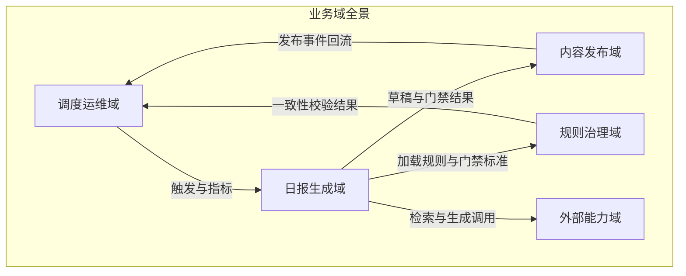

### 2.2 领域关系映射

#### 2.2.1 限界上下文清单

| 限界上下文 | 对应业务域 | 域类型 | 覆盖的核心业务实体 | 上下文边界（属于本域 vs 不属于） |
| --- | --- | --- | --- | --- |
| BC-Sched（调度运维上下文） | 调度运维域 | 支撑域 | `RunTask` / `RunEvent` / `AlertEvent` / 运行指标 | 属于：定时触发、人工触发、运行事件、看板指标、告警；不属于：6 步生成语义、规则内容、日报正文 |
| BC-Gen（日报生成上下文） | 日报生成域 | 核心域 | `RunTask` 执行态 / `NewsItem` / `GateResult` / 产业链关联 | 属于：6 步流程流转、检索分级、分类摘要、组装、门禁回退；不属于：定时调度、规则文件修订、发布放行 |
| BC-Rules（规则治理上下文） | 规则治理域 | 支撑域 | `RuleRegistry` / `RuleConsistency` / 分级域名 / Rubric 项 | 属于：规则注册表、三副本生成与 diff、裁决固化、回归用例；不属于：生成执行、发布审批 |
| BC-Ext（外部能力上下文） | 外部能力域 | 通用域 | 检索适配 / 抓取适配 / LLM 适配 | 属于：外部 API 封装、超时重试、出域调用；不属于：业务规则、日报内容 |
| BC-Pub（内容发布上下文） | 内容发布域 | 支撑域 | `ReportMeta` / `PublishAction` / 分类争议 | 属于：草稿终审、发布归档、产物命名、争议回收；不属于：门禁执行、生成编排 |

**域类型说明**：

| 域类型 | 含义 | 投入策略 |
| --- | --- | --- |
| 核心域（Core） | 业务护城河，差异化竞争力所在（6 步生成 + 领域强约束） | 投入最多资源自研 |
| 支撑域（Supporting） | 必要但非差异化（调度、规则、发布） | 可自研可外采 |
| 通用域（Generic） | 通用能力（外部 API 适配） | 优先复用 / 外采 |

#### 2.2.2 上下文映射（Context Mapping）

| 关系编号 | 上游上下文 | 下游上下文 | 关系模式 | 同步方式 | 选择理由 |
| --- | --- | --- | --- | --- | --- |
| C-01 | BC-Sched | BC-Gen | Customer/Supplier | 启动参数 + 终态回写（同步） | 调度层按生成域需求节奏提供触发与终态，生成域是调度层的客户 |
| C-02 | 外部检索 / LLM API | BC-Ext | ACL 防腐层 | HTTPS API + 适配器 | 外部模型不污染本域，超时/重试/降级全部收敛在适配层 |
| C-03 | BC-Rules | BC-Gen | Shared Kernel | 本地文件按需加载（同步） | 规则注册表与 15 项门禁标准是公共稳定概念，双方共享同一权威源 |
| C-04 | 硬校验器（BC-Rules 内） | BC-Gen | Conformist | 子进程调用 + 退出码（同步） | 校验器是既有硬约束执行权威，生成域顺从脚本口径 |
| C-05 | BC-Pub | BC-Sched / BC-Rules | Published Language | 发布事件 + 指标回流（异步） | 发布动作与质量结果被看板与规则治理多下游共同消费 |

**关系模式说明**：

| 关系模式 | 适用场景 |
| --- | --- |
| Customer/Supplier | 上下游强协作，下游能影响上游迭代节奏（C-01 调度 → 生成） |
| Conformist | 顺从者，下游完全遵循上游模型（C-04 生成顺从校验器退出码） |
| ACL（Anticorruption Layer） | 在本域和外部域之间建一层适配（C-02 外部检索/LLM 适配） |
| Shared Kernel | 共享内核，多个上下文共享一小块代码 / 模型（C-03 规则注册表） |
| Published Language | 上游以标准协议（事件 / Schema）对外暴露，多下游消费（C-05 发布事件） |

#### 2.2.3 跨域协作原则

| 原则编号 | 原则 |
| --- | --- |
| P-01 | 核心域（BC-Gen）→ 支撑域 / 通用域：禁止反向依赖（生成域不依赖调度域内部模型，仅消费启动参数与回写终态） |
| P-02 | 核心域之间：禁止直接耦合，必须通过事件 / API 解耦（BC-Gen 与 BC-Pub 通过草稿文件 + 发布事件交互） |
| P-03 | 对接外部不可控系统：必须建 ACL 防腐层（BC-Ext 承接全部外部调用，禁止外部模型贯穿到 BC-Gen） |
| P-04 | 硬门禁唯一执行权威：任何语义校验层（完整版 F11）不得取代 `validate_report.py` 的退出码拦截地位 |

### 2.3 详细业务架构

#### 2.3.1 用例图

> 体现"角色 — 用例 — 系统边界"。三个一级业务场景各一张用例图（Mermaid 内嵌，源文件归档 `.workbuddy/output/系统设计.md`）。

**用例图清单**：

| 编号 | 用例图标题 | 涉及业务域 | 源文件位置 |
| --- | --- | --- | --- |
| UC-01 | 日报生成与门禁回退 | 日报生成域 + 规则治理域 | 本文档 §2.3.1 UC-01 |
| UC-02 | 定时触发与运维观测 | 调度运维域 | 本文档 §2.3.1 UC-02 |
| UC-03 | 终审发布与归档 | 内容发布域 | 本文档 §2.3.1 UC-03 |

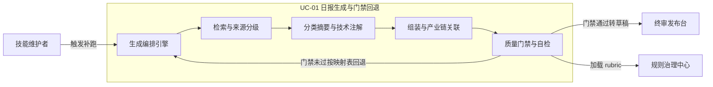

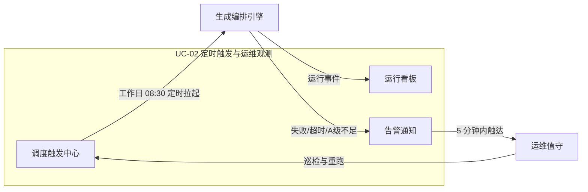

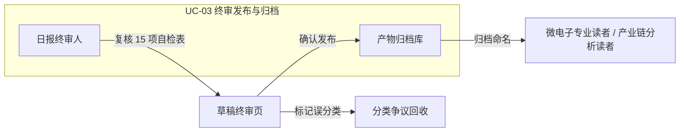

#### 2.3.2 业务流程图

> 关键业务以**角色泳道图**描述核心流程。判定节点必须有明确分支条件文字标注。

**关键流程清单**（核心业务覆盖度 ≥ 80%）：

| 流程编号 | 流程名 | 起点 | 终点 | 涉及业务域 | 源文件位置 |
| --- | --- | --- | --- | --- | --- |
| BF-01 | 6 步生成与门禁回退主链路 | 触发（定时/人工） | 草稿就绪 | 调度运维域 + 日报生成域 | 本文档 §2.3.2 BF-01 |
| BF-02 | 终审发布与归档流程 | 草稿就绪 | 发布归档 | 内容发布域 | 本文档 §2.3.2 BF-02 |
| BF-03 | 规则修订与三副本一致性流程 | 规则修订发起 | 三副本 diff=0 且回归通过 | 规则治理域 | 本文档 §2.3.2 BF-03 |

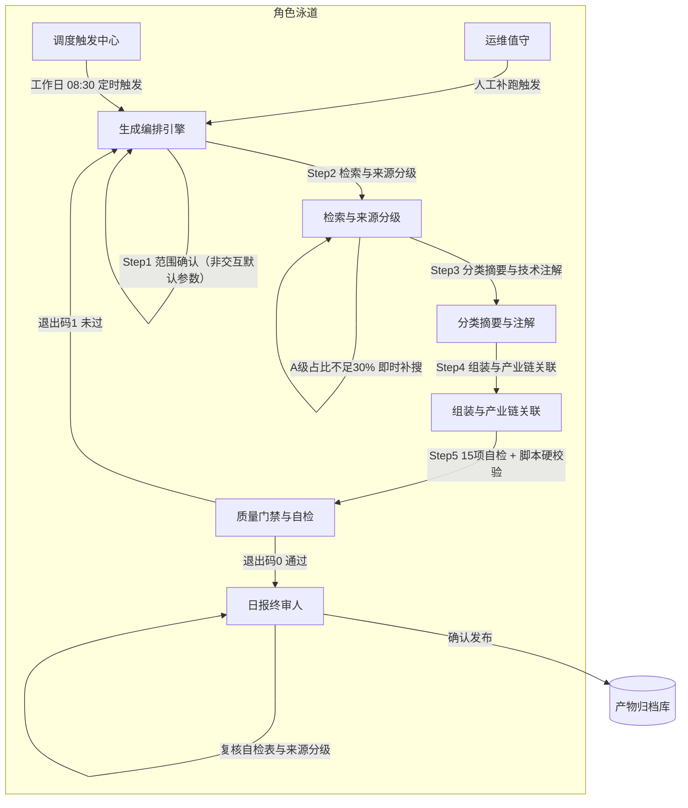

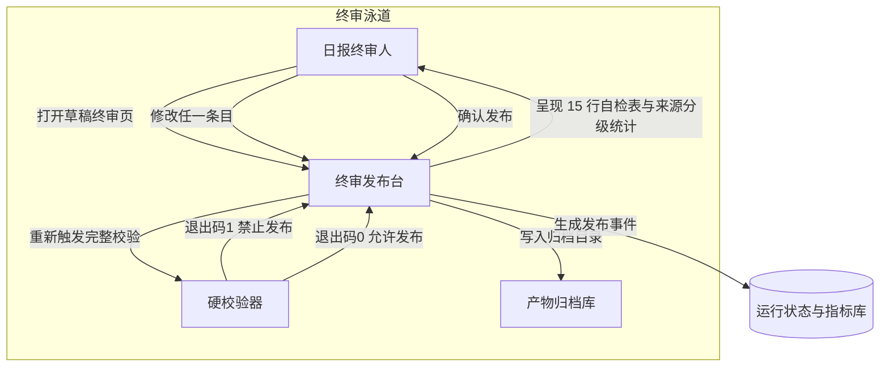

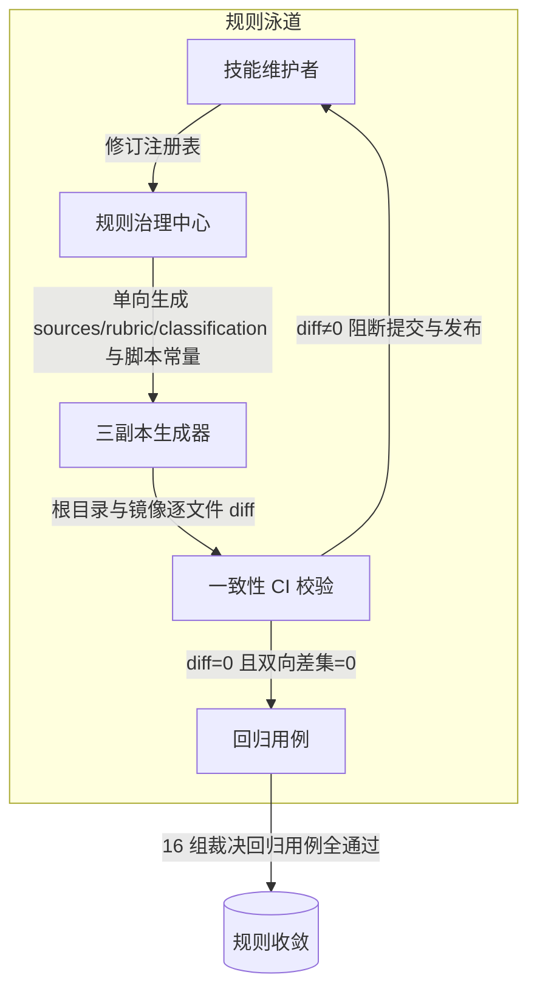

### 2.4 业务范围与边界

> **本节回答**：本期到底要做哪些功能、不做哪些功能，避免"边界蔓延"。

#### 2.4.1 功能模块清单

按"功能编号 → 子功能编号"两层组织，与 §2.1 业务域对应。以下沿用《高层架构设计》冻结的 F1–F15 编号。

| 编号 | 一级功能名 | 子功能描述 | 对应业务域 | 实现状态 |
| --- | --- | --- | --- | --- |
| F1 | 规则治理中心 | 单一权威规则注册表：域名分级、15 项 Rubric、分类仲裁条款集中定义并单向生成三处副本 | 规则治理域 | 完整实现 |
| F1.1 | — | 机器可读注册表 `rule_registry.yaml` 定义 A/B/C 域名、Rubric 项、仲裁条款 | 规则治理域 | 完整实现 |
| F1.2 | — | 向 `sources.md` / `rubric.md` / `classification.md` / 脚本常量单向生成 | 规则治理域 | 完整实现 |
| F2 | 规则治理中心 | 三副本一致性 CI 校验：根目录与 TRAE 镜像 diff + 域名双向差集 | 规则治理域 | 完整实现 |
| F2.1 | — | CI 流水线逐文件 diff，差异非 0 阻断提交 | 规则治理域 | 完整实现 |
| F3 | 规则治理中心 | X1–X16 裁决固化与回归用例 | 规则治理域 | 完整实现 |
| F3.1 | — | 16 组裁决写入规则文件并各配 ≥1 条回归用例 | 规则治理域 | 完整实现 |
| F4 | 调度触发中心 | 工作日定时触发：每工作日 08:30 非交互启动，装载默认参数 | 调度运维域 | 完整实现 |
| F5 | 生成编排引擎 | 6 步流程编排与门禁回退：按 Rubric-Step 映射回退，循环上限 5 次 | 日报生成域 | 完整实现（MVP 顺序编排） |
| F5.1 | — | Rubric-Step 映射表驱动回退（#1→Step4、#4→Step3、#13→Step2 等 15 项） | 日报生成域 | 完整实现 |
| F5.2 | — | 循环计数上限 5，超限保留最后结果并标注 FAIL 项 | 日报生成域 | 完整实现 |
| F6 | 质量门禁与自检 | 15 项硬门禁执行与发布拦截：退出码 1 即草稿态停留 | 日报生成域 | 完整实现 |
| F7 | 检索与来源分级 | A 级占比即时保障：三层检索 + 域名判级 + 不足补搜 | 日报生成域 | 完整实现 |
| F8 | 终审发布台 | 草稿态与人工终审发布：门禁通过仅生成草稿，终审确认发布归档 | 内容发布域 | 完整实现 |
| F9 | 运行看板 | 运行与质量指标看板：成功率、一次通过率、A 级占比、条数分布、FAIL 排行 | 调度运维域 | 完整实现 |
| F14 | 运行看板 | 告警与值班通知：失败/超时/A 级不足 5 分钟内通知 | 调度运维域 | 完整实现 |
| F10 | 生成编排引擎 | 状态化编排与断点恢复：状态机承载 6 步与条件回退 | 日报生成域 | `[简化]` MVP 顺序编排；完整版以 LangGraph StateGraph 替换执行引擎，6 步节点划分与门禁位置不变 |
| F11 | 质量门禁与自检 | 语义质量校验层：摘要忠实度、技术注解正确性自动评估 | 日报生成域 | `[MOCK]` MVP 以空实现钩子占位；完整版接入 DeepEval 式评委，先记录不拦截，硬门禁仍由脚本兜底 |
| F12 | 产物归档库 | 跨期事件去重记忆：近 14 期事件指纹库 | 内容发布域 | `[MOCK]` MVP 不启用；完整版基于归档库事件指纹实现 |
| F13 | 规则治理中心 | 源库健康巡检：月度探测 A/B 级域名可用性与命中率 | 规则治理域 | `[MOCK]` MVP 不启用；完整版按月任务触发 |
| F15 | 终审发布台 | 分类争议回收：终审人标记误分类并月度回流仲裁表 | 内容发布域 | `[MOCK]` MVP 不启用；完整版提供争议标记页 |

**编号规则**：

| 规则项 | 取值 |
| --- | --- |
| 一级编号 | `F1 / F2 / ...`，沿用高层架构冻结编号 |
| 子功能编号 | `F1.1 / F1.2 / ...`，互不重叠 |
| Mock / 简化标注 | `[MOCK]` / `[简化]` 已显式标注，并附"完整版替换路径" |

**In-Scope（本期范围内）**：

| 编号 | 本期必做的事项 |
| --- | --- |
| F1 | 单一权威规则注册表（MVP） |
| F2 | 三副本一致性 CI 校验（MVP） |
| F3 | X1–X16 裁决固化与回归用例（MVP） |
| F4 | 工作日定时触发（MVP） |
| F5 | 6 步流程编排与门禁回退（MVP 顺序编排） |
| F6 | 15 项硬门禁执行与发布拦截（MVP） |
| F7 | A 级占比即时保障（MVP） |
| F8 | 草稿态与人工终审发布（MVP） |
| F9 | 运行与质量指标看板（MVP） |
| F14 | 告警与值班通知（MVP） |
| N1 | 单期端到端耗时 ≤ 30 分钟（含最多 5 次门禁回退） |
| N2 | 数据不出域：正文、规则、运行元数据全部本地留存 |
| N3 | 校验器零第三方依赖：`validate_report.py` 可脱离系统独立运行 |
| N4 | 失败可观测性：任一步失败产生结构化运行事件，告警时延 ≤ 5 分钟 |

**Out-of-Scope（本期不做）**：

| 编号 | 不做的事项 | 不做的原因 | 未来归属 |
| --- | --- | --- | --- |
| O1 | 行情、股价指数与投资建议分析 | 违背 D1 §边界"不做投资建议与市场预测"，脚本已内置 19 个关键词拦截 | 永不做 |
| O2 | 付费墙与非公开信息采集 | D1 §边界"只汇总公开可访问来源，不引付费墙" | 永不做 |
| O3 | 多租户与多编辑部数据隔离 | 经中间确认 U-01 方案B 单节点单编辑部运行，租户模型收益不成正比 | 永不做 |
| O4 | 外文标题机器翻译与多语种发行 | D1 §边界"不翻译外文标题"，非英文附中文译名并标注 | 永不做 |
| O5 | 自建爬虫与反爬绕过 | 合规风险不可控，现有 web_search / web_fetch 已满足 | 永不做 |
| O6 | 私有化 LLM 推理部署 | 经中间确认 U-01 方案B 沿用现有 OpenAI 兼容 API | 完整版可选 |
| O7 | 社交媒体等 C 级来源接入 | D3 §C 级来源一律不使用，发现即丢弃 | 永不做 |

### 2.5 质量与柔性可用

#### 2.5.1 服务质量目标

**质量目标 Top 5**：

| 优先级 | 质量目标 | 业务驱动 | 受影响的关键章节 |
| --- | --- | --- | --- |
| Q1 | 合规可信：C 级来源零出现、来源可追溯率 100%、A 级占比 ≥ 30% | 合规底线（P1），V1/V5 | §3.2.M6 / §3.2.M12 / §7 |
| Q2 | 定时出报可靠性：工作日无人值守自动出报，任务成功率 ≥ 95% | V2，P2（无调度无可观测） | §3.2.M1 / §3.2.M5 / §5 |
| Q3 | 门禁一次通过率：无需回退重跑的期数占比 ≥ 90% | V5，P5（规模与格式漂移） | §3.2.M9 / §4.2 t_gate_result |
| Q4 | 可观测性：失败告警 ≤ 5 分钟、指标保留 90 天 | V2，N4 | §8 |
| Q5 | 可维护性：规则三副本 diff=0、新维护者 1 周上手 | V1，P1 | §3.2.M10 / §4.2 t_rule_consistency |

**可验证质量场景**（参考 SEI ATAM 方法）：

| 场景编号 | 关联目标 | 触发源 | 触发条件 | 期望响应 | 度量指标 |
| --- | --- | --- | --- | --- | --- |
| QS-01 | Q1 | 合规审阅抽查 | 抽查 10 期日报的来源级别与免责声明 | C 级 0 条、无链接 0 条、免责声明齐全 | C 级条目数 = 0；无链接条目数 = 0 |
| QS-02 | Q2 | 定时任务失败 | 单期检索或生成异常中断 | 5 分钟内告警触达运维值守，可一键重跑 | 失败到告警时延 ≤ 5min；成功率 ≥ 95% |
| QS-03 | Q3 | 门禁回退 | 单期出现 FAIL 项 | 按 Rubric-Step 映射自动回退重跑，循环 ≤ 5 次 | 门禁一次通过率 ≥ 90%；循环次数 ≤ 5 |
| QS-04 | Q4 | 单期超时 | 端到端耗时逼近 30 分钟 | 超时前发出预警事件 | 端到端耗时 ≤ 30min |

#### 2.5.2 业务柔性可用策略

**业务功能优先级分层**（§2.4.1 中每个一级功能 F-x 显式标注层级）：

| 层级 | 含义 | 故障态下的处置方向 | 用户感知 |
| --- | --- | --- | --- |
| L0 核心业务 | 系统的生命线，挂掉等于业务停摆 | 不降级；优先消耗所有资源保障 | 无 / 极轻微 |
| L1 重要业务 | 不影响主链路但用户高频使用 | 限流 + 排队 + 异步化 | 变慢 / 排队提示 |
| L2 辅助业务 | 提升体验但非必要 | 关闭 / 返回兜底数据 | 部分功能不可用 + 友好提示 |
| L3 附加业务 | 长尾 / 数据类 / 统计类 | 直接关闭 + 异步补偿 | 通常无感 |

**功能分层映射**：F1/F2/F6/F7/F8 → L0；F4/F5/F9 → L1；F3/F14 → L2；F10/F11/F12/F13/F15 → L3（完整版功能，MVP 不承载）。

**业务降级清单**：

| 编号 | 关联功能（F-xx） | 触发条件 | 降级动作 | 用户感知 | 决策类型 |
| --- | --- | --- | --- | --- | --- |
| BD-01 | F7 检索与来源分级 | 公开检索 API 连续失败或超时 | 切备用引擎重试 1 次，仍失败则保留已检索条目并标注"链接待验证" | 部分条目标注待验证，日报仍可产出 | 自动 |
| BD-02 | F5 生成编排引擎 | 单期门禁循环超 5 次仍 FAIL | 保留最后一次结果并标注 FAIL 项，产物停留草稿态不发布 | 草稿页呈现 FAIL 明细，发布按钮禁用 | 自动 |
| BD-03 | F4 定时触发 | 定时任务整体失败 | 保留失败告警 + 看板 FAIL 状态，等待人工补跑 | 运维值守收到告警并手动重跑 | 手动 |
| BD-04 | F11 语义校验层（完整版） | LLM 评委不可用或超时 | 跳过语义校验，仅输出 WARN 与抽检报告，硬门禁仍由脚本兜底 | 看板显示语义层跳过标记 | 自动 |
| BD-05 | F9 运行看板 | 指标库写入积压 | 指标异步落库并合并聚合，看板延迟刷新 | 看板数据延迟 ≤ 5 分钟 | 自动 |

> **§2 章节自检（中间确认协议 §2.4）**：
> - §2.1 判定：未命中。业务域划分为 5 个（调度运维 / 日报生成 / 规则治理 / 外部能力 / 内容发布），是对《高层架构设计》§6.2 已冻结 14 模块全集的分组视角，不增减模块、不改变功能清单 F1–F15；上下文映射 5 种关系模式为模板硬指标 + 单节点形态下的专业判断，无并列可替代方案。
> - §2.3 反向验证：Q1 若 3 个月后调整域粒度，返工范围 = §2.2 限界上下文表 + §3.2 模块归属列 + §4.2 表归属标注，均为文档级修订，切换成本 0 人月，可控；Q2 用户/客户/监管不可感知——域划分是内部建模视角，日报产物形态由 F8 与格式模板锁定，与域粒度无关；Q3 用户诉求"生成完整架构方案"与高层冻结的 14 模块全集一致，5 域不改变模块全集，一致。
> - 判定：未命中 §2.2，不发起中间确认。证据归档至附录 A 自检报告。

---

## 3. 应用架构

> **本章回答**：系统由哪些模块组成、模块与外部系统怎么集成、每个模块的内部交互链路是什么。
> **本章是系统设计的核心**，占全文篇幅约 45%。

### 3.1 应用架构概览

#### 3.1.1 系统上下文

本系统作为**中心节点**，周围辐射出"用户角色 + 外部业务系统 + 上游 / 下游平台"关系。

**系统上下文要素清单**：

| 节点类型 | 节点名 | 与本系统的关系 | 关系语义 |
| --- | --- | --- | --- |
| 角色 | 日报终审人 | 使用 | 终审发布台操作 |
| 角色 | 运维值守 | 使用 | 运行看板巡检与重跑 |
| 角色 | 技能维护者 | 使用 | 规则治理与人工触发 |
| 角色 | 微电子专业读者 | 消费 | 阅读已发布日报 |
| 角色 | 产业链分析读者 | 消费 | 阅读产业链关联小节 |
| 角色 | 合规审阅 | 抽查 | 来源级别 / 免责声明复核 |
| 上游平台 | E-01 公开检索 | 本系统 → 调用 | 关键词与站内限定检索 |
| 上游平台 | E-02 网页正文抓取 | 本系统 → 调用 | 正文与发布时间提取 |
| 上游平台 | E-03 LLM 推理服务 | 本系统 → 调用 | 摘要 / 技术注解 / 产业链推演 |
| 外部业务系统 | E-04 TRAE 技能镜像 | 双向同步 | 三副本一致性校验与分发 |

#### 3.1.2 系统模块图

**分层组件清单**（承接《高层架构设计》§6.2 模块全景，14 模块三层）：

| 层次 | 内容 | 数据来源 |
| --- | --- | --- |
| 接入层 | M1 调度触发中心 / M2 人工触发端 / M3 终审发布台 / M4 运行看板 | §2.3 用例图角色 |
| 业务能力层 | M5 生成编排引擎 / M6 检索与来源分级 / M7 分类摘要与技术注解 / M8 组装与产业链关联 / M9 质量门禁与自检 | §2.1 日报生成域 |
| 基础能力层 | M10 规则治理中心 / M11 外部能力适配层 / M12 硬校验器 / M13 产物归档库 / M14 运行状态与指标库 | §2.1 规则治理域 + 外部能力域 + 调度运维域 |

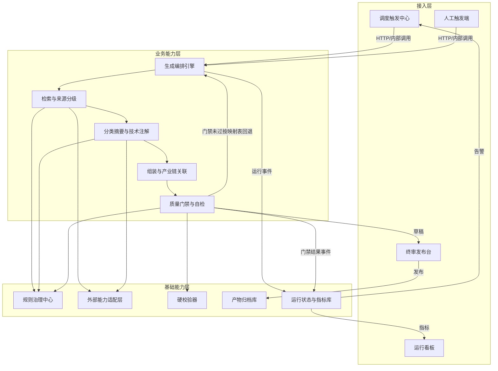

#### 3.1.3 集成架构

> 本系统按单节点自托管设计，外部依赖仅公开检索、网页抓取、LLM API 三类出域调用；其余全部为本地组件。

##### 外部依赖清单

| ID | 外部系统 | 归属团队 / 供应商 | 类别 | 使用方式 | 集成方式 | 协议 / 版本 | 功能定位（≤ 30 字） | 联系人 |
| --- | --- | --- | --- | --- | --- | --- | --- | --- |
| E-01 | 公开新闻检索 | 外部搜索引擎提供方 | 第三方业务平台 | 消费 | HTTPS API | HTTPS / 检索 REST v1 | 关键词检索与站内限定检索 | `@运维值守` |
| E-02 | 网页正文抓取 | 目标来源站点 | 第三方业务平台 | 消费 | HTTPS | HTTPS | 正文与发布时间提取 | `@运维值守` |
| E-03 | LLM 推理服务 | OpenAI 兼容 API 提供方 | 第三方业务平台 | 消费 | HTTPS REST | OpenAI 兼容 / chat completions v1 | 摘要生成 / 技术注解 / 产业链推演 | `@运维值守` |
| E-04 | TRAE 技能镜像 | 内部（本项目 `.trae` 目录） | 业务协作 | 双向 | 文件 diff / 同步脚本 | 本地文件 | 三副本一致性校验与分发 | `@技能维护者` |

**类别取值说明**：E-01/E-02/E-03 属"第三方业务平台"（本系统消费对方 API）；E-04 属"业务协作"（本地目录镜像，双向同步）。

##### 云组件 / 基础设施清单

| ID | 组件类别 | 选型 | 部署形态 | 规格量级 | 容量预估 | 提供方 / SLA | 用途 |
| --- | --- | --- | --- | --- | --- | --- | --- |
| C-01 | 编排框架 | LangGraph 2.x | 本地 Python 库 | 单进程 | 状态节点 6 个 / 循环 ≤ 5 | 开源 MIT / 社区 | 6 步状态化编排（完整版 StateGraph） |
| C-02 | 调度与可观测 | Prefect Server 3.x | Docker 容器（自托管） | 1 容器 2C4G | 每日 1 期 flow / 指标 90 天 | 开源 Apache 2.0 / 自托管 | 定时触发、失败重试、运行 UI |
| C-03 | 关系型存储 | SQLite 3.x | 本地单文件 | 单文件小于1GB | 指标行小于50万/90天 | 内嵌 / 单机 | 运行任务、事件、门禁结果、日报元信息 |
| C-04 | 本地文件存储 | 文件系统目录 | 数据卷挂载 | 4 目录 | 日报 90 天 + 规则 + 日志 | 单机 | 产物归档、规则注册表、运行日志 |
| C-05 | Web 服务框架 | FastAPI 0.115.x | 本地 Python 进程 | 单进程 | 终审台 / 看板 API | 开源 Apache 2.0 | 终审发布台与运行看板的后端 API |
| C-06 | 容器运行时 | Docker 27.x + Docker Compose 2.x | 单机 | 2~3 容器 | 单节点 | Docker Inc. | 部署与编排（见 §5） |
| C-07 | 可观测 SDK | OpenTelemetry Python 1.x | 库内嵌 | 单进程 | 采样错误 100% | 开源 Apache 2.0 | 链路追踪与指标透传 |

**不使用的组件（整行删除）**：消息队列（无跨进程异步依赖，单节点内部直接调用）；Redis 缓存（无缓存需求）；K8s（单节点非集群）；API 网关（本地访问，无公网网关）；对象存储（本地文件即可）；KMS（密钥放环境变量 + 文件权限，见 §7）。

##### 组件依赖关系

| 业务模块（§3.2） | 依赖的外部系统（E-xx） | 依赖的云组件（C-xx） | 故障传导风险 |
| --- | --- | --- | --- |
| M1 调度触发中心 | — | C-02 | C-02 不可用 → 定时触发中断，人工补跑兜底 |
| M5 生成编排引擎 | — | C-01, C-02, C-03 | C-01 编排异常 → 流程中断可重跑；C-03 不可用 → 状态无法落库 |
| M6 检索与来源分级 | E-01, E-02 | C-03 | E-01 超时 → 切备用引擎；E-02 抓取失败 → 标"链接待验证" |
| M7 分类摘要与技术注解 | E-03 | C-03 | E-03 超时 → 重试 2 次，仍失败则告警并保留草稿 |
| M9 质量门禁与自检 | — | C-03 | 校验器子进程失败 → 退出码 1 拦截发布 |
| M10 规则治理中心 | E-04 | C-04 | diff 非 0 → CI 阻断，不阻断已发布产物 |
| M11 外部能力适配层 | E-01, E-02, E-03 | — | ACL 层超时重试封顶，防外部故障扩散 |
| M13 产物归档库 | — | C-04 | 磁盘满 → 发布失败并告警 |
| M14 运行状态与指标库 | — | C-03 | C-03 不可用 → 指标落库延迟，看板延迟刷新 |

#### 3.1.4 工程结构

- 单仓结构：后端 Python（FastAPI + LangGraph + Prefect flow），前端本地静态页（终审台 / 看板）。
- 公共模块（`common`）与业务模块的依赖方向：**业务模块依赖 common，禁止反向**。

```
chip-daily-report/
├── backend/                     # 后端工程根目录
│   ├── common/                  # 公共模块：DTO / Enum / Exception / Constants / 错误码
│   │   ├── dto/                 # 请求 / 响应 DTO（与 §3.2.M{N}.3 对齐）
│   │   ├── enums/               # 共享枚举（RunStatus / GateResultStatus / AlertLevel）
│   │   ├── errors/              # 全局异常与错误码（§3.5.1）
│   │   └── constants/           # 常量（Rubric-Step 映射表、默认超时基线）
│   ├── orchestrator/            # M5 生成编排引擎（LangGraph 图定义 + Prefect flow 封装）
│   ├── search/                  # M6 检索与来源分级
│   ├── content/                 # M7 分类摘要与技术注解
│   ├── assembly/                # M8 组装与产业链关联
│   ├── gate/                    # M9 质量门禁与自检
│   ├── rules/                   # M10 规则治理中心（注册表生成 / 一致性校验）
│   ├── adapter/                 # M11 外部能力适配层（检索 / 抓取 / LLM 三个适配器）
│   ├── archive/                 # M13 产物归档库
│   ├── metrics/                 # M14 运行状态与指标库（SQLite 访问层 + 指标聚合）
│   ├── scheduler/               # M1 调度触发中心（Prefect schedule）
│   ├── console/                 # M3 终审发布台 + M4 运行看板 的 FastAPI 应用
│   └── main.py                  # 应用入口
├── frontend/
│   ├── console/                 # 终审发布台 + 运行看板 本地 Web（原生 HTML + 轻量 JS）
│   │   ├── index.html           # 看板入口
│   │   ├── review.html          # 终审台入口
│   │   ├── assets/              # 静态资源
│   │   └── api/                 # 后端接口封装（与 §3.2 接口清单对齐）
│   └── shared/                  # 跨页面组件 / 样式
├── scripts/                     # 既有资产（复用）
│   ├── validate_report.py       # M12 硬校验器（768 行，Python 3 零第三方依赖）
│   └── __init__.py
├── references/                  # 既有规则资产（复用，经 M10 单向生成）
│   ├── sources.md
│   ├── classification.md
│   └── rubric.md
├── rules/                       # 规则注册表（M10 权威源）
│   └── rule_registry.yaml
├── agents/
│   └── openai.yaml              # Agent 行为配置（复用）
├── data/                        # 运行时数据卷
│   ├── archives/                # 日报产物归档（草稿 / 已发布）
│   ├── metrics/                 # SQLite 指标库
│   ├── rules_out/               # 三副本生成输出
│   └── logs/                    # 运行日志
├── docker-compose.yml           # 单节点部署（§5）
└── pyproject.toml               # Python 依赖声明
```

#### 3.1.5 技术选型（版本约束）

| 技术分类 | 选型 | 版本 | 备注 / 选型理由 |
| --- | --- | --- | --- |
| 后端语言 | Python | 3.13.x | 既有校验器为 Python 3 零依赖实现，LangGraph / Prefect / FastAPI 生态一致，团队熟悉 |
| 编排框架 | LangGraph | 2.x | 为什么选 LangGraph 不选 AutoGen/CrewAI：StateGraph 条件边与原生循环几乎一一映射 Rubric-Step 回退与循环上限 5，MIT 开源可自托管（加权 4.70 最高，见高层架构 §3.2） |
| 调度与可观测 | Prefect Server | 3.x | 为什么选 Prefect 不选 Airflow：Pythonic 无 DSL、断点恢复、数据不出域混合执行，Apache 2.0 可自托管（加权 4.55）；Airflow 偏 DAG 重量级 |
| Web 框架 | FastAPI | 0.115.x | 为什么选 FastAPI 不选 Flask：原生异步 + Pydantic DTO 校验 + OpenAPI 自动文档，适配终审台/看板轻量 API |
| 前端 | 原生 HTML + 轻量 JS | 无构建链 | 为什么不做 React/Vue SPA：终审台与看板为低交互只读/表单页面，单节点本地访问，原生页免构建链、免 node 运行时，降低运维面 |
| 关系型存储 | SQLite | 3.x | 为什么选 SQLite 不选 MySQL/PostgreSQL：单节点单实例、指标量小于50万行，SQLite 内嵌零运维、数据即文件、天然不出域；MySQL/PG 需独立服务进程与账号体系，收益不成正比 |
| LLM 接入 | OpenAI 兼容 API | chat completions v1 | 沿用既有 `agents/openai.yaml` 配置；为什么不私有化推理：经中间确认 U-01 方案B，MVP 沿用现有 API，私有化列完整版可选（O6） |
| 硬校验器 | `validate_report.py` | v5.0 | 既有资产复用，Python 3 标准库零第三方依赖（N3），保持为唯一硬门禁执行权威 |
| 语义校验层 | DeepEval 式混合校验 | 1.x（完整版） | 为什么完整版才接入：LLM 评委存在位置/冗长偏差需人工校准（research_report R-03），MVP 以空钩子占位（F11） |
| 容器 | Docker + Docker Compose | 27.x + 2.x | 为什么 Compose 不选 K8s：单节点单机部署，Compose 足够，K8s 引入运维复杂度与本项目轻量定位不符（经中间确认 U-01 方案B） |
| 可观测 SDK | OpenTelemetry | 1.x | 错误 100% 采样 + 慢请求 100% 采样（§8.3），开源标准协议 |
| 认证方案 | 本地账号 + 会话 Token | — | 见 §7.2.1；单编辑部自建账号，不引入 SSO |
| 三方 SDK | openai / requests / prefect / langgraph | 对应版本 | 用途与替代方案见各模块 §3.2 |

---

### 3.2 模块详细设计

> **核心方法论**：模块详细设计画的是**业务逻辑在角色和系统之间流动的过程**，不是接口实现细节。
> 14 个模块（M1–M14）全部按 §3.2.3 五段式模板独立成节。

#### 3.2.1 模块公共约束（Common）

**通信方式约束**：

| 约束项 | 取值 |
| --- | --- |
| 接口路径风格 | RESTful（本地 Web 端）+ 内部 Python 函数调用 + 子进程调用（校验器） |
| 协议 | HTTP（本地）/ 进程内调用 / subprocess |
| 数据格式 | JSON（API）/ Markdown（产物）/ YAML（规则） |
| 字符编码 | UTF-8 |

**通用基础结构**：

| 基类 / 结构 | 用途 | 包路径 |
| --- | --- | --- |
| `BaseRequest` | 多态请求对象基类 | `backend.common.dto` |
| `BaseResponse` | 多态响应对象基类 | `backend.common.dto` |
| `PageRequest` | 分页请求 | `backend.common.dto` |
| `PageResponse` | 分页响应 | `backend.common.dto` |
| `Result` | 统一返回结构（含 code / msg / data / traceId） | `backend.common.dto` |
| `RunContext` | 跨步骤上下文（日期范围 / 关注领域 / 检索结果 / 草稿路径） | `backend.common.dto` |

#### 3.2.2 模块清单与编号规则

**模块清单**：

| 编号 | 模块名 | 业务域（§2.1） | 模块负责人 | 关联子领域 |
| --- | --- | --- | --- | --- |
| M1 | 调度触发中心 | 调度运维域 | `@技能维护组` | 定时触发 / 参数装载 |
| M2 | 人工触发端 | 调度运维域 | `@技能维护组` | 补跑触发 |
| M3 | 终审发布台 | 内容发布域 | `@内容运营组` | 草稿终审 / 发布归档 / 争议回收 |
| M4 | 运行看板 | 调度运维域 | `@运维平台组` | 指标展示 / 告警配置 |
| M5 | 生成编排引擎 | 日报生成域 | `@技能维护组` | 6 步流程 / 门禁回退 / 断点恢复 |
| M6 | 检索与来源分级 | 日报生成域 | `@技能维护组` | 三层检索 / 域名判级 / 即时去重 |
| M7 | 分类摘要与技术注解 | 日报生成域 | `@技能维护组` | 5 环节归类 / 五要素摘要 / 技术注解 |
| M8 | 组装与产业链关联 | 日报生成域 | `@技能维护组` | 头部 / 今日要点 / 5 环节 / 关联小节 |
| M9 | 质量门禁与自检 | 日报生成域 | `@技能维护组` | 15 项自检 / 脚本校验 / 发布拦截 |
| M10 | 规则治理中心 | 规则治理域 | `@技能维护组` | 注册表 / 三副本生成 / 一致性校验 |
| M11 | 外部能力适配层 | 外部能力域 | `@技能维护组` | 检索适配 / 抓取适配 / LLM 适配 |
| M12 | 硬校验器 | 规则治理域 | `@技能维护组` | 15 项硬门禁执行 |
| M13 | 产物归档库 | 内容发布域 | `@内容运营组` | 草稿 / 发布 / 命名 / 跨期指纹 |
| M14 | 运行状态与指标库 | 调度运维域 | `@运维平台组` | 运行事件 / 指标聚合 / 告警事件 |

**编号规则**：模块编号 `M{N}` 全局唯一；每个模块在 §3.2 下独立成节，编号 `§3.2.M{N}`；节内五段式编号 `§3.2.M{N}.1` ~ `§3.2.M{N}.5`。

#### 3.2.3 单模块设计模板（五段式）

> ⚠️ 本节为**规范说明**：定义每个模块在 §3.2.M{N} 下五段各应产出什么。各模块节内**只体现、不重复声明**本节硬性要求。

五段顺序固定：`§3.2.M{N}.1 模块概述`（位置 / 角色 / 内外部系统）→ `§3.2.M{N}.2 接口清单`（路径 / 方法 / DTO / 幂等 / 鉴权）→ `§3.2.M{N}.3 关键结构定义（DTO）`（DTO 代码 + 字段表）→ `§3.2.M{N}.4 模块逻辑时序图`（含异常分支）→ `§3.2.M{N}.5 关键流程逻辑`（状态机 / 复杂事务 / Mock 标注；简单模块可注明省略，禁止留空标题）。

---

#### 3.2.M1 调度触发中心

##### §3.2.M1.1 模块概述

调度触发中心覆盖"何时开始"场景，位于接入层，业务逻辑在运维值守、技能维护者与生成编排引擎之间流动，同时涉及 Prefect Server（C-02）、运行状态与指标库（M14）的数据流动。职责：每工作日 08:30 以非交互模式启动生成任务，自动装载默认日期范围（最近一个工作日）与默认关注领域，不等待用户输入（对齐 F4 / V2）。

##### §3.2.M1.2 接口清单

| 子领域 | 方法 | 路径 | 用途（≤ 20 字） | 请求 DTO | 响应 VO | 幂等 |
| --- | --- | --- | --- | --- | --- | --- |
| 定时触发 | POST | `/api/v1/scheduler/schedule` | 创建/更新工作日定时规则 | `ScheduleUpsertRequest` | `ScheduleVO` | 是（schedule_id） |
| 定时触发 | GET | `/api/v1/scheduler/schedule` | 查询当前定时配置 | — | `ScheduleVO` | 天然 |
| 定时触发 | POST | `/api/v1/scheduler/schedule/pause` | 暂停定时（节假日） | `ScheduleActionRequest` | `Result` | 是（schedule_id+version） |

##### §3.2.M1.3 关键结构定义（DTO）

```python
class ScheduleUpsertRequest(BaseRequest):
    # ===== 必填字段 =====
    cron_expr: str            # 工作日 08:30 表达式：'30 8 * * 1-5'
    timezone: str             # 时区：Asia/Shanghai

    # ===== 可选字段 =====
    default_coverage: str     # 默认覆盖范围：最近一个工作日
    default_domains: list     # 默认关注领域：设计/制造/封测/EDA/材料
```

| DTO / VO 名 | 字段名 | 类型 | 必填 | 业务含义 | 约束 / 默认值 |
| --- | --- | --- | --- | --- | --- |
| `ScheduleUpsertRequest` | `cron_expr` | String | 是 | 定时表达式 | 默认 `30 8 * * 1-5` |
| `ScheduleUpsertRequest` | `timezone` | String | 是 | 时区 | `Asia/Shanghai` |
| `ScheduleUpsertRequest` | `default_coverage` | String | 否 | 默认覆盖范围 | 最近一个工作日 |
| `ScheduleVO` | `schedule_id` | String | 是 | 定时规则 ID | 平台生成 |
| `ScheduleVO` | `status` | String | 是 | 状态 | 枚举：ACTIVE / PAUSED |

##### §3.2.M1.4 模块逻辑时序图

| 编号 | 标题（`调度触发中心 - 工作日定时触发`） | 场景类别 | 是否包含异常分支 |
| --- | --- | --- | --- |
| SQ-M1-01 | 工作日 08:30 定时拉起生成任务 | 核心动作的执行 / 触发 | 是 |

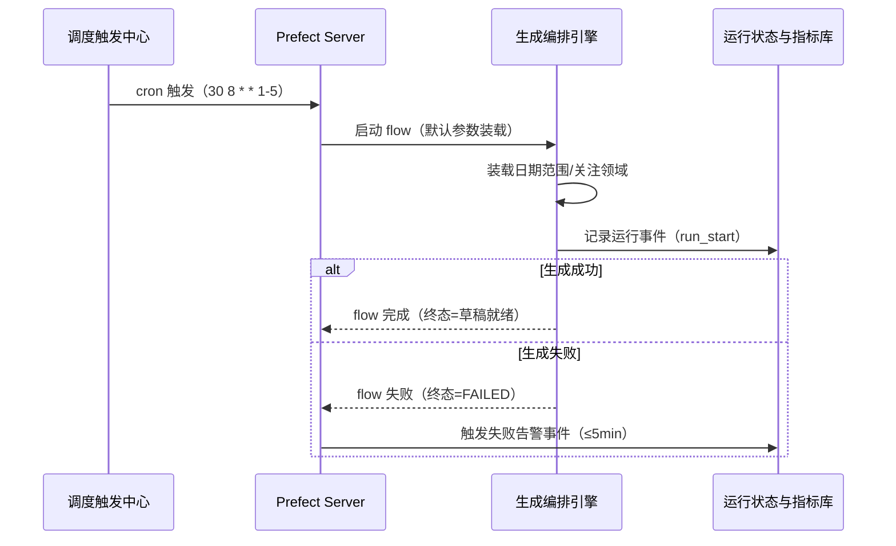

##### §3.2.M1.5 关键流程逻辑

触发：工作日 08:30（cron `30 8 * * 1-5`）

Step 1: 装载默认参数（同步）
  ├── 校验：定时规则为 ACTIVE → 失败时跳过当日触发并告警
  └── 状态变更：Schedule.ACTIVE → 触发 flow

Step 2: 启动生成 flow（同步，调用 M5）
  ├── 传递：日期范围（最近一个工作日）/ 关注领域（5 环节）
  └── 终态：草稿就绪 / 门禁未过 / 异常

Step 3: 记录运行事件（异步写 M14）
  ├── [MOCK] 断点恢复：MVP 顺序编排不做断点续跑
  │     输入：任务中断
  │     规则：完整版由 LangGraph Checkpointer 承接
  │     输出：MVP 直接整期重跑
  │     [完整版替换点] F10 状态机接入 Checkpointer
  └── 状态变更：flow 终态写入 t_run_task

---

#### 3.2.M2 人工触发端

##### §3.2.M2.1 模块概述

人工触发端覆盖"补跑触发"场景，位于接入层，业务逻辑在技能维护者、日报终审人与生成编排引擎之间流动。职责：保留触发词方式用于补跑，与定时触发共享同一生成入口，不重复实现 6 步流程（对齐 F5 复用）。

##### §3.2.M2.2 接口清单

| 子领域 | 方法 | 路径 | 用途（≤ 20 字） | 请求 DTO | 响应 VO | 幂等 |
| --- | --- | --- | --- | --- | --- | --- |
| 人工触发 | POST | `/api/v1/runs/trigger` | 手动触发一次生成 | `RunTriggerRequest` | `RunTaskVO` | 是（X-Idempotency-Key） |
| 人工触发 | GET | `/api/v1/runs/{run_id}` | 查询任务状态 | — | `RunTaskDetailVO` | 天然 |

##### §3.2.M2.3 关键结构定义（DTO）

```python
class RunTriggerRequest(BaseRequest):
    # ===== 必填字段 =====
    trigger_type: str       # 触发类型：manual
    # ===== 可选字段 =====
    coverage_start: str     # 覆盖起始日期（默认最近一个工作日）
    coverage_end: str       # 覆盖结束日期
    domains: list           # 关注领域（默认 5 环节全量）
```

| DTO / VO 名 | 字段名 | 类型 | 必填 | 业务含义 | 约束 / 默认值 |
| --- | --- | --- | --- | --- | --- |
| `RunTriggerRequest` | `trigger_type` | String | 是 | 触发类型 | `manual` |
| `RunTriggerRequest` | `coverage_start` | String | 否 | 覆盖起始日期 | 最近一个工作日 |
| `RunTriggerRequest` | `domains` | List | 否 | 关注领域 | 5 环节全量 |
| `RunTaskVO` | `run_id` | String | 是 | 运行任务 ID | UUID |
| `RunTaskVO` | `status` | String | 是 | 任务状态 | 枚举：RUNNING / DRAFT_READY / GATE_FAILED / FAILED |

##### §3.2.M2.4 模块逻辑时序图

| 编号 | 标题（`人工触发端 - 补跑触发`） | 场景类别 | 是否包含异常分支 |
| --- | --- | --- | --- |
| SQ-M2-01 | 运维值守触发补跑并查询状态 | 核心动作的执行 / 触发 | 是 |

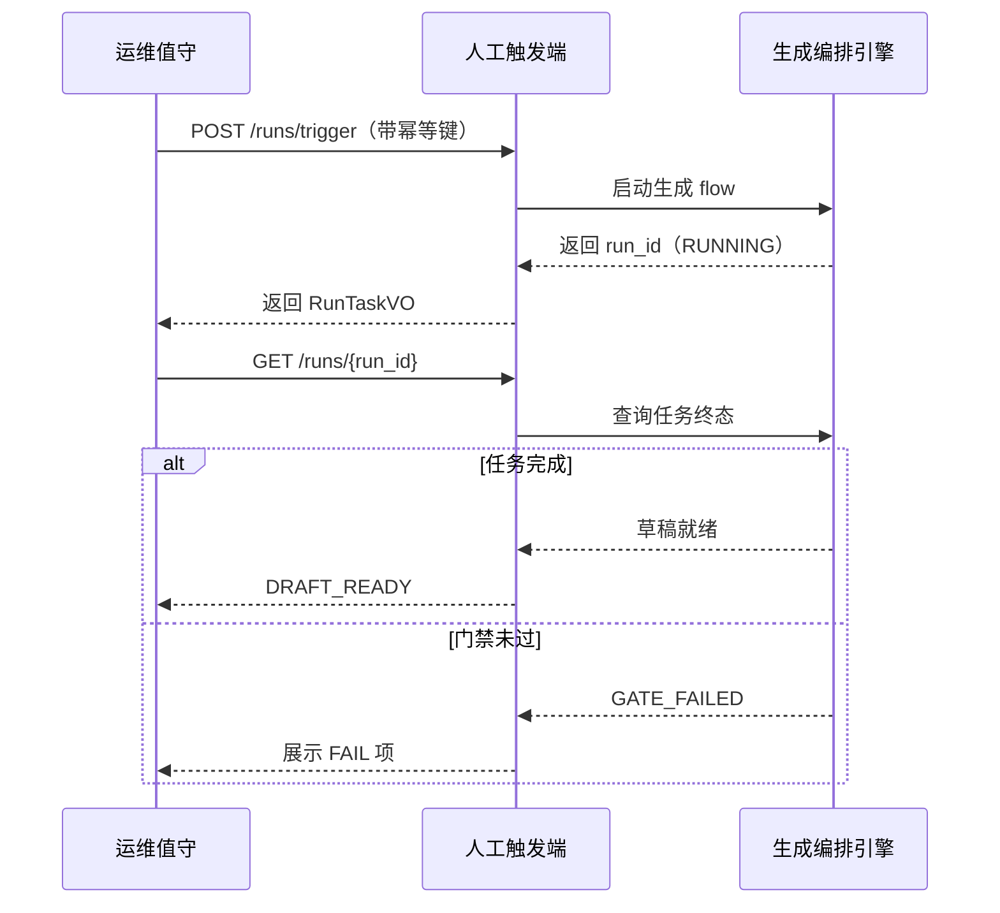

##### §3.2.M2.5 关键流程逻辑

无复杂状态机/事务/跨多步异步，仅触发与查询转发，本段省略。

---

#### 3.2.M3 终审发布台

##### §3.2.M3.1 模块概述

终审发布台覆盖"草稿复核与发布放行"场景，位于接入层，是**本系统唯一发布出口**，业务逻辑在日报终审人与产物归档库之间流动，同时涉及硬校验器（M12）与运行状态与指标库（M14）。职责：门禁通过仅生成草稿，终审人逐项复核 15 行自检表与三行来源分级统计后确认发布；任一条目被修改必须重新触发完整校验（对齐 F8 / V2）。

##### §3.2.M3.2 接口清单

| 子领域 | 方法 | 路径 | 用途（≤ 20 字） | 请求 DTO | 响应 VO | 幂等 |
| --- | --- | --- | --- | --- | --- | --- |
| 草稿终审 | GET | `/api/v1/reports/{report_id}/draft` | 获取草稿正文与自检表 | — | `DraftDetailVO` | 天然 |
| 草稿终审 | POST | `/api/v1/reports/{report_id}/publish` | 确认发布并归档 | `PublishRequest` | `PublishVO` | 是（report_id+version） |
| 条目校对 | POST | `/api/v1/reports/{report_id}/items/{item_id}` | 修改条目（环节/注解/删除） | `ItemUpdateRequest` | `ItemUpdateVO` | 是（item_id+version） |
| 条目校对 | POST | `/api/v1/reports/{report_id}/revalidate` | 修改后重新完整校验 | — | `GateResultVO` | 是（report_id+version） |
| 发布拦截 | GET | `/api/v1/reports/{report_id}/gate` | 查询门禁状态与 FAIL 明细 | — | `GateResultVO` | 天然 |

##### §3.2.M3.3 关键结构定义（DTO）

```python
class PublishRequest(BaseRequest):
    # ===== 必填字段 =====
    report_id: str        # 日报标识
    version: int          # 乐观锁版本号（防并发发布）
    # ===== 可选字段 =====
    note: str             # 终审备注

class PublishVO(BaseResponse):
    # ===== 基本信息 =====
    report_id: str        # 日报标识
    # ===== 状态字段 =====
    publish_status: str   # 枚举：DRAFT / PUBLISHED
    # ===== 时间字段 =====
    published_time: str   # 发布时间
```

| DTO / VO 名 | 字段名 | 类型 | 必填 | 业务含义 | 约束 / 默认值 |
| --- | --- | --- | --- | --- | --- |
| `PublishRequest` | `report_id` | String | 是 | 日报标识 | UUID |
| `PublishRequest` | `version` | Integer | 是 | 乐观锁版本 | 防并发发布 |
| `PublishVO` | `publish_status` | String | 是 | 发布状态 | 枚举：DRAFT / PUBLISHED |
| `ItemUpdateRequest` | `item_id` | String | 是 | 条目标识 | UUID |
| `ItemUpdateRequest` | `segment` | String | 否 | 环节归属修改 | 设计/制造/封测/EDA/材料 |

##### §3.2.M3.4 模块逻辑时序图

| 编号 | 标题（`终审发布台 - 草稿终审与发布`） | 场景类别 | 是否包含异常分支 |
| --- | --- | --- | --- |
| SQ-M3-01 | 终审人复核草稿并发布 | 核心实体的创建 / 配置 / 发布 | 是 |

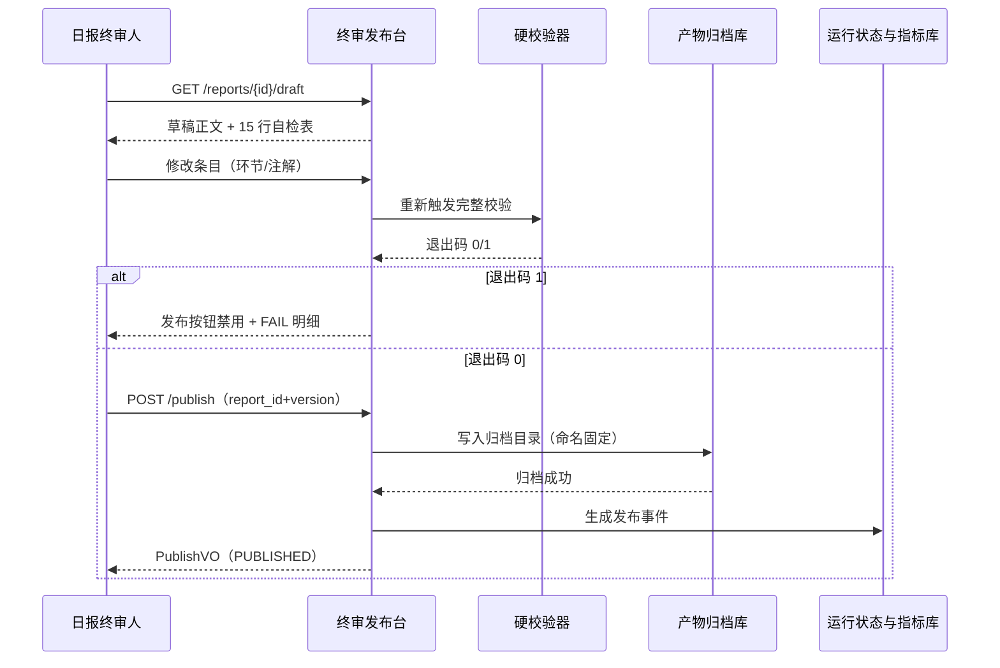

##### §3.2.M3.5 关键流程逻辑

触发：终审人确认发布（草稿就绪态）

Step 1: 获取草稿（同步）
  ├── 校验：草稿存在且 report_id 有效
  └── 返回正文 + 15 行自检表 + 三行来源分级统计

Step 2: 条目修改（同步）
  ├── 校验：item_id + version 乐观锁
  ├── 修改环节归属 / 技术注解 / 删除越界条目
  └── 状态变更：DRAFT → MODIFIED（触发重新校验）

Step 3: 重新完整校验（同步，调用 M12）
  ├── 校验：修改后必须重跑，禁止"改完直接发"
  └── 退出码 1 → 发布强制禁用；退出码 0 → 允许发布

Step 4: 发布归档（同步）
  ├── 校验：门禁退出码 0 且版本号一致
  ├── 写入：`芯片行业日报_YYYYMMDD.md` 到归档目录
  └── 状态变更：DRAFT → PUBLISHED（发布事件回写 M14）

---

#### 3.2.M4 运行看板

##### §3.2.M4.1 模块概述

运行看板覆盖"运行与质量指标展示"场景，位于接入层，业务逻辑在运维值守、技能维护者与运行状态与指标库（M14）之间流动。职责：展示近 30 期成功率、门禁一次通过率、A 级占比、条数分布与 FAIL 项排行；看板只读运行元数据，不呈现未发布日报正文（对齐 F9 / F14 / V2 / V5）。

##### §3.2.M4.2 接口清单

| 子领域 | 方法 | 路径 | 用途（≤ 20 字） | 请求 DTO | 响应 VO | 幂等 |
| --- | --- | --- | --- | --- | --- | --- |
| 指标展示 | GET | `/api/v1/dashboard/summary` | 运行总览指标 | — | `DashboardSummaryVO` | 天然 |
| 指标展示 | GET | `/api/v1/dashboard/fail-ranking` | FAIL 项排行 | — | `FailRankingListVO` | 天然 |
| 指标展示 | GET | `/api/v1/dashboard/rule-consistency` | 三副本 diff 结果 | — | `RuleConsistencyListVO` | 天然 |
| 告警配置 | GET | `/api/v1/alerts/rules` | 查询告警规则 | — | `AlertRuleListVO` | 天然 |
| 告警配置 | PUT | `/api/v1/alerts/rules/{rule_id}` | 更新告警阈值/渠道 | `AlertRuleUpdateRequest` | `AlertRuleVO` | 是（rule_id+version） |

##### §3.2.M4.3 关键结构定义（DTO）

```python
class DashboardSummaryVO(BaseResponse):
    # ===== 业务字段 =====
    success_rate: float       # 近 30 期成功率（%）
    gate_pass_rate: float     # 门禁一次通过率（%）
    avg_a_level_ratio: float  # 平均 A 级占比（%）
    news_count_dist: dict     # 条数分布（15-20 达标占比）
    window_days: int          # 窗口天数（90）
```

| DTO / VO 名 | 字段名 | 类型 | 必填 | 业务含义 | 约束 / 默认值 |
| --- | --- | --- | --- | --- | --- |
| `DashboardSummaryVO` | `success_rate` | Float | 是 | 成功率 | 目标 ≥ 95% |
| `DashboardSummaryVO` | `gate_pass_rate` | Float | 是 | 门禁一次通过率 | 目标 ≥ 90% |
| `DashboardSummaryVO` | `avg_a_level_ratio` | Float | 是 | 平均 A 级占比 | 目标 ≥ 30% |
| `DashboardSummaryVO` | `window_days` | Integer | 是 | 指标窗口 | 90 天 |
| `AlertRuleUpdateRequest` | `rule_id` | String | 是 | 告警规则 ID | UUID |
| `AlertRuleUpdateRequest` | `threshold` | Float | 否 | 阈值 | 与 §8.4 一致 |

##### §3.2.M4.4 模块逻辑时序图

| 编号 | 标题（`运行看板 - 指标查询与告警配置`） | 场景类别 | 是否包含异常分支 |
| --- | --- | --- | --- |
| SQ-M4-01 | 运维值守查看运行总览并配置告警 | 核心动作的执行 / 触发 | 是 |

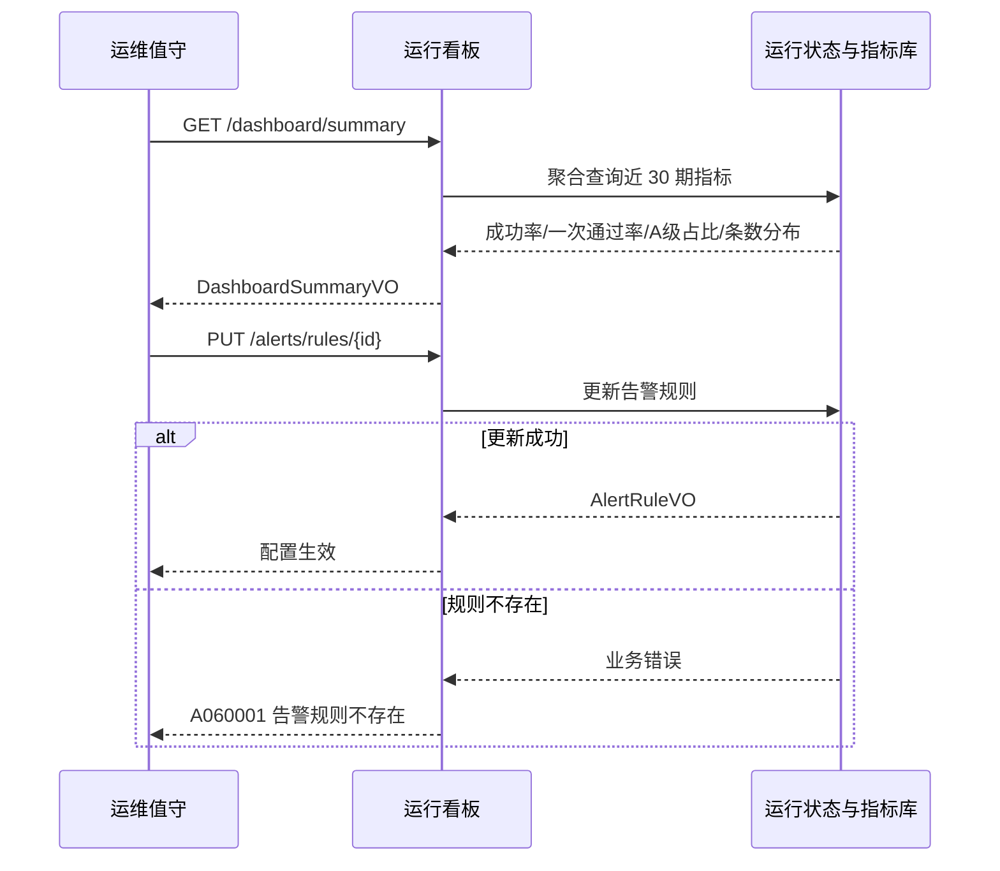

##### §3.2.M4.5 关键流程逻辑

无复杂状态机/事务/跨多步异步，仅只读查询与规则配置，本段省略。

---

#### 3.2.M5 生成编排引擎

##### §3.2.M5.1 模块概述

生成编排引擎是**日报生成域核心模块**，覆盖"6 步流程编排与门禁回退"场景，位于业务能力层，业务逻辑在调度触发中心、人工触发端、检索与来源分级、质量门禁与自检之间流动，同时涉及规则治理中心（M10）、外部能力适配层（M11）、运行状态与指标库（M14）。职责：按 D1 定义的 6 步顺序编排，接收门禁 FAIL 项后按 Rubric-Step 映射表回退到对应步骤重跑，循环计数上限 5 次；MVP 以顺序编排跑通，完整版以 LangGraph StateGraph 替换执行引擎（对齐 F5 / F10 / V2）。

##### §3.2.M5.2 接口清单

| 子领域 | 方法 | 路径 | 用途（≤ 20 字） | 请求 DTO | 响应 VO | 幂等 |
| --- | --- | --- | --- | --- | --- | --- |
| 流程编排 | POST | `/internal/orchestrator/run` | 启动 6 步生成流程 | `OrchestratorRunRequest` | `RunTaskDetailVO` | 是（run_id） |
| 流程编排 | GET | `/internal/orchestrator/runs/{run_id}` | 查询流程状态与回退记录 | — | `RunTaskDetailVO` | 天然 |
| 门禁回退 | POST | `/internal/orchestrator/rollback` | 接收门禁 FAIL 回退指令 | `RollbackRequest` | `RollbackVO` | 是（run_id+loop_count） |

##### §3.2.M5.3 关键结构定义（DTO）

```python
class RollbackRequest(BaseRequest):
    # ===== 必填字段 =====
    run_id: str           # 运行任务标识
    loop_count: int       # 当前循环计数（≤5）
    fail_items: list      # 门禁 FAIL 项编号列表

class RollbackVO(BaseResponse):
    # ===== 业务字段 =====
    target_step: int      # 回退目标步骤（1-6）
    loop_count: int       # 回退后循环计数
    # ===== 状态字段 =====
    status: str           # 枚举：RETRYING / MAX_LOOP_EXCEEDED
```

| DTO / VO 名 | 字段名 | 类型 | 必填 | 业务含义 | 约束 / 默认值 |
| --- | --- | --- | --- | --- | --- |
| `RollbackRequest` | `fail_items` | List | 是 | FAIL 项编号 | 1–15 |
| `RollbackVO` | `target_step` | Integer | 是 | 回退目标步骤 | 按映射表计算 |
| `RollbackVO` | `loop_count` | Integer | 是 | 循环计数 | 上限 5 |
| `RollbackVO` | `status` | String | 是 | 回退状态 | 枚举：RETRYING / MAX_LOOP_EXCEEDED |

##### §3.2.M5.4 模块逻辑时序图

| 编号 | 标题（`生成编排引擎 - 6 步流程与门禁回退`） | 场景类别 | 是否包含异常分支 |
| --- | --- | --- | --- |
| SQ-M5-01 | 6 步生成与门禁回退主链路 | 核心动作的执行 / 触发 | 是 |

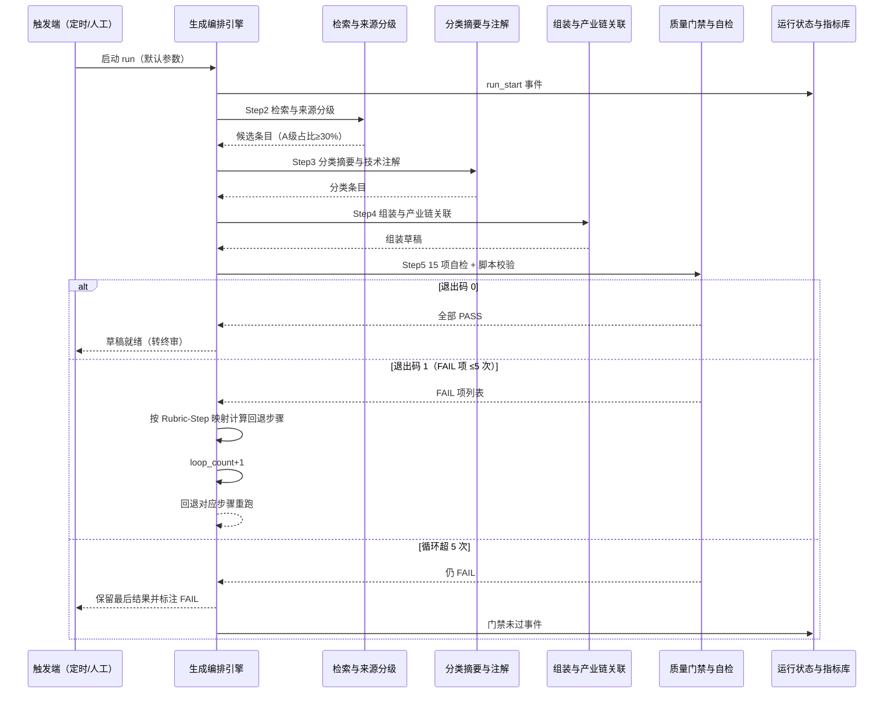

##### §3.2.M5.5 关键流程逻辑

触发：生成任务启动（定时 08:30 / 人工补跑）

Step 1: 范围确认（同步，非交互默认参数）
  ├── 校验：日期范围默认最近一个工作日；关注领域默认 5 环节
  └── 状态变更：INIT → RUNNING

Step 2: 检索与来源分级（同步，调用 M6）
  ├── 校验：A 级占比 ≥ 30%，不足即时补搜
  └── 输出：候选条目（15-20 目标区间）

Step 3: 分类摘要与技术注解（同步，调用 M7）
  ├── 校验：5 环节归类、五要素摘要、技术注解
  └── 输出：分类条目

Step 4: 组装与产业链关联（同步，调用 M8）
  ├── 校验：头部元信息、今日要点、5 环节、关联小节
  └── 输出：组装草稿

Step 5: 门禁自检与脚本校验（同步，调用 M9/M12）
  ├── 校验：15 行自检表显式输出 + 脚本退出码
  ├── 退出码 1 → 按 Rubric-Step 映射回退（#1→Step4、#2→Step2、#4→Step3、#13→Step2 等）
  ├── [MOCK] 状态机断点恢复：MVP 顺序编排无断点续跑
  │     输入：任务中断
  │     规则：完整版由 LangGraph Checkpointer 持久化每步状态
  │     输出：MVP 整期重跑
  │     [完整版替换点] F10 以 StateGraph 替换顺序执行，6 步节点与门禁位置不变
  └── 状态变更：RUNNING → DRAFT_READY / GATE_FAILED / FAILED（循环计数 ≤5）

**状态机迁移表**：

| 起始状态 | 触发事件 | 终止状态 | 触发条件 / 校验 | 副作用 |
| --- | --- | --- | --- | --- |
| INIT | start | RUNNING | 默认参数装载完成 | 记录 run_start 事件 |
| RUNNING | step_complete | RUNNING | 单步完成，未到门禁 | 记录步骤事件 |
| RUNNING | gate_pass | DRAFT_READY | 脚本退出码 0 | 转终审发布台 |
| RUNNING | gate_fail | RUNNING | 退出码 1 且循环低于5 | 按映射表回退，loop+1 |
| RUNNING | gate_fail | GATE_FAILED | 退出码 1 且循环 =5 | 保留最后结果并标注 FAIL |
| RUNNING | exception | FAILED | 任一步异常 | 触发失败告警（≤5min） |

---

#### 3.2.M6 检索与来源分级

##### §3.2.M6.1 模块概述

检索与来源分级覆盖"Step2 搜索+分级+筛选"场景，位于业务能力层，业务逻辑在生成编排引擎、规则治理中心、外部能力适配层之间流动。职责：执行三层检索（A 级站内限定、5 环节双语、技术突破）、URL 域名即时判级、同事件多来源合并、超 72 小时标 [回顾]，A 级占比不足 30% 即时补搜（对齐 F7 / V1）。

##### §3.2.M6.2 接口清单

| 子领域 | 方法 | 路径 | 用途（≤ 20 字） | 请求 DTO | 响应 VO | 幂等 |
| --- | --- | --- | --- | --- | --- | --- |
| 检索执行 | POST | `/internal/search/execute` | 执行三层检索 | `SearchExecuteRequest` | `SearchResultListVO` | 是（run_id+round） |
| 来源分级 | POST | `/internal/search/grade` | 对 URL 域名判级 | `GradeRequest` | `GradeResultListVO` | 天然 |

##### §3.2.M6.3 关键结构定义（DTO）

```python
class SearchExecuteRequest(BaseRequest):
    # ===== 必填字段 =====
    run_id: str            # 运行任务标识
    coverage: str          # 覆盖范围（日期区间）
    domains: list          # 关注领域
    search_round: int      # 检索轮次（≤3，D8 max_search_rounds）

class SearchResultListVO(BaseResponse):
    # ===== 业务字段 =====
    items: list            # 候选条目（title/summary/url/timestamp/level）
    a_level_ratio: float   # A 级占比（%）≥30%
    need_supplement: bool  # 是否需补搜
```

| DTO / VO 名 | 字段名 | 类型 | 必填 | 业务含义 | 约束 / 默认值 |
| --- | --- | --- | --- | --- | --- |
| `SearchExecuteRequest` | `search_round` | Integer | 是 | 检索轮次 | 上限 3 |
| `SearchResultListVO` | `a_level_ratio` | Float | 是 | A 级占比 | 目标 ≥ 30% |
| `SearchResultListVO` | `need_supplement` | Boolean | 是 | 是否补搜 | A级低于30% 为 true |
| `GradeRequest` | `url` | String | 是 | 待判级 URL | 基于域名，不依赖 display text |

##### §3.2.M6.4 模块逻辑时序图

| 编号 | 标题（`检索与来源分级 - 三层检索与补搜`） | 场景类别 | 是否包含异常分支 |
| --- | --- | --- | --- |
| SQ-M6-01 | 三层检索并即时保障 A 级占比 | 核心动作的执行 / 触发 | 是 |

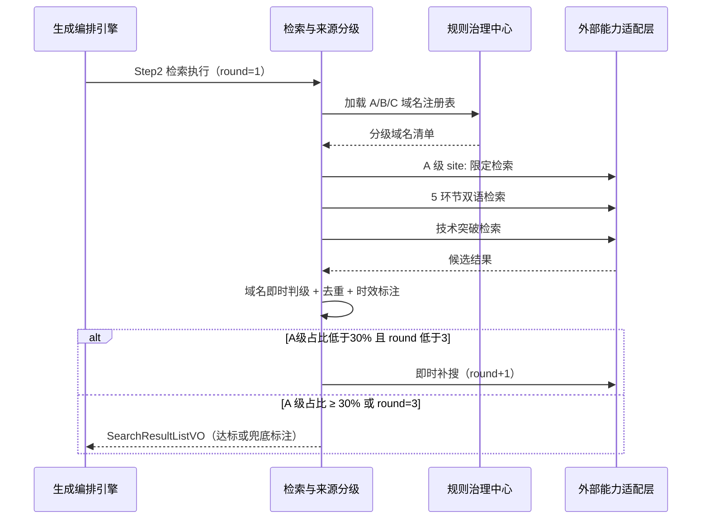

##### §3.2.M6.5 关键流程逻辑

触发：Step2 检索执行（round 从 1 开始）

Step 1: 加载分级域名（同步，调用 M10）
  └── 校验：注册表存在且三副本 diff=0；加载失败回退公开源

Step 2: 三层检索（同步，调用 M11）
  ├── A 级站内限定（确保 A 级 ≥30%）
  ├── 5 环节双语（每环节 ≥1 中 +1 英）
  └── 技术突破（ISSCC/VLSI/DAC/IEDM/Nature）

Step 3: 域名即时判级（同步）
  ├── 校验：基于 URL 域名（防注入，D6 防注入域名判级）
  ├── C 级域名发现即丢弃
  └── 判定：A 级占比 = A / (A+B)

Step 4: 补搜判断（同步）
  ├── 校验：A级占比低于30% 且 round 低于3 → 补搜
  └── round=3 仍不足 → 标"今日权威源不足"兜底

Step 5: 去重与时效（同步）
  ├── 同事件多来源合并并标多链接
  └── 超 72 小时标 [回顾]

---

#### 3.2.M7 分类摘要与技术注解

##### §3.2.M7.1 模块概述

分类摘要与技术注解覆盖"Step3 分类+摘要+技术注解"场景，位于业务能力层，业务逻辑在检索与来源分级、规则治理中心、外部能力适配层之间流动。职责：按 5 环节归类、生成五要素摘要（主体+事件+数据+影响+技术维度）、对非直观术语添加 `[技术注解: xxx]`（对齐 V4 / V5，X9/X10/X11 裁决落点）。

##### §3.2.M7.2 接口清单

| 子领域 | 方法 | 路径 | 用途（≤ 20 字） | 请求 DTO | 响应 VO | 幂等 |
| --- | --- | --- | --- | --- | --- | --- |
| 分类摘要 | POST | `/internal/content/classify` | 按 5 环节归类 | `ClassifyRequest` | `ClassifyResultListVO` | 是（run_id+item_id） |
| 技术注解 | POST | `/internal/content/annotate` | 生成技术注解 | `AnnotateRequest` | `AnnotateResultListVO` | 是（run_id+item_id） |

##### §3.2.M7.3 关键结构定义（DTO）

```python
class ClassifyRequest(BaseRequest):
    # ===== 必填字段 =====
    run_id: str            # 运行任务标识
    items: list            # 待分类条目列表
    segment_rules: dict    # 环节判定规则（来自 M10）

class AnnotateResultListVO(BaseResponse):
    # ===== 业务字段 =====
    items: list            # 条目（含 segment/tech_note/annotations）
    # ===== 状态字段 =====
    status: str            # 枚举：OK / PARTIAL_SKIP
```

| DTO / VO 名 | 字段名 | 类型 | 必填 | 业务含义 | 约束 / 默认值 |
| --- | --- | --- | --- | --- | --- |
| `ClassifyRequest` | `segment_rules` | Dict | 是 | 环节判定规则 | 来自 M10 注册表 |
| `AnnotateResultListVO` | `items` | List | 是 | 分类条目 | 含 5 环节归属 |
| `AnnotateResultListVO` | `status` | String | 是 | 状态 | 枚举：OK / PARTIAL_SKIP |

##### §3.2.M7.4 模块逻辑时序图

| 编号 | 标题（`分类摘要与技术注解 - 归类与注解生成`） | 场景类别 | 是否包含异常分支 |
| --- | --- | --- | --- |
| SQ-M7-01 | 5 环节归类并生成摘要与技术注解 | 核心动作的执行 / 触发 | 是 |

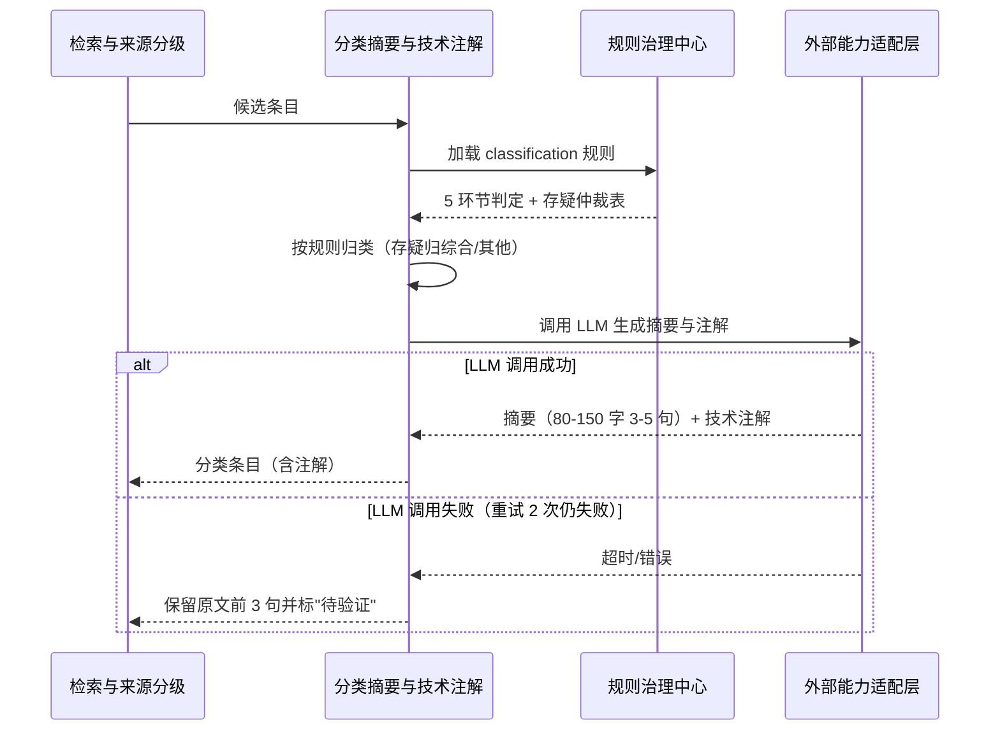

##### §3.2.M7.5 关键流程逻辑

触发：Step3 分类摘要执行

Step 1: 加载分类规则（同步，调用 M10）
  ├── 校验：classification.md 裁决条款（X9/X10/X11 已固化）
  └── 存疑归"综合/其他"，不强行塞入不相关环节

Step 2: 5 环节归类（同步）
  ├── 设计：GPU/CPU/AI 芯片产品、架构、IP 授权
  ├── 制造：晶圆代工、制程、产能、HBM 制造（X9 裁决）
  ├── 封测：封装工艺、测试方案、封测厂动态
  ├── EDA/工具：EDA 软件、设计自动化工具、AI 辅助设计
  ├── 材料/设备：硅片、特气、光刻胶、光刻机、设备市场
  └── 不纳入：股价/财经分析、软件平台、AI 大模型发布（X11 裁决）

Step 3: 摘要生成（同步，调用 M11 LLM）
  ├── 校验：五要素（主体+事件+数据+影响+技术维度）
  ├── 句数 3-5 句 PASS（X3 裁决）、80-150 字
  └── 过长回退 Step 3 重新压缩（X4 裁决）

Step 4: 技术注解（同步）
  ├── 校验：扫描 6 类术语（GAA/HBM4/CoWoS/Chiplet/EUV/存算一体等 43 词）
  └── 涉术语新闻必须注解，否则 FAIL（F11 语义层完整版自动判定）

---

#### 3.2.M8 组装与产业链关联

##### §3.2.M8.1 模块概述

组装与产业链关联覆盖"Step4 组装日报"场景，位于业务能力层，业务逻辑在分类摘要与技术注解、质量门禁与自检之间流动。职责：按固定模板组装头部元信息、今日要点、5 环节、产业链关联小节与自检表占位；一次性检查 10 项易错项；产业链关联为事实传导逻辑而非投资建议（对齐 V5，X13/X14/X15/X16 格式裁决落点）。

##### §3.2.M8.2 接口清单

| 子领域 | 方法 | 路径 | 用途（≤ 20 字） | 请求 DTO | 响应 VO | 幂等 |
| --- | --- | --- | --- | --- | --- | --- |
| 组装 | POST | `/internal/assembly/assemble` | 组装日报草稿 | `AssembleRequest` | `AssembleResultVO` | 是（run_id） |
| 关联生成 | POST | `/internal/assembly/chain` | 生成产业链关联小节 | `ChainRequest` | `ChainResultVO` | 是（run_id） |

##### §3.2.M8.3 关键结构定义（DTO）

```python
class AssembleRequest(BaseRequest):
    # ===== 必填字段 =====
    run_id: str            # 运行任务标识
    classified_items: list # 分类条目
    coverage: str          # 覆盖范围
    # ===== 可选字段 =====
    highlight: list        # 今日要点（1-3 条）
    chain_links: list      # 产业链关联组（≥2 组）
```

| DTO / VO 名 | 字段名 | 类型 | 必填 | 业务含义 | 约束 / 默认值 |
| --- | --- | --- | --- | --- | --- |
| `AssembleRequest` | `highlight` | List | 否 | 今日要点 | 1-3 条 |
| `AssembleRequest` | `chain_links` | List | 否 | 产业链关联 | ≥2 组、每组 ≥2 环节 |
| `AssembleResultVO` | `draft_path` | String | 是 | 草稿文件路径 | 草稿目录 |
| `AssembleResultVO` | `check_result` | List | 是 | 10 项易错项检查 | 与 X13-X16 对齐 |

##### §3.2.M8.4 模块逻辑时序图

| 编号 | 标题（`组装与产业链关联 - 组装草稿与关联小节`） | 场景类别 | 是否包含异常分支 |
| --- | --- | --- | --- |
| SQ-M8-01 | 组装日报草稿并生成产业链关联 | 核心实体的创建 / 配置 / 发布 | 是 |

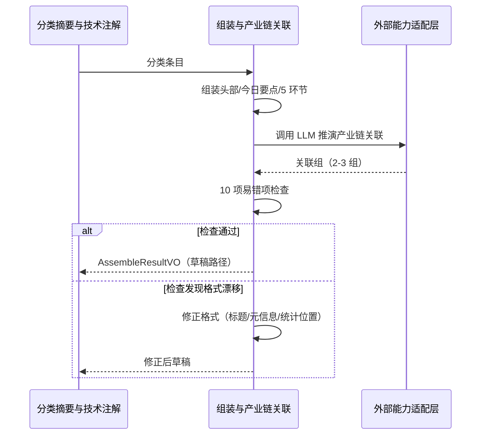

##### §3.2.M8.5 关键流程逻辑

触发：Step4 组装执行

Step 1: 组装头部（同步）
  ├── 一级标题附日期：`# 芯片行业日报 — 年月日`（X16 裁决）
  └── blockquote 三行：生成时间/覆盖范围/新闻总数（半角冒号）

Step 2: 组装正文（同步）
  ├── 今日要点 1-3 条
  ├── 5 环节标题全称：`## 设计`/`## 制造`/`## 封测`/`## EDA / 工具`/`## 材料 / 设备`（X15 裁决）
  └── 无新闻环节标"今日暂无重要动态"

Step 3: 产业链关联（同步，调用 M11）
  ├── 选 2-3 组上下游联动事件（每组 ≥2 环节）
  └── 事实传导逻辑，不掺投资建议

Step 4: 自检表占位（同步）
  ├── 15 行脚本口径自检表（X5/X6 裁决）
  └── 来源分级统计置于自检结果小节内（X14 裁决）

Step 5: 10 项易错项检查（同步）
  └── 与 X13/X15/X16 格式裁决对齐，发现漂移即时修正

---

#### 3.2.M9 质量门禁与自检

##### §3.2.M9.1 模块概述

质量门禁与自检是**发布拦截的关键闸口**，覆盖"Step5 Rubric 自检 + 脚本校验"场景，位于业务能力层，业务逻辑在组装与产业链关联、硬校验器、生成编排引擎、终审发布台之间流动。职责：显式输出 15 行自检表后调用硬校验器（M12），退出码 1 则产物停留草稿态且发布动作禁用；完整版在门禁网关后接入语义校验层（F11），但硬门禁始终由脚本兜底（对齐 F6 / V1 / V2）。

##### §3.2.M9.2 接口清单

| 子领域 | 方法 | 路径 | 用途（≤ 20 字） | 请求 DTO | 响应 VO | 幂等 |
| --- | --- | --- | --- | --- | --- | --- |
| 门禁执行 | POST | `/internal/gate/run` | 执行 15 项硬门禁 | `GateRunRequest` | `GateResultVO` | 是（run_id） |
| 门禁查询 | GET | `/internal/gate/runs/{run_id}` | 查询门禁结果明细 | — | `GateResultVO` | 天然 |
| 语义校验 | POST | `/internal/gate/semantic` | 语义质量抽检（完整版） | `SemanticCheckRequest` | `SemanticCheckVO` | 是（run_id） |

##### §3.2.M9.3 关键结构定义（DTO）

```python
class GateResultVO(BaseResponse):
    # ===== 基本信息 =====
    run_id: str            # 运行任务标识
    exit_code: int         # 校验器退出码（0/1）
    # ===== 业务字段 =====
    check_items: list      # 15 项逐项结果（PASS/FAIL/WARN）
    a_level_ratio: float   # A 级占比（%）
    fail_items: list       # FAIL 项编号
    # ===== 状态字段 =====
    status: str            # 枚举：PASS / FAIL
```

| DTO / VO 名 | 字段名 | 类型 | 必填 | 业务含义 | 约束 / 默认值 |
| --- | --- | --- | --- | --- | --- |
| `GateResultVO` | `exit_code` | Integer | 是 | 校验器退出码 | 0=通过 / 1=拦截 |
| `GateResultVO` | `check_items` | List | 是 | 15 项结果 | PASS/FAIL/WARN |
| `GateResultVO` | `fail_items` | List | 是 | FAIL 项编号 | 供回退映射使用 |
| `GateResultVO` | `status` | String | 是 | 门禁状态 | 枚举：PASS / FAIL |

##### §3.2.M9.4 模块逻辑时序图

| 编号 | 标题（`质量门禁与自检 - 15 项硬门禁执行`） | 场景类别 | 是否包含异常分支 |
| --- | --- | --- | --- |
| SQ-M9-01 | 执行 15 项自检与脚本校验 | 核心动作的执行 / 触发 | 是 |

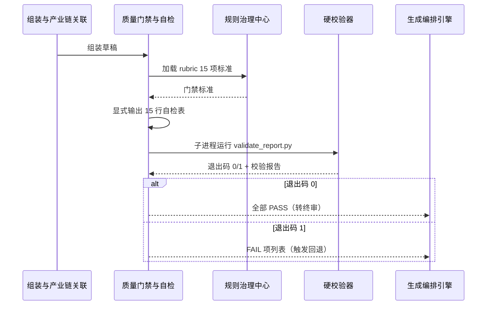

##### §3.2.M9.5 关键流程逻辑

触发：Step5 门禁执行

Step 1: 加载 rubric（同步，调用 M10）
  └── 校验：15 项标准与脚本口径一致（X5 裁决）

Step 2: 显式输出自检表（同步）
  └── 校验：15 行表格显式输出，禁止笼统声称"已自检通过"

Step 3: 脚本硬校验（同步，子进程调用 M12）
  ├── 校验：退出码 0=通过 / 1=拦截
  ├── WARN 级项不阻断但计入指标
  └── 退出码 1 → 产物停留草稿态，发布动作禁用

Step 4: 门禁结果回写（同步写 M14）
  ├── 15 项逐项结果、A 级占比、FAIL 项
  └── 状态变更：GATE_PASS → DRAFT_READY / GATE_FAIL → 回退

Step 5: 语义校验层（完整版 F11，MVP 空钩子）
  ├── [MOCK] 语义质量校验
  │     输入：摘要 / 技术注解 / 分类结果
  │     规则：DeepEval 式评委评估忠实度与正确性
  │     输出：WARN 与抽检报告（先记录不拦截）
  │     [完整版替换点] 门禁网关后接入 F11 钩子，不改调用链
  └── 硬门禁始终由脚本兜底

---

#### 3.2.M10 规则治理中心

##### §3.2.M10.1 模块概述

规则治理中心是**X1–X16 裁决的唯一落点**，覆盖"规则注册表维护与三副本一致性校验"场景，位于基础能力层，业务逻辑在技能维护者、日报生成域各模块之间流动。职责：把 A/B/C 域名分级、15 项 Rubric 定义、分类仲裁条款集中为一份机器可读注册表，向 sources.md / rubric.md / classification.md 与脚本常量单向生成；执行三副本 diff 校验，差异非 0 即阻断（对齐 F1 / F2 / F3 / V1 / V3）。

##### §3.2.M10.2 接口清单

| 子领域 | 方法 | 路径 | 用途（≤ 20 字） | 请求 DTO | 响应 VO | 幂等 |
| --- | --- | --- | --- | --- | --- | --- |
| 注册表 | GET | `/api/v1/rules/registry` | 查询规则注册表 | — | `RuleRegistryVO` | 天然 |
| 注册表 | POST | `/api/v1/rules/registry/generate` | 单向生成三处副本 | `RegistryGenerateRequest` | `RegistryGenerateVO` | 是（X-Idempotency-Key） |
| 一致性校验 | POST | `/api/v1/rules/consistency/check` | 执行三副本 diff 校验 | — | `RuleConsistencyVO` | 是（X-Idempotency-Key） |
| 回归用例 | GET | `/api/v1/rules/regression` | 查询裁决回归用例状态 | — | `RegressionListVO` | 天然 |

##### §3.2.M10.3 关键结构定义（DTO）

```python
class RegistryGenerateRequest(BaseRequest):
    # ===== 必填字段 =====
    registry_version: str   # 注册表版本（v5.1...）
    targets: list           # 生成目标：sources/rubric/classification/script

class RuleConsistencyVO(BaseResponse):
    # ===== 业务字段 =====
    diff_count: int         # 三副本 diff 差异数
    a_level_diff: int       # 域名双向差集数
    result: str             # 枚举：PASS / FAIL
    # ===== 时间字段 =====
    checked_time: str       # 校验时间
```

| DTO / VO 名 | 字段名 | 类型 | 必填 | 业务含义 | 约束 / 默认值 |
| --- | --- | --- | --- | --- | --- |
| `RegistryGenerateRequest` | `registry_version` | String | 是 | 注册表版本 | 语义化版本 |
| `RegistryGenerateRequest` | `targets` | List | 是 | 生成目标 | 四类目标 |
| `RuleConsistencyVO` | `diff_count` | Integer | 是 | 三副本 diff 数 | 目标 = 0 |
| `RuleConsistencyVO` | `a_level_diff` | Integer | 是 | 域名双向差集 | 目标 = 0 |
| `RuleConsistencyVO` | `result` | String | 是 | 校验结果 | 枚举：PASS / FAIL |

##### §3.2.M10.4 模块逻辑时序图

| 编号 | 标题（`规则治理中心 - 注册表生成与一致性校验`） | 场景类别 | 是否包含异常分支 |
| --- | --- | --- | --- |
| SQ-M10-01 | 修订注册表并生成三副本 | 核心实体的创建 / 配置 / 发布 | 是 |

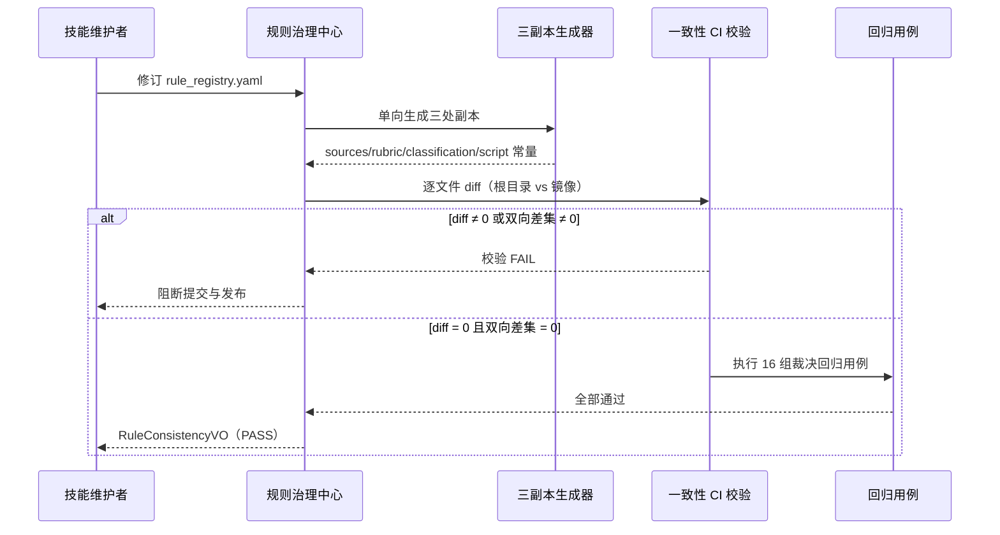

##### §3.2.M10.5 关键流程逻辑

触发：规则修订提交

Step 1: 修订注册表（同步）
  ├── 校验：YAML 语法与 Schema 校验
  └── 状态变更：registry_version 递增

Step 2: 单向生成（同步）
  ├── 生成 sources.md（业务权威，人读）
  ├── 生成 rubric.md（15 项按脚本口径重排，X5 裁决）
  ├── 生成 classification.md（含 X9/X10/X11 仲裁）
  └── 生成脚本 A_LEVEL_DOMAINS 常量（执行权威，X7 裁决）

Step 3: 一致性校验（同步）
  ├── 校验：根目录 vs `.trae` 镜像逐文件 diff
  ├── 校验：脚本域名清单 vs sources.md 双向差集
  └── diff ≠ 0 → CI 阻断提交与发布（F2）

Step 4: 回归用例（同步）
  ├── 16 组裁决各 ≥1 条回归用例
  └── 全部通过才允许合并

**状态机迁移表**：

| 起始状态 | 触发事件 | 终止状态 | 触发条件 / 校验 | 副作用 |
| --- | --- | --- | --- | --- |
| REGISTRY_DRAFT | generate | REGISTRY_GENERATED | Schema 校验通过 | 生成三处副本 |
| REGISTRY_GENERATED | diff_check | CONSISTENT | diff=0 且差集=0 | 放行合并 |
| REGISTRY_GENERATED | diff_check | INCONSISTENT | diff≠0 或差集≠0 | CI 阻断 |
| CONSISTENT | regression | REGRESSION_PASS | 16 组用例全过 | 规则收敛 |

---

#### 3.2.M11 外部能力适配层

##### §3.2.M11.1 模块概述

外部能力适配层是**ACL 防腐层**，覆盖"对外部检索、网页抓取、LLM 推理的适配与隔离"场景，位于基础能力层，业务逻辑在检索与来源分级、分类摘要与技术注解、组装与产业链关联之间流动。职责：统一封装外部 API 调用、超时重试、降级兜底；外部模型变化不污染本域（对齐 C-02 上下文映射，N2 数据不出域）。

##### §3.2.M11.2 接口清单

| 子领域 | 方法 | 路径 | 用途（≤ 20 字） | 请求 DTO | 响应 VO | 幂等 |
| --- | --- | --- | --- | --- | --- | --- |
| 检索适配 | POST | `/internal/adapter/search` | 封装公开检索 API | `AdapterSearchRequest` | `AdapterSearchResultVO` | 是（X-Idempotency-Key） |
| 抓取适配 | POST | `/internal/adapter/fetch` | 封装网页抓取 | `AdapterFetchRequest` | `AdapterFetchResultVO` | 是（X-Idempotency-Key） |
| LLM 适配 | POST | `/internal/adapter/llm` | 封装 LLM 推理调用 | `AdapterLLMRequest` | `AdapterLLMResultVO` | 是（X-Idempotency-Key） |

##### §3.2.M11.3 关键结构定义（DTO）

```python
class AdapterLLMRequest(BaseRequest):
    # ===== 必填字段 =====
    model: str            # 模型标识（OpenAI 兼容）
    messages: list        # 对话消息（仅传检索所得公开正文）
    max_tokens: int       # 单期 token 预算封顶
    # ===== 可选字段 =====
    temperature: float    # 采样温度

class AdapterLLMResultVO(BaseResponse):
    # ===== 业务字段 =====
    content: str          # 生成内容（摘要/注解/关联）
    usage: dict           # token 用量
    # ===== 状态字段 =====
    status: str           # 枚举：OK / RETRY_EXHAUSTED
```

| DTO / VO 名 | 字段名 | 类型 | 必填 | 业务含义 | 约束 / 默认值 |
| --- | --- | --- | --- | --- | --- |
| `AdapterLLMRequest` | `messages` | List | 是 | 对话消息 | 仅检索公开正文，不外传规则与元数据 |
| `AdapterLLMRequest` | `max_tokens` | Integer | 是 | token 预算封顶 | 单期封顶 |
| `AdapterLLMResultVO` | `status` | String | 是 | 调用状态 | 枚举：OK / RETRY_EXHAUSTED |

##### §3.2.M11.4 模块逻辑时序图

| 编号 | 标题（`外部能力适配层 - LLM 调用与降级`） | 场景类别 | 是否包含异常分支 |
| --- | --- | --- | --- |
| SQ-M11-01 | LLM 推理调用与超时重试 | 核心动作的执行 / 触发 | 是 |

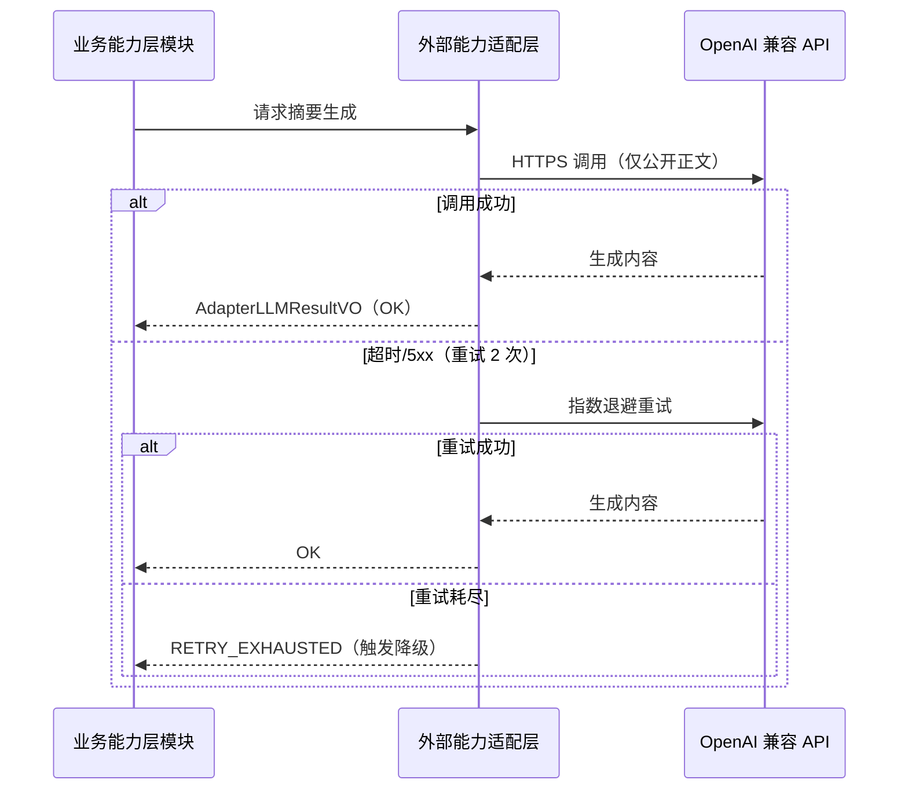

##### §3.2.M11.5 关键流程逻辑

触发：业务层调用外部能力

Step 1: 检索适配（同步）
  ├── 校验：单期检索轮次上限 3（D8 max_search_rounds）
  ├── 无结果切备用引擎重试 1 次
  └── 超时 15s → 标"链接待验证"

Step 2: 抓取适配（同步）
  ├── 校验：仅公开可访问页面，付费墙丢弃
  └── 单页超时 15s → 保留标题摘要

Step 3: LLM 适配（同步）
  ├── 校验：仅传检索所得公开正文，不外传规则文件与运行元数据
  ├── 超时 30s，重试 2 次指数退避（1s/2s）
  └── 重试耗尽 → 降级（保留原文前 3 句 / 跳过注解）

Step 4: 出域控制（横切）
  ├── 校验：仅允许白名单域名（E-01/E-02/E-03）
  └── 其他域名一律拒绝（§6.2.2 出域白名单）

---

#### 3.2.M12 硬校验器

##### §3.2.M12.1 模块概述

硬校验器是**既有资产复用的核心组件**（`scripts/validate_report.py`，768 行 Python 3 零第三方依赖），覆盖"15 项硬门禁自动校验"场景，位于基础能力层，业务逻辑在质量门禁与自检（M9）之间流动。职责：作为唯一硬门禁执行权威，退出码 1 即拦截发布（对齐 N3 / F6 / V1，X5 裁决"以脚本为执行权威"）。

##### §3.2.M12.2 接口清单

| 子领域 | 方法 | 路径 | 用途（≤ 20 字） | 请求 DTO | 响应 VO | 幂等 |
| --- | --- | --- | --- | --- | --- | --- |
| 硬校验 | CLI | `python validate_report.py 日报文件路径` | 15 项硬门禁校验 | 文件路径参数 | 退出码 0/1 + 报告 | 天然 |

##### §3.2.M12.3 关键结构定义（DTO）

本模块为 CLI 脚本，无 REST DTO。校验报告为 stdout 文本，关键字段：

| 输出字段 | 类型 | 业务含义 | 约束 |
| --- | --- | --- | --- |
| `校验报告 v5.0` | Text | 15 个检查块 | 头部横幅 |
| `all_pass` | Boolean | 全部通过标志 | false → 退出码 1 |
| `WARN 项` | List | 不阻断但计入指标 | 摘要 6 句 / 无 URL / 缺分隔线 / 疑似重复 |

##### §3.2.M12.4 模块逻辑时序图

| 编号 | 标题（`硬校验器 - 15 项硬门禁校验`） | 场景类别 | 是否包含异常分支 |
| --- | --- | --- | --- |
| SQ-M12-01 | 校验脚本执行与退出码判定 | 核心动作的执行 / 触发 | 是 |

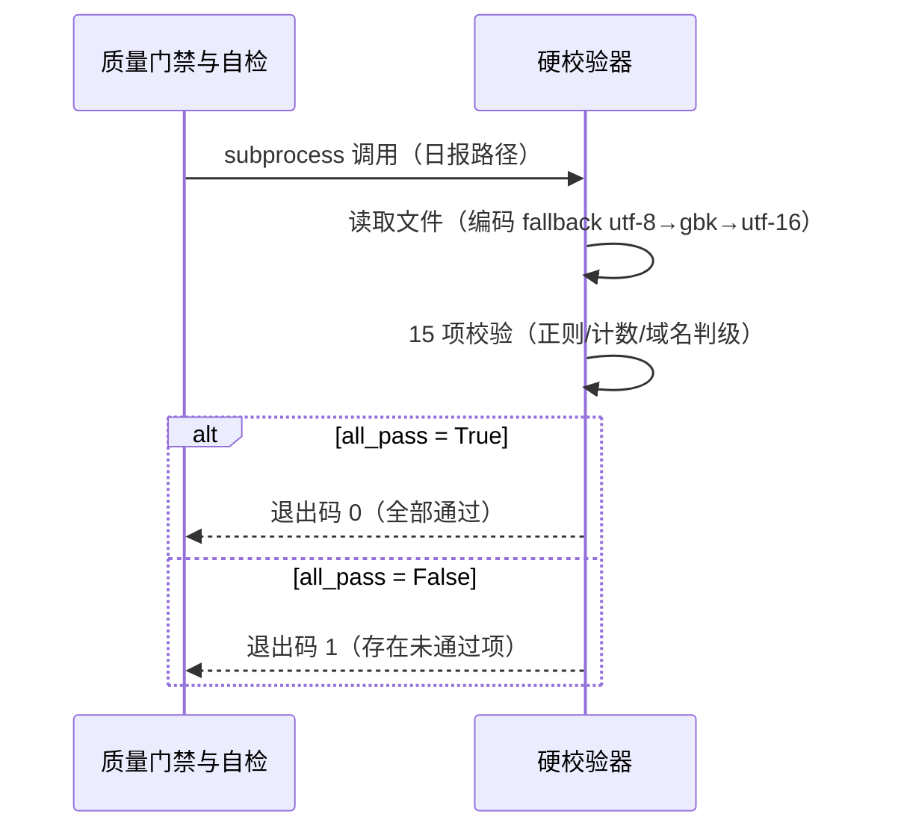

##### §3.2.M12.5 关键流程逻辑

触发：门禁网关调用

Step 1: 读取文件（同步）
  ├── 校验：路径存在 + 编码 fallback（utf-8→gbk→utf-16）
  └── 读取失败 → sys.exit(1)

Step 2: 15 项校验（同步，纯规则）
  ├── 元信息完整 / 产业链完整 / 来源可追溯 / 摘要句数 / 时效性 / 今日要点 / 自检表 / 无越界附录 / 中立性 / A 级占比 / 免责声明 / 章节顺序 / 去重 / 技术注解 / 产业链关联
  └── A 级占比分母 = A/(A+B)（X13 裁决口径）

Step 3: 退出码判定（同步）
  ├── all_pass → 退出码 0
  └── 存在 FAIL → 退出码 1（发布拦截）

---

#### 3.2.M13 产物归档库

##### §3.2.M13.1 模块概述

产物归档库覆盖"日报落盘与命名"场景，位于基础能力层，业务逻辑在终审发布台、读者、跨期去重之间流动。职责：已发布日报写入归档目录，命名固定为 `芯片行业日报_年月日.md`；未通过门禁的产物只能写入草稿目录；完整版基于归档建立近 14 期事件指纹库支撑跨期去重（F12）（对齐 F8 / V2）。

##### §3.2.M13.2 接口清单

| 子领域 | 方法 | 路径 | 用途（≤ 20 字） | 请求 DTO | 响应 VO | 幂等 |
| --- | --- | --- | --- | --- | --- | --- |
| 归档 | POST | `/internal/archive/write` | 写入草稿或归档 | `ArchiveWriteRequest` | `ArchiveWriteVO` | 是（report_id+version） |
| 读取 | GET | `/internal/archive/read/{report_id}` | 读取日报内容 | — | `ArchiveReadVO` | 天然 |
| 指纹库 | POST | `/internal/archive/fingerprint` | 生成事件指纹（完整版） | `FingerprintRequest` | `FingerprintVO` | 是（report_id） |

##### §3.2.M13.3 关键结构定义（DTO）

```python
class ArchiveWriteRequest(BaseRequest):
    # ===== 必填字段 =====
    report_id: str        # 日报标识
    content: str          # 日报 Markdown 内容
    target: str           # 枚举：draft / published
    # ===== 可选字段 =====
    publish_note: str     # 发布备注
```

| DTO / VO 名 | 字段名 | 类型 | 必填 | 业务含义 | 约束 / 默认值 |
| --- | --- | --- | --- | --- | --- |
| `ArchiveWriteRequest` | `target` | String | 是 | 写入目标 | 枚举：draft / published |
| `ArchiveWriteRequest` | `content` | String | 是 | 日报内容 | Markdown |
| `ArchiveWriteVO` | `file_path` | String | 是 | 落盘路径 | `芯片行业日报_年月日.md` |

##### §3.2.M13.4 模块逻辑时序图

| 编号 | 标题（`产物归档库 - 发布归档与跨期指纹`） | 场景类别 | 是否包含异常分支 |
| --- | --- | --- | --- |
| SQ-M13-01 | 发布归档与命名 | 核心实体的创建 / 配置 / 发布 | 是 |

```mermaid
sequenceDiagram
    participant CON as 终审发布台
    participant ARCH as 产物归档库
    CON->>ARCH: 发布写入（published）
    ARCH->>ARCH: 命名 芯片行业日报_年月日.md
    ARCH->>ARCH: 写入归档目录
    alt 写入成功
        ARCH-->>CON: ArchiveWriteVO（file_path）
    else 磁盘满/路径异常
        ARCH-->>CON: 归档失败（告警）
    end
```

##### §3.2.M13.5 关键流程逻辑

触发：终审确认发布

Step 1: 命名（同步）
  └── 校验：固定命名 `芯片行业日报_YYYYMMDD.md`

Step 2: 写入（同步）
  ├── 校验：target=draft 仅写草稿目录；target=published 写归档目录
  └── 未通过门禁只能写草稿目录

Step 3: 跨期指纹（完整版 F12，MVP 空钩子）
  ├── [MOCK] 事件指纹库
  │     输入：已发布日报条目
  │     规则：近 14 期滚动窗口指纹比对
  │     输出：跨期重复事件合并或标注回顾
  │     [完整版替换点] 归档库文件订阅 + 指纹索引
  └── 状态变更：发布事件回写 M14

---

#### 3.2.M14 运行状态与指标库

##### §3.2.M14.1 模块概述

运行状态与指标库覆盖"运行事件与质量指标持久化"场景，位于基础能力层，业务逻辑在生成编排引擎、质量门禁与自检、运行看板、调度触发中心之间流动。职责：持久化运行事件、门禁结果、指标聚合、告警事件；支撑看板查询与告警判定（指标保留 90 天，对齐 F9 / F14 / V2 / V5）。

##### §3.2.M14.2 接口清单

| 子领域 | 方法 | 路径 | 用途（≤ 20 字） | 请求 DTO | 响应 VO | 幂等 |
| --- | --- | --- | --- | --- | --- | --- |
| 事件写入 | POST | `/internal/metrics/event` | 记录运行事件 | `MetricEventRequest` | `Result` | 是（event_id） |
| 指标聚合 | GET | `/internal/metrics/aggregate` | 聚合看板指标 | `MetricAggregateRequest` | `MetricAggregateVO` | 天然 |
| 告警判定 | POST | `/internal/metrics/alert-eval` | 判定告警规则 | `AlertEvalRequest` | `AlertEvalVO` | 是（event_id） |

##### §3.2.M14.3 关键结构定义（DTO）

```python
class MetricEventRequest(BaseRequest):
    # ===== 必填字段 =====
    event_id: str         # 事件标识（幂等键）
    run_id: str           # 运行任务标识
    event_type: str       # 枚举：RUN_START/STEP/GATE/PUBLISH/ALERT
    payload: dict         # 事件载荷（步骤/门禁/指标）
```

| DTO / VO 名 | 字段名 | 类型 | 必填 | 业务含义 | 约束 / 默认值 |
| --- | --- | --- | --- | --- | --- |
| `MetricEventRequest` | `event_type` | String | 是 | 事件类型 | 枚举：RUN_START / STEP / GATE / PUBLISH / ALERT |
| `MetricEventRequest` | `payload` | Dict | 是 | 事件载荷 | JSON |
| `MetricAggregateVO` | `window_days` | Integer | 是 | 聚合窗口 | 90 天 |
| `AlertEvalVO` | `matched_rules` | List | 是 | 命中告警规则 | 与 §8.4 一致 |

##### §3.2.M14.4 模块逻辑时序图

| 编号 | 标题（`运行状态与指标库 - 事件落库与告警判定`） | 场景类别 | 是否包含异常分支 |
| --- | --- | --- | --- |
| SQ-M14-01 | 运行事件持久化与告警判定 | 核心动作的执行 / 触发 | 是 |

```mermaid
sequenceDiagram
    participant GEN as 生成编排引擎
    participant MET as 运行状态与指标库
    participant DASH as 运行看板
    participant ALERT as 告警通知
    GEN->>MET: 写入运行事件（run_start/step/gate）
    MET->>MET: 事件落库（SQLite）
    MET->>ALERT: 告警规则判定
    alt 命中告警（失败/超时/A级不足）
        ALERT->>DASH: 5 分钟内触达运维值守
    else 未命中
        MET-->>DASH: 指标聚合可查
    end
```

##### §3.2.M14.5 关键流程逻辑

触发：运行事件产生

Step 1: 事件落库（同步）
  ├── 校验：event_id 幂等去重（唯一索引）
  └── 写入 t_run_task / t_run_event / t_gate_result

Step 2: 指标聚合（异步，看板查询时聚合）
  ├── 成功率（近 30 期）
  ├── 门禁一次通过率
  ├── A 级占比均值
  ├── 条数分布（15-20 达标占比）
  └── FAIL 项排行

Step 3: 告警判定（异步）
  ├── 校验：任务失败 / 超时（高于30min）/ A级占比低于30%
  └── 命中 → 写入 t_alert_event 并触发通知（≤5min）

Step 4: 保留策略（定时）
  └── 指标保留 90 天，超期清理（§4.2 t_run_event 清理机制）

---

### 3.3 核心业务对象清单

#### 3.3.1 对象定义

| 编号 | 对象名（代码类名） | 对象类型 | 包路径 | 模块归属 | 被哪些模块复用 | 实例化策略 | 序列化约定 | 持久化策略 |
| --- | --- | --- | --- | --- | --- | --- | --- | --- |
| O-01 | `RunTask` | 聚合根 | `backend.common.dto` | M5 | M1 / M2 / M5 / M14 | 工厂方法 `RunTaskFactory.create()` | JSON | 落表 → `t_run_task` |
| O-02 | `RunEvent` | 实体 | `backend.metrics.domain` | M14 | M5 / M9 / M14 | 由事件采集器创建 | JSON | 落表 → `t_run_event` |
| O-03 | `ReportMeta` | 聚合根 | `backend.archive.domain` | M13 | M3 / M13 / M4 | 由发布动作创建 | JSON | 落表 → `t_report_meta` |
| O-04 | `GateResult` | 实体 | `backend.gate.domain` | M9 | M5 / M9 / M14 | 由门禁执行创建 | JSON | 落表 → `t_gate_result` |
| O-05 | `NewsItem` | 实体 | `backend.content.domain` | M7 | M6 / M7 / M8 | 由分类摘要创建 | JSON | 落表 → `t_news_item` |
| O-06 | `RuleConsistency` | 实体 | `backend.rules.domain` | M10 | M10 / M4 | 由一致性校验创建 | JSON | 落表 → `t_rule_consistency` |
| O-07 | `AlertEvent` | 实体 | `backend.metrics.domain` | M14 | M14 / M4 | 由告警判定创建 | JSON | 落表 → `t_alert_event` |
| O-08 | `RuleRegistry` | 聚合根 | `backend.rules.domain` | M10 | M6 / M7 / M9 / M10 | 从 YAML 装载 | YAML + JSON | 落表 → `t_rule_registry` |
| O-09 | `PublishAction` | 值对象 | `backend.console.domain` | M3 | M3 / M13 | new（不可变） | JSON | 嵌入字段（report_id + version） |

**对象类型说明**：

| 类型 | 含义 |
| --- | --- |
| 聚合根（Aggregate Root） | 业务一致性边界（RunTask / ReportMeta / RuleRegistry） |
| 实体（Entity） | 有标识、生命周期独立（RunEvent / GateResult / NewsItem / RuleConsistency / AlertEvent） |
| 值对象（Value Object） | 无标识、不可变（PublishAction） |
| 防腐层 ACL | 外部能力适配层（M11），与 §2.2 C-02 关系对齐 |

#### 3.3.2 命名漂移登记表

| 业务实体（§2） | 代码类名（§3.3.1） | 数据表名（§4.2） | 漂移原因 |
| --- | --- | --- | --- |
| 生成任务 | `RunTask` | `t_run_task` | 业务实体与表名一致，无漂移（仅登记口径统一） |
| 日报产物 | `ReportMeta` | `t_report_meta` | 正文存文件系统，库表仅存元信息，故表名带 `_meta` 后缀 |

---

### 3.4 跨模块公共能力

| 公共能力 | 简述 | 提供方（SDK / 切面 / Bean） | 被哪些模块复用 | 接入方式 |
| --- | --- | --- | --- | --- |
| 统一响应与错误码 | 全局 Result 结构与 6 位错误码 | `backend.common.dto.Result` + `backend.common.errors.GlobalExceptionHandler` | 全部业务模块 | 函数返回 + 异常捕获 |
| 幂等去重 | 写入类接口幂等键校验 | `backend.common.middleware.IdempotencyMiddleware` | M1/M2/M3/M5/M9/M10/M11/M13/M14 | 中间件拦截 `X-Idempotency-Key` |
| 链路追踪 | traceId 生成与透传 | `backend.common.middleware.TraceMiddleware`（OpenTelemetry） | 全部业务模块 | 中间件 + HTTP Header 透传 |
| 出域白名单 | 外部调用域名白名单校验 | `backend.adapter.egress.EgressGuard` | M11 全部适配器 | 适配层入口统一校验 |
| 运行上下文 | 跨步骤共享上下文 | `backend.common.dto.RunContext` | M5~M9 | 依赖注入 |
| 审计日志 | 关键操作留痕（发布/规则变更） | `backend.common.aspect.AuditLogAspect` | M3 / M10 | AOP 切面，注解 `@AuditLog` |

---

### 3.5 接口契约

> 本系统对外暴露的接口在错误码、幂等、限流、超时上的全局约定。**所有接口必须遵守，不在每个接口下重复声明**。

#### 3.5.1 全局错误码体系

**错误码格式**：

| 项 | 取值 |
| --- | --- |
| 错误码格式 | 6 位字符串，例 `A010001` |
| 分段规则 | 1 位类别 + 2 位模块 + 3 位错误序号 |
| 类别取值 | `A` = 业务错误（HTTP 200，业务语义失败）/ `B` = 系统错误（HTTP 5xx）/ `C` = 客户端错误（HTTP 4xx） |

**模块编号映射**（2 位）：01=调度/触发、02=生成编排、03=检索、04=分类摘要、05=组装、06=门禁、07=规则治理、08=外部适配、09=归档、10=看板/指标、99=全局。

**错误响应统一结构**：

```json
{
  "code": "A010001",
  "msg": "日报草稿不存在",
  "msgI18n": { "zh-CN": "日报草稿不存在", "en-US": "Draft report not found" },
  "data": null,
  "traceId": "abc123",
  "timestamp": "2026-08-07T08:30:00.000Z"
}
```

**错误码注册表**（每模块登记关键业务错误 + 全局通用错误）：

| 错误码 | HTTP 状态 | 所属模块 | 含义 | 重试建议 | 用户文案 |
| --- | --- | --- | --- | --- | --- |
| A010001 | 200 | M2/M3 | 日报草稿不存在 | 不重试 | 日报草稿不存在，请刷新列表 |
| A010002 | 200 | M3 | 门禁未通过禁止发布 | 不重试 | 日报存在未通过检查项，发布已禁用 |
| A020001 | 200 | M5 | 生成任务不存在 | 不重试 | 生成任务不存在 |
| A020002 | 200 | M5 | 门禁循环超 5 次 | 不重试 | 门禁重试已达上限，产物停留草稿态 |
| A030001 | 200 | M6 | A 级占比不足且补搜耗尽 | 不重试 | 权威源占比不足，已标注兜底 |
| A070001 | 200 | M10 | 规则注册表版本冲突 | 不重试 | 规则版本冲突，请刷新后重试 |
| A100001 | 200 | M4 | 告警规则不存在 | 不重试 | 告警规则不存在 |
| B999001 | 500 | 全局 | 系统内部错误 | 可重试 | 系统繁忙，请稍后再试 |
| C400001 | 400 | 全局 | 参数校验失败 | 不重试 | 参数错误 |
| C401001 | 401 | 全局 | 未登录 | 不重试 | 请重新登录 |
| C403001 | 403 | 全局 | 无权限 | 不重试 | 无权访问 |
| C429001 | 429 | 全局 | 触发限流 | 退避后重试 | 操作太频繁，请稍后再试 |

#### 3.5.2 幂等性约定

| 接口类型 | 是否要求幂等 | 幂等键来源（建议） |
| --- | --- | --- |
| 写入类（POST 创建） | 必须幂等（触发生成 / 发布 / 规则生成等均有副作用） | Header `X-Idempotency-Key`（UUID，调用方生成） |
| 更新类（PUT / PATCH） | 必须幂等 | 资源 ID + 版本号（乐观锁） |
| 删除类（DELETE） | 天然幂等 | — |
| 查询类（GET） | 天然幂等 | — |
| 发布 / 门禁 / 归档类 | **强制幂等**（发布属资金级不可重复副作用） | 业务侧请求号（report_id + version / run_id + loop_count） |

**幂等设计需考虑的问题**：

| 问题维度 | 设计要点 |
| --- | --- |
| 幂等键的生命周期 | 保留 90 天（与指标窗口一致），覆盖发布与规则生成场景 |
| 重复请求的语义 | 返回相同响应（幂等命中），不返回"重复提交"错误码 |
| 执行中态的处理 | 第一个请求未返回时，第二个请求返回"处理中"（RUNNING） |
| 失败请求的可重试性 | 失败后允许同一幂等键重试（run_id 不变化） |
| 存储兜底 | SQLite 唯一索引（t_run_task.run_id / t_report_meta.report_id）作为最终防线 |

#### 3.5.3 限流约定

| 维度 | 默认值 | 触发动作 | 调整方式 |
| --- | --- | --- | --- |
| 全局 QPS | 100 | 返回 C429001 | 应用配置 |
| 单用户 QPS | 20 | 返回 C429001 | 应用配置 |
| 单 IP QPS | 50 | 返回 C429001 + 记录审计 | 应用配置 |
| 终审台页面 | 10 | 返回 C429001 | 应用配置 |
| 发布接口 | 单用户 5 次/分钟 | 锁定 15 分钟 | 应用配置 |

**降级策略**：

| 策略项 | 内容 |
| --- | --- |
| 前端退避 | 触发限流后，前端按 `Retry-After` Header 退避重试 |
| 后端记录 | 写入类接口同时记录到运行事件表 |
| 红线联动 | 限流红线与 §5.5 容量水位线"红线"一致 |

#### 3.5.4 默认超时与重试基线

| 调用类型 | 默认超时 | 默认重试 | 重试条件 |
| --- | --- | --- | --- |
| 同步 API（内部） | 3s | 0 次 | — |
| 同步 API（外部 E-01 检索） | 15s | 1 次（切备用引擎） | 无结果 / 网络错误 |
| 同步 API（外部 E-02 抓取） | 15s | 0 次 | 抓取失败标"链接待验证" |
| 同步 API（外部 E-03 LLM） | 30s | 2 次（指数退避 1s/2s） | 仅网络错误 / 5xx |
| 定时任务（整期生成） | 30min | 3 次 | 失败告警，重试不跳过门禁网关 |
| 子进程（校验器） | 60s | 0 次 | 退出码 1 即拦截 |

#### 3.5.5 路由设计规范

**API 路由规范**：

| 维度 | 取值 |
| --- | --- |
| 风格 | RESTful（资源化 URL） |
| 版本控制 | `/api/v1/...`（路径版本） |
| 命名 | 小写 + 中划线（kebab-case） |
| 资源命名 | 名词复数（`/api/v1/reports`） |
| 子资源 | `/api/v1/reports/{report_id}/items/{item_id}` |
| 动作类接口 | `/api/v1/{resource}/{id}/{action}`（POST） |

**前端页面路由清单**：

| 路径 | 页面 / 功能 | 入口角色（§2.3） | 鉴权要求 | 关联模块（§3.2.M{N}） |
| --- | --- | --- | --- | --- |
| `/login` | 登录页 | 全部 | 公开 | — |
| `/review` | 终审台首页 | 日报终审人 | 已登录 + 角色 `reviewer` | M3 |
| `/review/reports/:id` | 草稿终审页 | 日报终审人 | 已登录 + 角色 `reviewer` | M3 |
| `/dashboard` | 看板首页 | 运维值守 / 技能维护者 | 已登录 + 角色 `ops` / `maintainer` | M4 |
| `/dashboard/fail-ranking` | FAIL 归因页 | 运维值守 / 技能维护者 | 已登录 | M4 |
| `/rules/registry` | 规则注册表页 | 技能维护者 | 已登录 + 角色 `maintainer` | M10 |

**前端路由约定**：

| 维度 | 取值 |
| --- | --- |
| 路由模式 | Hash（本地静态页免服务端配置） |
| 命名风格 | 小写 + 中划线（kebab-case） |
| 动态参数 | `/review/reports/:id` |
| 鉴权方式 | 路由元信息 `meta.requireAuth = true` + `meta.roles = [...]`，由全局路由守卫拦截 |
| 嵌套路由 | 终审台：列表页 → 草稿终审页 → 条目校对页 |

> **§3 章节自检（中间确认协议 §2.4）**：
> - §2.1 判定：未命中。接口契约风格（本地 REST + 内部函数 + 子进程）由单节点形态与高层冻结技术选型（LangGraph / Prefect / 既有校验器）直接决定，无并列可替代方案；14 模块清单为高层 §6.2 冻结全集，仅细化不增减。
> - §2.3 反向验证：Q1 若 3 个月后调整接口风格（如引入 gRPC/MQ），返工范围 = §3.2 全部模块接口清单 + §3.5 契约表，切换成本约 2~3 人周（单节点内部调用，无分布式一致性依赖），可控；Q2 用户/客户/监管不可感知——内部通信协议不进入日报产物与对外 SLA；Q3 用户诉求"生成完整架构方案"与高层冻结选型一致，本层未新增或删除任何模块，一致。
> - 判定：未命中 §2.2，不发起中间确认。证据归档至附录 A 自检报告。

---

## 4. 数据库设计

> **本章回答**：每个模块的状态用什么表存、表怎么建、数据怎么清理、缓存怎么用。
> **核心方法论**：数据库按业务域组织，业务域与第 2 章 / 第 3 章保持一致，禁止按"用户表 / 订单表 / 日志表"这种横向技术维度组织。

### 4.1 全局数据约定

> 写在所有表设计之前，作为整个项目的**数据基线**。后续每张表的字段类型、命名都必须遵循本节约定。

| 约定项 | 取值 | 说明 |
| --- | --- | --- |
| 数据库类型 | SQLite 3.x（单文件 `cdr.db`） | 运行任务 / 事件 / 门禁结果 / 日报元信息 / 规则一致性 / 告警事件 |
| 命名规范（表名） | `t_xxx` 业务主表；无扩展表与关联表需求 | 全项目统一前缀 `t_` |
| 命名规范（字段名） | 小写 + 下划线（snake_case） | 禁止驼峰 |
| 主键类型 | `INTEGER PRIMARY KEY AUTOINCREMENT`（SQLite） | 全项目统一 |
| 字符集 / 排序 | UTF-8（SQLite 原生） | 支持中文与 emoji |
| 时间字段类型 | `TEXT` 存储 ISO-8601 UTC（`YYYYMMDDTHHMMSS.sssZ`） | 统一精度（毫秒）；统一时区（UTC）；应用层转换显示 |
| 软删除字段 | `deleted TINYINT(1) DEFAULT 0` | 全项目统一，业务删除置 1，定期物理清理 |
| 审计字段 | `created_by / created_time / updated_by / updated_time` | 命名锁定；单实例场景 created_by 记录系统/触发类型 |
| 隔离字段（多租户） | 不启用（单实例单编辑部，经中间确认 U-01 方案B） | 日志与指标仍带 `tenant_id='cdr-single'` 便于未来扩展 |
| 业务唯一标识 | `biz_id VARCHAR(100)` | run_id / report_id / event_id 等业务标识 |
| 状态枚举 | `TEXT` 字符串 | 全项目统一；DDL 注释列出全部取值 |
| 金额字段 | 不适用（本系统无资金类数据） | — |
| 手机号存储 | 不适用（无用户手机号采集） | — |
| 产物正文存储 | 文件系统（`data/archives/`），数据库仅存元信息 | 正文为 Markdown 长文本，文件存储便于直接消费 |

**数据存储选型说明**：选择 SQLite + 本地文件组合，理由：①单节点自托管、数据不出域（N2），SQLite 单文件天然不出域、免独立服务进程；②运行指标量级小于50万行/90 天，SQLite 完全承载看板聚合查询；③Prefect Server 自托管默认支持 SQLite 元数据库，无需额外引入数据库服务；④纯本地文件无法支撑结构化指标聚合，故指标类数据落 SQLite，产物类落文件系统。该选择在任务书给定候选（本地文件 / SQLite / 轻量 DB）内锁定为 SQLite + 本地文件组合。

### 4.2 单表设计

> 每张表严格按 5 段编写：库表元信息 → 库表结构定义 → 索引设计 → DDL → 扩展逻辑（清理机制）。

#### 4.2.1 t_run_task（运行任务表）

**① 库表元信息**

| 字段 | 取值 |
| --- | --- |
| 数据库类型 | SQLite 3.x |
| 库名 | cdr.db |
| 表名 | `t_run_task` |
| 业务含义（≤ 50 字） | 记录每次日报生成任务的运行状态、触发方式、循环计数与终态 |
| 模块归属（§3.2） | M5 生成编排引擎 / M14 运行状态与指标库 |
| 对应核心对象（§3.3） | O-01 RunTask |

**② 库表结构定义**

| 列名 | 数据类型 | 可为空 | 约束 | 默认值 | 备注 |
| --- | --- | --- | --- | --- | --- |
| id | INTEGER | NOT NULL | PRIMARY KEY AUTOINCREMENT |  | 主键 ID |
| run_id | TEXT | NOT NULL | UNIQUE |  | 运行任务业务标识（幂等键） |
| tenant_id | TEXT | NOT NULL |  | 'cdr-single' | 租户标识（单实例固定值） |
| trigger_type | TEXT | NOT NULL |  |  | 触发类型：schedule / manual |
| report_date | TEXT | NULL |  |  | 覆盖日期（YYYYMMDD） |
| status | TEXT | NOT NULL |  | 'RUNNING' | 状态：RUNNING / DRAFT_READY / GATE_FAILED / FAILED / PUBLISHED |
| loop_count | INTEGER | NOT NULL |  | 0 | 门禁回退循环计数（上限 5） |
| total_duration_sec | INTEGER | NULL |  |  | 端到端耗时（秒），目标 ≤ 1800 |
| a_level_ratio | REAL | NULL |  |  | A 级占比（%），目标 ≥ 30 |
| news_count | INTEGER | NULL |  |  | 条数（目标 15-20） |
| fail_items | TEXT | NULL |  |  | FAIL 项编号 JSON 数组 |
| error_msg | TEXT | NULL |  |  | 异常信息 |
| created_by | TEXT | NULL |  | 'system' | 创建人（system=定时 / 触发类型） |
| created_time | TEXT | NOT NULL |  |  | 创建时间 ISO-8601 UTC |
| updated_by | TEXT | NULL |  | NULL | 更新人 |
| updated_time | TEXT | NOT NULL |  |  | 更新时间 ISO-8601 UTC |
| deleted | TINYINT(1) | NOT NULL |  | 0 | 删除标志（0：存在，1：已删除） |

**③ 索引设计**

| 索引名 | 索引类型 | 字段（含顺序） | 设计目的 | 关联查询场景 |
| --- | --- | --- | --- | --- |
| PRIMARY | 主键 | `id` | 唯一标识 | 全部按主键查询 |
| uk_run_id | 唯一索引 | `run_id` | 业务唯一性约束 | 防止重复触发，幂等兜底 |
| idx_status_time | 普通索引 | `status, created_time` | 按状态与时间倒序查询 | 看板"近 30 期任务状态" |
| idx_report_date | 普通索引 | `report_date` | 按日期检索 | 单期回溯查询 |

**④ DDL**

```sql
CREATE TABLE `t_run_task` (
  `id` INTEGER PRIMARY KEY AUTOINCREMENT,
  `run_id` TEXT NOT NULL COMMENT '运行任务业务标识',
  `tenant_id` TEXT NOT NULL DEFAULT 'cdr-single' COMMENT '租户标识',
  `trigger_type` TEXT NOT NULL COMMENT '触发类型：schedule/manual',
  `report_date` TEXT COMMENT '覆盖日期 YYYYMMDD',
  `status` TEXT NOT NULL DEFAULT 'RUNNING' COMMENT '状态：RUNNING/DRAFT_READY/GATE_FAILED/FAILED/PUBLISHED',
  `loop_count` INTEGER NOT NULL DEFAULT 0 COMMENT '门禁回退循环计数（上限5）',
  `total_duration_sec` INTEGER COMMENT '端到端耗时秒（目标≤1800）',
  `a_level_ratio` REAL COMMENT 'A级占比%（目标≥30）',
  `news_count` INTEGER COMMENT '条数（目标15-20）',
  `fail_items` TEXT COMMENT 'FAIL项编号JSON数组',
  `error_msg` TEXT COMMENT '异常信息',
  `created_by` TEXT DEFAULT 'system' COMMENT '创建人',
  `created_time` TEXT NOT NULL COMMENT '创建时间 ISO-8601 UTC',
  `updated_by` TEXT COMMENT '更新人',
  `updated_time` TEXT NOT NULL COMMENT '更新时间 ISO-8601 UTC',
  `deleted` TINYINT(1) NOT NULL DEFAULT 0 COMMENT '删除标志（0存在/1已删除）',
  PRIMARY KEY (`id`),
  UNIQUE KEY `uk_run_id` (`run_id`),
  KEY `idx_status_time` (`status`, `created_time`),
  KEY `idx_report_date` (`report_date`)
) COMMENT='运行任务表';
```

**⑤ 扩展逻辑（数据清理机制）**

| 清理机制 | 适用场景 | 配置 |
| --- | --- | --- |
| 物理删除 | 运行任务超保留窗口 | 按 `created_time` 保留 90 天，由 M14 定时清理任务触发 |
| 软删 | 业务上"删除"但需可恢复 | 仅置 `deleted = 1`，90 天窗口内可恢复 |
| 分区策略 | 不启用（SQLite 单表，量级小于5万行/90天） | — |

#### 4.2.2 t_run_event（运行事件表）

**① 库表元信息**

| 字段 | 取值 |
| --- | --- |
| 数据库类型 | SQLite 3.x |
| 库名 | cdr.db |
| 表名 | `t_run_event` |
| 业务含义（≤ 50 字） | 记录任务执行中的步骤级结构化事件，供失败定位与耗时分析 |
| 模块归属（§3.2） | M14 运行状态与指标库 |
| 对应核心对象（§3.3） | O-02 RunEvent |

**② 库表结构定义**

| 列名 | 数据类型 | 可为空 | 约束 | 默认值 | 备注 |
| --- | --- | --- | --- | --- | --- |
| id | INTEGER | NOT NULL | PRIMARY KEY AUTOINCREMENT |  | 主键 ID |
| event_id | TEXT | NOT NULL | UNIQUE |  | 事件业务标识（幂等键） |
| run_id | TEXT | NOT NULL |  |  | 关联运行任务 |
| tenant_id | TEXT | NOT NULL |  | 'cdr-single' | 租户标识 |
| event_type | TEXT | NOT NULL |  |  | 事件类型：RUN_START / STEP / GATE / PUBLISH / ALERT |
| step_no | INTEGER | NULL |  |  | 步骤号（1-6） |
| payload | TEXT | NOT NULL |  |  | 事件载荷 JSON |
| trace_id | TEXT | NULL |  |  | 链路追踪 ID（§8.3） |
| created_time | TEXT | NOT NULL |  |  | 创建时间 ISO-8601 UTC |
| deleted | TINYINT(1) | NOT NULL |  | 0 | 删除标志 |

**③ 索引设计**

| 索引名 | 索引类型 | 字段（含顺序） | 设计目的 | 关联查询场景 |
| --- | --- | --- | --- | --- |
| PRIMARY | 主键 | `id` | 唯一标识 | 按主键查询 |
| uk_event_id | 唯一索引 | `event_id` | 业务唯一性 | 幂等兜底 |
| idx_run_type | 普通索引 | `run_id, event_type` | 按任务查事件流 | 单期运行日志 |
| idx_created_time | 普通索引 | `created_time` | 时间范围查询 | 耗时分析 / 清理 |

**④ DDL**

```sql
CREATE TABLE `t_run_event` (
  `id` INTEGER PRIMARY KEY AUTOINCREMENT,
  `event_id` TEXT NOT NULL COMMENT '事件业务标识',
  `run_id` TEXT NOT NULL COMMENT '关联运行任务',
  `tenant_id` TEXT NOT NULL DEFAULT 'cdr-single' COMMENT '租户标识',
  `event_type` TEXT NOT NULL COMMENT '事件类型：RUN_START/STEP/GATE/PUBLISH/ALERT',
  `step_no` INTEGER COMMENT '步骤号1-6',
  `payload` TEXT NOT NULL COMMENT '事件载荷JSON',
  `trace_id` TEXT COMMENT '链路追踪ID',
  `created_time` TEXT NOT NULL COMMENT '创建时间 ISO-8601 UTC',
  `deleted` TINYINT(1) NOT NULL DEFAULT 0 COMMENT '删除标志',
  PRIMARY KEY (`id`),
  UNIQUE KEY `uk_event_id` (`event_id`),
  KEY `idx_run_type` (`run_id`, `event_type`),
  KEY `idx_created_time` (`created_time`)
) COMMENT='运行事件表';
```

**⑤ 扩展逻辑（数据清理机制）**

| 清理机制 | 适用场景 | 配置 |
| --- | --- | --- |
| 物理删除 | 事件明细超保留窗口 | 按 `created_time` 保留 90 天，由 M14 定时清理任务触发 |
| 归档 | 历史事件低频访问 | 90 天后归档至 `data/archives/events/` JSON 行，正文与指标摘要保留 |

#### 4.2.3 t_report_meta（日报产物元信息表）

**① 库表元信息**

| 字段 | 取值 |
| --- | --- |
| 数据库类型 | SQLite 3.x |
| 库名 | cdr.db |
| 表名 | `t_report_meta` |
| 业务含义（≤ 50 字） | 记录日报产物的草稿/发布状态、归档路径、门禁结果与发布事件 |
| 模块归属（§3.2） | M13 产物归档库 / M3 终审发布台 |
| 对应核心对象（§3.3） | O-03 ReportMeta |

**② 库表结构定义**

| 列名 | 数据类型 | 可为空 | 约束 | 默认值 | 备注 |
| --- | --- | --- | --- | --- | --- |
| id | INTEGER | NOT NULL | PRIMARY KEY AUTOINCREMENT |  | 主键 ID |
| report_id | TEXT | NOT NULL | UNIQUE |  | 日报标识（幂等键） |
| tenant_id | TEXT | NOT NULL |  | 'cdr-single' | 租户标识 |
| report_date | TEXT | NOT NULL |  |  | 日报日期（YYYYMMDD） |
| publish_status | TEXT | NOT NULL |  | 'DRAFT' | 状态：DRAFT / PUBLISHED |
| file_path | TEXT | NOT NULL |  |  | 落盘路径（草稿或归档） |
| run_id | TEXT | NULL |  |  | 关联运行任务 |
| gate_result | TEXT | NULL |  |  | 门禁结果：PASS / FAIL |
| a_level_ratio | REAL | NULL |  |  | A 级占比（%） |
| news_count | INTEGER | NULL |  |  | 条数 |
| version | INTEGER | NOT NULL |  | 1 | 乐观锁版本（防并发发布） |
| published_time | TEXT | NULL |  |  | 发布时间 ISO-8601 UTC |
| created_by | TEXT | NULL |  | 'system' | 创建人 |
| created_time | TEXT | NOT NULL |  |  | 创建时间 |
| updated_by | TEXT | NULL |  | NULL | 更新人 |
| updated_time | TEXT | NOT NULL |  |  | 更新时间 |
| deleted | TINYINT(1) | NOT NULL |  | 0 | 删除标志 |

**③ 索引设计**

| 索引名 | 索引类型 | 字段（含顺序） | 设计目的 | 关联查询场景 |
| --- | --- | --- | --- | --- |
| PRIMARY | 主键 | `id` | 唯一标识 | 按主键查询 |
| uk_report_id | 唯一索引 | `report_id` | 业务唯一性 | 幂等兜底 |
| uk_date | 唯一索引 | `report_date` | 每日唯一日报 | 防同日重复发布 |
| idx_status | 普通索引 | `publish_status` | 按发布状态筛选 | 草稿列表 / 已发布列表 |

**④ DDL**

```sql
CREATE TABLE `t_report_meta` (
  `id` INTEGER PRIMARY KEY AUTOINCREMENT,
  `report_id` TEXT NOT NULL COMMENT '日报标识',
  `tenant_id` TEXT NOT NULL DEFAULT 'cdr-single' COMMENT '租户标识',
  `report_date` TEXT NOT NULL COMMENT '日报日期 YYYYMMDD',
  `publish_status` TEXT NOT NULL DEFAULT 'DRAFT' COMMENT '状态：DRAFT/PUBLISHED',
  `file_path` TEXT NOT NULL COMMENT '落盘路径',
  `run_id` TEXT COMMENT '关联运行任务',
  `gate_result` TEXT COMMENT '门禁结果：PASS/FAIL',
  `a_level_ratio` REAL COMMENT 'A级占比%',
  `news_count` INTEGER COMMENT '条数',
  `version` INTEGER NOT NULL DEFAULT 1 COMMENT '乐观锁版本',
  `published_time` TEXT COMMENT '发布时间 ISO-8601 UTC',
  `created_by` TEXT DEFAULT 'system' COMMENT '创建人',
  `created_time` TEXT NOT NULL COMMENT '创建时间',
  `updated_by` TEXT COMMENT '更新人',
  `updated_time` TEXT NOT NULL COMMENT '更新时间',
  `deleted` TINYINT(1) NOT NULL DEFAULT 0 COMMENT '删除标志',
  PRIMARY KEY (`id`),
  UNIQUE KEY `uk_report_id` (`report_id`),
  UNIQUE KEY `uk_date` (`report_date`),
  KEY `idx_status` (`publish_status`)
) COMMENT='日报产物元信息表';
```

**⑤ 扩展逻辑（数据清理机制）**

| 清理机制 | 适用场景 | 配置 |
| --- | --- | --- |
| 无 | 已发布日报永久保留（归档基线） | — |
| 软删 | 草稿废弃可恢复 | 仅置 `deleted = 1`，不物理删除已发布产物 |

#### 4.2.4 t_gate_result（门禁结果表）

**① 库表元信息**

| 字段 | 取值 |
| --- | --- |
| 数据库类型 | SQLite 3.x |
| 库名 | cdr.db |
| 表名 | `t_gate_result` |
| 业务含义（≤ 50 字） | 记录每次门禁执行的 15 项逐项结果与回退记录 |
| 模块归属（§3.2） | M9 质量门禁与自检 / M14 运行状态与指标库 |
| 对应核心对象（§3.3） | O-04 GateResult |

**② 库表结构定义**

| 列名 | 数据类型 | 可为空 | 约束 | 默认值 | 备注 |
| --- | --- | --- | --- | --- | --- |
| id | INTEGER | NOT NULL | PRIMARY KEY AUTOINCREMENT |  | 主键 ID |
| run_id | TEXT | NOT NULL |  |  | 关联运行任务 |
| tenant_id | TEXT | NOT NULL |  | 'cdr-single' | 租户标识 |
| loop_index | INTEGER | NOT NULL |  | 1 | 回退循环序号（1-5） |
| exit_code | INTEGER | NOT NULL |  |  | 校验器退出码（0/1） |
| check_result_json | TEXT | NOT NULL |  |  | 15 项逐项结果 JSON |
| fail_items | TEXT | NULL |  |  | FAIL 项编号列表 |
| a_level_ratio | REAL | NULL |  |  | A 级占比（%） |
| target_step | INTEGER | NULL |  |  | 回退目标步骤（退出码 1 时） |
| created_time | TEXT | NOT NULL |  |  | 创建时间 |
| deleted | TINYINT(1) | NOT NULL |  | 0 | 删除标志 |

**③ 索引设计**

| 索引名 | 索引类型 | 字段（含顺序） | 设计目的 | 关联查询场景 |
| --- | --- | --- | --- | --- |
| PRIMARY | 主键 | `id` | 唯一标识 | 按主键查询 |
| idx_run_loop | 普通索引 | `run_id, loop_index` | 查单次运行回退历史 | 门禁回退复盘 |
| idx_created_time | 普通索引 | `created_time` | 时间范围查询 | FAIL 归因趋势 |

**④ DDL**

```sql
CREATE TABLE `t_gate_result` (
  `id` INTEGER PRIMARY KEY AUTOINCREMENT,
  `run_id` TEXT NOT NULL COMMENT '关联运行任务',
  `tenant_id` TEXT NOT NULL DEFAULT 'cdr-single' COMMENT '租户标识',
  `loop_index` INTEGER NOT NULL DEFAULT 1 COMMENT '回退循环序号1-5',
  `exit_code` INTEGER NOT NULL COMMENT '校验器退出码0/1',
  `check_result_json` TEXT NOT NULL COMMENT '15项逐项结果JSON',
  `fail_items` TEXT COMMENT 'FAIL项编号列表',
  `a_level_ratio` REAL COMMENT 'A级占比%',
  `target_step` INTEGER COMMENT '回退目标步骤',
  `created_time` TEXT NOT NULL COMMENT '创建时间',
  `deleted` TINYINT(1) NOT NULL DEFAULT 0 COMMENT '删除标志',
  PRIMARY KEY (`id`),
  KEY `idx_run_loop` (`run_id`, `loop_index`),
  KEY `idx_created_time` (`created_time`)
) COMMENT='门禁结果表';
```

**⑤ 扩展逻辑（数据清理机制）**

| 清理机制 | 适用场景 | 配置 |
| --- | --- | --- |
| 物理删除 | 门禁明细超保留窗口 | 按 `created_time` 保留 90 天，由 M14 定时清理任务触发 |
| 聚合保留 | FAIL 排行需长期趋势 | FAIL 项计数按周聚合进 `t_gate_fail_stat`（见 §4.2.6），明细 90 天后清理 |

#### 4.2.5 t_news_item（新闻条目表）

**① 库表元信息**

| 字段 | 取值 |
| --- | --- |
| 数据库类型 | SQLite 3.x |
| 库名 | cdr.db |
| 表名 | `t_news_item` |
| 业务含义（≤ 50 字） | 记录每期日报的新闻条目快照，支撑跨期去重与回溯 |
| 模块归属（§3.2） | M7 分类摘要与技术注解 / M13 产物归档库 |
| 对应核心对象（§3.3） | O-05 NewsItem |

**② 库表结构定义**

| 列名 | 数据类型 | 可为空 | 约束 | 默认值 | 备注 |
| --- | --- | --- | --- | --- | --- |
| id | INTEGER | NOT NULL | PRIMARY KEY AUTOINCREMENT |  | 主键 ID |
| item_id | TEXT | NOT NULL | UNIQUE |  | 条目标识（幂等键） |
| report_id | TEXT | NOT NULL |  |  | 所属日报 |
| tenant_id | TEXT | NOT NULL |  | 'cdr-single' | 租户标识 |
| title | TEXT | NOT NULL |  |  | 标题 |
| summary | TEXT | NOT NULL |  |  | 摘要（80-150 字 3-5 句） |
| source_url | TEXT | NOT NULL |  |  | 来源 URL（可点击） |
| source_level | TEXT | NOT NULL |  |  | 来源级别：A / B / C（C 不允许出现） |
| segment | TEXT | NOT NULL |  |  | 环节：设计/制造/封测/EDA/材料 |
| tech_annotation | TEXT | NULL |  |  | 技术注解内容 |
| timestamp_text | TEXT | NULL |  |  | 发布时间（至日期） |
| is_review | INTEGER | NOT NULL |  | 0 | 是否 [回顾]（超 72 小时） |
| created_time | TEXT | NOT NULL |  |  | 创建时间 |
| deleted | TINYINT(1) | NOT NULL |  | 0 | 删除标志 |

**③ 索引设计**

| 索引名 | 索引类型 | 字段（含顺序） | 设计目的 | 关联查询场景 |
| --- | --- | --- | --- | --- |
| PRIMARY | 主键 | `id` | 唯一标识 | 按主键查询 |
| uk_item_id | 唯一索引 | `item_id` | 业务唯一性 | 幂等兜底 |
| idx_report_segment | 普通索引 | `report_id, segment` | 按日报查条目 | 终审台条目校对 |
| idx_source_level | 普通索引 | `source_level` | 按来源级别统计 | A 级占比核算 |

**④ DDL**

```sql
CREATE TABLE `t_news_item` (
  `id` INTEGER PRIMARY KEY AUTOINCREMENT,
  `item_id` TEXT NOT NULL COMMENT '条目标识',
  `report_id` TEXT NOT NULL COMMENT '所属日报',
  `tenant_id` TEXT NOT NULL DEFAULT 'cdr-single' COMMENT '租户标识',
  `title` TEXT NOT NULL COMMENT '标题',
  `summary` TEXT NOT NULL COMMENT '摘要80-150字3-5句',
  `source_url` TEXT NOT NULL COMMENT '来源URL可点击',
  `source_level` TEXT NOT NULL COMMENT '来源级别A/B/C',
  `segment` TEXT NOT NULL COMMENT '环节：设计/制造/封测/EDA/材料',
  `tech_annotation` TEXT COMMENT '技术注解内容',
  `timestamp_text` TEXT COMMENT '发布时间至日期',
  `is_review` INTEGER NOT NULL DEFAULT 0 COMMENT '是否回顾超72小时',
  `created_time` TEXT NOT NULL COMMENT '创建时间',
  `deleted` TINYINT(1) NOT NULL DEFAULT 0 COMMENT '删除标志',
  PRIMARY KEY (`id`),
  UNIQUE KEY `uk_item_id` (`item_id`),
  KEY `idx_report_segment` (`report_id`, `segment`),
  KEY `idx_source_level` (`source_level`)
) COMMENT='新闻条目表';
```

**⑤ 扩展逻辑（数据清理机制）**

| 清理机制 | 适用场景 | 配置 |
| --- | --- | --- |
| 物理删除 | 条目明细超保留窗口 | 按 `created_time` 保留 90 天；已发布条目正文保留在归档文件 |
| 跨期指纹 | 完整版 F12 去重 | 近 14 期窗口内指纹比对，超窗口自动过期 |

#### 4.2.6 t_gate_fail_stat（门禁 FAIL 聚合表）

**① 库表元信息**

| 字段 | 取值 |
| --- | --- |
| 数据库类型 | SQLite 3.x |
| 库名 | cdr.db |
| 表名 | `t_gate_fail_stat` |
| 业务含义（≤ 50 字） | 按周聚合 15 项门禁 FAIL 计数，支撑 FAIL 归因趋势与规则治理回路 |
| 模块归属（§3.2） | M14 运行状态与指标库 / M4 运行看板 |
| 对应核心对象（§3.3） | O-04 GateResult（聚合视图） |

**② 库表结构定义**

| 列名 | 数据类型 | 可为空 | 约束 | 默认值 | 备注 |
| --- | --- | --- | --- | --- | --- |
| id | INTEGER | NOT NULL | PRIMARY KEY AUTOINCREMENT |  | 主键 ID |
| tenant_id | TEXT | NOT NULL |  | 'cdr-single' | 租户标识 |
| period_week | TEXT | NOT NULL |  |  | 统计周（YYYY-Www） |
| check_item_no | INTEGER | NOT NULL |  |  | 检查项编号（1-15） |
| fail_count | INTEGER | NOT NULL |  | 0 | FAIL 次数 |
| sample_run_id | TEXT | NULL |  |  | 典型样本运行 ID |
| created_time | TEXT | NOT NULL |  |  | 创建时间 |
| deleted | TINYINT(1) | NOT NULL |  | 0 | 删除标志 |

**③ 索引设计**

| 索引名 | 索引类型 | 字段（含顺序） | 设计目的 | 关联查询场景 |
| --- | --- | --- | --- | --- |
| PRIMARY | 主键 | `id` | 唯一标识 | 按主键查询 |
| uk_week_item | 唯一索引 | `period_week, check_item_no` | 每周每项唯一 | FAIL 归因排行 |
| idx_week | 普通索引 | `period_week` | 按周查询 | 质量趋势 |

**④ DDL**

```sql
CREATE TABLE `t_gate_fail_stat` (
  `id` INTEGER PRIMARY KEY AUTOINCREMENT,
  `tenant_id` TEXT NOT NULL DEFAULT 'cdr-single' COMMENT '租户标识',
  `period_week` TEXT NOT NULL COMMENT '统计周YYYY-Www',
  `check_item_no` INTEGER NOT NULL COMMENT '检查项编号1-15',
  `fail_count` INTEGER NOT NULL DEFAULT 0 COMMENT 'FAIL次数',
  `sample_run_id` TEXT COMMENT '典型样本运行ID',
  `created_time` TEXT NOT NULL COMMENT '创建时间',
  `deleted` TINYINT(1) NOT NULL DEFAULT 0 COMMENT '删除标志',
  PRIMARY KEY (`id`),
  UNIQUE KEY `uk_week_item` (`period_week`, `check_item_no`),
  KEY `idx_week` (`period_week`)
) COMMENT='门禁FAIL聚合表';
```

**⑤ 扩展逻辑（数据清理机制）**

| 清理机制 | 适用场景 | 配置 |
| --- | --- | --- |
| 物理删除 | 聚合统计超保留窗口 | 按 `period_week` 保留 90 天 |
| 归档 | 长期趋势分析 | 90 天前归档至 CSV 导出，保留 1 年 |

#### 4.2.7 t_rule_consistency（规则一致性校验记录表）

**① 库表元信息**

| 字段 | 取值 |
| --- | --- |
| 数据库类型 | SQLite 3.x |
| 库名 | cdr.db |
| 表名 | `t_rule_consistency` |
| 业务含义（≤ 50 字） | 记录每次三副本 diff 校验与域名双向差集校验结果 |
| 模块归属（§3.2） | M10 规则治理中心 / M4 运行看板 |
| 对应核心对象（§3.3） | O-06 RuleConsistency |

**② 库表结构定义**

| 列名 | 数据类型 | 可为空 | 约束 | 默认值 | 备注 |
| --- | --- | --- | --- | --- | --- |
| id | INTEGER | NOT NULL | PRIMARY KEY AUTOINCREMENT |  | 主键 ID |
| check_id | TEXT | NOT NULL | UNIQUE |  | 校验记录标识 |
| tenant_id | TEXT | NOT NULL |  | 'cdr-single' | 租户标识 |
| registry_version | TEXT | NOT NULL |  |  | 注册表版本 |
| diff_count | INTEGER | NOT NULL |  |  | 三副本 diff 差异数（目标 0） |
| a_level_diff | INTEGER | NOT NULL |  |  | 域名双向差集数（目标 0） |
| result | TEXT | NOT NULL |  |  | 校验结果：PASS / FAIL |
| detail_json | TEXT | NULL |  |  | 差异明细 JSON |
| created_by | TEXT | NULL |  | 'system' | 创建人 |
| created_time | TEXT | NOT NULL |  |  | 创建时间 |
| deleted | TINYINT(1) | NOT NULL |  | 0 | 删除标志 |

**③ 索引设计**

| 索引名 | 索引类型 | 字段（含顺序） | 设计目的 | 关联查询场景 |
| --- | --- | --- | --- | --- |
| PRIMARY | 主键 | `id` | 唯一标识 | 按主键查询 |
| uk_check_id | 唯一索引 | `check_id` | 业务唯一性 | 幂等兜底 |
| idx_result_time | 普通索引 | `result, created_time` | 按结果与时间查询 | 一致性趋势 |

**④ DDL**

```sql
CREATE TABLE `t_rule_consistency` (
  `id` INTEGER PRIMARY KEY AUTOINCREMENT,
  `check_id` TEXT NOT NULL COMMENT '校验记录标识',
  `tenant_id` TEXT NOT NULL DEFAULT 'cdr-single' COMMENT '租户标识',
  `registry_version` TEXT NOT NULL COMMENT '注册表版本',
  `diff_count` INTEGER NOT NULL COMMENT '三副本diff差异数目标0',
  `a_level_diff` INTEGER NOT NULL COMMENT '域名双向差集数目标0',
  `result` TEXT NOT NULL COMMENT '校验结果PASS/FAIL',
  `detail_json` TEXT COMMENT '差异明细JSON',
  `created_by` TEXT DEFAULT 'system' COMMENT '创建人',
  `created_time` TEXT NOT NULL COMMENT '创建时间',
  `deleted` TINYINT(1) NOT NULL DEFAULT 0 COMMENT '删除标志',
  PRIMARY KEY (`id`),
  UNIQUE KEY `uk_check_id` (`check_id`),
  KEY `idx_result_time` (`result`, `created_time`)
) COMMENT='规则一致性校验记录表';
```

**⑤ 扩展逻辑（数据清理机制）**

| 清理机制 | 适用场景 | 配置 |
| --- | --- | --- |
| 物理删除 | 校验记录超保留窗口 | 按 `created_time` 保留 90 天 |
| 软删 | 误删恢复 | 仅置 `deleted = 1` |

#### 4.2.8 t_alert_event（告警事件表）

**① 库表元信息**

| 字段 | 取值 |
| --- | --- |
| 数据库类型 | SQLite 3.x |
| 库名 | cdr.db |
| 表名 | `t_alert_event` |
| 业务含义（≤ 50 字） | 记录失败/超时/A 级占比不足等告警事件，支撑告警回溯 |
| 模块归属（§3.2） | M14 运行状态与指标库 / M4 运行看板 |
| 对应核心对象（§3.3） | O-07 AlertEvent |

**② 库表结构定义**

| 列名 | 数据类型 | 可为空 | 约束 | 默认值 | 备注 |
| --- | --- | --- | --- | --- | --- |
| id | INTEGER | NOT NULL | PRIMARY KEY AUTOINCREMENT |  | 主键 ID |
| alert_id | TEXT | NOT NULL | UNIQUE |  | 告警事件标识 |
| tenant_id | TEXT | NOT NULL |  | 'cdr-single' | 租户标识 |
| run_id | TEXT | NULL |  |  | 关联运行任务 |
| alert_type | TEXT | NOT NULL |  |  | 类型：TASK_FAIL / TIMEOUT / A_RATIO_LOW / GATE_FAIL |
| level | TEXT | NOT NULL |  |  | 级别：P0 / P1 / P2 / P3（§8.4） |
| content | TEXT | NOT NULL |  |  | 告警内容 |
| status | TEXT | NOT NULL |  | 'FIRING' | 状态：FIRING / RESOLVED |
| notified_at | TEXT | NULL |  |  | 通知时间 |
| resolved_at | TEXT | NULL |  |  | 解除时间 |
| created_time | TEXT | NOT NULL |  |  | 创建时间 |
| deleted | TINYINT(1) | NOT NULL |  | 0 | 删除标志 |

**③ 索引设计**

| 索引名 | 索引类型 | 字段（含顺序） | 设计目的 | 关联查询场景 |
| --- | --- | --- | --- | --- |
| PRIMARY | 主键 | `id` | 唯一标识 | 按主键查询 |
| uk_alert_id | 唯一索引 | `alert_id` | 业务唯一性 | 幂等兜底 |
| idx_level_status | 普通索引 | `level, status` | 按级别与状态筛选 | 告警实时看板 |
| idx_created_time | 普通索引 | `created_time` | 时间范围查询 | 告警回溯 |

**④ DDL**

```sql
CREATE TABLE `t_alert_event` (
  `id` INTEGER PRIMARY KEY AUTOINCREMENT,
  `alert_id` TEXT NOT NULL COMMENT '告警事件标识',
  `tenant_id` TEXT NOT NULL DEFAULT 'cdr-single' COMMENT '租户标识',
  `run_id` TEXT COMMENT '关联运行任务',
  `alert_type` TEXT NOT NULL COMMENT '类型TASK_FAIL/TIMEOUT/A_RATIO_LOW/GATE_FAIL',
  `level` TEXT NOT NULL COMMENT '级别P0/P1/P2/P3',
  `content` TEXT NOT NULL COMMENT '告警内容',
  `status` TEXT NOT NULL DEFAULT 'FIRING' COMMENT '状态FIRING/RESOLVED',
  `notified_at` TEXT COMMENT '通知时间',
  `resolved_at` TEXT COMMENT '解除时间',
  `created_time` TEXT NOT NULL COMMENT '创建时间',
  `deleted` TINYINT(1) NOT NULL DEFAULT 0 COMMENT '删除标志',
  PRIMARY KEY (`id`),
  UNIQUE KEY `uk_alert_id` (`alert_id`),
  KEY `idx_level_status` (`level`, `status`),
  KEY `idx_created_time` (`created_time`)
) COMMENT='告警事件表';
```

**⑤ 扩展逻辑（数据清理机制）**

| 清理机制 | 适用场景 | 配置 |
| --- | --- | --- |
| 物理删除 | 告警事件超保留窗口 | 按 `created_time` 保留 90 天 |
| 无 | 未解除告警持续保留 | 状态 RESOLVED 后计入保留窗口 |

### 4.3 数据部署与备份

#### 4.3.1 存储清单

| 存储类型 | 用途 | 部署模式 | HA 方案 | 备份策略 | 日志 / 审计去向 |
| --- | --- | --- | --- | --- | --- |
| SQLite（`cdr.db`） | 运行任务 / 事件 / 门禁 / 日报元信息 / 告警 | 单文件（数据卷 `data/metrics/`） | 单节点文件级，随数据卷备份恢复 | 每日全量备份至 `data/backup/`，保留 90 天 | 审计日志独立文件 |
| 本地文件系统（`data/archives/`） | 日报产物（草稿 / 已发布 Markdown） | 数据卷 | 单节点文件级 | 每日全量备份，保留 90 天 | — |
| 本地文件系统（`references/` + `rules/`） | 规则注册表与三处副本 | 代码仓库 + 数据卷 | CI 一致性校验 | 随 Git 版本管理 | 规则变更审计 |
| 本地文件系统（`data/logs/`） | 结构化运行日志 | 数据卷 | 单节点文件级 | 日志按天滚动，保留 90 天热 + 1 年冷 | 独立目录 |

#### 4.3.2 备份与恢复

| 维度 | 取值 |
| --- | --- |
| 备份方式 | 每日全量备份（SQLite + 产物目录 + 日志目录）；冷备 + 热备（SQLite WAL 模式） |
| 备份位置 | 单机内独立备份目录 `data/backup/`，与生产数据目录分离 |
| 保留策略 | 全量保留 90 天（与指标窗口一致）；日志冷备保留 1 年 |
| RPO（数据丢失容忍） | ≤ 24h（每日全量备份，最多丢失 1 日运行指标；已发布日报产物在归档目录实时落盘，丢失概率低） |
| RTO（恢复时间目标） | ≤ 4h（单节点：重装容器 + 恢复数据卷 + 启动 Prefect/LangGraph 流程） |
| 恢复演练 | 频率：季度；负责人：`@运维值守` |

### 4.4 缓存与 Key 规范

> 未启用：§4.4（理由：单节点轻量系统无独立缓存组件，指标查询直连 SQLite，检索结果不跨进程缓存，无 Redis/Memcached 需求）。见 §0 模板使用约定。

### 4.5 数据迁移与兼容性

> **无存量数据迁移**。本项目为既有技能升级：历史日报产物（D9/D10/D11 三份样例）仅作格式基线不复核入库；`validate_report.py` / `references/` / `agents/` 等既有资产全部复用，不迁移表结构；SQLite 为新引入的运行元数据库，初始为空表。三处规则副本的一致性通过 §3.2.M10 注册表单向生成收敛（V1），不属于存量数据迁移。

> **§4 章节自检（中间确认协议 §2.4）**：
> - §2.1 判定：未命中。数据存储选型（SQLite + 本地文件组合）在任务书给定候选（本地文件 / SQLite / 轻量 DB）内锁定，理由为单节点自托管、指标量级小于50万行、Prefect 默认支持 SQLite，无并列可替代方案；数据一致性等级为单节点 SQLite 事务（无分布式事务需求），无 Saga/消息补偿候选。
> - §2.3 反向验证：Q1 若 3 个月后从 SQLite 切换轻量 DB（如 PostgreSQL），返工范围 = §4 全部 DDL + M14 指标访问层 + Prefect 配置，切换成本约 2~4 人周（数据量小、无分布式一致性依赖），可控；Q2 用户/客户/监管不可感知——存储引擎为内部实现，日报产物形态（Markdown 文件）与数据不出域底线（N2）不随存储引擎变化；Q3 用户诉求"可私有化运行、数据不出域"与 SQLite 单文件天然不出域一致，且任务书已限定候选范围，一致。
> - 判定：未命中 §2.2，不发起中间确认。证据归档至附录 A 自检报告。

---

## 5. 部署架构

> **本章定位**：只承载**对开发产生约束的部署结论**——开发据此设计容错、降级、限流、外部访问。节点规格、CICD 流水线阶段、回滚 SOP 等施工细节见《系统部署文档》。

### 5.1 环境与集群划分

| 环境名称 | 环境定位 | 集群隔离 | 集群规格 |
| --- | --- | --- | --- |
| dev | 开发自测（规则修订、编排联调） | 与其他系统共用 | 单节点 Docker Compose，2C4G |
| prod | 生产（每日定时出报） | 独立 | 单节点 Docker Compose，4C8G |

> **环境数量说明**：单节点自托管形态（经中间确认 U-01 方案B），不设独立 int/uat 集群；int/uat 验证并入 dev 侧预演，prod 独立单机承载每日出报。仅锁定"环境数量 + 是否独立集群"两项，节点规格细节见《系统部署文档》。

**配置策略**：

| 配置层级 | 存放位置 | 适用内容 | 变更生效 | 对开发的约束 |
| --- | --- | --- | --- | --- |
| L1 代码内 | 代码仓库（`pyproject.toml` / `agents/openai.yaml`） | 默认值、枚举、不会变的常量（Rubric-Step 映射、错误码） | 重新部署 | 禁止写入：环境差异、密码、地址 |
| L2 环境变量 | docker-compose env / `.env` 文件 | 环境差异（LLM API 地址、检索 API 地址、端口） | 重启容器 | 启动失败 fail-fast，禁止跑默认值连外部 |
| L3 Secret | 环境变量 + 文件权限（`secrets/` 目录 0600） | LLM API Key、检索 API Key | 重启容器 | 禁止落日志、禁止入代码（§7.2.3） |
| L4 配置中心 | 不启用（单节点无 Nacos/Apollo 需求） | — | — | — |

### 5.2 运行时高可用与弹性

#### 5.2.1 负载均衡

| 维度 | 取值 |
| --- | --- |
| 类型 | 不启用外部负载均衡（单节点单实例）；本地访问经 `127.0.0.1` 或内网 IP |
| 健康检查路径 | `/healthz`（Liveness）/ `/readyz`（Readiness），由 FastAPI 提供 |
| 健康检查频率 | 10s |
| 失败阈值 | 连续 3 次失败标记不健康 |
| 恢复阈值 | 连续 2 次成功标记健康 |
| 会话保持 | 不适用（单实例） |

#### 5.2.2 弹性伸缩

| 维度 | 取值 |
| --- | --- |
| 触发指标 | 不启用水平弹性伸缩（单节点自托管，业务量固定为每日 1 期） |
| 扩容阈值 | 资源水位 > 80% 时人工升配（见 §5.5.4） |
| 副本区间 | min 1 / max 1（单实例） |

#### 5.2.3 容灾级别

| 维度 | 取值 |
| --- | --- |
| 容灾级别 | 单机单节点（非多 AZ / 多 Region，经中间确认 U-01 方案B） |
| 故障切换 RTO | ≤ 4h（数据卷恢复 + 容器重启） |
| 跨 Region 数据同步策略 | 不适用（单节点，每日备份即可） |

#### 5.2.4 可用性来源拆分

| 可用性来源 | 范围 | 责任方 |
| --- | --- | --- |
| 宿主环境 | 单机计算 / 网络 / 存储 | 运维值守 |
| 本系统自身保障 | 业务逻辑容错 / 重试 / 降级 / 兜底数据 | 研发团队 |
| 强依赖外部（E-01/E-02/E-03）故障策略 | 熔断 / 降级 / 重试（见 §3.2.M11） | 研发团队 |

**对开发的约束**：

| 契约项 | 本系统取值 | 开发实现要求 |
| --- | --- | --- |
| 无状态化 | 编排与 Web 无状态（状态落 SQLite）；本地无状态服务 | 无状态：容器内禁止本地落文件；SQLite 与产物走数据卷 |
| 优雅停机 | SIGTERM → 停止接入新流量 → 处理在飞请求 → 退出；超时上限 30s | HTTP server 实现 shutdown；Prefect flow 中断后允许重跑 |
| Liveness | `/healthz`，仅判进程存活 | 失败 → 重启容器 |
| Readiness | `/readyz`，判依赖（SQLite 可写、数据卷可写）就绪 | 失败 → 摘流不杀进程 |
| 幂等性范围 | 全部写接口必须幂等（见 §3.5.2） | 幂等键来源、存储、有效期在模块详细设计中说明 |
| 超时与重试基线 | 默认值见 §3.5.4 | 跨服务调用必须显式设置超时；重试配合幂等键 |

### 5.3 服务级别（SLA）

| SLA 指标项 | 指标定义 | 目标值 | 度量方式 |
| --- | --- | --- | --- |
| 系统开放时间 | 定时出报窗口（工作日 08:30 触发）+ 看板/终审台可用时间 | 工作日 08:00–09:30 关键窗口 + 全天可用 | 业务侧约定 |
| 系统可用性 | 月度可用时长 / 月度总时长 | ≥ 99.5%（单节点，月度约 715 分钟可容忍故障） | 监控统计 |
| 单接口分位响应时延 | 终审台首屏 / 看板接口 | P95 ≤ 2s（终审首屏加载）；P99 ≤ 5s | APM 采样 |
| 故障恢复目标（RTO、RPO） | 故障到恢复的时间 / 数据丢失容忍 | RTO ≤ 4h；RPO ≤ 24h | 演练验证（季度） |
| 计划内停机窗口 | 升级 / 维护窗口 | 每月 1 次，时长 ≤ 30min，提前 1 工作日通知 | 公告 |
| 不可用界定 | 何为"不可用" | 任务成功率低于95% 持续3期 或 终审台错误率高于5% 持续5min | 告警规则 |

**判定合格**：可用性 99.5% / RTO 4h / RPO 24h / P99 5s 均有数字，与 §4.3 备份恢复、§5.2.3 容灾级别自洽。

### 5.4 部署拓扑图

#### 5.4.1 物理拓扑图

```mermaid
flowchart TB
    subgraph 单机[单节点宿主机 4C8G]
        subgraph Docker[ docker-compose ]
            PRE[prefect-server 容器
调度/可观测/元数据]
            ORC[cdr-orchestrator 容器
LangGraph 编排 + 校验子进程]
            WEB[cdr-console 容器
FastAPI 终审台 + 看板]
        end
        subgraph VOL[数据卷]
            ARCH[data/archives 产物]
            MET[data/metrics cdr.db]
            LOG[data/logs 日志]
            BAK[data/backup 备份]
        end
    end
    PRE --> ORC
    WEB --> MET
    ORC --> MET
    ORC --> ARCH
    ORC --> LOG
    WEB --> LOG
    ORC -. 出域白名单 .-> EXT[公开检索/网页抓取/LLM API]
    WEB -. 本地访问 127.0.0.1:8080 .-> OP[运维值守 / 日报终审人 / 技能维护者]
```

#### 5.4.2 拓扑要素清单

| 要素 | 取值 |
| --- | --- |
| 跨 Region 部署 | 否；单 Region（单节点） |
| 跨 AZ 部署 | 否；单机单 AZ |
| 流量入口路径 | 本地/内网 → 直接访问 `127.0.0.1:8080`（无 CDN/WAF/网关） |
| 内部调用路径 | Docker Compose 内部网络（bridge） + 进程内调用 |
| 数据库访问路径 | SQLite 文件直连（无连接池/无主从） |

#### 5.4.3 故障域划分

| 故障域 | 影响范围 | 容错机制 | 预期 RTO |
| --- | --- | --- | --- |
| 单容器崩溃 | 单服务（prefect / orchestrator / console） | docker restart 自动拉起 | 小于1min |
| 单机宕机 | 全部服务 | 数据卷保留，重装容器恢复 | ≤ 4h |
| 磁盘满 | 归档/日志写入失败 | 磁盘水位告警（§5.5.4）+ 清理任务 | 告警后 30min 处置 |

### 5.5 容量规划

#### 5.5.1 业务量预估

| 业务指标 | 当前值 | MVP 阶段值 | 生产阶段值 | 备注 |
| --- | --- | --- | --- | --- |
| 定时任务数 | 0（手动） | 1 期/工作日 | 1 期/工作日 | 节假日 0 期兜底 |
| 日报条数 | 11/9/22（三样例） | 15-20 目标区间 | 15-20 目标区间 | 软指标 WARN（X12 裁决） |
| 峰值 QPS | 0（手动） | 小于5 | 小于5 | 终审台/看板低并发 |
| 数据写入量 / 天 | 0 | 小于500行 | 小于500行 | 运行事件 + 门禁 + 元信息 |
| 数据存量 | 0 | 小于15万行/90天 | 小于50万行/90天 | 指标保留90天 |

#### 5.5.2 资源容量推算

| 资源 | 推算公式 | 当前配置 | 生产阶段配置 |
| --- | --- | --- | --- |
| 应用容器数 | 固定 3 容器（prefect / orchestrator / console） | 3 | 3 |
| 宿主机 CPU | 编排 + Web 低负载 | 2C | 4C |
| 宿主机内存 | Prefect Server + Python 编排 + FastAPI | 4G | 8G |
| 磁盘 | 产物 90 天 + SQLite + 日志 + 备份 | 40GB | 100GB |
| SQLite | 单文件小于1GB | 数据卷 | 数据卷 |
| 备份目录 | 日增量 × 90 天 | 10GB | 20GB |

#### 5.5.3 扩容触发与路径

| 资源 | 扩容触发指标 | 扩容方式 | 扩容耗时 |
| --- | --- | --- | --- |
| 宿主机 CPU | CPU高于80%持续10min | 人工升配（单节点固定规格） | 小于30min |
| 宿主机内存 | 内存高于80%持续10min | 人工升配 | 小于30min |
| 磁盘 | 容量高于80% | 清理旧日志 + 扩容磁盘 | 小于10min |
| 外部 LLM API | 调用超时率高于5% | 切换备用模型 / 降级（BD-04） | 小于5min |

#### 5.5.4 容量水位线

| 水位 | 阈值 | 动作 | 对开发的约束 |
| --- | --- | --- | --- |
| 健康水位 | 低于60% | 无动作 | — |
| 预警水位 | 60-80% | 告警，启动扩容评审 | — |
| 危险水位 | 高于80% | 清理 + 扩容 | — |
| 红线 | 高于95% | 触发限流 / 降级（与 §3.5.3 联动） | 限流红线值需与本表一致 |

---

## 6. 网络架构

> **本章定位**：只承载**对开发产生约束的网络结论**。单节点 Docker 形态（非 K8s 多 AZ），VPC / 子网等运维施工细节见《系统部署文档》。

### 6.1 网络环境规划

| 网络环境 | 用途 | 说明 / 访问策略 |
| --- | --- | --- |
| LOCAL（本地回环） | 终审台 / 看板 / API 访问 | 绑定 `127.0.0.1:8080`，仅本机或内网白名单可访问 |
| DOCKER-NET（容器内部） | prefect / orchestrator / console 互访 | Docker Compose bridge 网络，默认隔离 |
| EGRESS（出域） | 公开检索 / 网页抓取 / LLM API | 仅允许白名单域名（§6.2.2），其余一律拒绝 |

> 不设 DMZ / INT / UAT / PROD 多网段：单节点自托管（经中间确认 U-01 方案B），本地访问 + 受控出域即可，非公网多租户形态。

### 6.2 流量入口与南北向流量

#### 6.2.1 入口流量链路

| 组件 | 作用 | 部署位置 |
| --- | --- | --- |
| 本地绑定 | 终审台/看板绑定 127.0.0.1 | 宿主机 |
| FastAPI | 业务 API（路由 / 鉴权 / 限流） | cdr-console 容器 |
| 业务服务 | 业务逻辑 | 容器内部 |

**入口决策（对开发的约束）**：

| 决策项 | 取值 | 对开发的约束 |
| --- | --- | --- |
| TLS 终结点 | 不启用公网 TLS（本地/内网访问）；如内网跨主机访问需自行加反向代理 | 业务侧不解析 X-Forwarded-* 头（默认直连） |
| 限流位置 | 业务自实现（FastAPI 中间件） | 对接 §3.5.3 限流红线 |
| 鉴权位置 | 业务自鉴权（本地账号 + Token） | 与 §7.2.1 用户认证一致 |
| 真实客户端 IP 获取 | 直接使用 socket 远端 IP（本地直连） | 不依赖代理头 |

#### 6.2.2 出口流量

| 决策项 | 取值 | 对开发的约束 |
| --- | --- | --- |
| 出口方式 | 宿主 NAT 直连公网（仅白名单域名） | 外部 SDK 仅经 M11 适配层调用 |
| 是否需要固定出口 IP | 否 | 不依赖外部白名单 IP |
| 出口白名单 | E-01 公开检索域名 / E-02 目标来源站点（公开可访问）/ E-03 LLM API 域名 | 业务对接 E-xx 时必须使用白名单内域名；新增 E-xx 必须先登记（M11 EgressGuard） |
| 跨地域 / 跨云出口 | 公网直连（无专线/VPN） | 出域延迟计入超时基线（§3.5.4） |

### 6.3 内部互联（东西向流量）

| 决策项 | 取值 | 对开发的约束 |
| --- | --- | --- |
| 服务发现 | Docker Compose 服务名（`prefect-server` / `cdr-orchestrator` / `cdr-console`） | 禁止硬编码容器 IP |
| 服务间通信协议 | HTTP（本地 REST）+ 进程内调用 + 子进程 | 与 §3.5.4 超时重试基线对齐 |
| 内部 mTLS | 不启用（单机 bridge 网络，非多租户公网） | — |
| 跨 VPC 互联 | 不适用（单节点） | — |
| 跨账号互联 | 不适用 | — |
| 跨地域互联 | 不适用 | — |
| 跨服务调用幂等性 | 必须遵循 §3.5.2 | 跨服务调用透传幂等键与 traceId（§8.3） |

**判定合格**：§6.1 / §6.2 / §6.3 所有决策项 100% 已锁定；TLS 终结点、限流位置、鉴权位置三项与 §3.5 / §7 数值与位置一致；服务发现与通信协议已锁定。

---

## 7. 安全设计

> **本章回答**：本系统在安全维度做了哪些选择、对应到哪些安全产品 / 能力域、关键机制如何落地。
> 本系统为单节点自托管、数据不出域（经中间确认 U-01 方案B），实际暴露面为：本地 Web 终审台/看板访问控制、LLM API 密钥、出域白名单、数据不出域。更深的细节（完整威胁模型 STRIDE、OWASP 防御对照、IAM 策略片段等）整体引用至独立《系统安全设计》文档。

### 7.1 架构安全全景

| 能力域 | 选用产品 / 机制 | 作用范围 | 是否启用 |
| --- | --- | --- | --- |
| 抗 DDoS | 不适用（本地/内网访问，非公网入口） | 公网入口 | 否（不适用：单节点本地访问，无公网暴露面） |
| WAF | 不适用（无公网 Web 入口） | Web 应用层 | 否（不适用：仅本地/内网访问） |
| 防火墙 / 安全组 | 宿主机 OS 防火墙 | 主机级 | 是（仅放行本地端口与出域白名单端口） |
| 主机安全 | 宿主机基础加固（最小软件面 / 补丁） | 全部主机 | 是（由运维值守落实） |
| 容器安全 | 非 root 运行 + 最小镜像 + 只读文件系统 | 全部容器 | 是 |
| 数据安全审计 | 审计日志（发布 / 规则变更 / 登录） | 关键操作 | 是（§7.2.4） |
| 密钥管理（KMS） | 不启用 KMS；采用环境变量 + 文件权限（0600） | LLM API Key / 检索 Key | 否（不适用：单节点轻量，密钥量小，环境变量 + 权限足够；完整版如需合规可上 KMS） |
| 安全运营中心（SOC） | 不适用（单节点，无 SOC 需求） | 安全事件监控 | 否（不适用：告警由运行看板承载） |
| 堡垒机 | 不适用（单机运维，SSH 直连 + 密钥） | 运维通道 | 否（不适用：单节点单运维入口） |

### 7.2 业务安全架构

#### 7.2.1 用户认证

| 维度 | 取值 |
| --- | --- |
| 账号体系 | 自建（单编辑部本地账号，无 SSO/三方互联） |
| 登录方式 | 账号密码（本地） |
| 多因素认证（MFA） | 不启用（本地访问 + 低风险内网，MVP 不引入；完整版可选 TOTP） |
| 密码强度 | 最小长度 12；复杂度（大小写 + 数字 + 符号） |
| 登录失败锁定 | 连续失败 5 次锁定 15 分钟 |
| Token 有效期 | 访问 Token 12h；会话注销支持 |
| 会话管理 | 单点登录（单会话）；服务端维护会话，注销即失效 |

#### 7.2.2 数据安全

| 维度 | 取值 |
| --- | --- |
| 数据分级 | 是（L1~L4，见下表） |
| 传输加密 | 本地回环明文（不跨公网）；出域调用强制 TLS（E-01/E-02/E-03 HTTPS） |
| 存储加密 | 不启用全库加密（SQLite 本地文件 + 文件权限）；密钥单独目录 0600 |
| 敏感字段清单 | LLM API Key（L4）/ 检索 API Key（L4）/ 日报正文与规则（L2）/ 运行元数据（L2） |
| 数据导出与共享 | 日报产物为公开来源汇编，可正常归档；密钥禁止导出 |

**敏感字段处理策略表**：

| 字段 | 分级 | 存储策略 | 展示策略（脱敏） | 导出策略 |
| --- | --- | --- | --- | --- |
| LLM API Key | L4 | 环境变量 + `secrets/` 文件（0600），禁止入库 | 全遮蔽（`sk-****`） | 禁止导出 |
| 检索 API Key | L4 | 环境变量 + `secrets/` 文件（0600） | 全遮蔽 | 禁止导出 |
| 日报正文 | L2 | 本地文件（公开来源汇编） | 完整展示 | 正常归档 |
| 运行元数据 | L2 | SQLite 本地文件 | 看板只读展示 | 导出需审计 |

#### 7.2.3 密钥与凭证

| 维度 | 取值 |
| --- | --- |
| 存储方式 | 环境变量 + `secrets/` 目录文件（权限 0600），不启用 KMS（§7.1 已说明） |
| 下发方式 | 部署时手动注入环境变量；禁止写入代码仓库 |
| 轮换策略 | 定期轮换；轮换周期基线 90 天；轮换需重启容器但无需停机窗口 |
| 红线 | 禁止入库 / 入代码 / 入配置文件明文；禁止跨环境共用密钥（dev 与 prod 密钥分离） |

#### 7.2.4 审计日志

| 维度 | 取值 |
| --- | --- |
| 启用的日志类型 | 业务操作（发布 / 规则变更 / 登录 / 触发）/ 应用日志 |
| 审计内容 | 必须包含"谁、何时、对什么资源、做了什么、结果如何、来源 IP"（本地为来源进程标识） |
| 不可篡改保障 | 审计日志写入独立 `data/logs/audit/` 目录，权限 0600，与业务日志分离 |
| 保留期 | ≥ 1 年（合规要求），与 §8.2 日志保留一致 |

#### 7.2.5 访问控制

| 维度 | 取值 |
| --- | --- |
| 权限模型 | RBAC0（角色：reviewer 终审人 / ops 运维值守 / maintainer 技能维护者 / admin 管理员） |
| 多租户隔离 | 不启用（单实例单编辑部，经中间确认 U-01 方案B） |
| 越权防护 | 终审台仅 reviewer 可发布；看板仅 ops/maintainer 可读；规则注册表仅 maintainer 可写；横向越权校验数据归属（report_id 归属） |
| 接口级权限 | 与 §3.5 调用契约对齐（§3.5.5 前端路由鉴权要求列） |

**判定合格**：§7.1 安全能力全景表无空白（不适用项均注明原因）；§7.2 五项维度均给出"本系统的选择 + 关键基线"，无"待定"或"详见安全文档"代替正文。

---

## 8. 可观测设计

> **本章回答**：系统跑起来之后，怎么知道它健康、出问题怎么定位、业务目标是否达标。
> **三大支柱**：Metrics（指标）/ Logs（日志）/ Traces（链路追踪）。

### 8.1 Metrics

#### 8.1.1 指标分层

| 指标层 | 样例 | 工具 |
| --- | --- | --- |
| 业务指标 | 任务成功率 / 门禁一次通过率 / A 级占比 / 条数分布 / FAIL 项排行 | M14 指标库 + 运行看板 |
| 应用指标 | RED：生成流程 Rate / 门禁 Errors / 单期 Duration | M14 指标库 + OpenTelemetry |
| 中间件指标 | SQLite 写入延迟 / LLM 调用延迟与 token 用量 / 检索 API 延迟 | OpenTelemetry |
| 资源指标 | USE：CPU / 内存 / 磁盘 / 网络 | 宿主监控（docker stats + 看板） |

#### 8.1.2 关键指标 Dashboard 清单

| Dashboard 名 | 受众 | 核心指标 | 刷新频率 |
| --- | --- | --- | --- |
| 运行总览大盘 | 运维值守 / 技能维护者 | 近 30 期成功率、耗时、回退次数 | 1min |
| 门禁归因大盘 | 运维值守 / 技能维护者 | 15 项检查 FAIL 计数排行、典型样本 | 5min |
| 规则一致性大盘 | 技能维护者 / 合规审阅 | 三副本 diff、域名双向差集、校验结果 | 手动触发 + 每日 |
| 质量趋势大盘 | 技能维护者 / 日报终审人 | 门禁一次通过率、A 级占比、条数分布趋势 | 1min |
| 告警实时大盘 | On-call 运维值守 | 当前活跃告警（P0~P3） | 实时 |

### 8.2 Logs

#### 8.2.1 日志分级与去向

| 日志类型 | 级别 | 保存时间 | 日志去向 |
| --- | --- | --- | --- |
| 应用日志（业务） | INFO+ | 90 天热 + 1 年冷 | `data/logs/`（结构化 JSON） |
| 应用日志（异常） | ERROR+ | 90 天热 + 1 年冷 | `data/logs/` + 实时告警 |
| 接入日志（FastAPI） | INFO+ | 90 天 | `data/logs/` |
| 审计日志 | INFO+ | ≥ 1 年（合规） | `data/logs/audit/`（独立目录 0600） |
| 慢查询日志（LLM/检索） | WARN+ | 90 天 | `data/logs/` |

#### 8.2.2 结构化日志规范

```json
{
  "timestamp": "2026-08-07T08:30:00.000Z",
  "level": "INFO",
  "service": "cdr-orchestrator",
  "instance": "container-1",
  "traceId": "4bf92f3577b34da6a3ce929d0e0e4736",
  "spanId": "e8b3f2a1c4d5e6f7",
  "tenantId": "cdr-single",
  "userId": "system",
  "module": "orchestrator",
  "event": "run_start",
  "msg": "生成任务启动",
  "extra": { "run_id": "run-20260807-01", "trigger_type": "schedule" }
}
```

**硬性要求**：

| 要求项 | 内容 |
| --- | --- |
| 必含字段 | 所有日志必须含 `traceId` + `tenantId`（traceId 透传，tenantId 固定 'cdr-single'） |
| 敏感字段 | 禁止打印密钥明文（与 §7.2.2 数据安全联动） |
| ERROR 级别 | 必须含完整堆栈 + 业务上下文（run_id / report_id / step_no） |

### 8.3 Traces

| 项 | 取值 |
| --- | --- |
| 协议标准 | OpenTelemetry / W3C TraceContext |
| 采样策略 | 默认 10% 采样；错误请求 100% 采样；慢请求（> 30s，单期长流程）100% 采样 |
| 透传方式 | HTTP Header `traceparent` / `tracestate`；进程内透传 traceId |
| 关键 Span 命名 | `orchestrator.run` / `search.execute` / `content.annotate` / `gate.validate` / `adapter.llm` |
| 跨外部系统 | 调用 E-01/E-02/E-03 时透传 `traceId`（若对方支持），并记录 `peer.service` |

**与时序图的关联**：§3.2 模块内时序图要求标注 traceId 透传节点，本节是其落地规范（M14 事件 payload 带 trace_id，§4.2.2）。

### 8.4 告警体系

#### 8.4.1 告警分级

| 级别 | 适用场景 | 响应时间 | 通知方式 |
| --- | --- | --- | --- |
| P0 紧急 | 生成主链路不可用 / 连续多期失败 | ≤ 5 min | IM + 电话（值班） |
| P1 高 | 单期失败 / 超时 / A 级占比不足 / 门禁 FAIL 超限 | ≤ 15 min | IM |
| P2 中 | 规则 diff 非 0 / 磁盘水位预警 / 单点异常 | ≤ 1 h | IM |
| P3 低 | 趋势性预警（成功率下降 / 条数漂移） | 工作时间 | IM / 邮件 |

#### 8.4.2 告警规则编排

| 编号 | 级别 | 触发条件 | 维度 | Owner | Runbook |
| --- | --- | --- | --- | --- | --- |
| AL-01 | P0 | 连续 2 个工作日定时任务失败 | 任务成功率 | `@运维值守` | `runbook/AL-01.md` |
| AL-02 | P0 | 门禁循环超 5 次仍 FAIL | 门禁质量 | `@技能维护者` | `runbook/AL-02.md` |
| AL-03 | P1 | 单期任务失败（非连续） | 任务状态 | `@运维值守` | `runbook/AL-03.md` |
| AL-04 | P1 | 单期端到端耗时 > 30min | 性能 | `@运维值守` | `runbook/AL-04.md` |
| AL-05 | P1 | A级占比低于30% 且补搜耗尽 | 来源质量 | `@技能维护者` | `runbook/AL-05.md` |
| AL-06 | P2 | 规则一致性 diff ≠ 0 或双向差集 ≠ 0 | 规则治理 | `@技能维护者` | `runbook/AL-06.md` |
| AL-07 | P2 | 磁盘使用率 > 80% 持续 10min | 资源水位 | `@运维值守` | `runbook/AL-07.md` |
| AL-08 | P3 | 近30期成功率低于95% | 趋势 | `@运维值守` | `runbook/AL-08.md` |
| AL-09 | P3 | 单期条数落入 10-14 或 21-25（WARN） | 条数分布 | `@技能维护者` | `runbook/AL-09.md` |

**判定合格**：
- 关键指标覆盖业务 / 应用 / 中间件 / 资源四层（§8.1.1）✓；
- 关键告警均能映射到具体指标（AL-01~AL-09 → t_alert_event / t_run_task / t_rule_consistency）✓；
- 全部 P0 / P1 告警有 Owner ✓；
- 关键 Dashboard ≥ 5 个（§8.1.2 共 5 个）✓；
- 日志含 traceId + tenantId（§8.2.2）✓；
- 采样策略覆盖错误 / 慢请求兜底（§8.3 错误 100% + 慢请求 100%）✓；
- §5.3 SLA（成功率 ≥ 95%、RTO 4h、告警 ≤ 5min）、§2.5.1 质量目标与本章告警阈值数值自洽 ✓。

---

## 附录 A：中间确认自检报告（协议合规留痕）

> 本附录为元信息，记录本轮按《阶段内中间确认协议》在关键章节后插入的 4 次自检及反向验证 3 问结论，供 G4 人工审核追溯。

### A.1 自检结果总表

| 自检节点 | 协议 §2.1 判定 | 协议 §2.3 反向验证 3 问结论 | 是否命中 §2.2 | 是否发起 |
| --- | --- | --- | --- | --- |
| §2 完成业务架构 / DDD 限界上下文 / 上下文映射后 | 未命中：5 个业务域为高层冻结 14 模块的分组视角，不增减模块；上下文映射 5 种关系模式为模板硬指标 + 单节点形态下的专业判断，无并列可替代方案 | Q1 若调整域粒度，返工范围 = §2.2 限界上下文表 + §3.2 模块归属列 + §4.2 表归属标注，均为文档级修订，切换成本 0 人月，可控；Q2 用户/客户/监管不可感知——域划分是内部建模视角，日报产物形态由 F8 与格式模板锁定；Q3 与高层冻结的 14 模块全集一致，一致 | 否 | 否 |
| §3 完成应用架构 / 模块设计 / 接口契约后 | 未命中：接口契约风格由单节点形态与高层冻结选型直接决定；14 模块为高层 §6.2 冻结全集，仅细化不增减 | Q1 若引入 gRPC/MQ，返工范围 = §3.2 模块接口清单 + §3.5 契约表，切换成本约 2~3 人周（单节点内部调用），可控；Q2 用户/客户/监管不可感知——内部通信协议不进入日报产物与对外 SLA；Q3 与高层冻结选型一致，一致 | 否 | 否 |
| §4 完成数据库设计与数据迁移路径后 | 未命中：数据存储选型在任务书给定候选（本地文件 / SQLite / 轻量 DB）内锁定为 SQLite + 本地文件组合，理由充分；无存量数据迁移，无分布式事务需求 | Q1 若从 SQLite 切换轻量 DB，返工范围 = §4 全部 DDL + M14 指标访问层 + Prefect 配置，切换成本约 2~4 人周，可控；Q2 用户/客户/监管不可感知——存储引擎为内部实现，产物形态与数据不出域底线不随存储引擎变化；Q3 与"可私有化运行、数据不出域"诉求一致，且任务书已限定候选范围，一致 | 否 | 否 |
| §5 完成部署架构概览与高可用设计后（最后一次完整复核） | 未命中：部署形态为单节点 Docker Compose，经中间确认 U-01 方案B 用户裁决，属已冻结事项，本层直接继承 | Q1 若改为托管 SaaS，返工范围 = §5/§6/§7 全部重写，切换成本 > 1 人月，不可控——但该项已由 U-01 中间确认冻结，用户已裁决方案B，协议 §6 禁止重复打扰已裁决论题，不重复发起；Q2 运维值守/合规审阅可感知（看板形态/数据出域），但该感知已随 U-01 确认；Q3 与用户裁决的方案B 一致 | 否（已冻结事项，不重复发起） | 否 |

### A.2 说明

1. 本轮未触发任何 `[中间确认]` 阻塞：4 次自检均判定未命中 §2.2（或属已冻结事项不重复发起）。
2. 部署形态（单节点自托管服务化、数据不出域）为《高层架构设计》经中间确认 U-01 已裁决并标注「经中间确认」，本层全程继承，未重新决策。
3. 所有可追溯决策均写明依据与对应章节：技术选型（§3.1.5，继承高层 §3.2）、数据存储选型（§4.1，任务书候选内锁定）、接口契约风格（§3.2.1，单节点形态）、MVP/完整版边界（§2.4.1，继承高层 §4.3）。


