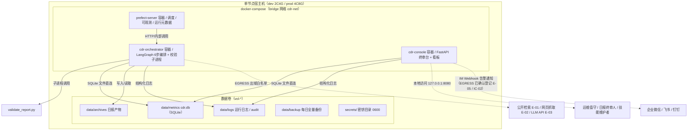
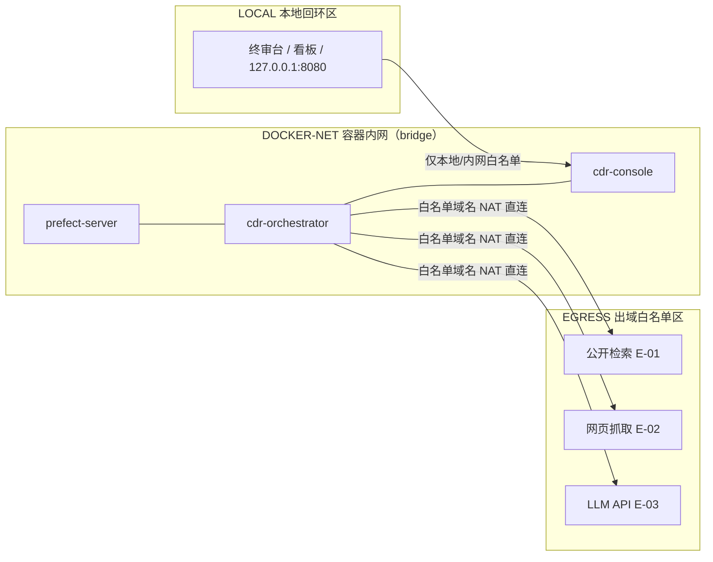

# AICoding 架构设计 · 部署设计

> 本文档为《AICoding 架构设计》核心产物之一，对应 **部署设计**。
> 上游输入：《系统设计》（G4 通过，含 §5 部署架构 / §6 网络架构 / §7 安全设计 / §8 可观测设计）+《高层架构设计》（G3 通过，含部署形态方案B 经中间确认 U-01）+ 资料摘要 `material_digest.md`（G1 通过）；
> 下游输出：可落地的环境与资源清单、部署拓扑、CI/CD 流水线、监控告警、应急回滚、容量成本基线。
> 标的系统：chip-daily-report —— 芯片行业日报自动生成系统（简称 CDR）。

> **模板使用约定（按需裁剪）**：
> - 模板为通用云系统骨架（K8s 多 AZ / 云组件），本项目为**单节点自托管 Docker Compose 形态**（经中间确认 U-01 方案B，用户裁决：单节点自托管服务化、数据不出域），本章按系统设计 §5/§6 实际适配：环境矩阵按 dev/prod 两环境（int/uat 并入 dev 侧预演，不单独建集群）；资源清单按本机/单台服务器 Docker 单节点；拓扑按单节点容器编排；高可用按单节点能力（备份 / 重启 / 数据卷恢复）设计；VPC / 子网按本地网络三区（LOCAL / DOCKER-NET / EGRESS）适配；KMS / Vault 按本地密钥管理方案（环境变量 + `secrets/` 文件 0600）适配；WAF / DDoS 因无公网 Web 入口按"不适用"裁剪。
> - **不可裁剪章节**：§1 引言、§2 环境与资源清单、§3 部署拓扑与高可用、§4 部署流程、§5 监控告警接入、§6 应急与回滚、§7 安全合规（部署视角）、§8 容量与成本，全部保留；§3.2 流量与网络链路三表（出口 / 入口 / 内部链路）为与安全架构师的交接骨架，完整保留。

---

## 0. 元信息：修订记录

| 文档版本 | 发布日期 | 修订人 | 修订说明 |
| --- | --- | --- | --- |
| v0.9-draft | 2026-08-07 | `platform-architect`（部署架构师 - 毕落地） | 初稿：完成 §1~§8 全章，含单节点 Docker Compose 环境矩阵、六大资源清单、LOCAL/DOCKER-NET/EGRESS 三区拓扑、8 阶段 CI/CD、L1~L4 配置管理、5 Dashboard 与 P0~P3 告警、应急回滚 Runbook、容量成本；§3 物理拓扑 + §3.2 三表按 `[骨架交接]` 协议先行回传，安全重叠项（KMS / 密钥分级 / 日志保留期 / 安全组 / WAF）待 security-architect 草稿交叉转交后对齐 |
| v1.0 | 2026-08-07 | `platform-architect` | 定稿：接收 security-architect 信任域草稿（§1.1 + §5.1 + §5.2）与 IC-02 裁决后按权威方口径完成对齐——§2.2.4（KMS/Vault 本地密钥 + HMAC 签名密钥，安全侧已校验）、§2.2.5（审计 ≥ 1 年）、§2.2.6（R-Sec-001 五条防火墙规则 R-Sec-001a~e、WAF/DDoS/CLB 不适用、堡垒机裁剪）、§3.2（限流口径 100/20/50/10/5、防 SSRF、TLS1.2+、高敏写调用 HMAC-SHA256、**E-05 IM Webhook 已确认登记（IC-02）**）、§7（自检清单 / 凭证 SEC-06 / 运维通道审计 / EGRESS 登记纪律）；通过模板合规校验 8/8，`decision: 部署设计冻结，可进入 G5 审核` |
| v1.1 | 2026-08-07 | `platform-architect-r`（部署设计恢复执行） | 定稿对齐（增量）：按《安全设计》v1.0（9/9 通过）最终版逐项核对——§1.1/§1.2 数据边界补 E-05 出域项；§2.2.4 密钥分级引用修正为安全侧 §6.1/§6.2 权威（分级 5 类 / 90 天轮换 / 访问策略）；§2.2.5 审计不可篡改要求（audit/ 0600、append-only + 哈希归档校验）引用安全侧 §7.2；§2.2.6 R-Sec-001 五条规则复核通过（a~e 与安全侧 §5.1.1 一一对应）；§3.2 E-05 已确认登记复核通过（443 / EgressGuard / 仅运行状态摘要）；§7.2/§7.3 权威引用同步修正；其余已冻结章节未改动；通过模板合规校验，`decision: 部署设计冻结，可进入 G5 审核` |

> **版本管理纪律**：破坏性变更（章节结构调整 / 关键决策反转）升 MAJOR；新增章节、扩充内容升 MINOR。v1.0 发布需通过 G5 人工审核并由主理人归档至 `delivery/部署设计.md`。

---

## 1. 引言

### 1.1 适用范围与部署形态

| 维度 | 取值 |
| --- | --- |
| 部署形态 | 单节点自托管服务化（Docker Compose），**经中间确认（U-01 部署形态，用户裁决：方案B 单节点自托管服务化，数据不出域）** |
| 运行载体 | 单台宿主机（dev 2C4G / prod 4C8G），本机或内网服务器 |
| 数据边界 | 产物、规则、运行元数据全部本地留存，**仅出域调用**：公开新闻检索（E-01）、网页正文抓取（E-02）、OpenAI 兼容 LLM API（E-03）、告警 IM Webhook（E-05，仅运行状态摘要，已确认登记） |
| 面向环境 | dev（开发自测）+ prod（每日定时出报）；int/uat 验证并入 dev 侧预演，不单独部署集群 |
| 交付承诺 | SLA 可用性 ≥ 99.5%；RTO ≤ 4h；RPO ≤ 24h；单期端到端 ≤ 30min；告警 ≤ 5min；指标保留 90 天 |

> 本方案不涉及公有云资源（无云主机 / 云存储 / 云数据库 / 云网关）；部署目标是**现有本地机器或专用单台服务器**，云资源现状核对（CloudQ）不适用，宿主实际规格以 `待人工确认` 标注（见 §2.2）。

### 1.2 名词与缩写

| 缩写 / 名词 | 全称 / 含义 |
| --- | --- |
| CDR | chip-daily-report 芯片行业日报自动生成系统 |
| Compose | Docker Compose 单机容器编排 |
| Prefect | Prefect Server 3.x，调度与可观测底座（自托管） |
| LangGraph | LangGraph 2.x，6 步编排框架（MVP 顺序编排 / 完整版 StateGraph） |
| FastAPI | 本地 Web 框架，承载终审发布台与运行看板 API |
| SQLite | 内嵌关系型存储，承载运行元数据（`cdr.db`） |
| E-xx | 外部系统：E-01 公开检索 / E-02 网页正文抓取 / E-03 LLM 推理服务 / E-04 TRAE 技能镜像 |
| C-xx | 本地组件：C-02 Prefect / C-03 SQLite / C-04 本地文件 / C-05 FastAPI / C-06 Docker / C-07 OpenTelemetry |
| M-xx | 业务模块：M1 调度触发中心 … M14 运行状态与指标库（沿用系统设计 §3.2.2） |
| LOCAL | 本地回环访问区（127.0.0.1） |
| DOCKER-NET | Docker Compose bridge 容器内网 |
| EGRESS | 出域白名单区（仅公开检索 + 网页抓取 + LLM API + 告警 IM Webhook E-05） |
| RBAC | 基于角色的访问控制（reviewer / ops / maintainer / admin） |
| traceId / tenantId | 链路追踪 ID / 租户标识（tenantId 固定 `cdr-single`） |
| RPO / RTO | 数据丢失容忍 / 恢复时间目标 |
| P0~P3 | 告警分级（紧急 / 高 / 中 / 低） |

---

## 2. 环境与资源清单

### 2.1 环境矩阵

| 环境 | 用途 | 集群隔离 | 数据 | 网络访问 |
| --- | --- | --- | --- | --- |
| dev | 开发自测（规则修订、编排联调、CI 冒烟） | 与其他系统共用宿主机，Docker 网络隔离 | 模拟/样例数据 + 少量真实运行事件 | LOCAL + DOCKER-NET + EGRESS（白名单） |
| int | 联调验证：**并入 dev 侧预演**（不单独建集群，以 dev 上一次性端到端预演替代） | 共享 dev 宿主 | 仿生产样例 | 同 dev |
| uat | 预发 / 验收：**并入 dev 侧预演**（发布前在 dev 执行完整 1 期端到端 + 恢复演练抽样） | 共享 dev 宿主 | 仿生产样例 | 同 dev |
| prod | 生产（每工作日 08:30 定时出报 + 终审发布 + 运行看板） | 独立宿主机 | 真实数据（日报产物 / 规则 / 运行元数据） | LOCAL + DOCKER-NET + EGRESS（白名单） |

> **环境数量说明**（继承系统设计 §5.1）：单节点自托管形态（经中间确认 U-01 方案B）不设独立 int/uat 集群；int/uat 验证并入 dev 侧预演，prod 独立单机承载每日出报。模板的 4 环境矩阵按此适配：dev / prod 为真实运行环境，int / uat 为并入 dev 预演的验证阶段。

### 2.2 资源清单

> 本方案无云资源，全部为**本地宿主资源 + Docker 单节点资源**。资源 ID 沿用 R-xx 编号体系；"资源 ID"一列对本地资源登记为部署路径 / 卷名。宿主实际规格（CPU 核数 / 内存 / 磁盘）为设计基线，实机核实标注 `待人工确认`。

#### 2.2.1 计算资源

| 资源编号 | 类型 | 产品 | 资源 ID | 名称 | 规格 | 数量 | 环境 | 复用 / 新建 | HA 方案 | 用途 |
| --- | --- | --- | --- | --- | --- | --- | --- | --- | --- | --- |
| R-C-001 | 宿主计算 | 本地服务器/PC | host-dev | dev 宿主机 | 2C4G（基线，实机 `待人工确认`） | 1 | dev | 复用现有机器 | 单节点；故障由重建恢复（RTO ≤ 4h） | dev 容器运行底座 |
| R-C-002 | 宿主计算 | 本地服务器/PC | host-prod | prod 宿主机 | 4C8G（基线，实机 `待人工确认`） | 1 | prod | 新建或复用（`待人工确认`） | 单节点；数据卷保留 + 容器重建 | prod 容器运行底座 |
| R-C-003 | 容器编排 | Docker 27.x + Compose 2.x | compose-cdr | cdr docker-compose 栈 | prefect-server / cdr-orchestrator / cdr-console 共 3 容器 | 1 栈 | dev + prod | 新建 | `restart: unless-stopped` 自动拉起 | 单节点容器编排 |

#### 2.2.2 存储资源

| 资源编号 | 类型 | 产品 | 资源 ID | 名称 | 规格 | 容量 | 环境 | 复用 / 新建 | HA 方案 | 备份策略 |
| --- | --- | --- | --- | --- | --- | --- | --- | --- | --- | --- |
| R-S-001 | 文件存储 | 本地数据卷 | vol-archives | 日报产物归档（草稿 / 已发布 Markdown） | 数据卷 `data/archives/` | prod 100GB 含全部卷（dev 40GB） | dev + prod | 新建 | 单节点文件级 | 每日全量备份至 `data/backup/`，保留 90 天 |
| R-S-002 | 关系型存储 | SQLite 3.x | vol-metrics | 运行元数据 `cdr.db`（任务 / 事件 / 门禁 / 告警） | 数据卷 `data/metrics/`，单文件 ≤ 1GB | 指标行 ≤ 50 万 / 90 天 | dev + prod | 新建 | 单文件 + WAL 热备 | 每日全量备份（WAL checkpoint），保留 90 天 |
| R-S-003 | 文件存储 | 本地数据卷 | vol-logs | 结构化运行日志 + 审计日志 | 数据卷 `data/logs/`（审计独立 `audit/` 0600） | 90 天热 + 1 年冷 | dev + prod | 新建 | 按天滚动 | 日志按天滚动，冷备保留 1 年 |
| R-S-004 | 文件存储 | 本地数据卷 | vol-backup | 备份目录（与生产数据目录分离） | 数据卷 `data/backup/` | prod 20GB / dev 10GB | dev + prod | 新建 | 独立目录 | 全量保留 90 天；日志冷备 1 年 |

#### 2.2.3 网络资源

| 资源编号 | 类型 | 产品 | 资源 ID | 名称 | 规格 | 环境 | 复用 / 新建 | 用途 |
| --- | --- | --- | --- | --- | --- | --- | --- | --- |
| R-N-001 | 本地回环 | LOCAL | net-local | 终审台 / 看板 / API 访问区 | 绑定 `127.0.0.1:8080`，仅本机或内网白名单 | dev + prod | 复用宿主网络 | 人机访问入口 |
| R-N-002 | 容器网络 | Docker bridge | net-docker | 容器内部互访区 | 默认 bridge 网络（`cdr-net`） | dev + prod | 新建 | prefect / orchestrator / console 互访 |
| R-N-003 | 出域网络 | 宿主 NAT | net-egress | 出域白名单区 | NAT 直连公网，仅白名单域名（§3.2.3） | dev + prod | 复用宿主网络 | 公开检索 / 网页抓取 / LLM API |

#### 2.2.4 中间件与平台服务

| 资源编号 | 类型 | 产品 | 资源 ID | 名称 | 规格 | 环境 | 复用 / 新建 | HA 方案 | 用途 |
| --- | --- | --- | --- | --- | --- | --- | --- | --- | --- |
| R-M-001 | 调度与可观测 | Prefect Server 3.x | prefect-server | 调度触发 / 运行 UI / 元数据 | 1 容器 2C4G | dev + prod | 新建（自托管） | `restart: unless-stopped`；失败重试 | 定时触发、断点恢复、运行 UI（M1 / F4 / F9 底座） |
| R-M-002 | 编排框架 | LangGraph 2.x | cdr-orchestrator | 6 步生成编排（含校验子进程） | 1 容器（与 console 分容器） | dev + prod | 新建 | 容器重建 | 6 步流程、门禁回退、循环上限 5（M5~M9） |
| R-M-003 | Web 服务 | FastAPI 0.115.x | cdr-console | 终审台 + 看板 API | 1 容器 | dev + prod | 新建 | 容器重建 | 终审发布（M3）、运行看板（M4） |
| R-M-004 | 关系型存储 | SQLite 3.x | cdr.db | 运行元数据库（同 R-S-002） | 单文件 ≤ 1GB | dev + prod | 新建 | 文件级 | M14 指标库 / t_run_task 等 8 表 |
| R-M-005 | 密钥管理（KMS / Vault） | 不启用 KMS | secrets-local | 本地密钥方案：环境变量 + `secrets/` 目录（0600） | 目录权限 0600 | dev + prod | 新建 | 文件权限 + 轮换（90 天基线） | LLM API Key / 检索 Key / HMAC 签名密钥存储（选型归属部署侧：**不启用 KMS，本地密钥管理 = 环境变量 + `secrets/` 0600，安全设计 §6 已校验通过**；**密钥分级 5 类、90 天轮换、访问策略以安全设计 §6.1/§6.2 为权威**，部署侧引用其口径：轮换周期 90 天、禁止跨环境共用密钥、仅 M11 适配层读取） |

#### 2.2.5 可观测资源

| 资源编号 | 类型 | 产品 | 资源 ID | 名称 | 规格 | 环境 | 复用 / 新建 | 承载可观测维度 |
| --- | --- | --- | --- | --- | --- | --- | --- | --- |
| R-O-001 | 可观测 SDK | OpenTelemetry Python 1.x | otel-sdk | 指标 / 链路 SDK（库内嵌） | 错误 100% + 慢请求 100% 采样 | dev + prod | 新建 | Metrics + Traces |
| R-O-002 | 运行看板 | Prefect UI + 自建看板 | dashboard-web | 5 个 Dashboard（§5.2） | 本地 Web | dev + prod | 新建 | 业务 / 应用 / 中间件 / 资源指标 |
| R-O-003 | 日志存储 | 本地结构化日志 | vol-logs | 运行日志（JSON，含 traceId + tenantId） | `data/logs/` | dev + prod | 新建 | Logs（90 天热 + 1 年冷） |
| R-O-004 | 审计日志 | 独立审计目录 | audit-dir | 发布 / 规则变更 / 登录 / 触发 / 运维通道审计 | `data/logs/audit/`（0600） | dev + prod | 新建 | 审计（保留 ≥ 1 年；**审计字段与不可篡改要求：audit/ 0600、append-only + 哈希归档校验，以安全设计 §7.2 为权威**，部署侧引用） |
| R-O-005 | 告警引擎 | Prefect events + 看板轮询 + IM Webhook | alert-engine | 失败 / 超时 / A 级占比不足告警 | 规则 AL-01~AL-09 | dev + prod | 新建 | 告警（P0 ≤ 5min 触达） |

#### 2.2.6 安全资源

| 资源编号 | 类型 | 产品 | 资源 ID | 名称 | 规格 | 环境 | 复用 / 新建 | HA 方案 | 用途 |
| --- | --- | --- | --- | --- | --- | --- | --- | --- | --- |
| R-Sec-001 | 主机防火墙 | 宿主机 OS 防火墙（iptables / firewalld） | fw-host | 宿主防火墙 | 按安全侧权威五条规则（R-Sec-001a~e）：入站 8080 仅本机/内网白名单；入站 22 仅运维跳板；其余入站默认 DROP（禁 0.0.0.0/0 开放 22/8080/3306/6379）；出站 443 仅 EGRESS 白名单域名；其余出站默认 DROP | dev + prod | 复用宿主 | 宿主级 | 最小暴露面（安全侧对齐 §5.1.1；堡垒机裁剪为 SSH 密钥 + 运维审计） |
| R-Sec-002 | 密钥存储 | `secrets/` 目录（0600） | secrets-local | 密钥文件目录 | 权限 0600，禁止入库 / 入代码 | dev + prod | 新建 | 轮换（90 天基线） | LLM / 检索 Key + HMAC 签名密钥落盘 |
| R-Sec-003 | 容器安全 | 非 root + 最小镜像 + 只读文件系统 | container-sec | 容器加固 | 全部容器非 root 运行；高敏写调用叠加内部签名（HMAC-SHA256） | dev + prod | 新建 | 镜像重建 | 容器最小权限 + 内部写调用防伪 |
| R-Sec-004 | 审计日志 | 独立审计目录（同 R-O-004） | audit-dir | 审计落盘 | 0600，与业务日志分离 | dev + prod | 新建 | 保留 ≥ 1 年 | 不可篡改审计（继承系统设计 §7.2.4；含运维通道审计） |
| R-Sec-005 | WAF / DDoS / CLB | 不适用（无公网 Web 入口） | n/a | WAF / DDoS / CLB 防护 | 仅本地 / 内网访问 | — | — | — | 不适用：无公网暴露面（安全侧权威确认，同 §1.1 裁剪） |

### 2.3 复用资源清单

| 复用资源 ID | 原业务方 | 余量评估 | 隔离方式 |
| --- | --- | --- | --- |
| R-C-001（host-dev） | 现有开发机器 | 2C4G 基线，余量以实机负载评估（`待人工确认`） | Docker 网络隔离，与同机其他系统互不感知 |
| scripts/validate_report.py（M12 硬校验器） | 本项目 v5.0 既有资产 | 768 行 Python 3 零第三方依赖，可脱离系统独立运行（N3） | 随代码仓库版本管理；容器内只读挂载 |
| references/（sources / classification / rubric） | 本项目 v5.0 既有规则资产 | 三副本一致性由 F1/F2 注册表单向生成与 CI diff 保障 | 随代码仓库版本管理；规则修订经注册表生成 |
| agents/openai.yaml（Agent 行为配置） | 本项目 v5.0 既有配置 | 工具权限 / 搜索策略 / 门禁参数复用 | 随代码仓库版本管理；L2 环境变量注入差异项 |
| .trae/skills/chip-daily-report/（E-04 TRAE 镜像） | 本项目 v5.0 分发镜像 | 8 文件中 7 个逐字节一致，仅域名常量待同步（X1/X2 已裁决） | 纳入三副本一致性 CI 校验；与根目录双向差集 = 0 |

> **复用说明**：本项目为既有技能升级（高层架构 §4.2 D4：领域规则资产 100% 复用），复用对象为**代码资产**而非云资源；宿主机器复用遵循"共享宿主 + Docker 网络隔离"策略，与同机其他业务互不干扰。

---

## 3. 部署拓扑与高可用设计

### 3.1 物理拓扑

#### 3.1.1 物理拓扑图



**网络三区示意（LOCAL / DOCKER-NET / EGRESS）**：



#### 3.1.2 拓扑要素清单

| 要素 | 取值 |
| --- | --- |
| 跨 Region 部署 | 否；单 Region（单节点） |
| 跨 AZ 部署 | 否；单机单 AZ |
| 流量入口路径 | 本地 / 内网 → 直接访问 `127.0.0.1:8080`（无 CDN / WAF / 网关；内网跨主机访问需自行加反向代理） |
| 内部调用路径 | Docker Compose bridge 网络（服务名互访）+ 进程内调用 + 子进程调用（校验器） |
| 数据库访问路径 | SQLite 文件直连（无连接池 / 无主从） |
| 出域路径 | 宿主 NAT 直连公网，仅白名单域名（§3.2.3） |
| 告警通知路径 | IM Webhook 出域（EGRESS 已确认登记 E-05，经中间确认 IC-02 用户裁决） |
| 运维通道 | SSH 密钥登录（禁 root 远程、独立低权限账号），运维登录 / 命令执行入审计日志（安全侧对齐 §5.2） |

### 3.2 流量与网络链路（连通视图）

#### 3.2.1 流量入口链路（入口）

| 组件 (R-xx) | 协议 - 端口 | TLS 终结 | 作用 |
| --- | --- | --- | --- |
| 本地绑定 R-N-001 | HTTP - `127.0.0.1:8080` | 不启用公网 TLS（本地 / 内网访问） | 终审台 / 看板 / API 访问入口，仅本机或内网白名单 |
| cdr-console（FastAPI R-M-003） | HTTP - 容器内 `8080` | 无（内部明文，不跨公网） | 业务 API（路由 / 鉴权 / 限流） |
| 业务服务（M3 / M4） | 进程内 / HTTP | 无 | 终审发布、运行看板业务逻辑 |
| 反向代理（可选，内网跨主机时） | HTTPS - 443 → 8080 | 内网证书 | 内网跨主机访问时的 TLS 终结（业务侧不解析 X-Forwarded-*，默认直连） |

**入口决策（继承系统设计 §6.2.1，安全侧对齐 §5.2）**：TLS 终结点不启用公网 TLS（本地 / 内网访问）；DDoS / WAF / CLB 不适用（无公网入口）；本地入口由 FastAPI 鉴权 + 限流承担（限流口径按安全侧规则：全局 100 / 单用户 20 / 单 IP 50 / 终审台 10 / 发布 5 次每分，与 §3.5.3 限流红线联动）；宿主防火墙按安全侧权威五条规则 R-Sec-001a~e（§5.1.1）：入站 8080 仅本机/内网白名单、入站 22 仅运维跳板、其余入站默认 DROP、出站 443 仅 EGRESS 白名单域名、其余出站默认 DROP，禁止 0.0.0.0/0 开放 22 / 8080 / 3306 / 6379 等敏感端口；真实客户端 IP 使用 socket 远端 IP（本地直连，不依赖代理头）。

#### 3.2.2 内部互联链路（内部）

| 项 | 说明 |
| --- | --- |
| 服务发现 | Docker Compose 服务名（`prefect-server` / `cdr-orchestrator` / `cdr-console`），禁止硬编码容器 IP |
| 服务间协议 | HTTP（本地 REST）+ 进程内调用 + 子进程调用（校验器） |
| mTLS | 不启用（单机 bridge 网络，非多租户公网，安全侧对齐 §5.2） |
| 高敏写调用签名 | 发布 / 规则变更 / 配置变更等高敏写调用叠加内部签名（HMAC-SHA256，密钥存 `secrets/`） |
| 数据库连接 | 应用 → SQLite 文件直连（`data/metrics/cdr.db` 数据卷挂载，无连接池 / 无主从） |
| 缓存连接 | 不适用（无独立缓存组件，指标查询直连 SQLite，检索结果不跨进程缓存） |
| MQ 连接 | 不适用（无跨进程异步依赖，单节点内部直接调用） |
| 校验器调用 | cdr-orchestrator → subprocess 调用 `validate_report.py`（退出码 0/1 即门禁硬拦截） |
| 幂等与追踪 | 跨服务调用透传幂等键与 traceId（HTTP Header `traceparent` / `tracestate`） |

#### 3.2.3 跨网络互联（出口）

| 互联类型 | 通道 | 带宽 | 加密 | 用途 |
| --- | --- | --- | --- | --- |
| 出域（EGRESS） | 宿主 NAT 直连公网（无专线 / VPN） | 低带宽（每日 1 期检索 + LLM 调用） | 强制 HTTPS TLS1.2+，校验证书（E-01 / E-02 / E-03） | 公开检索、网页正文抓取、LLM 推理调用 |
| 出域白名单 | 仅白名单域名 | 见下表 | TLS1.2+ | 新增外部依赖必须先登记（M11 EgressGuard） |
| 告警通知（EGRESS 登记项） | IM Webhook 出域 | 极低 | TLS1.2+ | 失败 / 超时 / A 级占比不足告警推送（**已确认登记，经中间确认 IC-02 用户裁决：允许 IM Webhook 出域，默认企业微信、可切换飞书 / 钉钉；443；EgressGuard 校验；告警内容仅运行状态摘要**） |
| 跨 VPC / 跨账号 / 跨 Region（灾备） | 不适用（单节点） | — | — | — |

**出域白名单清单（EGRESS）**：

| 白名单项 | 域名 / 端点类型 | 用途 | 端口 |
| --- | --- | --- | --- |
| E-01 公开检索 | 公开搜索引擎 API 域名（如 `api.xxx-search.com`，`待人工确认` 以实际提供方登记） | 关键词与站内限定检索 | 443 |
| E-02 网页正文抓取 | 目标来源站点域名（A/B 级源库公开可访问站点） | 正文与发布时间提取 | 443 |
| E-03 LLM 推理服务 | OpenAI 兼容 API 域名（`agents/openai.yaml` 配置，`待人工确认` 以实际提供方登记） | 摘要 / 技术注解 / 产业链推演 | 443 |
| E-05 告警 IM（已确认登记） | 企业微信 / 飞书 / 钉钉机器人 Webhook 域名（默认企业微信，经中间确认 IC-02 用户裁决） | 告警通知（仅运行状态摘要，不含日报正文 / 规则文件 / API Key） | 443 |

> **规则（安全侧对齐 §5.2）**：白名单以外的一律拒绝（EgressGuard 在 M11 适配层强制域名校验）；出域仅 HTTPS TLS1.2+ 并校验证书；**防 SSRF**（解析后 IP 禁内网 / 回环 / 保留网段，重定向目标须在白名单内）；**出域限速**（检索轮次 ≤ 3、LLM token 预算封顶）；业务对接 E-xx 时必须使用白名单内域名；新增 E-xx 必须先登记白名单并经安全架构师确认。出口白名单 = E-01 / E-02 / E-03 / E-05（E-05 已确认登记）。

### 3.3 高可用与故障容错

#### 3.3.1 故障域划分

| 故障域 | 影响范围 | 容错机制 | 预期 RTO |
| --- | --- | --- | --- |
| 单容器崩溃（prefect / orchestrator / console 任一） | 单服务不可用 | `restart: unless-stopped` 自动拉起；健康检查失败触发重建 | ≤ 1min（瞬时无业务影响） |
| 单机宕机 | 全部服务不可用 | 数据卷保留，重装容器恢复；每日全量备份兜底 | ≤ 4h |
| 磁盘满 | 归档 / 日志写入失败 | 磁盘水位告警（§8.1.4 危险水位）+ 清理任务 | 告警后 30min 处置 |
| 单 AZ / 单 Region | 不适用（单节点单 AZ，无跨 AZ / 跨 Region 部署，经中间确认 U-01 方案B） | 无 | — |

> **可用性来源拆分**：宿主环境（计算 / 网络 / 存储）由运维值守保障；本系统自身保障业务逻辑容错 / 重试 / 降级（§2.5.2 业务降级清单 BD-01~BD-05）；强依赖外部（E-01/E-02/E-03）故障由 M11 适配层熔断 / 降级 / 重试兜底。SLA 99.5% 对应月度约 715 分钟可容忍故障，单节点形态下由"快速重启 + 备份恢复"实现。

#### 3.3.2 负载均衡

| 维度 | 取值 |
| --- | --- |
| 类型 | 不启用外部负载均衡（单节点单实例）；本地访问经 `127.0.0.1` 或内网 IP |
| 4 层 / 7 层 | 不适用（无多副本） |
| 说明 | 内网跨主机访问可加反向代理（可选，§3.2.1） |

#### 3.3.3 健康检查配置

| 检查项 | 取值 |
| --- | --- |
| Liveness 路径 | `/healthz`（仅判进程存活）→ 失败则重启容器 |
| Readiness 路径 | `/readyz`（判依赖：SQLite 可写、数据卷可写）→ 失败则摘流不杀进程 |
| 检查频率 | 10s |
| 失败阈值 | 连续 3 次失败标记不健康 |
| 恢复阈值 | 连续 2 次成功标记健康 |
| 实现 | FastAPI 提供（继承系统设计 §5.2.1） |

#### 3.3.4 弹性伸缩配置

| 维度 | 取值 |
| --- | --- |
| 触发指标 | 不启用水平弹性伸缩（单节点自托管，业务量固定为每日 1 期） |
| 扩容阈值 | 资源水位 > 80% 时人工升配（§8.1.4） |
| 伸缩区间 | min 1 / max 1（单实例） |
| 垂直扩容 | 人工升配宿主 CPU / 内存（≤ 30min）；磁盘扩容（≤ 10min） |

#### 3.3.5 容灾切换配置

| 维度 | 取值 |
| --- | --- |
| 容灾级别 | 单机单节点（非多 AZ / 多 Region，经中间确认 U-01 方案B） |
| 故障切换 RTO | ≤ 4h（数据卷恢复 + 容器重启） |
| 数据同步策略 | 不适用（单节点，每日全量备份至 `data/backup/`，保留 90 天） |
| 恢复演练 | 季度演练；负责人 `@运维值守`（继承系统设计 §4.3.2） |

> **§3 章节自检（中间确认协议 §2.4，骨架交接同步提交）**：
> - §2.1 判定：未命中。物理拓扑（单节点 3 容器）、网络三区（LOCAL / DOCKER-NET / EGRESS）、故障域 4 层划分均为对系统设计 §5.4 / §6 / §5.2 已冻结结论的部署落地，无并列可替代方案；部署形态（方案B）与多 AZ / 多 Region 取舍已经中间确认 U-01 用户裁决，属已冻结事项，协议 §6 禁止重复打扰。
> - §2.3 反向验证：Q1 若 3 个月后从单节点演进为双节点高可用，返工范围 = §3.1 拓扑 + §3.3 故障域 + §4.5 发布策略 + §6.1 回滚 SOP，切换成本约 0.5~1 人月（需引入共享存储与负载均衡），属架构演进而非推翻，且该演进方向已作为完整版可选保留；Q2 用户/客户/监管不可感知——拓扑与故障域为内部部署细节，日报产物形态与对外 SLA（99.5%）不随单节点/双节点变化；Q3 与用户裁决的方案B（单节点自托管服务化、数据不出域）一致，一致。
> - 判定：未命中 §2.2，不发起中间确认。证据归档至附录 A 自检报告。

---

## 4. 部署流程

### 4.1 代码仓库与分支

| 项 | 规范 / 值 | 说明 |
| --- | --- | --- |
| 代码仓库地址 | 本地 Git 仓库 `chip-daily-report/`（`待人工确认` 是否接入远端 Git 服务如 Gitea） | 单仓结构（后端 + 前端 + 脚本 + 规则 + 部署文件） |
| 分支管理 | `main`（可发布基线）+ `dev`（开发集成分支）+ `feature/*`（特性分支） | MVP 单人维护可简化：`main` + `feature/*` |
| 合并规范 | feature → dev 需通过 3 项门禁（三副本 diff=0 / 校验器回归 / 静态扫描）后合入；dev → main 需人工评审 | 对齐 F2 三副本一致性 CI 阻断 |
| 标签规范 | `v{主}.{次}.{修订}`（如 `v5.1.0`） | 发布 Tag 与制品 Tag 对齐 |
| 禁止事项 | 禁止把密钥 / 环境差异写入仓库；禁止绕过多副本一致性提交 | 继承系统设计 §5.1 配置策略 L1 |

### 4.2 流水线（CI / CD）

> **形态说明**：本项目为单节点自托管、数据不出域（经中间确认 U-01 方案B），不引入云 CI（避免代码出域）；CI/CD 采用**本地 Git 钩子 + 脚本化流水线 + Docker Compose 部署**，8 阶段完整保留。预演（int/uat）并入 dev 阶段执行。

| 阶段 | 触发条件 | 关键动作 | 失败处理 |
| --- | --- | --- | --- |
| 1 构建 | 提交 / 手动触发 | 拉代码 → 单元测试（pytest）→ 依赖锁校验（uv / poetry lock）→ 前端静态资源构建 → 构建产物 | 阻断后续阶段 |
| 2 代码扫描 | 构建后 | 静态扫描（ruff / mypy / pre-commit）+ **三副本一致性 diff（F2 硬门禁：根目录 vs `.trae` 镜像逐文件 diff + 域名双向差集 = 0）** | 不达标阻断 |
| 3 安全扫描 | 构建后 | SCA 依赖漏洞（pip-audit / uv audit）+ 密钥扫描（gitleaks / trufflehog）+ 镜像漏洞（trivy） | 高危阻断 |
| 4 集成测试 | 合并到 dev / 发布前 | 校验器回归（16 组 X1~X16 裁决用例全部通过）+ 端到端冒烟（mock 检索 / LLM 生成草稿 → `validate_report.py` 退出码 0）+ 接口契约校验 | 阻断后续阶段 |
| 5 制品打包构建 | 构建 / 测试通过 | `docker build` 3 镜像（prefect-server / cdr-orchestrator / cdr-console），打 Tag `v{tag}-{commit-sha-short}`，本地镜像仓库或 `docker save` 归档 | 失败重试 |
| 6 部署 dev（含 int/uat 预演） | Package 完成 | 自动部署到 dev 环境（`docker compose up -d`）→ `/healthz` `/readyz` 冒烟 → int/uat 预演：完整 1 期端到端验证 + 恢复演练抽样 | 失败回滚到上一版本 |
| 7 部署预发（uat 并入 dev 预演） | 手动触发 | 发布前在 dev 执行完整 1 期端到端 + 门禁全量回归 + 备份恢复演练抽样 | 失败回滚到上一版本 |
| 8 部署生产环境 | 人工审批（≥ 1 名 Owner） | 按 §4.5 镜像 Tag 替换 + 容器重建上线 → 冒烟 → 观察窗口（30min） | 按 §6.1 回滚策略实施回滚 |

> **三副本一致性 CI 校验说明**：阶段 2 的 diff 检查是本项目特有硬门禁（V1 / F2），任何规则注册表修订必须保证根目录与 `.trae` 镜像逐文件一致且 `sources.md` 与脚本域名双向差集 = 0，否则阻断提交与发布（继承系统设计 §3.2.M10 / 高层架构 §2.4）。

### 4.3 构建产物与制品管理

| 配置项 | 配置值 / 规则 | 说明 |
| --- | --- | --- |
| 产物类型 | 容器镜像（3 个）+ 前端静态包（内嵌镜像） | prefect-server / cdr-orchestrator / cdr-console |
| 镜像仓库 | 本地镜像仓库（docker registry，`待人工确认` 地址）或 `docker save` 归档 | 单节点可无远端仓库，备份为 `tar` 归档 |
| 镜像命名 | `cdr-{service}:{git-tag}-{commit-sha-short}` | 例如 `cdr-orchestrator:v5.1.0-3f2a1c9` |
| 制品保留期 | 最近 10 个版本；归档镜像保留 90 天 | 与备份保留期一致 |
| 制品溯源 | 镜像 Label 必含 `git-commit` / `build-time` / `pipeline-id`；镜像 manifest 可反查源码 | 便于反查与回滚 |
| 签名与校验 | MVP 以镜像 `sha256` 校验代替签名；完整版可选启用 cosign | 单节点本地环境 |

### 4.4 配置管理

> 四层级配置管理（继承系统设计 §5.1 配置策略），L4 配置中心不启用（单节点无 Nacos / Apollo 需求）。

| 层级 | 存放位置 | 适用内容 | 变更生效 | 对部署的约束 |
| --- | --- | --- | --- | --- |
| L1 代码内 | 代码仓库（`pyproject.toml` / `agents/openai.yaml`） | 默认值、枚举、不会变的常量（Rubric-Step 映射、错误码） | 重新部署 | 禁止写入：环境差异、密码、地址 |
| L2 环境变量 | docker-compose env / `.env` 文件 | 环境差异（LLM API 地址、检索 API 地址、端口） | 重启容器 | 启动失败 fail-fast，禁止跑默认值连外部 |
| L3 Secret | 环境变量 + 文件权限（`secrets/` 目录 0600） | LLM API Key、检索 API Key | 重启容器 | 禁止落日志、禁止入代码 |
| L4 配置中心 | 不启用（单节点无 Nacos / Apollo 需求） | — | — | — |

> **配置版本管理**：`.env` 不入代码仓库（模板 + 说明文档入库）；`secrets/` 目录独立于数据卷、仅宿主机可读（0600）；配置变更走 Git 评审 + 重启容器生效，禁止直接改容器内配置。

### 4.5 发布策略

#### 4.5.1 发布方式

> 单节点形态下蓝绿 / 金丝雀无多副本容量，不适用；全系统统一采用 **「镜像 Tag 替换 + 容器重建」发布**（等价蓝绿的最小化：新镜像先构建并冒烟通过，再替换容器，回滚即切回上一 Tag）。

| 模块 | 发布方式 | 说明 |
| --- | --- | --- |
| 全系统（prefect-server / cdr-orchestrator / cdr-console） | 镜像 Tag 替换 + 容器重建 | 新镜像冒烟通过 → 停旧起新 → 观察窗口 30min；回滚 = 切回上一 Tag |
| 规则 / 配置（references / rules / agents） | 代码发布随镜像 | 三副本一致性 CI 阻断（§4.2 阶段 2） |
| SQLite 表结构 | 无 DDL 发布场景 | 新表由应用启动时初始化（`PRAGMA user_version` 迁移），禁止破坏性 DDL |

#### 4.5.2 发布标准流程

- **首次发布标准流程（含资源初始化）**：宿主准备（4C8G / Docker 27+ / 目录创建）→ 生成 `secrets/` 并注入密钥 → 拉取代码并构建 3 镜像 → 初始化数据卷（archives / metrics / logs / backup）→ `docker compose up -d` → 冒烟（/healthz /readyz + 手动触发 1 期端到端）→ 配置定时（工作日 08:30）→ 归档基线快照。
- **常规迭代发布流程**：feature → dev（自动部署 dev + 预演）→ 人工审批 → 生产镜像 Tag 替换 + 容器重建 → 观察窗口 30min → 更新看板基线。
- **资源变更流程**：升配（CPU / 内存 / 磁盘）→ 停机窗口（每月 ≤ 1 次，≤ 30min，提前 1 工作日通知）→ 变更后恢复演练抽样。

#### 4.5.3 灰度路径与观测窗口

> 单实例无灰度批次；以"构建 + 冒烟 + 观察窗口"替代灰度放量。

| 项 | 取值 |
| --- | --- |
| 灰度批次 | 不适用（单实例） |
| 冒烟门禁 | 部署后 `/healthz` `/readyz` 通过 + 手动触发 1 期端到端（mock 外部）退出码 0 |
| 观察窗口 | 生产发布后 30min：盯任务成功率、错误率、告警 AL-01~AL-04 |
| 放量条件 | 观察窗口内无 P0 / P1 告警则确认发布完成；否则按 §6.1 回滚 |

#### 4.5.4 发布门禁

| 门禁项 | 拦截条件 | 检查时机 |
| --- | --- | --- |
| 单元测试通过率 | 100% | 构建阶段 |
| 单元测试覆盖率（增量） | ≥ 70% | 代码扫描阶段 |
| 三副本一致性 diff | diff ≠ 0 或双向差集 ≠ 0 即阻断（F2 硬门禁） | 代码扫描阶段 |
| 校验器回归用例 | 16 组 X1~X16 裁决用例 100% 通过 | 集成测试阶段 |
| 集成测试通过率 | 100%（端到端冒烟退出码 0） | 集成测试阶段 |
| 安全扫描高危漏洞 | 0（中危需评审） | 安全扫描阶段 |
| 镜像漏洞 | 高危 0 | 制品扫描 |
| 性能基线 | 单期端到端 ≤ 30min（P99 不退化） | 集成测试阶段 |
| 人工审批 | 至少 1 名 Owner | 生产发布前 |

> **§4 章节自检（中间确认协议 §2.4）**：
> - §2.1 判定：未命中。CI/CD 形态存在本地脚本 CI 与远端 Git 服务 CI 两类可选，但本项目单节点自托管、数据不出域（经中间确认 U-01 方案B），本地脚本 CI + Docker Compose 与数据边界一致，远端云 CI 会把代码推往外部，与 N2 数据不出域的精神相悖；发布策略为单节点下唯一可行形态（无多副本容量），无并列可替代方案。
> - §2.3 反向验证：Q1 若 3 个月后引入远端 Git 服务（Gitea）接管 CI，返工范围 = §4.1 仓库地址 + §4.2 流水线脚本迁移，切换成本 ≤ 0.5 人月（脚本化迁移），可控；Q2 用户/客户/监管不可感知——CI/CD 为内部研发流程，不进入日报产物形态与对外 SLA（99.5%），运维侧感知点仅为提交方式变化；Q3 与用户"可私有化运行、数据不出域"诉求一致（不把代码推到云 CI），一致。
> - 判定：未命中 §2.2，不发起中间确认。证据归档至附录 A 自检报告。

---

## 5. 监控告警接入

### 5.1 监控架构与数据流

```text
单节点容器（prefect / orchestrator / console）
  ├─► Metrics ──► OpenTelemetry SDK (R-O-001) ──► SQLite 指标库 (R-M-004) ──► 运行看板 5 Dashboard (R-O-002)
  ├─► Logs   ──► data/logs 结构化 JSON (R-O-003，含 traceId + tenantId=cdr-single)
  │              └─► data/logs/audit 审计独立目录 0600 (R-O-004，保留 ≥ 1 年)
  ├─► Traces ──► OpenTelemetry / W3C TraceContext（错误 100% + 慢请求 100% 采样）
  └─► 事件   ──► Prefect events + 看板轮询 ──► 告警引擎 (R-O-005，AL-01~AL-09)
                                                    ▼
                                     IM Webhook / 电话值班（P0 ≤ 5min）
```

**监控指标分层**（继承系统设计 §8.1.1）：业务指标（任务成功率 / 门禁一次通过率 / A 级占比 / 条数分布 / FAIL 排行）+ 应用指标（RED：Rate / Errors / Duration）+ 中间件指标（SQLite 写入延迟 / LLM 调用延迟与 token 用量 / 检索 API 延迟）+ 资源指标（USE：CPU / 内存 / 磁盘 / 网络，`docker stats` + 看板）。

### 5.2 关键 Dashboard 清单

| 大盘 | 用户 | 指标 | 刷新频率 |
| --- | --- | --- | --- |
| 运行总览大盘 | 运维值守 / 技能维护者 | 近 30 期成功率、耗时、回退次数 | 1min |
| 门禁归因大盘 | 运维值守 / 技能维护者 | 15 项检查 FAIL 计数排行、典型样本 | 5min |
| 规则一致性大盘 | 技能维护者 / 合规审阅 | 三副本 diff、域名双向差集、校验结果 | 手动触发 + 每日 |
| 质量趋势大盘 | 技能维护者 / 日报终审人 | 门禁一次通过率、A 级占比、条数分布趋势 | 1min |
| 告警实时大盘 | On-call 运维值守 | 当前活跃告警（P0~P3） | 实时 |

> Dashboard 数量 = 5，对齐模板硬指标与系统设计 §8.1.2；看板只读运行元数据，不呈现未发布日报正文（继承系统设计 §6.5 关键交互约束）。

### 5.3 告警规则清单

| 编号 | 级别 | 触发条件 | 关联资源 (R-xx) | Owner | Runbook |
| --- | --- | --- | --- | --- | --- |
| AL-01 | P0 | 连续 2 个工作日定时任务失败 | R-M-001 / R-M-004 | `@运维值守` | RB-01 |
| AL-02 | P0 | 门禁循环超 5 次仍 FAIL | R-M-002 / R-M-004 | `@技能维护者` | RB-02 |
| AL-03 | P1 | 单期任务失败（非连续） | R-M-001 / R-M-004 | `@运维值守` | RB-03 |
| AL-04 | P1 | 单期端到端耗时 > 30min | R-M-002 | `@运维值守` | RB-03 |
| AL-05 | P1 | A 级占比低于 30% 且补搜耗尽 | R-M-002 / R-N-003 | `@技能维护者` | RB-04 |
| AL-06 | P2 | 规则一致性 diff ≠ 0 或双向差集 ≠ 0 | 规则文件卷（references/ + rules/） | `@技能维护者` | RB-05 |
| AL-07 | P2 | 磁盘使用率 > 80% 持续 10min | R-S-001~004 | `@运维值守` | RB-06 |
| AL-08 | P3 | 近 30 期成功率低于 95% | R-M-004 | `@运维值守` | RB-07 |
| AL-09 | P3 | 单期条数落入 10-14 或 21-25（WARN） | R-M-004 | `@技能维护者` | RB-07 |

> 告警规则继承系统设计 §8.4.2（AL-01~AL-09），Owner 与 Runbook 索引对齐 §6.2。

### 5.4 告警通道

| 级别 | 响应时间 | 通知方式 | 上升机制 |
| --- | --- | --- | --- |
| P0 | ≤ 5 min | IM + 电话（值班） | 15min 未响应升级至 Manager |
| P1 | ≤ 15 min | IM | 30min 未响应升级至 Owner |
| P2 | ≤ 1 h | IM | 2h 未响应升级至技能维护组 |
| P3 | 工作时间 | IM / 邮件 | 当周内闭环 |

> **IM 通道说明**：默认企业微信机器人 Webhook（EGRESS E-05 **已确认登记**，经中间确认 IC-02 用户裁决：允许 IM Webhook 出域，默认企业微信、可切换飞书 / 钉钉，443，EgressGuard 校验，告警仅运行状态摘要，§3.2.3）；电话值班依赖值班人通讯录（`待人工确认` 值班机制）。

---

## 6. 应急与回滚

### 6.1 回滚机制

#### 6.1.1 回滚触发条件

- 生产错误率：终审台 / 看板 5xx 错误率 > 5% 持续 5min（继承系统设计 §5.3 不可用界定）
- 任务成功率：低于 95% 持续 3 期（继承系统设计 §5.3）
- P90 耗时：单期端到端 > 30min 触发超时预警（AL-04）
- 关键告警：AL-01 / AL-02 / AL-03 任一触发

#### 6.1.2 回滚决策人

- On-call 主值班可独立决定 P0 回滚（无需等待 Owner）
- 其他级别（P1 / P2 / P3）由 Owner 决定（`@运维值守` / `@技能维护者`）

#### 6.1.3 回滚执行 SOP

| 对象 | 回滚方式 | 预计耗时 | 有损风险 / 数据丢失 |
| --- | --- | --- | --- |
| 应用版本（3 容器镜像） | 流水线"一键回滚" → 切回上一镜像 Tag → 容器重建 | ≤ 5 min | 无（产物 / 元数据落数据卷，不随镜像丢失） |
| 配置（`.env` / `secrets/`） | Git 回滚 + 重启容器 | ≤ 5 min | 无 |
| 规则文件（references / rules） | Git 回滚 + 三副本一致性 CI 复核 | ≤ 10 min | 无（diff 阻断防止不一致） |
| SQLite 数据 | 无 DDL 发布场景；如数据损坏，从 `data/backup/` 恢复最近全量备份 | ≤ 4h（RTO） | 有损：最多丢失 24h 运行指标（RPO ≤ 24h）；已发布日报产物实时落盘，丢失概率低 |

> **不可回滚 DDL / 数据变更**：本项目 SQLite 无破坏性 DDL（新表由应用启动初始化），不存在不可回滚数据变更；若完整版引入表结构变更，必须前置兼容迁移（`PRAGMA user_version` + 备份后执行），禁止 DROP COLUMN 类变更与代码同发布（继承系统设计 §4.3 / §5.2）。

### 6.2 故障应急 Runbook

#### 6.2.1 Runbook 索引

| Runbook 编号 | 关联告警 | 故障场景 | Owner |
| --- | --- | --- | --- |
| RB-01 | AL-01 | 定时任务连续失败（2 个工作日） | `@运维值守` |
| RB-02 | AL-02 | 门禁循环超限（5 次仍 FAIL） | `@技能维护者` |
| RB-03 | AL-03 / AL-04 | 单期失败 / 超时 | `@运维值守` |
| RB-04 | AL-05 | A 级占比不足（补搜耗尽） | `@技能维护者` |
| RB-05 | AL-06 | 规则一致性 diff ≠ 0 | `@技能维护者` |
| RB-06 | AL-07 | 磁盘水位告警 / 磁盘满 | `@运维值守` |
| RB-07 | AL-08 / AL-09 | 趋势性预警（成功率下降 / 条数漂移） | `@运维值守` |

#### 6.2.2 Runbook 编写规范

每条 Runbook 按以下结构编写：

- **症状**：触发该 Runbook 的可观测特征（大盘指标 / 告警内容 / 用户反馈）
- **诊断（按顺序执行）**：定位根因的诊断步骤，明确使用的可观测工具与查询路径
  1. ...
- **缓解**：分场景的处置动作（与回滚 §6.1、降级、限流、切换等机制衔接）
  - 场景 A → ...
  - 场景 B → ...
- **升级**：缓解未生效的升级条件、升级路径与对外通告机制

#### 6.2.3 RB-01：定时任务连续失败（AL-01，P0）

- **症状**：AL-01 触发（连续 2 个工作日定时任务失败）；运行总览大盘近 30 期成功率骤降；Prefect 运行 UI 显示 flow FAILED。
- **诊断（按顺序执行）**：
  1. 打开 Prefect 运行 UI，定位失败 flow 的 `run_id` 与失败步骤（§8.3 Span：`orchestrator.run`）。
  2. 查 `data/logs/` 结构化日志（traceId 过滤），确认失败发生在检索（E-01/E-02）还是生成（E-03）。
  3. 查 `/healthz` `/readyz` 与 SQLite 可写性；查磁盘水位（§8.1.4）。
- **缓解**：
  - 场景 A（外部检索 / LLM 超时）：切备用引擎 / 备用模型（BD-01 / BD-04），重跑 1 次。
  - 场景 B（容器崩溃 / 数据卷异常）：`docker compose restart`，失败则重建容器恢复数据卷。
  - 场景 C（规则文件损坏）：Git 回滚规则 + 三副本一致性复核（§6.1.3）。
- **升级**：缓解后仍连续失败 → 升级至 `@技能维护者` + Manager；影响当日出报窗口（08:00–09:30）时通告日报终审人启用人工补跑。

#### 6.2.4 RB-02：门禁循环超限（AL-02，P0）

- **症状**：AL-02 触发（门禁循环超 5 次仍 FAIL）；门禁归因大盘显示同一 FAIL 项反复出现；产物停留草稿态。
- **诊断（按顺序执行）**：
  1. 查 `t_gate_result` 该期 FAIL 项明细（§4.2.4）与 Rubric-Step 映射（§3.2.M9）。
  2. 确认 FAIL 项为内容性（A 级占比 / 分类）还是格式性（条数 / 标题）。
- **缓解**：
  - 场景 A（内容性 FAIL）：人工介入补搜 / 修订规则（BD-02 保留最后结果并标注 FAIL 项）。
  - 场景 B（格式性 FAIL）：按 X12 / X14 / X15 / X16 模板规范修正。
  - 场景 C（规则口径漂移）：周度规则修订 + 回归用例（§2.3.2 BF-03）。
- **升级**：无法收敛 → 升级至 `@技能维护者` + 合规审阅（涉来源分级口径）。

#### 6.2.5 RB-03：单期失败 / 超时（AL-03 / AL-04，P1）

- **症状**：AL-03（单期失败）或 AL-04（单期 > 30min）触发；看板该期状态 FAILED 或耗时超限。
- **诊断（按顺序执行）**：
  1. 查结构化日志（traceId）定位失败步骤；查 LLM / 检索慢查询日志（§8.2.1 WARN+）。
  2. 确认是否偶发（外部超时）还是持续（代码 / 依赖变更）。
- **缓解**：
  - 场景 A（偶发外部超时）：按 M11 超时重试基线重跑 1 次（§3.5.4）。
  - 场景 B（代码回归）：触发回滚（§6.1.3 应用版本回滚）。
  - 场景 C（依赖变更）：检查 E-xx 白名单与 API 版本（EgressGuard）。
- **升级**：单期失败不影响 SLA 可用性（成功率 ≥ 95% 为 30 期窗口），但连续 2 期失败升级至 P0（RB-01）。

#### 6.2.6 RB-04：A 级占比不足（AL-05，P1）

- **症状**：AL-05 触发（A 级占比低于 30% 且补搜耗尽）；草稿自检表 A 级占比不达标。
- **诊断（按顺序执行）**：
  1. 查该期 `t_news_item` 来源域名分级明细（§4.2.5）。
  2. 复核 A 级源库命中情况（sources.md 与域名判级函数一致性，X7）。
- **缓解**：
  - 场景 A（补搜不足）：手动追加 A 级来源补搜。
  - 场景 B（源库失效）：月度源库健康巡检（F13 完整版）提前发现，MVP 人工标注失效源。
  - 场景 C（判级口径漂移）：三副本一致性复核（X7 / RB-05）。
- **升级**：连续多期不足 → 升级至 `@技能维护者` + 规则修订。

#### 6.2.7 RB-05：规则一致性 diff ≠ 0（AL-06，P2）

- **症状**：AL-06 触发；规则一致性大盘显示 diff ≠ 0 或双向差集 ≠ 0；CI 阻断提交。
- **诊断（按顺序执行）**：
  1. 打开 CI 校验输出，定位差异文件（根目录 vs `.trae` 镜像）。
  2. 确认差异为单点修改未同步还是口径漂移（X1 / X7 / X8）。
- **缓解**：
  - 场景 A（未同步）：执行注册表单向生成（M10）重新生成三副本。
  - 场景 B（口径漂移）：按 X1~X16 裁决收敛，加回归用例。
- **升级**：规则差异影响判级结果时，升级至合规审阅确认。

#### 6.2.8 RB-06：磁盘水位告警 / 磁盘满（AL-07，P2）

- **症状**：AL-07 触发（磁盘 > 80% 持续 10min）；归档 / 日志写入失败（发布失败并告警，§3.1.3 C-04 故障传导）。
- **诊断（按顺序执行）**：
  1. `docker stats` + `df -h` 定位高占用卷（archives / logs / backup）。
  2. 查备份保留策略执行情况（90 天全量 + 1 年冷备）。
- **缓解**：
  - 场景 A（日志 / 备份膨胀）：清理过期日志（冷备迁移）与过期备份，触发归档压缩。
  - 场景 B（产物增长超预期）：扩容磁盘（≤ 10min）或调整保留期（需评审）。
- **升级**：磁盘满导致发布失败 → 升级至 `@运维值守` + 扩容。

#### 6.2.9 RB-07：趋势性预警（AL-08 / AL-09，P3）

- **症状**：AL-08（近 30 期成功率低于 95%）或 AL-09（条数漂移 WARN）触发。
- **诊断（按顺序执行）**：
  1. 质量趋势大盘下钻：成功率下降归因（失败步骤 / 外部依赖）。
  2. 条数分布归因：检索量 / 去重 / 规则口径变化。
- **缓解**：
  - 场景 A（成功率趋势下降）：周度规则修订 + 外部依赖健康检查。
  - 场景 B（条数漂移）：按 X12 软指标区间评估，模板锁定（X14 / X15 / X16）。
- **升级**：趋势恶化至 P1 阈值（单期失败 / A 级不足）→ 升级至 RB-03 / RB-04。

> **§6 章节自检（中间确认协议 §2.4）**：
> - §2.1 判定：未命中。回滚机制（镜像 Tag 回滚 + 数据卷备份恢复）与 Runbook 场景均为对系统设计 §4.3 / §5.2 / §8.4 已冻结结论的落地，无并列可替代方案；不可回滚 DDL 场景在本项目不存在（SQLite 无破坏性 DDL），无决策分歧。
> - §2.3 反向验证：Q1 若 3 个月后引入双节点高可用，回滚 SOP 返工范围 = §6.1.3 表格 + RB-01~RB-07 部分场景，切换成本 ≤ 0.5 人月，可控；Q2 用户/客户/监管不可感知——回滚机制为内部运维流程，日报产物形态与对外 SLA 不随回滚方式变化；Q3 与用户裁决方案B（单节点）一致，一致。
> - 判定：未命中 §2.2，不发起中间确认。证据归档至附录 A 自检报告。

---

## 7. 安全合规（部署视角）

> 本章为**部署视角**安全合规清单，安全策略细节（STRIDE / OWASP / IAM / 威胁模型）由 security-architect 独立产出《安全设计》；本章按重叠区权威方分配表执行：KMS 选型与基础部署归属部署侧（§7.2），密钥分级 / 访问控制 / 轮转周期与审计保留期按安全侧口径消费；已接收 security-architect 信任域草稿并按权威方口径完成对齐（见 §2.2.4 / §2.2.6 / §3.2 / §7.1~§7.3）。

### 7.1 上线前安全自检

| 编号 | 检查项 | 检查内容 / 标准 | 责任人 | 检查时机 | 是否通过 |
| --- | --- | --- | --- | --- | --- |
| 7.1.1 | 《安全架构设计》清单自检 | 与《安全设计》STRIDE / OWASP 清单逐项对齐 | `@运维值守` + `@技能维护者` | 上线前 | 上线时勾选 |
| 7.1.2 | 合规系统评审 | 来源分级 / 免责声明 / 中立性经合规负责人评审 | 合规审阅 | 上线前 | 上线时勾选 |
| 7.1.3 | 公网暴露面评估 | 无公网 Web 入口，仅本地 / 内网访问（127.0.0.1:8080） | `@运维值守` | 上线前 | 不适用（无公网暴露面） |
| 7.1.4 | 安全组 / 防火墙开放性检查 | 宿主 OS 防火墙按安全侧五条规则 R-Sec-001a~e（入站 8080 仅本机/白名单；入站 22 仅跳板；其余入站 DROP；出站 443 仅 EGRESS 白名单；其余出站 DROP）；禁止 0.0.0.0/0 开放 22/8080/3306/6379（安全侧对齐 §5.1.1） | `@运维值守` | 上线前 | 上线时勾选 |
| 7.1.5 | 安全组件接入（WAF / 主机安全） | WAF / DDoS / CLB 不适用（无公网 Web 入口）；主机基础加固（最小软件面 / 补丁）；堡垒机裁剪为 SSH 密钥 + 运维审计（安全侧对齐） | `@运维值守` | 上线前 | 上线时勾选 |
| 7.1.6 | KMS / 凭证管理（明文票据） | 密钥存 `secrets/`（0600）+ 环境变量，禁止入库 / 入日志 / 入代码；轮换周期 90 天、dev 与 prod 密钥分离（安全侧对齐） | `@运维值守` | 上线前 | 上线时勾选 |
| 7.1.7 | 代码漏洞扫描 | ruff / mypy / 密钥扫描（gitleaks）+ 三副本一致性 CI（§4.2 阶段 2/3） | `@技能维护者` | 每次发布 | 上线时勾选 |
| 7.1.8 | 镜像漏洞扫描 | trivy 扫描 3 镜像，高危 0（§4.5.4 门禁） | `@技能维护者` | 制品扫描 | 上线时勾选 |
| 7.1.9 | 系统上线前扫描 | 容器非 root 运行 + 最小镜像 + 只读文件系统；高敏写调用 HMAC-SHA256 签名启用；审计日志（含运维通道）启用 | `@运维值守` | 上线前 | 上线时勾选 |

### 7.2 凭证与密钥清单

| 凭证编号 | 类型 | 存储方式 | 所有人 | 用途 |
| --- | --- | --- | --- | --- |
| SEC-01 | LLM API Key（L4） | 环境变量 + `secrets/` 文件（0600），禁止入库 / 入日志 / 入代码 | `@运维值守` | E-03 摘要 / 技术注解 / 产业链推演 |
| SEC-02 | 检索 API Key（L4） | 环境变量 + `secrets/` 文件（0600） | `@运维值守` | E-01 公开检索 |
| SEC-03 | 本地账号密码（L3） | 服务端哈希存储（FastAPI 鉴权） | `@运维值守` | 终审台 / 看板登录（RBAC：reviewer / ops / maintainer / admin） |
| SEC-04 | IM Webhook Token（L3） | 环境变量 + `secrets/` 文件（0600） | `@运维值守` | 告警通知（§5.4） |
| SEC-05 | 镜像签名私钥（可选，完整版） | `secrets/` 文件（0600） | `@技能维护者` | 制品签名（cosign，MVP 以 sha256 校验代替） |
| SEC-06 | HMAC-SHA256 内部签名密钥（L4） | `secrets/` 文件（0600），禁止入库 / 入日志 | `@运维值守` | 高敏写调用内部签名（发布 / 规则变更 / 配置变更，安全侧对齐 §5.2） |

> **密钥管理（KMS / Vault 选型，部署侧权威项）**：本项目**不启用 KMS / Vault，本地密钥管理 = 环境变量 + `secrets/` 0600**（继承系统设计 §7.1，理由：单节点轻量、密钥量小、环境变量 + 文件权限足够；完整版如需合规可上 KMS；安全设计 §6 已校验通过）。**密钥分级 5 类 / 访问控制 / 轮转周期（安全侧权威项）**：以安全设计 §6.1/§6.2 为权威，部署侧引用其口径——分级 5 类（数据库访问控制 / 外部 API Key / 服务间密钥 / 用户密码 / API Key），轮换周期 90 天、禁止跨环境共用密钥（dev 与 prod 分离）、访问策略（仅 M11 适配层读取）；运维通道（SSH 密钥登录、禁 root 远程、独立低权限账号）按安全设计 §5.2.4 对齐。

### 7.3 访问审计接入

| 审计源 | 去向 | 保留期 | 是否启用 |
| --- | --- | --- | --- |
| 业务操作审计（发布 / 规则变更 / 登录 / 触发） | `data/logs/audit/`（独立目录 0600，与业务日志分离） | ≥ 1 年（合规） | 是 |
| 运维通道审计（SSH 登录 / 命令执行） | `data/logs/audit/`（独立目录 0600） | ≥ 1 年（合规） | 是（安全侧对齐 §5.2） |
| 应用日志（业务 INFO+ / 异常 ERROR+） | `data/logs/`（结构化 JSON，含 traceId + tenantId） | 90 天热 + 1 年冷 | 是 |
| 接入日志（FastAPI） | `data/logs/` | 90 天 | 是 |
| 慢查询日志（LLM / 检索） | `data/logs/`（WARN+） | 90 天 | 是 |
| 审计内容标准 | 谁、何时、对什么资源、做了什么、结果如何、来源（本地为来源进程标识） | — | 是 |

> **日志保留期对齐（安全侧权威项）**：审计保留期 ≥ 1 年（继承系统设计 §7.2.4 / §8.2.1）；应用日志 90 天热 + 1 年冷；运维通道审计（SSH 登录 / 命令执行）纳入审计目录。**审计字段与不可篡改要求（audit/ 0600、append-only + 哈希归档校验）以安全设计 §7.2 为权威**，部署侧引用（§2.2.5 R-O-004 / §5.1 日志管道）。
>
> **EGRESS 出域登记（部署侧落地，安全侧权威）**：出口白名单 E-01 / E-02 / E-03 / E-05；E-05 告警 IM Webhook 域名**已确认登记**（经中间确认 IC-02 用户裁决：允许 IM Webhook 出域，默认企业微信、可切换飞书 / 钉钉，端口 443，EgressGuard 校验，告警内容仅运行状态摘要，不含日报正文 / 规则文件 / API Key），与《安全设计》§5.2.2 白名单登记纪律一致。

---

## 8. 容量与成本

### 8.1 容量规划

#### 8.1.1 业务量预估

| 业务指标 | 当前值 | MVP 阶段值 | 生产阶段值 | 备注 |
| --- | --- | --- | --- | --- |
| 定时任务数 | 0（手动） | 1 期 / 工作日 | 1 期 / 工作日 | 节假日 0 期兜底 |
| 日报条数 | 11 / 9 / 22（三样例） | 15-20 目标区间 | 15-20 目标区间 | 软指标 WARN（X12 裁决） |
| 峰值 QPS | 0（手动） | 小于 5 | 小于 5 | 终审台 / 看板低并发 |
| 数据写入量 / 天 | 0 | 小于 500 行 | 小于 500 行 | 运行事件 + 门禁 + 元信息 |
| 数据存量 | 0 | 小于 15 万行 / 90 天 | 小于 50 万行 / 90 天 | 指标保留 90 天 |

#### 8.1.2 资源容量推算

| 资源 | 推算公式 | 当前配置（dev） | 生产阶段配置（prod） |
| --- | --- | --- | --- |
| 应用容器数 | 固定 3 容器（prefect / orchestrator / console） | 3 | 3 |
| 宿主机 CPU | 编排 + Web 低负载（峰值 QPS 小于 5） | 2C | 4C |
| 宿主机内存 | Prefect Server + Python 编排 + FastAPI | 4G | 8G |
| 磁盘 | 产物 90 天 + SQLite + 日志 + 备份 | 40GB | 100GB |
| SQLite | 单文件 ≤ 1GB（50 万行 / 90 天） | 数据卷 | 数据卷 |
| 备份目录 | 日增量 × 90 天 | 10GB | 20GB |
| 带宽 | 峰值 QPS 小于 5 × 单次报文 ~100KB × 冗余 1.5 | 低带宽（宿主 NAT） | 低带宽（宿主 NAT） |
| LLM / 检索 | 单期 token 预算封顶 + 检索轮次 ≤ 3（D8） | 按量 | 按量 |

#### 8.1.3 扩容触发与路径

| 资源 | 扩容触发指标 | 扩容方式 | 扩容耗时 |
| --- | --- | --- | --- |
| 宿主机 CPU | CPU > 80% 持续 10min | 人工升配（单节点固定规格） | ≤ 30min |
| 宿主机内存 | 内存 > 80% 持续 10min | 人工升配 | ≤ 30min |
| 磁盘 | 容量 > 80% | 清理旧日志 + 扩容磁盘 | ≤ 10min |
| 外部 LLM API | 调用超时率 > 5% | 切换备用模型 / 降级（BD-04） | ≤ 5min |
| 外部检索 API | 连续失败或超时 | 切备用引擎重试 1 次（BD-01） | ≤ 5min |

#### 8.1.4 容量水位线

**水位分层定义（标准）**：

| 水位 | 含义 | 动作 |
| --- | --- | --- |
| 健康水位 | 正常运行区间 | 无动作 |
| 预警水位 | 接近瓶颈，需关注 | 告警，启动扩容评审 |
| 危险水位 | 即将超载 | 清理 + 扩容 |
| 红线水位 | 必须保护 | 触发限流 / 降级 |

**各资源水位阈值（按系统资源填写）**：

| 资源 | 监控指标 | 健康 | 预警 | 危险 | 红线 |
| --- | --- | --- | --- | --- | --- |
| 宿主机 CPU | CPU 使用率 | 低于 60% | 60-80% | > 80% | > 95% |
| 宿主机内存 | 内存使用率 | 低于 60% | 60-80% | > 80% | > 95% |
| 磁盘（产物 + SQLite + 日志 + 备份） | 磁盘使用率 | 低于 60% | 60-80% | > 80% | > 95% |
| SQLite 指标行数 | 行数 / 90 天窗口 | 小于 30 万 | 30-40 万 | > 40 万 | > 50 万（告警并评估归档） |
| LLM 调用 | 超时率 | 小于 1% | 1-3% | > 3% | > 5%（触发降级 BD-04） |

> 水位红线与系统设计 §3.5.3 限流约定联动：红线水位触发限流 / 降级，限流红线值需与本表一致。

### 8.2 成本计算

> 本项目单节点自托管、无云资源，成本 = **复用现有机器（基准假设）+ 按量出域调用费 + 电力 + 维护机会成本**；基准假设为"复用现有开发机器承载 dev + 现有或新增一台专用机承载 prod"，与项目"既有技能升级"定位一致。若选择新购专用机，见敏感性分析。

**成本假设**：

| 假设项 | 取值 | 依据 |
| --- | --- | --- |
| 出报频率 | 22 期 / 月（工作日） | 每工作日 1 期，节假日 0 期 |
| 单期 LLM token 消耗 | 输入 15 万 tokens + 输出 4 万 tokens（含最多 5 次回退重试） | 15-20 条 × 摘要 / 注解 + 重试余量 |
| LLM 单价（OpenAI 兼容） | 输入 ¥12 / 百万 tokens，输出 ¥24 / 百万 tokens | 市场常见 OpenAI 兼容价格带（`待人工确认` 以实际 API 提供方价目为准） |
| 检索 API | 免费额度内为主，预留备用引擎 ¥20 / 月 | E-01 公开检索 |
| 电价 | ¥0.7 / kWh | 民用 / 商用平均 |
| 宿主机功耗 | 平均 80W（4C8G 低负载） | 低负载运行 |

**月度 / 年度成本分项**：

| 分项 | 月度成本 | 年度成本 | 说明 |
| --- | --- | --- | --- |
| 计算（宿主） | ¥0 | ¥0 | 复用现有机器（基准假设）；新购专用机见敏感性 |
| 存储（数据卷 + 备份） | ¥0 | ¥0 | 复用宿主磁盘；备份 20GB 占既有磁盘 |
| 网络（出域带宽） | ¥0 | ¥0 | 低带宽，宿主 NAT，无独立带宽费用 |
| 中间件（软件授权） | ¥0 | ¥0 | 全部开源：LangGraph MIT / Prefect Apache 2.0 / SQLite / FastAPI（高层架构 §1.3 成本目标 0 元订阅） |
| LLM API（E-03） | ¥60.7 | ¥728 | 22 期 ×（15 万 × 12/百万 + 4 万 × 24/百万）= 22 ×（1.8 + 0.96）= ¥60.7 / 月 |
| 检索 API（E-01） | ¥20 | ¥240 | 备用引擎付费额度预留 |
| 电力 | ¥40 | ¥484 | 0.08kW × 24h × 30d × ¥0.7 = ¥40.3 / 月 |
| 维护人力（机会成本） | 约 8 小时 | 约 96 小时 | 每周约 2 小时（巡检 / 规则修订 / 恢复演练），不计现金，按人力单价另计 |
| **现金成本合计** | **约 ¥121** | **约 ¥1,452** | 不含人力机会成本 |

**敏感性分析（若新购专用机）**：

| 场景 | 一次性投入 | 年化增量 |
| --- | --- | --- |
| 新购 4C8G 专用迷你主机 / 工控机 | ¥3,500（一次性） | +¥0（计入一次性；年化按 3 年折旧约 ¥1,167 / 年） |
| 异地备份（可选增强，规避单机磁盘物理损坏） | ¥0 | +¥60（云盘 / 移动硬盘额度） |

> **成本结论**：基准假设下月度现金成本约 ¥121、年度约 ¥1,452（主要为 LLM 按量 + 电力），与高层架构 §1.3「不引入任何订阅型外部组件、0 元订阅费」一致；实际 LLM 单价与用量以真实 API 账单为准（`待人工确认`）。若预算口径要求含新购硬件，按敏感性分析叠加。

> **§8 章节自检（中间确认协议 §2.4，最后一次完整复核）**：
> - §2.1 判定：未命中。容量推算与水位线继承系统设计 §5.5 全部数值；成本口径（复用现有机器基准）为估算假设而非设计决策，不改变系统边界 / 部署形态 / 对外承诺；超预算 ≥ 20% 的降配场景在本基准估算中不触发（预算即按量 + 电力，无固定订阅）。
> - §2.3 反向验证：Q1 若 3 个月后成本口径从"复用现有机器"改为"新购专用机"，返工范围 = §8.2 成本表 + §2.2.1 资源行标注，切换成本 0 人月（文档级修订），可控；Q2 用户可感知成本数字——但该数字为估算口径而非对外承诺，且已在文中显式标注基准假设 + 敏感性，用户可在 G5 审核中直接修正；Q3 用户原始诉求未显式提及成本口径，基准假设（复用现有机器）与"基于项目背景生成完整架构方案"中项目为既有 v5.0 技能升级的定位一致，一致。
> - 判定：未命中 §2.2，不发起中间确认；成本口径作为 G5 审核待确认项显式提交主理人。证据归档至附录 A 自检报告。

---

## 附录 A：中间确认自检报告（协议合规留痕）

> 本附录为元信息，记录本轮按《阶段内中间确认协议》在关键章节后插入的自检及反向验证 3 问结论，供 G5 人工审核追溯。

### A.1 自检结果总表

| 自检节点 | 协议 §2.1 判定 | 协议 §2.3 反向验证 3 问结论 | 是否命中 §2.2 | 是否发起 |
| --- | --- | --- | --- | --- |
| §2 完成环境矩阵与资源清单后 | 未命中：环境矩阵 dev/prod（int/uat 并入 dev 预演）与全部资源规格继承系统设计 §5.1 / §5.5 / §3.1.3 已冻结结论，无并列可替代方案；KMS 选型（不启用，环境变量 + 文件权限）继承系统设计 §7.1 已冻结结论 | Q1 若调整宿主规格（2C4G / 4C8G）仅改资源表与成本表，返工低于 5% 文档，0 人月，可控；Q2 用户/客户/监管不可感知——资源规格为内部部署细节，日报产物形态与 SLA 不随之变化；Q3 与用户裁决方案B（单节点自托管）一致，一致 | 否 | 否 |
| §3 完成物理拓扑与高可用设计后 | 未命中：单节点 3 容器拓扑、LOCAL/DOCKER-NET/EGRESS 三区、故障域划分均继承系统设计 §5.4 / §6 / §5.2 已冻结结论；多 AZ / 多 Region 取舍已经中间确认 U-01 用户裁决，属已冻结事项，协议 §6 禁止重复打扰 | Q1 若演进双节点，返工范围 = §3.1 + §3.3 + §4.5 + §6.1，切换成本约 0.5~1 人月，属架构演进非推翻，且已作为完整版可选保留，可控；Q2 用户/客户/监管不可感知——拓扑为内部部署细节，产物与 SLA 不变；Q3 与方案B 一致，一致 | 否 | 否 |
| §4 完成 CI/CD 与发布策略后 | 未命中：CI/CD 采用本地脚本 CI + Docker Compose（远端云 CI 与 N2 数据不出域冲突）；发布策略为单节点下唯一可行形态（无多副本容量），无并列可替代方案 | Q1 若引入 Gitea 接管 CI，返工范围 = §4.1 + §4.2 脚本迁移，切换成本 ≤ 0.5 人月，可控；Q2 用户/客户/监管不可感知——CI 为内部研发流程；Q3 与"可私有化运行、数据不出域"一致，一致 | 否 | 否 |
| §6 完成应急回滚机制后 | 未命中：回滚机制（镜像 Tag 回滚 + 数据卷备份恢复）与 Runbook 场景继承系统设计 §4.3 / §5.2 / §8.4；无不可回滚 DDL 场景（SQLite 无破坏性 DDL），无决策分歧 | Q1 若引入双节点，回滚 SOP 返工范围 = §6.1.3 + 部分 Runbook，≤ 0.5 人月，可控；Q2 用户/客户/监管不可感知——回滚为内部运维流程；Q3 与方案B 一致，一致 | 否 | 否 |
| §8 完成容量与成本测算后（最后一次完整复核） | 未命中：容量继承系统设计 §5.5；成本口径（复用现有机器基准）为估算假设而非设计决策，不改变边界 / 形态 / 对外承诺 | Q1 若改"新购专用机"，返工范围 = §8.2 + §2.2.1 标注，0 人月，可控；Q2 用户可感知成本数字——已显式标注基准假设 + 敏感性，作为 G5 审核待确认项提交；Q3 用户诉求未显式提及成本口径，基准与"既有技能升级"定位一致，一致 | 否 | 否 |

### A.2 说明

1. 本轮未触发任何 `[中间确认]` 阻塞：5 次自检均判定未命中 §2.2（部署形态等核心决策为《高层架构设计》经中间确认 U-01 已裁决并标注「经中间确认」，本层全程继承，未重新决策；CI/CD / 发布 / 成本口径等新决策点经 §2.3 反向验证判定可控、不可感知、与诉求一致）。
2. 部署形态（单节点自托管服务化、数据不出域）为已冻结事项，本层未重新决策。
3. 成本口径（复用现有机器）作为估算假设显式标注，并作为 G5 审核待确认项提交主理人，未静默锁定为唯一口径。
4. 与 security-architect 的重叠项（KMS 选型 / 密钥分级 / 日志保留期 / 安全组 / WAF）按重叠区权威方分配表执行：部署侧出 KMS 选型与基础部署，安全侧出分级 / 轮转 / 审计字段；已接收 security-architect 信任域草稿（§1.1 + §5.1 + §5.2）并按权威方口径完成对齐（见 §2.2.4 / §2.2.6 / §3.2 / §7），不再存在待交叉转交项。

---

## 附录 B：配套工具

### Skill

- `CloudQ`：腾讯云 CLI 技能——本项目无云资源，云资源现状核对不适用；如后续迁云可启用。
- `tcloud-arch-diagram` / `diagrams-generator`：拓扑图绘制——本项目拓扑以 Mermaid 内嵌直出（§3.1.1），由部署架构师本人生成，未委托独立图表角色。
- `validate_template_compliance.py`：模板合规校验，产出本文档后自跑确保通过。

---

## 附录 C：模板裁剪与适配说明

| 模板章节 | 裁剪 / 适配内容 | 理由 |
| --- | --- | --- |
| §2.1 环境矩阵 | 4 环境矩阵保留，int / uat 标注"并入 dev 侧预演"不单独建集群 | 单节点自托管（U-01 方案B），系统设计 §5.1 明确不设独立 int/uat 集群 |
| §2.2 云资源清单 | 全部按本地宿主 + Docker 单节点资源登记（R-xx 编号保留） | 本项目无云资源 |
| §2.2.4 KMS / Vault | 不启用 KMS，本地密钥方案（环境变量 + `secrets/` 0600） | 继承系统设计 §7.1 / §7.2.3 |
| §3.2.3 跨网络互联 | 替换为 EGRESS 出域白名单三表（出口 / 入口 / 内部链路），叠加防 SSRF / TLS1.2+ / 出域限速（安全侧对齐 §5.2） | 单节点无跨 VPC / 跨账号 / 跨 Region |
| §3.2 流量管控 | 入口限流口径（全局 100 / 单用户 20 / 单 IP 50 / 终审台 10 / 发布 5 次每分）、宿主防火墙禁止敏感端口开放、高敏写调用 HMAC-SHA256 签名（安全侧对齐 §5.2） | 单节点本地访问 + 受控出域 |
| §3.3.1 故障域 | 4 层故障域裁剪为单容器 / 单机 / 磁盘 3 类 + 不适用层标注 | 单节点无 AZ / Region 层 |
| §3.3.2 负载均衡 / §3.3.4 弹性伸缩 | 不启用外部 LB 与水平伸缩，标注不适用 | 单节点单实例 |
| §4.2 流水线 | 8 阶段保留，CI 形态为本地脚本 + Docker Compose，int/uat 并入 dev 预演 | 数据不出域（N2） |
| §4.4 配置管理 | L1~L4 保留，L4 配置中心不启用 | 单节点无 Nacos / Apollo |
| §4.5 发布策略 | 蓝绿 / 金丝雀裁剪为「镜像 Tag 替换 + 容器重建」 | 单节点无多副本容量 |
| §5.4 告警通道 | IM Webhook 出域为 EGRESS 登记项 E-05（**已确认登记**，经中间确认 IC-02 用户裁决：默认企业微信、可切换飞书/钉钉，443，EgressGuard 校验，告警仅运行状态摘要） | 告警通知需出域，用户已裁决放行 |
| §6.1.3 数据库回滚 | 无 DDL 发布场景，数据恢复走备份（RPO ≤ 24h / RTO ≤ 4h） | SQLite 无破坏性 DDL |
| §7 安全合规 | WAF / DDoS / CLB 标注"不适用（无公网 Web 入口）"；堡垒机裁剪为 SSH 密钥 + 运维审计；密钥分级 / 保留期 / 运维通道审计按安全侧口径消费并已对齐 | 单节点本地访问 + 安全侧权威分配 |
| §8.2 成本 | 月度 / 年度分项含计算 / 存储 / 网络 / 中间件 / LLM / 电力，基准复用现有机器 + 敏感性 | 无云资源，自托管按量成本 |
