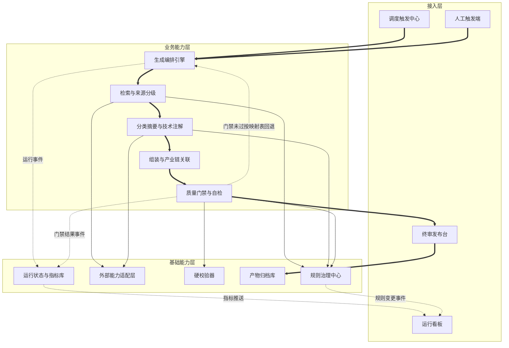
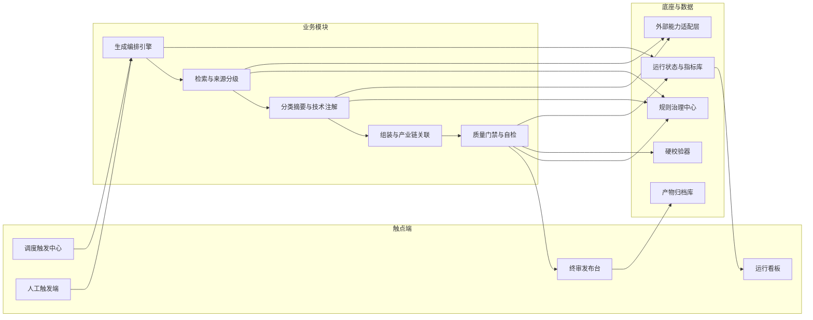

# AICoding 架构设计 · 高层架构设计

> 本文档为《AICoding 架构设计》核心产物之一，对应**高层架构设计**。
> 上游输入：用户原始诉求 + 资料摘要 `material_digest.md`（G1 通过）+ 行业调研报告 `research_report.md`（G2 通过）；
> 下游输出：驱动《系统设计》《部署设计》《安全设计》《UserStory》四份文档的撰写。
> 标的系统：chip-daily-report —— 芯片行业日报自动生成器（现状 v5.0 专业深度版）。

---

## 0. 元信息：修订记录

> 记录文档版本、变更内容、修订人、修订时间，确保设计文档的可追溯。

```yaml
标题: chip-daily-report（芯片行业日报自动生成系统） - 高层架构设计 v1.0
版本: v1.0
状态: Reviewing   # Draft | Reviewing | Approved | Deprecated
创建日期: 2026-08-07
最后更新: 2026-08-07
作者: business-architect（业务架构师 - 许边界）
评审人:
  - team-lead（AICoding 架构专家团主理人）
  - 人工审核（G3 阶段门）

关联文档:
  上游输入:
    - 用户原始诉求: 启动 AICoding 架构专家团，基于 chip-daily-report 项目背景与资料生成完整架构方案
    - 资料摘要: D:\创建skill\skills\chip-daily-report\.workbuddy\output\material_digest.md（G1 通过，含 D1–D12 与 X1–X16）
    - 行业调研报告: D:\创建skill\skills\chip-daily-report\.workbuddy\output\research_report.md（G2 通过，含 B1–B4 与加权评分）
    - 现有架构资产: chip-daily-report 仓库（SKILL.md / references / scripts / agents / .trae 镜像）
  下游产出:
    - 系统设计: .workbuddy/output/系统设计.md
    - 部署设计: .workbuddy/output/部署设计.md
    - 安全设计: .workbuddy/output/安全设计.md
    - UserStory: .workbuddy/output/UserStory.md
```

| 版本 | 日期 | 作者 | 变更内容 | 评审状态 |
| --- | --- | --- | --- | --- |
| v1.0 | 2026-08-07 | `business-architect` | 初稿：需求概要、痛点解构、行业调研整合、X1–X16 冲突裁决、方案决策、三层业务架构、产品需求与原型 | Reviewing |

> **版本管理纪律**：破坏性变更（章节结构调整 / 关键决策反转）升 MAJOR；新增章节、扩充内容升 MINOR。

---

## 1. 需求概要

### 1.1 需求概要说明

chip-daily-report 现状为一套模块化 Markdown 技能（1 份主控 SKILL.md + 3 份 references 知识库 + 1 个 768 行 Python 校验脚本 + 1 份 Agent YAML + 1 套 TRAE 镜像），只能由人工触发词手动启动 6 步流程，已产出 3 期日报（D9 11 条 / D10 9 条 / D11 22 条）。触发本期的关键事件：v5.0 升级后暴露三类结构性问题——规则口径在「文档 / 脚本 / 镜像」三处分裂（共 16 组冲突 X1–X16）、全流程无调度与无可观测、质量门禁只守格式不守语义。本期将其定位为「可定时、可观测、可校验、可私有化运行的芯片行业日报自动生成系统」，服务微电子专业读者与内容运维团队。

### 1.2 关键决策摘要

> 本期最关键的 5 项设计决策，每条均可映射到正文具体章节。

| 编号 | 决策类别 | 决策内容 | 关联章节 |
| --- | --- | --- | --- |
| D1 | 范围决策 | 本期只覆盖「每日芯片产业新闻的自动汇编 + 质量硬门禁 + 定时运维」；行情分析、投资建议、多语种发行、付费墙采集均不在范围内 | §6.1 需求边界 |
| D2 | 技术选型决策 | 采用开源三件套：LangGraph 承载 6 步状态化编排（加权 4.70）、Prefect 承载定时与可观测（加权 4.55）、既有 `validate_report.py` 保持为唯一硬门禁执行权威；DeepEval 式混合校验列入完整版 | §3.2 / §4.3 |
| D3 | MVP / 完整版边界 | MVP = 规则单一权威源 + X1–X16 裁决固化 + 定时生成 + 硬门禁拦截发布 + 运行看板（F1–F9、F14）；语义校验层、状态机断点恢复、跨期去重延后至完整版 | §4.3 |
| D4 | 复用 vs 新建 | 领域规则资产（分类规则 / 源库 / Rubric / 校验器 / Agent 配置）100% 复用；新建「规则治理中心」与「调度运维层」两块能力 | §2.4 / §5.2 |
| D5 | 部署形态 | 单节点自托管、数据不出域，仅出域调用公开检索与 LLM API；否决托管 SaaS（数据出境）；架构保持可退化为纯本地定时形态 | §4.2 / §5.2 |

**硬指标**：≥ 3 条，≤ 5 条；每条决策必须能映射到正文具体章节。本表 5 条，全部已标注关联章节。

### 1.3 价值主张

> 本系统对业务的核心价值贡献。本项目为内部专业内容生产工具，无直接营收，"收入"维度改以「内容供给达标率」度量，其余维度保留。

| 价值维度 | 量化目标 | 度量指标 | 当前值 | 目标值 | 截止时间 |
| --- | --- | --- | --- | --- | --- |
| 效率 | 单期日报的人工在场时长下降 | 人工在场分钟数 / 期 | 约 10 分钟（D1 六步耗时合计 9 分 40 秒，全程需人工在场触发与确认） | ≤ 2 分钟（仅终审确认） | MVP 上线后 1 个月 |
| 合规 | 来源分级口径统一，消除双清单 | 三副本 A 级域名清单 diff 条数 | 12 条差异（根目录 33 域名 vs 镜像 21 域名，同一份 D11 判出 72.7% 与 40.9% 两个结果） | 0 条差异 | MVP 上线 |
| 合规 | C 级来源零出现、来源可追溯率 | C 级条目数 / 无链接条目数 | 未做自动阻断，仅靠脚本事后判定 | C 级 0 条且无链接条目 0 条，硬门禁前置拦截 | MVP 上线 |
| 内容供给达标率 | 单期条数落入 15–20 目标区间 | 达标期数 / 总期数 | 0 / 3（实测 11、9、22 条，无一落区间） | ≥ 90% | 完整版上线 |
| 成本 | 不引入任何订阅型外部组件 | 新增 SaaS 订阅费 / 月 | 0 元（现状无订阅） | 0 元（LangGraph MIT、Prefect Apache 2.0 全开源自托管） | MVP 上线 |
| 体验 | 门禁一次通过率（无需回退重跑） | 一次通过期数 / 总期数 | 无法度量（D11 自检表自称 15 项全 PASS，但其内部来源统计自相矛盾，见 X13） | ≥ 90% | MVP 上线后 1 个月 |

**硬指标**：业务价值 ≥ 2 条 + 技术/成本价值 ≥ 1 条；每条必须可量化。本表业务价值 4 条（效率 / 合规 2 条 / 供给达标率）、技术成本价值 2 条（成本 / 体验），全部带数值。

---

## 2. 需求分析 & 痛点解构

### 2.1 核心角色关注点

> 按「甲方决策者 / 最终用户 / 受影响方」三大维度盘点角色诉求，共 3 类 6 个具体角色。

- 甲方决策者：技能维护者、日报终审人，共 2 个核心角色。
- 最终用户：微电子专业读者、产业链分析读者，共 2 个核心角色。
- 受影响方：运维值守、合规审阅，共 2 个核心角色。

| 角色 | 业务身份 | 主要操作 | Top1 关心点 | 来源 |
| --- | --- | --- | --- | --- |
| 技能维护者（甲方决策者） | skill owner / 项目负责人 | 修订规则文件、决定版本、同步镜像 | 改一处规则不遗漏其余副本，杜绝"文件间引用失效导致加载到过时规则" | D1 §反例黑名单 #12；D2 §当前状态 |
| 日报终审人（甲方决策者） | 内容负责人 | 发布前逐项复核自检表并放行 | 15 项门禁是"真实跑过脚本"而非笼统声称已自检通过 | D5 §门禁规则；D2 §怎么跑 |
| 微电子专业读者（最终用户 A） | 芯片行业从业者 / 微电子方向研究生 | 通读日报、点开来源链接回溯原文 | 每条含技术维度（制程 / 工艺 / 器件 / 材料）且术语有技术注解 | D2 §定位；D5 §4；D5 §14 |
| 产业链分析读者（最终用户 B） | 投研 / 战略分析岗 | 重点看产业链关联小节做传导推演 | 上下游传导写的是事实链路，不掺投资建议与价格预测 | D1 §边界；D5 §15；D5 §7 |
| 运维值守（受影响方） | SRE / 技能运维 | 每日巡检定时任务与失败重跑 | 失败可见、可重跑，绝不静默把错误日报自动发出去 | research_report §5.1 R-05；D2 §怎么跑 |
| 合规审阅（受影响方） | 合规 / 法务 | 抽查来源级别、免责声明与中立性 | C 级社媒来源零出现、每条可点击可追溯、无投资建议措辞 | D3 §使用规则；D5 §6；D5 §7 |

**硬指标**：≥ 3 类（甲方决策者 / 最终用户 / 受影响方各至少一行）；每行必须有"Top1 关心点"。本表 3 类 6 行，全部填写具体关心点。

### 2.2 核心痛点

> 以 P1 / P2 / P3 ... 编码列出本期需要解决的关键痛点，每条均有现象或数据佐证。

| 编号 | 痛点描述 | 现象 / 数据 | 影响角色 | 影响程度 | 优先级 |
| --- | --- | --- | --- | --- | --- |
| P1 | 规则口径在文档、脚本、镜像三处分裂，同一份日报能判出两种结果 | 根目录 A 级域名 33 个 vs `.trae` 镜像 21 个，净差 12 个；同一份 D11 的 22 条来源，按根目录清单 A 级占比 72.7%，按镜像清单 40.9%，相差 31.8 个百分点 | 技能维护者、合规审阅 | 高（合规底线） | P1 |
| P2 | 无调度、无可观测，运行全程依赖人工在场 | 现状唯一运行方式是触发词手动启动；失败信号只有脚本退出码 0/1；无日志留存、无重试、无历史指标 | 运维值守、技能维护者 | 高（不解决则无法自动化） | P1 |
| P3 | 分类与纳入边界规则自相矛盾，同类新闻在样例中归属相反 | HBM 量产在规则与 D9 归"制造"、在 D11 归"封测"；晶圆厂上市在 D4 §制造为正面条目、在 §存疑仲裁为"不纳入"；股价内容规则禁止却出现在 D9 标题与今日要点第 1 条且自评 PASS | 最终用户 A/B、日报终审人 | 高（产物可信度） | P1 |
| P4 | 质量门禁只覆盖格式，不覆盖语义 | `validate_report.py` 15 项均为正则与计数类检查；摘要是否忠实于来源、技术注解是否解释正确、分类是否真的正确，全部无自动校验；D11 出现"氧化镓正文配碳化硅注解"的错配 | 日报终审人、最终用户 A | 中 | P2 |
| P5 | 产出规模与格式持续漂移，三期样例无一致基线 | 条数 11 / 9 / 22 条，无一落入 15–20 目标区间；自检表 13 行与 15 行两套口径并存；元信息 blockquote 与全角冒号文本行两种写法；环节标题 `## EDA / 工具` 与 `## EDA` 两种写法；来源分级统计位置在自检表内与独立章节两种 | 最终用户 A/B、日报终审人 | 中 | P2 |

**优先级标准**：
- **P1**：直接影响业务核心流程或合规底线，不解决无法上线。
- **P2**：影响用户体验或运营效率，可在 MVP 后迭代。
- **P3**：体验型 / 长尾问题，列入完整版或后续版本。

**硬指标**：每条痛点必须有"现象 / 数据"佐证；P1 ≥ 1 条且必须在 §2.3 有对应目标。本表 P1 级 3 条（P1/P2/P3），均在 §2.3 有 V 级目标对应。

### 2.3 期待目标

> 以 V1 / V2 ... 形式列出可量化的业务目标，逐条反向对齐 §2.2 痛点。

| 编号 | 目标描述 | 对齐痛点 | 度量指标 | 当前值 | 目标值 | 截止时间 |
| --- | --- | --- | --- | --- | --- | --- |
| V1 | 规则收敛为单一权威源，三副本口径完全一致 | P1 | 三副本逐文件 diff 差异数；A 级域名双向差集 | 12 个域名差异；sources.md 与脚本双向差集 5 + 12 个 | diff = 0；双向差集 = 0，并由 CI 每次提交阻断 | MVP 上线 |
| V2 | 每工作日无人值守自动出报，失败可感知可重跑 | P2 | 定时任务成功率；失败到告警时延；人工在场时长 | 无定时任务，成功率不可度量 | 成功率 ≥ 95%；失败告警 ≤ 5 分钟；人工在场 ≤ 2 分钟/期 | MVP 上线 |
| V3 | 上游 16 组冲突全部裁决并固化进规则文件 | P3 | 已裁决冲突数 / 总冲突数；回归用例覆盖数 | 0 / 16 已裁决，0 条回归用例 | 16 / 16 裁决落地，每组至少 1 条回归用例 | MVP 上线 |
| V4 | 语义质量可抽检，摘要与注解不再靠人眼兜底 | P4 | 摘要忠实度抽检合格率；技术注解正确率 | 无自动校验，合格率不可度量 | 两项抽检合格率均 ≥ 90% | 完整版上线 |
| V5 | 产出规模与格式稳定，消除版本漂移 | P5 | 条数落入 15–20 区间的期数占比；格式漂移项数 | 0 / 3；格式漂移 4 类（自检表口径 / 元信息格式 / 环节标题 / 来源统计位置） | 条数达标 ≥ 90%；格式漂移 0 类 | 格式漂移 MVP 上线；条数达标 完整版上线 |

**硬指标**：每条目标必须有数字 + 对齐至少 1 条痛点；P1 痛点必须有对应 V 级目标。本表 5 条目标全部带数值，P1 级痛点 P1/P2/P3 分别对应 V1/V2/V3。

### 2.4 基线复用

> 现有资产中可直接复用的规则、脚本、配置与格式基线。凡列入 §2.5 功能缺口的能力，均已先在本节确认基线无法覆盖。

| 复用类别 | 现有能力 | 复用方式 | 来源系统 | 备注 |
| --- | --- | --- | --- | --- |
| 领域分类底座 | 产业链 5 环节分类判定规则（含正反条目、学术突破归类、不纳入清单、存疑仲裁表） | 直接复用，仅对 §3.4 裁决命中的条款定点修订 | `references/classification.md`（D4，215 行） | 分类原则"存疑归综合/其他"保留 |
| 来源分级底座 | A/B/C 三级源库（A 级 29 条）+ 未列入来源的兜底判定规则 + 三类搜索关键词模板 | 复用，与脚本硬编码清单合并为一份机器可读注册表 | `references/sources.md`（D3，176 行） | 业务权威源，见 X7 裁决 |
| 质量门禁底座 | 15 项 Rubric 的通过标准、判定方法与 PASS/FAIL 判例 | 复用，编号与项目名按脚本口径重排 | `references/rubric.md`（D5，353 行） | 见 X5 裁决 |
| 硬校验器 | 15 项自动校验 + 退出码 0/1 + 编码 fallback + 防注入域名判级 | 直接复用为唯一执行权威，仅增量补检查项 | `scripts/validate_report.py`（D6，768 行） | Python 3 无第三方依赖 |
| Agent 行为配置 | 工具权限、搜索策略、来源约束、输出约束、质量门禁、摘要约束的机器可读定义 | 复用为编排层的参数来源 | `agents/openai.yaml`（D8，99 行） | 检索轮次上限 3、门禁重试上限 5 |
| 产物格式基线 | 日报 markdown 骨架、blockquote 元信息、15 行自检表、三行来源分级统计、免责声明 | 复用 D9/D10 的格式写法，D11 差异项按 X14/X15/X16 裁决收敛 | `芯片行业日报_20260720.md` / `_20260722.md`（D9/D10） | v4.0 历史产物不追溯修订 |
| 检索与生成能力 | web_search / web_fetch 联网检索 + OpenAI 兼容 LLM 的摘要与技术注解生成 | 直接调用现有能力，不新建模型 | `agents/openai.yaml` §behavior.tools（D8） | 无自建爬虫、无私有模型依赖 |
| 安装分发形态 | TRAE 技能镜像目录（8 文件，7 个已逐字节一致） | 复用为分发副本，纳入一致性 CI 校验 | `.trae/skills/chip-daily-report/`（D12） | 见 X1/X2 裁决 |

**硬指标**：必须先盘点再决定新建；凡列入功能缺口的能力，必须先在本节确认基线无法覆盖。本节盘点 8 类基线，§2.5 的 8 项缺口均为基线中不存在的能力。

### 2.5 功能缺口

> 在现有基线之上仍需新建的能力，按「规则治理 / 生成前 / 生成中 / 生成后 / 运营」五个业务阶段分组。

| 阶段 | 功能缺口 | 必要性 | 优先级 | 对齐目标 |
| --- | --- | --- | --- | --- |
| 规则治理 | 单一权威规则注册表：域名分级、Rubric 项、分类仲裁条款集中定义，向三处副本单向生成 | 必须 | MVP | V1 |
| 规则治理 | 三副本一致性校验：根目录与镜像逐文件 diff，差异非 0 即阻断 | 必须 | MVP | V1 |
| 规则治理 | 16 组冲突裁决的规则化固化与回归用例 | 必须 | MVP | V3 |
| 生成前 | 工作日定时触发 + 非交互默认参数装载（日期范围、关注领域） | 必须 | MVP | V2 |
| 生成中 | 6 步流程的状态化编排：条件回退、循环计数上限 5、断点恢复 | 重要 | 完整版 | V2 |
| 生成后 | 门禁网关：脚本退出码 1 即拦截，产物停留草稿态不得发布 | 必须 | MVP | V2 |
| 生成后 | 语义质量校验层：摘要忠实度、技术注解正确性、分类正确性 | 重要 | 完整版 | V4 |
| 运营 | 运行看板与告警：成功率、门禁一次通过率、A 级占比、条数分布、FAIL 项排行 | 重要 | MVP | V5 |

**硬指标**：每条缺口必须对齐 §2.3 至少一条目标；MVP 缺口必须在 §6.3 功能清单中对应有 MVP 范围标记。本表 8 条全部标注对齐目标，6 条 MVP 缺口分别对应 F1/F2/F3/F4/F6/F9。

---

## 3. 行业调研

> 本章事实、对比、结论全部承接 `research_report.md`（G2 通过）。§3.4 为本项目专属的上游冲突裁决，由业务架构师行使裁决权。

### 3.1 行业标杆系统分析

| 标杆系统 | 厂商 / 来源 | 场景覆盖 | 技术亮点 | 商业模式 | 适用度 |
| --- | --- | --- | --- | --- | --- |
| B1 Perplexity（含 Sonar API） | Perplexity AI | 实时联网问答、深度研究、带内联引用的报告生成 | RAG 管线 + 逐句引用锚定 + 多模型编排 + 实时检索 | SaaS 订阅 + API 按 token 计费 | 低（范式可参考，组件不可用） |
| B2 LangGraph | LangChain 社区（MIT） | 有状态、多步、含分支与循环的 Agent 编排 | StateGraph 状态机 + Checkpointer 持久化 + 人工介入中断 | 开源，可自托管 | 高 |
| B3 DeepEval | Confident AI 社区（开源） | LLM 输出单元化评测（幻觉 / 忠实度 / 摘要质量） | Pytest 原生 + G-Eval 评委 + 50 余项指标 + 确定性代码评估器 | 开源，可自托管 | 中 |
| B4 Prefect | Prefect 社区（Apache 2.0） | Python 工作流编排、定时调度、可观测、可恢复执行 | flow 装饰器 + 持久化状态恢复 + 事件驱动 + 数据不出域的混合执行 | 开源，可自托管 | 高 |

**硬指标**：≥ 3 家；至少包含 1 家头部 SaaS + 1 家开源/自研代表。本表 4 家，B1 为头部 SaaS，B2/B3/B4 为开源代表。

### 3.2 方案对标及优先级打分

**对比矩阵**（权重之和 = 1）：

| 评估维度 | 权重 | B1 得分 | B2 得分 | B3 得分 | B4 得分 |
| --- | --- | --- | --- | --- | --- |
| 场景契合度 | 0.30 | 3 | 5 | 4 | 4 |
| 技术成熟度 | 0.20 | 5 | 5 | 4 | 5 |
| 集成难度（反向）| 0.15 | 3 | 3 | 3 | 4 |
| 成本（反向） | 0.15 | 3 | 5 | 5 | 5 |
| 合规可控性 | 0.20 | 2 | 5 | 5 | 5 |
| **加权总分** | **1.00** | **3.20** | **4.70** | **4.20** | **4.55** |

**结论摘要**：
- **优先借鉴**：**B2 LangGraph（4.70）** —— 理由：StateGraph 的条件边与原生循环几乎一一映射本项目"Rubric 失败按映射表回退对应 Step、循环上限 5 次"的流程约束；MIT 开源可自托管，合规与成本双 5 分。作为多步编排底座首选。
- **部分借鉴**：**B4 Prefect（4.55）** —— 借鉴点：定时触发、失败重试、断点恢复、运行 UI 与告警，直接补齐本项目最薄弱的调度与可观测环节；不借鉴其生成与质量逻辑（与 B2 分工，边界见 §5.2）。
- **部分借鉴**：**B3 DeepEval（4.20）** —— 借鉴点：以"确定性规则 + LLM 评委"双层评估补强纯规则脚本的语义盲区（摘要忠实度、技术注解正确性）；不借鉴其通用指标集，需按本项目 15 项 Rubric 自定义，且评委偏差需人工校准，故列入完整版。
- **不借鉴**：**B1 Perplexity（3.20）** —— 否决理由：闭源 SaaS、数据出境，合规可控性仅 2 分，与本项目私有化与来源分级底线冲突，不作为采购或集成组件；其"检索 → 综合 → 逐句引用"范式仅作架构参考。

**对本项目的选型落点**：编排层选 LangGraph（完整版启用状态机，MVP 先以顺序流程跑通）；运维层选 Prefect Server 自托管；质量层保持 `validate_report.py` 为硬门禁执行权威，DeepEval 式语义层在完整版以"先记录不拦截"方式灰度接入；来源分级与防幻觉沿用本项目既有 A/B/C 域名规则，不引入外部锚定服务。

### 3.3 完整报告参考

- 完整报告路径：`D:\创建skill\skills\chip-daily-report\.workbuddy\output\research_report.md`（G2 已通过人工审核）
- 调研工具：`tech-research-advisor`（见附录 B）
- 调研日期：2026-08-07
- 调研归档：`.workbuddy/output/research_report.md`，含 B1–B4 详述卡片、8 维度能力横向事实、SR-01–SR-18 共 18 条可追溯来源
- 调研移交的三项待确认：U-01 部署合规等级（本文档 §4.2 裁决）、U-02 混合校验是否进 MVP（本文档 §4.3 裁决）、U-03 冲突裁决归属（本文档 §3.4 裁决）

### 3.4 上游冲突裁决（X1–X16）

> `material_digest.md` §3 按纪律并列保留了 16 组冲突不做裁决，`research_report.md` U-03 将裁决权移交业务架构师。本节逐组给出**唯一裁决结论**，并标注裁决依据的 D 编号与落地动作。本节裁决权归属业务架构师本人，故不适用「经中间确认」标注。

| 编号 | 冲突主题 | 裁决结论（唯一） | 裁决依据 | 落地动作 |
| --- | --- | --- | --- | --- |
| X1 | 根目录与镜像 A 级域名清单不一致（33 vs 21） | 以**根目录 33 域名清单**为唯一权威，`.trae` 镜像同步至 v5.0；后续清单内容统一由 §X7 的注册表单向生成 | D2 §目录与约定要求镜像"必须与根目录同步"；D1 §反例黑名单 #12 禁止配套文件不一致 | F1 建注册表；F2 加 CI diff 阻断 |
| X2 | 镜像同步状态描述不一致（整体待同步 vs 仅一个常量） | 以 **D12 逐字节 diff 实测**为准：8 文件中 7 个已一致，仅 `validate_report.py` 的 A 级域名常量不同步；D2 §当前状态文案改写为"镜像仅域名常量待同步" | D12 §同步状态（diff 逐文件比对） | 修订 CLAUDE.md 当前状态段 |
| X3 | 摘要句数阈值差 1 句（3-4 PASS vs 3-5 PASS） | 采用 **3-5 句 PASS / 6 句 WARN / 7 句及以上 FAIL / 1-2 句 FAIL**；D1 §Step 3 那一行"3-4 句 PASS，5 句 WARN"判定为单点笔误 | D5 §4、D6 检查 4、D8 summary_constraints 三方一致，且 D1 §输出格式说明本身也写 3-5 句 | 修订 SKILL.md Step 3 该行 |
| X4 | 摘要过长回退目标（Step 5 vs Step 3） | 回退 **Step 3**（摘要生成步）；D1 §失败处理写"回到 Step 5"判定为笔误——Step 5 是自检步，不产出摘要 | D1 §Rubric-Step 映射表第 4 项；流程语义 | 修订 SKILL.md 失败处理表 |
| X5 | 15 项 Rubric 双口径（rubric.md vs 脚本各有 3 项独有） | 以 **`validate_report.py` 输出的 15 项为执行权威**（编号与项目名），`rubric.md` 按脚本口径重排；rubric 独有的"时间戳准确 / 信源可靠性 / 分类正确"3 项不删除，降级为 Step 2/Step 3 的**生成期强制规则**单列，并在完整版由语义校验层承接自动判定 | 脚本是硬约束执行方（D2 §怎么跑、D5 §门禁规则）；不删 3 项以免"15/15 通过"名不副实 | F3 重排 rubric.md；F11 承接 3 项 |
| X6 | 样例自检表口径（13 行 vs 15 行） | 新产物一律采用 **15 行脚本口径**；D9/D10 为 v4.0 历史产物，不追溯修订，仅作格式基线参考 | D1 §输出格式与 D5 §自检结果输出格式均要求 15 行；D11 已是 15 行 | 模板锁定 15 行；加回归用例 |
| X7 | A 级来源的权威定义源（sources.md vs 脚本硬编码） | `sources.md` 为**业务权威**（人读、含收录理由），脚本 `A_LEVEL_DOMAINS` 为**执行权威**，二者必须由**同一份机器可读注册表单向生成**，双向差集必须为 0：先向脚本补齐 5 个学术域名（isscc.org、vlsisymposium.org、dac.com、ieee-iedm.org、nature.com），再把脚本多出的 12 个媒体域名回写进 sources.md A 级表 | D5 §13 判定方法要求"对照 sources.md"，D6 实际用硬编码清单，二者必须同源 | F1 注册表；F2 双向差集校验 |
| X8 | Samsung 官方源域名写法（news.samsung.com vs samsung.com） | 采用 **`samsung.com`（父域匹配）**，覆盖 news.samsung.com 与 semiconductor.samsung.com 两个官方子域；sources.md 条目文字同步为 samsung.com（官方新闻室与半导体官网） | D3 收录意图是"三星官方"整体；D11 实际引用 semiconductor.samsung.com，窄匹配会误判为 B 级 | 注册表登记 samsung.com |
| X9 | HBM 类新闻归属（制造 vs 封测） | 归 **制造**；仅当新闻主体是封装工艺细节（混合键合、热压键合、MR-MUF、堆叠层数工艺）时才归封测。D11 把"HBM4 进入量产交付"放封测属误分类 | D4 §存疑仲裁规则明写"HBM 相关新闻归制造"；D4 §封测反条目同样写"HBM4 量产不是封测是制造"；D9 先例一致 | 加分类回归用例；F15 回收争议 |
| X10 | 企业上市/IPO 是否纳入 | 按**主体类型二分**：晶圆厂、存储厂、封测厂等**产能实体**的上市/新建/投产，且新闻披露产能或工艺信息的，**纳入**对应环节；芯片设计公司与 AI 芯片公司的**纯融资/IPO 事件不纳入**。据此长鑫科技科创板上市（3 座 12 英寸 DRAM 厂、产能规模）纳入制造成立，正文须以产能与工艺事实为主、募资金额仅作背景 | D4 §制造包含项明列"晶圆厂动态（新建/投产/上市）"并有晶合集成上市的正面条目；D4 §存疑仲裁的"不纳入"限定语是"AI 芯片公司融资/上市"，二者本可共存，原文缺限定语 | 改写 classification.md 存疑仲裁该行 |
| X11 | 股价信息能否出现 | **股价与指数不得作为新闻主体、标题主语或今日要点**；当股价变动是某技术事件的市场反应且来源已如实报道时，允许在摘要中作为**一句影响佐证**出现，且不得含涨跌预测与投资建议措辞。D9 把"Cadence/Synopsys 股价重挫"写进标题并列为今日要点第 1 条，属越界，正确写法应以"48 小时自主完成芯片设计流程"为标题主体 | D4 §不纳入清单与 D5 §11 禁止股价类内容；D4 §EDA 的正面条目又保留了股价表述，二者以"主体 vs 佐证"划界 | classification.md 增补书写规范；脚本保留 19 个投资建议关键词扫描 |
| X12 | 单期条数 15–20 的刚性 | 15–20 保留为**目标区间但为 WARN 级软指标**；脚本新增条数检查：落区间 PASS，10–14 或 21–25 判 WARN，少于 10 条或多于 25 条判 FAIL；节假日 0 条按既有兜底自动 PASS | D1 §Step2/§Step3/§反例 #16 要求 15–20；D1 §失败处理又允许 0 条节假日兜底，刚性 15–20 与之自相矛盾；D9/D10/D11 实测 11/9/22 | 脚本增检查项；SKILL.md 表述改软指标 |
| X13 | D11 自身 A/B 统计矛盾（16 条 72.7% vs 5 条 33.3%） | 以**按根目录 33 域名清单对 22 条 URL 逐条判定的结果为准**：A 级 16 条 / B 级 6 条 / 占比 72.7%。自检表第 10 项数据正确；独立"来源分级统计"章节数据错误（合计 15 条与声明的 22 条不符），应整体删除并回归自检结果小节内（见 X14） | D6 域名判级函数对 D11 全部来源域名的集合比对；D12 §差异影响的同源数据 | 删除 D11 式独立统计章节；模板锁定 |
| X14 | 来源分级统计的位置与格式 | 置于 **`## 自检结果` 小节内部，采用三行文本格式**（A 级列出具体来源与条数 / B 级条数 / A 级占比与达标标记）；D11 的独立一级章节加 4 列表格写法废止 | D1 §输出格式、D5 §自检结果输出格式、D9、D10 四处一致 | 模板锁定；脚本增位置 WARN 检查 |
| X15 | 环节章节标题写法 | 统一 **`## EDA / 工具`** 与 **`## 材料 / 设备`** 全称；D11 的 `## EDA`、`## 材料` 简写废止。脚本前缀匹配对两者均可命中，故额外新增"标题全称一致性"WARN 检查以防漂移 | D1 §输出格式、D5 §1 的 PASS 写法、D9、D10 四处一致 | 模板锁定；脚本增 WARN 检查 |
| X16 | 头部元信息书写格式 | 统一 **blockquote 三行 + 半角冒号**，且一级标题必须附日期（`# 芯片行业日报 — 年月日`）；D11 的普通文本行 + 全角冒号 + 行尾双空格 + 标题无日期写法废止 | D1 §输出格式、D5 §9、D9、D10 四处一致；脚本正则虽兼容全半角，但与模板字面要求不符 | 模板锁定；脚本增标题日期检查 |

**裁决覆盖度**：16 / 16 组冲突全部给出唯一结论，无并列保留项。其中 6 组（X1、X2、X7、X8、X13、X14）收敛为「单一权威源」类裁决，4 组（X3、X4、X5、X6）收敛为「以脚本为执行权威、文档对齐脚本」类裁决，3 组（X9、X10、X11）为分类边界裁决，3 组（X12、X15、X16）为格式与规模裁决。全部落地动作已映射到 §6.3 的 F1/F2/F3/F6/F11/F15。

---

## 4. 方案决策

### 4.1 价值定位澄清

**定位三段式**：

```
对外价值（读者侧）: 每工作日 09:00 前交付一份 15 项硬门禁全通过、A 级来源占比不低于 30%、
                    每条摘要含技术维度且术语带技术注解、每条来源可点击可追溯的芯片行业日报
对内价值（编辑与运维侧）: 人工从"全程在场约 10 分钟/期"降到"仅终审不超过 2 分钟/期"；
                    规则口径从文档、脚本、镜像三处分裂收敛为一处权威，改一处即全量生效
差异化价值        : 相较通用 AI 新闻聚合与问答式研究工具，本系统把「产业链 5 环节完整性、
                    A/B/C 来源分级与 C 级禁用、微电子技术注解、产业链上下游关联」四条领域强约束
                    固化为可执行硬门禁（15 项检查、退出码 0/1），不合格产物在系统层面无法被发布
```

**与产品矩阵的关系**：本系统在「芯片行业情报供给」价值主线中承担**每日事实层供给与质量把关**职责，向上承接公开检索与 LLM 推理底座，向下为专业读者、产业链分析读者与归档检索提供标准化产物，与规则治理中心、运行看板共同形成完整业务闭环（见 §5.2、§5.3）。本系统不承担情报的解读、估值与投资决策职责，该部分由读者自身的分析流程承担。

### 4.2 系统定位澄清

| 维度 | 内容 |
| --- | --- |
| 系统名称 | chip-daily-report 芯片行业日报自动生成系统（简称 CDR，与后续术语表一致） |
| 系统类型 | 已有系统扩展 —— 在 v5.0 技能资产（主控 + 规则库 + 校验器 + Agent 配置）之上新增「规则治理中心」与「调度运维层」，不推倒重建 |
| 部署形态 | 单节点自托管服务化、数据不出域；产物、规则与运行状态全部落本地卷，仅出域调用公开新闻检索与 OpenAI 兼容 LLM API（现状已在用）。否决托管云 SaaS 形态。**经中间确认（U-01 部署形态，用户裁决：方案B 单节点自托管服务化，数据不出域）** |
| 多租户 | 否 —— 单实例单编辑部运行，按单机单用户定位，不引入租户模型。**经中间确认（U-01 部署形态，用户裁决：方案B 单节点自托管服务化，数据不出域）** |
| 服务对象 | §2.1 的 3 类 6 个角色：技能维护者、日报终审人、微电子专业读者、产业链分析读者、运维值守、合规审阅 |
| 上游依赖 | 公开新闻检索能力、网页正文抓取能力、OpenAI 兼容 LLM 推理服务、既有规则知识库与硬校验器（详见 §5.2） |
| 下游消费者 | 日报产物目录与归档库、运行看板、终审发布端（详见 §5.2） |
| 边界（不做） | 不做行情与投资分析、不做付费墙与非公开信息采集、不做外文标题机器翻译与多语种发行、不做自建爬虫与反爬绕过、不做社交媒体（C 级）来源接入；上述能力由读者自身流程或外部合规渠道承担 |

### 4.3 MVP 与完整版决策

| 阶段 | 时间窗 | 范围（功能编号） | 架构差异点 | 退出标准 | 不做（延后） |
| --- | --- | --- | --- | --- | --- |
| MVP | W1 ~ W6 | F1, F2, F3, F4, F5, F6, F7, F8, F9, F14 | 单节点 Docker 基线（Prefect Server + 生成编排容器 + 本地 Web 终审台），单实例无多租户、数据不出域；6 步流程以顺序编排跑通（不启用状态机断点恢复）；语义校验层不接入；沿用现有 OpenAI 兼容 LLM API，不做私有化推理；看板指标仅本地留存。**经中间确认（U-01 部署形态，用户裁决：方案B 单节点自托管服务化，数据不出域）** | 连续 10 个工作日无人值守自动出报，成功率 ≥ 95%；门禁一次通过率 ≥ 90%；三副本清单 diff = 0 且 CI 阻断生效；X1–X16 共 16 组裁决全部固化并各有回归用例 | F10, F11, F12, F13, F15 |
| 完整版 | W7 ~ W16 | 追加 F10, F11, F12, F13, F15 | 同一单节点 Docker 基线内，编排改为状态机承载条件回退与断点恢复；语义校验层以"先记录不拦截"灰度 4 周后转为拦截；新增跨期事件指纹库支撑跨期去重；新增分类争议回收工作流 | 摘要忠实度与技术注解正确率抽检均 ≥ 90%；连续 30 个工作日成功率 ≥ 98%；单期条数落入 15–20 区间占比 ≥ 90%；格式漂移项归零 | — |

**U-02 裁决（LLM 混合校验是否进 MVP）**：**不进 MVP，列入完整版 F11**。依据：research_report §4.2 与 §5.1 R-03 指出 LLM 评委存在位置、冗长与自我偏好偏差，未经校准直接作硬门禁会误判良品、漏判次品；MVP 阶段的首要矛盾是 P1 规则口径与 P2 调度可观测，而非语义精度。落地纪律：F11 上线后仍不取代 `validate_report.py`，硬门禁始终由规则脚本兜底，语义层只输出 WARN 与抽检报告。

**演进纪律**：
- MVP 的架构骨架必须是完整版的**子集**：MVP 的顺序编排在完整版被状态机替换时，6 步的节点划分、Rubric-Step 回退映射、门禁网关位置三者保持不变，只替换执行引擎，不改业务分层。
- MVP 中可延后的能力必须在本节写明替换计划：语义校验层在 MVP 阶段的位置由"门禁网关后的空实现钩子"占位，完整版直接在该钩子接入 F11，不改调用链。
- 禁止为赶工引入完整版无法继承的临时架构：MVP 不允许把规则清单硬编码回脚本内（那会让 F1 注册表失效并使 X1/X7 复发）；不允许用"人工每日手动跑一次脚本"冒充 F4 定时触发。

---

## 5. 业务架构设计

### 5.1 业务架构图

**绘制规范**：
- 本图共三层，自上而下为 接入层（触发与人机交互）→ 业务能力层（6 步生成与质量门禁）→ 基础能力层（规则底座、外部能力与存储底座）。
- 每个模块使用与 §6.2 模块全景图、§4.2 系统定位一致的标准名。
- 数据流方向：实线为同步调用，虚线为异步事件，加粗链路为日报生成主链路。



**分层职责说明**：
- **接入层**：负责"何时开始"与"人如何介入"。调度触发中心按工作日定时拉起非交互运行；人工触发端保留触发词方式用于补跑；终审发布台是唯一发布出口；运行看板面向运维值守。
- **业务能力层**：承载 D1 定义的 6 步流程。生成编排引擎对应 Step 1 范围确认与全流程调度；检索与来源分级对应 Step 2；分类摘要与技术注解对应 Step 3；组装与产业链关联对应 Step 4；质量门禁与自检对应 Step 5，并向编排引擎回送回退指令。Step 6 的保存动作由终审发布台与产物归档库共同完成。
- **基础能力层**：规则治理中心是 X1–X16 裁决的唯一落点，向业务层提供分级规则、分类规则与门禁标准；外部能力适配层封装检索与 LLM 调用；硬校验器为 `validate_report.py`；产物归档库存日报；运行状态与指标库存运行事件与质量指标。

### 5.2 系统依赖架构

| 依赖类型 | 系统 / 模块 | 提供方 | 依赖能力 | 接入方式 | 同步/异步 | 关键约束 |
| --- | --- | --- | --- | --- | --- | --- |
| 上游 | 公开新闻检索 | 外部搜索引擎 | 关键词检索与站内限定检索（三层检索策略） | HTTPS API | 同步 | 单期检索轮次上限 3（D8 max_search_rounds）；A 级占比不足即时补搜；无结果时切备用引擎重试 1 次 |
| 上游 | 网页正文抓取 | 目标来源站点 | 正文与发布时间提取，用于时效判定 | HTTPS | 同步 | 仅公开可访问页面，付费墙内容直接丢弃；单页超时 15 秒；抓取失败标"链接待验证"并保留标题摘要 |
| 上游 | LLM 推理服务 | OpenAI 兼容 API 提供方 | 摘要生成、技术注解、产业链关联推演 | HTTPS REST | 同步 | 单期 token 预算封顶；仅传递检索所得公开正文，不外传规则文件与运行元数据；输出须满足 3-5 句与 80-150 字约束 |
| 复用底座 | 规则治理中心（源库 / 分类规则 / Rubric） | 本项目 `references/` | 来源分级、5 环节分类判定、15 项门禁标准 | 本地文件按需加载 | 同步 | 按 Step 加载（sources 于 Step 2、classification 于 Step 3、rubric 于 Step 5）；单一权威注册表生成，三副本 diff 必须为 0 |
| 复用底座 | 硬校验器 | 本项目 `scripts/validate_report.py` | 15 项硬门禁自动校验 | 子进程调用 | 同步 | Python 3 无第三方依赖；退出码 1 即拦截发布；WARN 级项不阻断但须计入指标 |
| 复用底座 | Agent 行为配置 | 本项目 `agents/openai.yaml` | 工具权限、搜索策略、门禁参数、摘要约束 | 启动时配置加载 | 同步 | 参数变更必须同步 SKILL.md 与镜像；门禁重试上限固定 5 次 |
| 复用底座 | 调度与可观测底座 | Prefect Server（自托管） | 定时触发、失败重试、状态持久化、运行 UI | 本地 Python SDK 与本地 HTTP UI | 混合 | 仅存运行元数据不存正文；失败告警 ≤ 5 分钟；自动重试不得跳过门禁网关。**经中间确认（U-01 部署形态，用户裁决：方案B 单节点自托管服务化，数据不出域）**：Prefect Server 随单节点 Docker 基线一并自托管部署，运行 UI 即本地 Web 看板之一 |
| 下游 | 产物归档库 | 本项目归档目录 | 日报正文落盘与命名 | 本地文件写入 | 同步 | 命名固定为 `芯片行业日报_年月日.md`；未通过门禁的产物只能写入草稿目录 |
| 下游 | 终审发布台 | 内容负责人 | 草稿复核与发布放行 | 人工确认 | 同步 | 门禁未通过时发布动作强制禁用，无绕过路径 |
| 下游 | 运行看板 | 运维值守 | 成功率、门禁一次通过率、A 级占比、条数分布、FAIL 排行 | 本地 Web UI | 异步 | 只读元数据，不呈现未发布正文；指标保留 90 天 |
| 数据订阅 | 历史日报事件指纹 | 产物归档库 | 跨期去重与回顾标注 | 文件订阅 | 异步 | 近 14 期滚动窗口；完整版启用（F12） |

**硬指标**：
- 每条依赖必须明确"接入方式 + 同步/异步 + 关键约束"。本表 11 条依赖全部三项齐备。
- 所有 P1 痛点对应的核心能力，必须能在本表中找到依赖来源。核对：P1（规则口径分裂）对应"规则治理中心"复用底座；P2（无调度无可观测）对应"调度与可观测底座"复用底座与"运行看板"下游；P3（分类边界矛盾）对应"规则治理中心"中的分类规则与 §3.4 裁决落地。

**编排层与调度层的职责边界**（承接 research_report §5.3 D-01）：调度层只管"每日何时拉起、整体失败如何重试与恢复、运行元数据如何观测"，不感知 6 步内部语义；编排层只管"6 步之间如何流转、门禁失败回退到哪一步、循环是否超过 5 次"，不感知定时与告警。两层的唯一交互面是"一次生成任务的启动参数与终态（成功 / 门禁未过 / 异常）"。

### 5.3 业务闭环

**业务主链路**（端到端）：

```
定时触发或人工补跑
  → 范围确认（非交互装载默认日期范围与关注领域）
  → 检索与来源分级（三层检索、域名判级、即时去重、时效标注）
  → 分类与摘要生成（5 环节归类、五要素摘要、技术注解）
  → 组装（头部元信息、今日要点、5 环节、产业链关联、自检表）
  → Rubric 自检与脚本硬校验
  → 门禁网关（通过则转草稿待终审，未过则按 Rubric-Step 映射回退，循环上限 5 次）
  → 终审发布与归档
  → 运行与质量指标回流规则治理中心
```

**关键反馈回路**：

| 回路 | 触发点 | 反馈对象 | 反馈机制 | 价值 |
| --- | --- | --- | --- | --- |
| 质量门禁回路 | 脚本校验输出 FAIL 项 | 生成编排引擎 | 按 Rubric-Step 映射即时回退对应步骤重跑，循环上限 5 次，超限则保留最后结果并标注 FAIL 项 | 不合格日报无法外发，对齐 V2 |
| 规则治理回路 | 门禁 FAIL 项按检查项周度聚合 | 规则治理中心（源库 / 分类规则 / Rubric） | 周度规则修订，经注册表单向生成三副本并跑回归用例 | 规则口径持续收敛，减少重复 FAIL，对齐 V1 |
| 运营监控回路 | 任务失败、超时、A 级占比低于 30% | 运维值守 | 实时告警加运行看板，5 分钟内可感知 | 杜绝静默失败与静默发布，对齐 V2 |
| 分类争议回路 | 终审人在终审台标记误分类条目 | classification.md 存疑仲裁表 | 月度汇总增补仲裁条款，纳入回归用例 | 收敛 X9/X10/X11 一类边界争议，对齐 V3 |
| 来源健康回路 | 域名连续多期 0 命中或抓取失败率升高 | sources.md 源库 | 月度源可用性核查与失效标注（D3 §头部维护规则） | 保障 A 级占比不低于 30% 长期可达成，对齐 V1 |
| 语义质量回路 | 语义校验层抽检不合格样本 | 提示词与技术注解规则 | 完整版启用，双周校准评委并修订提示词 | 提升摘要忠实度与注解正确率，对齐 V4 |

**运营主线**：
- **每日**：运维值守于 08:40 巡检定时任务状态、重试次数与门禁结果，异常即刻重跑；日报终审人于 09:00 前在终审台复核 15 项自检表与来源分级统计并放行发布。
- **每周**：技能维护者复盘本周 FAIL 项 Top3、A 级占比分布与条数分布，提交规则修订并触发三副本一致性校验。
- **每月**：合规审阅抽查不少于 10 期日报的来源级别、免责声明与中立性；技能维护者执行源库可用性核查、失效源标注与替换，并归档分类争议仲裁增补。

---

## 6. 产品需求及原型

### 6.1 需求边界

**In-Scope（本期必做，共 13 条）**：

| 编号 | In-Scope 项 | 类型 | 说明 |
| --- | --- | --- | --- |
| F1 | 单一权威规则注册表 | 功能 | 域名分级、Rubric 项、分类仲裁条款集中定义并单向生成三处副本 |
| F2 | 三副本一致性 CI 校验 | 功能 | 根目录与镜像逐文件 diff，差异非 0 即阻断 |
| F3 | X1–X16 裁决固化 | 功能 | 16 组裁决写入规则文件并配回归用例 |
| F4 | 工作日定时触发 | 功能 | 每工作日 08:30 非交互启动，装载默认参数 |
| F5 | 6 步流程编排与门禁回退 | 功能 | 按 Rubric-Step 映射自动回退重跑，上限 5 次 |
| F6 | 15 项硬门禁执行与发布拦截 | 功能 | 退出码 1 即拦截，产物停留草稿态 |
| F7 | A 级占比即时保障 | 功能 | 三层检索加域名判级，不足即时补搜 |
| F8 | 草稿态与人工终审发布 | 功能 | 门禁通过仅生成草稿，终审确认后发布归档 |
| F9 | 运行与质量指标看板 | 功能 | 成功率、一次通过率、A 级占比、条数分布、FAIL 排行 |
| N1 | 单期端到端耗时上限 | 非功能 | 单期生成（含最多 5 次门禁回退）总耗时 ≤ 30 分钟 |
| N2 | 数据不出域 | 非功能 | 正文、规则、运行元数据全部本地留存，仅出域调用检索与 LLM API |
| N3 | 零第三方依赖的校验器 | 非功能 | `validate_report.py` 保持 Python 3 标准库实现，可脱离系统独立运行 |
| N4 | 失败可观测性 | 非功能 | 任一步失败均产生结构化运行事件，告警时延 ≤ 5 分钟 |

**Out-of-Scope（本期不做，逐条列原因）**：

| 编号 | 不做的事 | 边界类型 | 不做原因 | 后续计划 |
| --- | --- | --- | --- | --- |
| O1 | 行情、股价指数与投资建议分析 | Out-of-Scope | 违背 D1 §边界"不做投资建议与市场预测"与 D5 §7 中立性；脚本已内置 19 个投资建议关键词拦截 | 不做 |
| O2 | 付费墙与非公开信息采集 | Out-of-Scope | D1 §边界明确"只汇总公开可访问来源，不引付费墙"，非公开信息自动跳过 | 不做 |
| O3 | 多租户与多编辑部数据隔离 | Out-of-Scope | 经中间确认（U-01 部署形态，用户裁决：方案B 单节点自托管服务化，数据不出域），方案B 定位单机单用户运行，单实例单编辑部已满足全部角色诉求；引入租户模型会放大权限模型与存储隔离成本，收益不成正比 | 不做 |
| O4 | 外文标题机器翻译与多语种发行 | Out-of-Scope | D1 §边界"不翻译外文标题"，非英文可附中文译名并标注，属生成期规则而非独立能力 | 不做 |
| O5 | 自建爬虫与反爬绕过 | Out-of-Scope | 合规风险不可控；现有 web_search 与 web_fetch 已满足公开来源获取需求 | 不做 |
| O6 | 私有化 LLM 推理部署 | Out-of-Scope | 经中间确认（U-01 部署形态，用户裁决：方案B 单节点自托管服务化，数据不出域），方案B 单节点自托管服务化已满足数据不出域底线，MVP 沿用现有 OpenAI 兼容 API 即可，私有化 LLM 推理不在本期范围 | 不做 |
| O7 | 社交媒体等 C 级来源接入 | Out-of-Scope | D3 §C 级来源规定微博、推特、抖音、快手、知乎、小红书、B 站一律不使用，发现即丢弃 | 不做 |

**硬指标**：In-Scope ≤ 15 条；Out-of-Scope ≥ 3 条。本节 In-Scope 13 条（9 功能 + 4 非功能），Out-of-Scope 7 条。

### 6.2 产品模块全景图

**模块卡片字段定义**：

| 字段 | 说明 |
| --- | --- |
| 模块名称 | 标准名，与 §5.1 业务架构图、§4.2 系统定位一致 |
| 一级归属 | 接入层 / 业务能力层 / 基础能力层 |
| 责任团队 | 承担建设与维护的团队 |
| 上游 | 输入来源的模块或系统列表 |
| 下游 | 输出去向的模块或系统列表 |
| MVP 是否包含 | 是 / 否 |

**模块清单**：

| 模块名称 | 一级归属 | 责任团队 | 上游 | 下游 | MVP 是否包含 |
| --- | --- | --- | --- | --- | --- |
| 调度触发中心 | 接入层 | 运维平台组 | 系统定时器 | 生成编排引擎 | 是 |
| 人工触发端 | 接入层 | 技能维护组 | 技能维护者、日报终审人 | 生成编排引擎 | 是 |
| 终审发布台 | 接入层 | 内容运营组 | 质量门禁与自检 | 产物归档库 | 是 |
| 运行看板 | 接入层 | 运维平台组 | 运行状态与指标库 | 运维值守、技能维护者 | 是 |
| 生成编排引擎 | 业务能力层 | 技能维护组 | 调度触发中心、人工触发端、质量门禁回退指令 | 检索与来源分级 | 是 |
| 检索与来源分级 | 业务能力层 | 技能维护组 | 生成编排引擎、规则治理中心、外部能力适配层 | 分类摘要与技术注解 | 是 |
| 分类摘要与技术注解 | 业务能力层 | 技能维护组 | 检索与来源分级、规则治理中心、外部能力适配层 | 组装与产业链关联 | 是 |
| 组装与产业链关联 | 业务能力层 | 技能维护组 | 分类摘要与技术注解 | 质量门禁与自检 | 是 |
| 质量门禁与自检 | 业务能力层 | 技能维护组 | 组装与产业链关联、规则治理中心、硬校验器 | 终审发布台、生成编排引擎 | 是 |
| 规则治理中心 | 基础能力层 | 技能维护组 | 技能维护者、分类争议回路、来源健康回路 | 检索与来源分级、分类摘要与技术注解、质量门禁与自检 | 是 |
| 外部能力适配层 | 基础能力层 | 技能维护组 | 公开检索、网页抓取、LLM 推理服务 | 检索与来源分级、分类摘要与技术注解 | 是 |
| 硬校验器 | 基础能力层 | 技能维护组 | 质量门禁与自检 | 质量门禁与自检 | 是 |
| 产物归档库 | 基础能力层 | 内容运营组 | 终审发布台 | 读者、跨期去重（完整版） | 是 |
| 运行状态与指标库 | 基础能力层 | 运维平台组 | 生成编排引擎、质量门禁与自检 | 运行看板 | 是 |



### 6.3 功能清单

| 编号 | 一级模块 | 二级功能 | 功能描述 | 优先级 | MVP 范围 | 完整版范围 | 对齐目标 |
| --- | --- | --- | --- | --- | --- | --- | --- |
| F1 | 规则治理中心 | 单一权威规则注册表 | 把 A/B/C 域名分级、15 项 Rubric 定义、分类仲裁条款集中为一份机器可读注册表，向 sources.md、rubric.md、classification.md 与脚本常量单向生成 | P0 | ✅ | ✅ | V1 |
| F2 | 规则治理中心 | 三副本一致性 CI 校验 | 根目录与 TRAE 镜像逐文件 diff，并校验脚本域名清单与 sources.md 双向差集为 0，差异非 0 即阻断提交与发布 | P0 | ✅ | ✅ | V1 |
| F3 | 规则治理中心 | 冲突裁决固化与回归用例 | 将 §3.4 的 16 组裁决写入对应规则文件，并为每组配置至少 1 条回归用例，防止裁决被后续修订回退 | P0 | ✅ | ✅ | V3 |
| F4 | 调度触发中心 | 工作日定时触发 | 每工作日 08:30 以非交互模式启动，自动装载默认日期范围（最近一个工作日）与默认关注领域，不等待用户输入 | P0 | ✅ | ✅ | V2 |
| F5 | 生成编排引擎 | 6 步流程编排与门禁回退 | 按 D1 定义的 6 步顺序编排，接收门禁 FAIL 项后按 Rubric-Step 映射表回退到对应步骤重跑，循环计数上限 5 次 | P0 | ✅ | ✅ | V2 |
| F6 | 质量门禁与自检 | 15 项硬门禁执行与发布拦截 | 显式输出 15 行自检表后调用校验器，退出码 1 则产物停留草稿态且发布动作禁用 | P0 | ✅ | ✅ | V1 |
| F7 | 检索与来源分级 | A 级占比即时保障 | 执行 A 级站内限定、5 环节双语、技术突破三层检索，按 URL 域名即时判级，占比不足 30% 立即补搜 | P0 | ✅ | ✅ | V1 |
| F8 | 终审发布台 | 草稿态与人工终审发布 | 门禁通过仅生成草稿，终审人逐项复核自检表与来源分级统计后确认发布并归档 | P0 | ✅ | ✅ | V2 |
| F9 | 运行看板 | 运行与质量指标看板 | 展示近 30 期成功率、门禁一次通过率、A 级占比、条数分布与 FAIL 项排行 | P1 | ✅ | ✅ | V5 |
| F14 | 运行看板 | 告警与值班通知 | 任务失败、超时、A 级占比不足三类事件在 5 分钟内通知到运维值守 | P1 | ✅ | ✅ | V2 |
| F10 | 生成编排引擎 | 状态化编排与断点恢复 | 以状态机承载 6 步与条件回退，每步持久化，异常后可从断点续跑而非整期重来 | P1 | ❌ | ✅ | V2 |
| F11 | 质量门禁与自检 | 语义质量校验层 | 对摘要忠实度、技术注解正确性、分类正确性做自动评估，先记录不拦截，灰度 4 周后转为 WARN 输出，硬门禁始终由规则脚本兜底 | P1 | ❌ | ✅ | V4 |
| F12 | 产物归档库 | 跨期事件去重记忆 | 建立近 14 期事件指纹库，跨期重复事件自动合并或标注回顾，避免同一事件多期重复出现 | P2 | ❌ | ✅ | V5 |
| F13 | 规则治理中心 | 源库健康巡检 | 月度探测 A/B 级域名可用性与命中率，自动标注失效源并提示替换 | P2 | ❌ | ✅ | V1 |
| F15 | 终审发布台 | 分类争议回收 | 终审人可对条目标记误分类并附理由，月度汇总回流存疑仲裁表 | P2 | ❌ | ✅ | V3 |

**硬指标核对**：
- 全部 P0 功能共 8 条（F1–F8），在 MVP 范围列均标记为 ✅，无一延后。
- 每个功能均可反向映射到 §2.5 功能缺口与 §2.3 期待目标：F1/F2/F13 对应"规则治理"缺口与 V1；F3/F15 对应裁决固化缺口与 V3；F4 对应"生成前"缺口与 V2；F5/F10 对应"生成中"缺口与 V2；F6/F11 对应"生成后"缺口与 V2/V4；F7 对应来源分级保障与 V1；F8 对应门禁网关与 V2；F9/F12/F14 对应"运营"缺口与 V5/V2。

### 6.4 产品原型 - 终审发布台

> 面向日报终审人的核心触点端，是本系统唯一的发布出口。MVP 形态为命令行文本终审加本地静态复核页。

**核心页面清单**：

| 页面 | 用途 | 关键交互 | MVP |
| --- | --- | --- | --- |
| 草稿终审页 | 呈现当期日报正文、15 行自检表与三行来源分级统计 | 逐项展开 FAIL 与 WARN 说明、跳转到问题条目、一键触发指定 Step 回退重跑 | ✅ |
| 门禁详情页 | 呈现校验器原始输出与失败定位 | 按检查项筛选、复制修正建议、查看 Rubric-Step 映射指引 | ✅ |
| 条目校对页 | 单条新闻的标题、摘要、来源链接、时间戳、环节归属与技术注解 | 修改环节归属、补技术注解、增删回顾标签、删除越界条目 | ✅ |
| 发布确认页 | 归档命名、免责声明与产业链关联小节的最终确认 | 确认发布、写入归档目录、生成发布事件 | ✅ |
| 争议标记页 | 记录误分类与边界争议供月度仲裁 | 标记条目、填写理由、提交回流 | ❌（完整版，对应 F15） |

**关键交互约束**：
- 终审首屏（正文加 15 行自检表）加载 P95 ≤ 2 秒，对齐 V2 的人工在场 ≤ 2 分钟。
- 从"草稿就绪告警"到"发布完成"的核心路径 ≤ 4 步（打开草稿 → 复核自检表 → 逐条抽查 → 确认发布）。
- 校验器退出码为 1 时，发布按钮强制禁用且无命令行绕过参数，对齐 V1 与 §2.1 日报终审人的 Top1 关心点。
- 任一条目被修改后必须重新触发完整校验，禁止"改完直接发"。

**原型归档**：本期以命令行终审加本地静态复核页为最小形态，页面结构与字段清单归档于 `.workbuddy/output/prototype/终审发布台.md`；高保真交互稿列入完整版。

### 6.5 产品原型 - 运行看板

> 面向运维值守与技能维护者的监控触点端。**经中间确认（U-01 部署形态，用户裁决：方案B 单节点自托管服务化，数据不出域）**，本系统按单节点自托管服务化部署，运行看板以本地 Web 看板形态呈现（Prefect UI 或自建 Web 看板，只读运行元数据），页面清单与指标口径如下。

**核心页面清单**：

| 页面 | 用途 | 关键交互 | MVP |
| --- | --- | --- | --- |
| 运行总览页 | 近 30 期任务状态、耗时、门禁回退次数 | 按状态筛选、一键重跑、查看单期运行日志 | ✅ |
| FAIL 归因页 | 15 项检查的 FAIL 计数排行与典型样本 | 按检查项下钻到具体期次与条目 | ✅ |
| 规则一致性页 | 三副本 diff 结果与域名双向差集 | 手动触发校验、查看差异明细、跳转修复指引 | ✅ |
| 告警配置页 | 失败、超时、A 级占比不足三类阈值与通知渠道 | 阈值编辑、测试通知、值班人配置 | ✅ |
| 质量趋势页 | 门禁一次通过率、A 级占比、条数分布的时间趋势 | 时间维下钻、按环节维度拆分、导出 | ❌（完整版） |
| 源库健康页 | A/B 级域名可用性与命中率 | 探测触发、失效标注、替换建议 | ❌（完整版，对应 F13） |

**关键交互约束**：
- 看板只读运行元数据，不呈现未发布日报正文，避免绕过终审发布台形成第二个发布出口。
- 告警从事件产生到触达值守 ≤ 5 分钟，对齐 V2。
- 指标保留窗口 90 天，满足每周复盘与每月合规抽查的回溯需求。

**原型归档**：页面结构与指标口径归档于 `.workbuddy/output/prototype/运行看板.md`。

---

## 附录 A：生成流程方法论

> 本附录为高层架构设计的**生成方法论**，描述每一步的目标、工具与产物形态，作为正文章节的产出依据，属元信息。

### A.0 生成流程总览

> 高层架构设计采用 Step0 → Step5 六步法，逐步从业务背景推导至系统高层架构与产品需求原型。

| 步骤 | 名称 | 核心产出 | 落入正文章节 |
| --- | --- | --- | --- |
| Step0 | 业务基础知识库构建 | 关联文档结构化知识库 | 为全文提供输入 |
| Step1 | 行业调研分析 | 行业标杆、方案对比、MVP 决策 | §3 行业调研 |
| Step2 | 需求分析与痛点解构 | 需求画像卡 | §2 需求分析 & 痛点解构 |
| Step3 | 能力盘点与系统定位 | 价值定位、系统定位 | §4 方案决策、§5.2 系统依赖架构 |
| Step4 | 生成系统高层架构设计 | 本文档主文档 | §1 ~ §5 |
| Step5 | 产品需求及原型 | 需求边界、全景图、原型 | §6 产品需求及原型 |


### A.1 Step0：业务基础知识库构建

#### A.1.1 目标

构建业务系统关联信息知识库，为后续步骤提供现有架构与外部依赖文档等业务背景。

#### A.1.2 工具（Skill）

- `docx`：解析 Word 类业务与产品文档
- `pdf`：解析 PDF 类规范与手册
- `pptx`：解析方案与汇报型 PPT
- `xlsx`：解析数据表与清单类文件

#### A.1.3 本次执行情况

本项目原始资料全部为代码仓库内的 Markdown、Python、YAML 与目录镜像，未触发上述四类办公文档解析。实际由 `knowledge-ingest-engineer` 产出 `material_digest.md`，含 D1–D12 共 12 份资料、105 条章节级摘要与 X1–X16 共 16 组冲突记录，作为本文档全部事实底座。

### A.2 Step1：行业调研分析

#### A.2.1 目标

基于当前需求调研行业标杆系统及对应解决方案，对标行业优秀方案，结合当前系统背景与基础组件能力，综合打分决策 MVP 功能与落地路径。

#### A.2.2 工具（Skill）

- `tech-research-advisor`

#### A.2.3 完整报告参考

- 完整报告路径：`.workbuddy/output/research_report.md`（G2 已通过）

#### A.2.4 本次执行情况

调研围绕 5 个问题展开：自动成文的行业标杆与架构模式、LLM 多步编排框架选型、内容质量校验机制、来源可信度分级与防幻觉做法、定时调度与可观测私有化选型。产出 B1–B4 共 4 家标杆、5 维度加权评分矩阵与开源三件套组合建议，全部整合入本文档 §3.1 与 §3.2，并在 §3.4 完成上游冲突裁决。

### A.3 Step2：需求分析与痛点解构

#### A.3.1 目标

构建需求画像卡，深入解构需求要点及目标。

#### A.3.2 本次执行情况

按「核心角色关注点 / 核心痛点 / 期待目标 / 基线复用 / 功能缺口」五段式产出，对应正文 §2.1 至 §2.5：盘点 3 类 6 个角色、5 条痛点（其中 P1 级 3 条）、5 条量化目标、8 类可复用基线与 8 项功能缺口。

### A.4 Step3：能力盘点与系统定位

#### A.4.1 目标

- 从能力知识库中召回现有系统资产与已有能力，完成分层与去重
- 明确需求与系统在当前架构中的价值定位
- 完成系统架构定位与上下游推导

#### A.4.2 产物形态

- 价值定位澄清（正文 §4.1）
- 系统定位澄清（正文 §4.2）
- 系统依赖架构（正文 §5.2）

### A.5 Step4：生成系统高层架构设计

#### A.5.1 目标

整合行业分析、需求结构与现有项目背景知识库，输出系统高层设计，即正文 §1 至 §5。

#### A.5.2 产物形态

- 需求概要（§1）
- 需求分析与痛点解构（§2）
- 行业调研与冲突裁决（§3）
- 方案决策（§4）
- 业务架构设计（§5）

### A.6 Step5：产品需求及原型

#### A.6.1 目标

在系统高层设计基础上，输出可被产品与研发直接消费的需求边界、功能清单与产品原型，即正文 §6。

#### A.6.2 产物形态

- 需求边界（§6.1）
- 产品模块全景图（§6.2）
- 功能清单（§6.3）
- 产品原型 - 终审发布台（§6.4）
- 产品原型 - 运行看板（§6.5）

---

## 附录 B：配套工具清单

### B.1 知识库 Skill

> 用途：解析存量知识库内容。本项目资料为代码仓库文本，未触发调用。

- `docx`
- `pdf`
- `pptx`
- `xlsx`

### B.2 行业调研

> 用途：基于核心痛点与客户诉求，调研行业标杆项目及解决方案。

- `tech-research-advisor`

### B.3 图示生成

> 用途：绘制三层业务架构图与产品模块全景图。本文档图示以 Mermaid 内嵌形式直出，由业务架构师本人生成，未委托独立图表角色。

- `diagrams-generator`

---

## 附录 C：中间确认自检报告（协议合规留痕）

> 本附录为元信息，记录本轮按《阶段内中间确认协议》在关键章节后插入的 4 次自检及反向验证 3 问结论，供 G3 人工审核追溯。

### C.1 自检结果总表

| 自检节点 | 协议 §2.1 判定 | 协议 §2.3 反向验证 3 问结论 | 是否命中 §2.2 | 是否发起 |
| --- | --- | --- | --- | --- |
| §2 完成需求分析与痛点解构后 | 未命中：角色、痛点、目标均由 D1–D12 事实直接归纳，无并列可选方案 | Q1 若推翻仅重写本文档 §2 章节，返工低于本文档 20%，无工程代价，可控；Q2 角色与痛点为内部分析产物，不改变日报产物形态，读者与合规方均不可感知；Q3 用户诉求为"基于项目背景生成完整架构方案"，本章严格基于项目背景，一致 | 否 | 否 |
| §3.4 完成 X1–X16 冲突裁决后 | 未命中触发条件：主理人任务书已明确"你为裁决 Owner，直接裁决即可"，属已授权且已明确事项，协议 §6 禁止重复打扰 | Q1 单组裁决被推翻只需改对应规则文件一行与一条回归用例，返工低于工程量 5%，可控；Q2 X9/X10/X11 三组确实改变日报可见内容，但裁决权已由主理人显式下放，属授权范围内决策，且每组均写明依据与来源 D 编号供 G3 复核；Q3 用户诉求未对具体分类边界做过表述，裁决均在 D4 原文两处规则之间做调和，未新增用户未要求的能力 | 否（已授权事项） | 否 |
| §4 完成 MVP 与部署形态决策后 | **命中 §2.1 全部三条**：部署形态存在本地定时、单节点自托管、托管 SaaS 三种各有合理性的方案；直接决定 platform-architect 与 security-architect 的产出范围；上游 D1–D12 与用户原始诉求均未对此做过选择 | Q1 若 3 个月后推翻，部署设计与安全设计需 100% 重写，切换成本超过 1 人月，不可控；Q2 运维值守与合规审阅两方可直接感知（是否存在 Web 看板、是否有元数据出域）；Q3 用户原始诉求未显式提及部署形态 | **是（同时命中 §2.2 第 1、2 条）** | **是，已发起 `[中间确认]`** |
| §6 完成需求边界与功能清单后 | 未命中：In-Scope 13 条与 Out-of-Scope 7 条均由 §2.5 缺口与 D1 §边界直接推导，无并列方案；U-02 混合校验是否进 MVP 已由主理人在任务书中给出"LLM 混合校验延后"的既定结论，属已明确事项 | Q1 功能优先级调整只需改本章表格与排期，不涉及已建工程，返工可控；Q2 P0/P1 划分影响交付顺序但不改变最终产物形态，读者不可感知，运维值守的感知点已在 §6.5 说明并随部署形态论题一并阻塞；Q3 In-Scope 全部落在用户诉求"完整架构方案"范围内，Out-of-Scope 七条全部有 D1/D3/D4 原文依据，未偏离 | 否 | 否 |

### C.2 已发起的中间确认

| 序号 | 论题 | 候选方案 | 推荐项 | 阻塞范围 | 状态 |
| --- | --- | --- | --- | --- | --- |
| IC-01 | chip-daily-report 演进后的目标部署形态与运行边界（承接 research_report U-01） | A 本地单机技能加操作系统定时；B 单节点自托管服务化数据不出域；C 托管云 SaaS | B（可平滑退化为 A，否决 C 因数据出境） | §4.2 部署形态/多租户/边界三行、§4.3 架构差异点与退出标准两列、§5.2 调度与可观测底座行、§6.1 的 O3 与 O6、§6.5 呈现形态 | **已裁决：方案B 单节点自托管服务化，数据不出域**（用户经中间确认弹窗裁决回注；§4.2 / §4.3 / §5.2 / §6.1 / §6.5 已全部按方案B定稿并标注「经中间确认」） |

### C.3 未发起的说明

除 IC-01 外，本轮未发起其他中间确认。X1–X16 共 16 组冲突的裁决权已由主理人在任务书中显式下放给业务架构师并注明"经中间确认不适用"，按协议 §6"禁止重复打扰已明确事项"不再发起；U-02（混合校验是否进 MVP）主理人已在任务书中给出既定结论，本文档 §4.3 据此裁决并补充了依据，同样不再发起。所有裁决均在正文写明依据与来源 D 编号，可逐条回溯。
